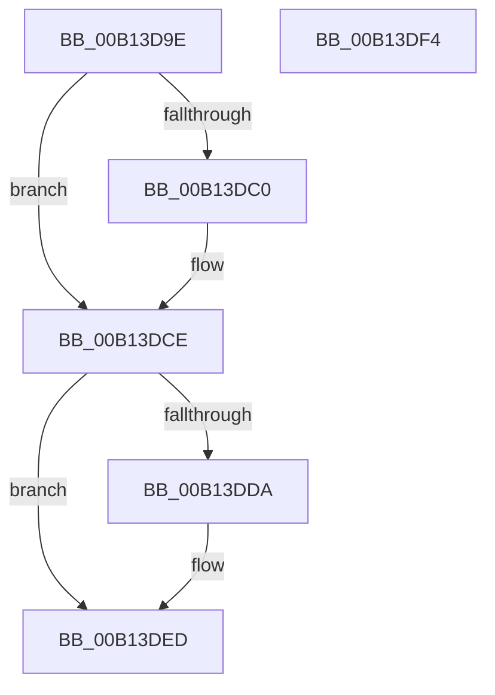

# FsRtlNotifyFilterChangeDirectoryLite$fin$0

- RVA: `0x00B13D9E`–`0x00B13DF5` (길이 `87` bytes)
- VA: `0x0000000140B13D9E`
- 실행 섹션: `PAGE`
- PDB 이름 있음: `예`; PDB Function 태그: `예`
- unwind 정보 RVA: `0x000C62CC`
- 디코드: `30`개 명령, `87/87` bytes 표시
- 미해석 바이트: `0` (있으면 어셈블리에 `.byte`로 보존)

> 이 문서는 커널 이미지의 기계어와 PDB 기호를 분석해 생성했습니다. 4번과 5번은 함수 원형과 자료형을 바이너리 사용 방식에서 추정한 C 해석이며 원본 소스 복구 결과는 아닙니다.

## 1. Dependencies

- 직접 호출 지점: **3**; 고유 호출 대상: **3**
- 직접 호출자로 확인된 함수: **0**
- RIP 상대 이미지 참조: **0**

### Outgoing calls
- `0x00B13DC8` → [ExReleaseFastMutexUnsafe](../../text/25/ExReleaseFastMutexUnsafe_function_002503A0.md) (function, `0x002503A0`)
- `0x00B13DDD` → [SeReleaseSubjectContext](../86/SeReleaseSubjectContext_function_0086B710.md) (function, `0x0086B710`)
- `0x00B13DE7` → [ExFreePoolWithTag](../../poolcode/B8/ExFreePoolWithTag_function_00B82870.md) (function, `0x00B82870`)

### Direct callers
- 이 함수 시작 RVA로 연결되는 직접 call은 확인되지 않았습니다. 간접 호출은 완전히 역산할 수 없습니다.

### Static image references
- 디코드된 RIP-relative 메모리 참조가 없습니다.

## 2. Other-region calls and transfers

- 다른 실행 섹션으로 향하는 call: **2**
  - `0x00B13DC8` → [ExReleaseFastMutexUnsafe](../../text/25/ExReleaseFastMutexUnsafe_function_002503A0.md) (`PAGE` → `.text`)
  - `0x00B13DE7` → [ExFreePoolWithTag](../../poolcode/B8/ExFreePoolWithTag_function_00B82870.md) (`PAGE` → `POOLCODE`)
- 별도 외부 분기/꼬리 이동을 확인하지 못했습니다.

## 3. Assembly (complete function range)

```asm
00B13D9E  40 53                           push rbx
00B13DA0  55                              push rbp
00B13DA1  48 83 EC 38                     sub rsp, 0x38
00B13DA5  48 8B EA                        mov rbp, rdx
00B13DA8  48 8B 4D 70                     mov rcx, qword ptr [rbp + 0x70]
00B13DAC  48 8B 01                        mov rax, qword ptr [rcx]
00B13DAF  8B 50 40                        mov edx, dword ptr [rax + 0x40]
00B13DB2  FF CA                           dec edx
00B13DB4  89 50 40                        mov dword ptr [rax + 0x40], edx
00B13DB7  48 8B 01                        mov rax, qword ptr [rcx]
00B13DBA  83 78 40 00                     cmp dword ptr [rax + 0x40], 0
00B13DBE  75 0E                           jne 0x140b13dce
00B13DC0  48 83 60 38 00                  and qword ptr [rax + 0x38], 0
00B13DC5  48 8B 09                        mov rcx, qword ptr [rcx]
00B13DC8  E8 D3 C5 73 FF                  call 0x1402503a0
00B13DCD  90                              nop
00B13DCE  48 8B 9D A8 00 00 00            mov rbx, qword ptr [rbp + 0xa8]
00B13DD5  48 85 DB                        test rbx, rbx
00B13DD8  74 13                           je 0x140b13ded
00B13DDA  48 8B CB                        mov rcx, rbx
00B13DDD  E8 2E 79 D5 FF                  call 0x14086b710
00B13DE2  33 D2                           xor edx, edx
00B13DE4  48 8B CB                        mov rcx, rbx
00B13DE7  E8 84 EA 06 00                  call 0x140b82870
00B13DEC  90                              nop
00B13DED  48 83 C4 38                     add rsp, 0x38
00B13DF1  5D                              pop rbp
00B13DF2  5B                              pop rbx
00B13DF3  C3                              ret
00B13DF4  CC                              int3
```

## 4. C-style interpretation (structured pseudocode)

```c
__int64 __fastcall FsRtlNotifyFilterChangeDirectoryLite_fin_0(__int64 a1, __int64 a2)
{
    __int64 result;
    __int64 v_rsp;

    v_rsp = (v_rsp) - (56);
    a2 = (unsigned int)(((unsigned int)(*(unsigned int *)(*(unsigned __int64 *)(*(unsigned __int64 *)(a2 + 112)) + 64))) - 1);
    *(unsigned int *)(*(unsigned __int64 *)(*(unsigned __int64 *)(a2 + 112)) + 64) = (unsigned int)(a2);
    result = *(unsigned __int64 *)(*(unsigned __int64 *)(a2 + 112));
    if ((*(unsigned int *)(*(unsigned __int64 *)(*(unsigned __int64 *)(a2 + 112)) + 64)) == 0) {
        a1 = *(unsigned __int64 *)(*(unsigned __int64 *)(a2 + 112));
        result = ExReleaseFastMutexUnsafe(a1, a2, a3, a4);
    }
    if (*(unsigned __int64 *)(a2 + 168) != 0) {
        a1 = *(unsigned __int64 *)(a2 + 168);
        result = SeReleaseSubjectContext(a1, a2, a3, a4);
        a2 = 0;
        a1 = *(unsigned __int64 *)(a2 + 168);
        result = ExFreePoolWithTag(a1, a2, a3, a4);
    }
    v_rsp = (v_rsp) + (56);
    return result;
}
```

## 5. (Beta) C Style

```c
int64_t FsRtlNotifyFilterChangeDirectoryLite_fin_0(int64_t Arg1, void *Arg2)
{
    uint8_t *arg2 = (uint8_t *)Arg2;

    int64_t result;
    int64_t local_rsp;

    local_rsp = (local_rsp) - (56);
    Arg2 = (uint32_t)(((uint32_t)(*(uint32_t *)(*(uint64_t *)(*(uint64_t *)(arg2 + 0x70)) + 0x40))) - 1);
    *(uint32_t *)(*(uint64_t *)(*(uint64_t *)(arg2 + 0x70)) + 0x40) = (uint32_t)(Arg2);
    result = *(uint64_t *)(*(uint64_t *)(arg2 + 0x70));
    if ((*(uint32_t *)(*(uint64_t *)(*(uint64_t *)(arg2 + 0x70)) + 0x40)) == 0) {
        Arg1 = *(uint64_t *)(*(uint64_t *)(arg2 + 0x70));
        result = ExReleaseFastMutexUnsafe(Arg1, Arg2, a3, a4);
    }
    if (*(uint64_t *)(arg2 + 0xA8) != 0) {
        Arg1 = *(uint64_t *)(arg2 + 0xA8);
        result = SeReleaseSubjectContext(Arg1, Arg2, a3, a4);
        Arg2 = 0;
        Arg1 = *(uint64_t *)(arg2 + 0xA8);
        result = ExFreePoolWithTag(Arg1, Arg2, a3, a4);
    }
    local_rsp = (local_rsp) + (56);
    return result;
}
```

### 관측된 메모리 오프셋

구조체 형식이 확인되지 않은 접근은 인자 기준의 오프셋으로만 기록했습니다.

| 기준 인자 | 오프셋 표현 | 폭 (bit) | 접근 |
|---|---:|---:|---|
| `Arg2` | `+ 0x70` | `64` | `R` |
| `Arg2` | `+ 0xA8` | `64` | `R` |

## 6. Execution-region graph

[열기: 2D/3D 그래프와 함수 탐색 컨트롤 패널](../../../control-panel.html?section=page&rva=0x00B13D9E&view=graph)

- 2D 그래프는 위에서 아래로 흐르고, 3D 그래프는 빈 공간을 드래그해 회전합니다. Shift+드래그는 이동, 휠은 확대·축소, 함수 노드 선택은 대상 보고서 이동입니다.

### Static fallback


