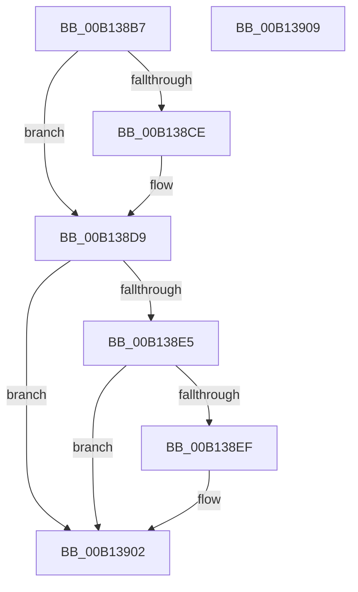

# FsRtlNotifyFilterChangeDirectory$fin$0

- RVA: `0x00B138B7`–`0x00B1390A` (길이 `83` bytes)
- VA: `0x0000000140B138B7`
- 실행 섹션: `PAGE`
- PDB 이름 있음: `예`; PDB Function 태그: `예`
- unwind 정보 RVA: `0x000BBE68`
- 디코드: `26`개 명령, `83/83` bytes 표시
- 미해석 바이트: `0` (있으면 어셈블리에 `.byte`로 보존)

> 이 문서는 커널 이미지의 기계어와 PDB 기호를 분석해 생성했습니다. 4번과 5번은 함수 원형과 자료형을 바이너리 사용 방식에서 추정한 C 해석이며 원본 소스 복구 결과는 아닙니다.

## 1. Dependencies

- 직접 호출 지점: **3**; 고유 호출 대상: **3**
- 직접 호출자로 확인된 함수: **0**
- RIP 상대 이미지 참조: **0**

### Outgoing calls
- `0x00B138D3` → [ExReleaseFastMutexUnsafe](../../text/25/ExReleaseFastMutexUnsafe_function_002503A0.md) (function, `0x002503A0`)
- `0x00B138F2` → [SeReleaseSubjectContext](../86/SeReleaseSubjectContext_function_0086B710.md) (function, `0x0086B710`)
- `0x00B138FC` → [ExFreePoolWithTag](../../poolcode/B8/ExFreePoolWithTag_function_00B82870.md) (function, `0x00B82870`)

### Direct callers
- 이 함수 시작 RVA로 연결되는 직접 call은 확인되지 않았습니다. 간접 호출은 완전히 역산할 수 없습니다.

### Static image references
- 디코드된 RIP-relative 메모리 참조가 없습니다.

## 2. Other-region calls and transfers

- 다른 실행 섹션으로 향하는 call: **2**
  - `0x00B138D3` → [ExReleaseFastMutexUnsafe](../../text/25/ExReleaseFastMutexUnsafe_function_002503A0.md) (`PAGE` → `.text`)
  - `0x00B138FC` → [ExFreePoolWithTag](../../poolcode/B8/ExFreePoolWithTag_function_00B82870.md) (`PAGE` → `POOLCODE`)
- 별도 외부 분기/꼬리 이동을 확인하지 못했습니다.

## 3. Assembly (complete function range)

```asm
00B138B7  40 53                           push rbx
00B138B9  55                              push rbp
00B138BA  48 83 EC 38                     sub rsp, 0x38
00B138BE  48 8B EA                        mov rbp, rdx
00B138C1  48 8B 8D 80 00 00 00            mov rcx, qword ptr [rbp + 0x80]
00B138C8  83 69 40 01                     sub dword ptr [rcx + 0x40], 1
00B138CC  75 0B                           jne 0x140b138d9
00B138CE  48 83 61 38 00                  and qword ptr [rcx + 0x38], 0
00B138D3  E8 C8 CA 73 FF                  call 0x1402503a0
00B138D8  90                              nop
00B138D9  48 8B 9D C8 00 00 00            mov rbx, qword ptr [rbp + 0xc8]
00B138E0  48 85 DB                        test rbx, rbx
00B138E3  74 1D                           je 0x140b13902
00B138E5  48 83 BD 98 00 00 00 00         cmp qword ptr [rbp + 0x98], 0
00B138ED  74 13                           je 0x140b13902
00B138EF  48 8B CB                        mov rcx, rbx
00B138F2  E8 19 7E D5 FF                  call 0x14086b710
00B138F7  33 D2                           xor edx, edx
00B138F9  48 8B CB                        mov rcx, rbx
00B138FC  E8 6F EF 06 00                  call 0x140b82870
00B13901  90                              nop
00B13902  48 83 C4 38                     add rsp, 0x38
00B13906  5D                              pop rbp
00B13907  5B                              pop rbx
00B13908  C3                              ret
00B13909  CC                              int3
```

## 4. C-style interpretation (structured pseudocode)

```c
__int64 __fastcall FsRtlNotifyFilterChangeDirectory_fin_0(__int64 a1, __int64 a2)
{
    __int64 result;
    __int64 v_rsp;

    v_rsp = (v_rsp) - (56);
    if (!(condition_is_not_equal)) {
        result = ExReleaseFastMutexUnsafe(*(unsigned __int64 *)(a2 + 128), a2, a3, a4);
    }
    if (*(unsigned __int64 *)(a2 + 200) == 0) goto loc_00B13902;
    if ((*(unsigned __int64 *)(a2 + 152)) != 0) {
        a1 = *(unsigned __int64 *)(a2 + 200);
        result = SeReleaseSubjectContext(a1, a2, a3, a4);
        a2 = 0;
        a1 = *(unsigned __int64 *)(a2 + 200);
        result = ExFreePoolWithTag(a1, a2, a3, a4);
    }
    v_rsp = (v_rsp) + (56);
    return result;
}
```

## 5. (Beta) C Style

```c
int64_t FsRtlNotifyFilterChangeDirectory_fin_0(int64_t Arg1, void *Arg2)
{
    uint8_t *arg2 = (uint8_t *)Arg2;

    int64_t result;
    int64_t local_rsp;

    local_rsp = (local_rsp) - (56);
    if (!(condition_is_not_equal)) {
        result = ExReleaseFastMutexUnsafe(*(uint64_t *)(arg2 + 0x80), Arg2, a3, a4);
    }
    if (*(uint64_t *)(arg2 + 0xC8) == 0) goto loc_00B13902;
    if ((*(uint64_t *)(arg2 + 0x98)) != 0) {
        Arg1 = *(uint64_t *)(arg2 + 0xC8);
        result = SeReleaseSubjectContext(Arg1, Arg2, a3, a4);
        Arg2 = 0;
        Arg1 = *(uint64_t *)(arg2 + 0xC8);
        result = ExFreePoolWithTag(Arg1, Arg2, a3, a4);
    }
    local_rsp = (local_rsp) + (56);
    return result;
}
```

### 관측된 메모리 오프셋

구조체 형식이 확인되지 않은 접근은 인자 기준의 오프셋으로만 기록했습니다.

| 기준 인자 | 오프셋 표현 | 폭 (bit) | 접근 |
|---|---:|---:|---|
| `Arg2` | `+ 0x80` | `64` | `R` |
| `Arg2` | `+ 0x98` | `64` | `R` |
| `Arg2` | `+ 0xC8` | `64` | `R` |

## 6. Execution-region graph

[열기: 2D/3D 그래프와 함수 탐색 컨트롤 패널](../../../control-panel.html?section=page&rva=0x00B138B7&view=graph)

- 2D 그래프는 위에서 아래로 흐르고, 3D 그래프는 빈 공간을 드래그해 회전합니다. Shift+드래그는 이동, 휠은 확대·축소, 함수 노드 선택은 대상 보고서 이동입니다.

### Static fallback


