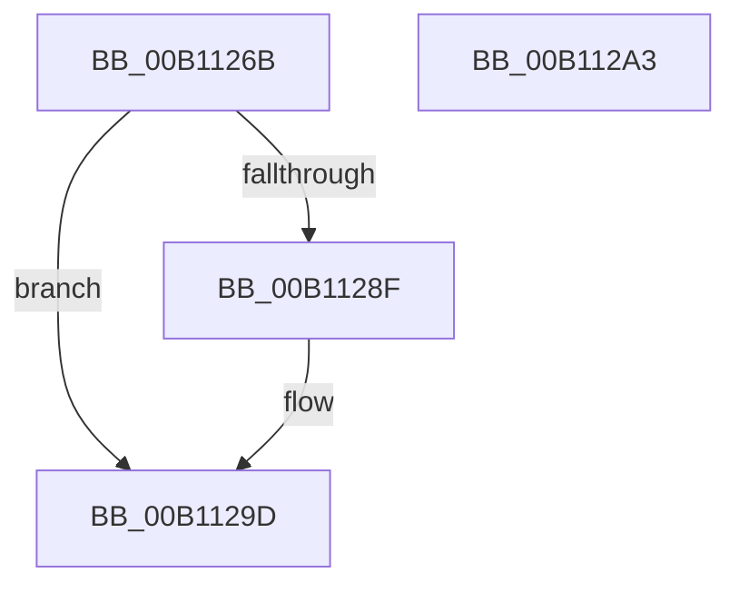

# FsRtlNotifyFilterReportChangeLiteEx$fin$1

- RVA: `0x00B1126B`–`0x00B112A4` (길이 `57` bytes)
- VA: `0x0000000140B1126B`
- 실행 섹션: `PAGE`
- PDB 이름 있음: `예`; PDB Function 태그: `예`
- unwind 정보 RVA: `0x000AAB70`
- 디코드: `19`개 명령, `57/57` bytes 표시
- 미해석 바이트: `0` (있으면 어셈블리에 `.byte`로 보존)

> 이 문서는 커널 이미지의 기계어와 PDB 기호를 분석해 생성했습니다. 4번과 5번은 함수 원형과 자료형을 바이너리 사용 방식에서 추정한 C 해석이며 원본 소스 복구 결과는 아닙니다.

## 1. Dependencies

- 직접 호출 지점: **1**; 고유 호출 대상: **1**
- 직접 호출자로 확인된 함수: **0**
- RIP 상대 이미지 참조: **0**

### Outgoing calls
- `0x00B11297` → [ExReleaseFastMutexUnsafe](../../text/25/ExReleaseFastMutexUnsafe_function_002503A0.md) (function, `0x002503A0`)

### Direct callers
- 이 함수 시작 RVA로 연결되는 직접 call은 확인되지 않았습니다. 간접 호출은 완전히 역산할 수 없습니다.

### Static image references
- 디코드된 RIP-relative 메모리 참조가 없습니다.

## 2. Other-region calls and transfers

- 다른 실행 섹션으로 향하는 call: **1**
  - `0x00B11297` → [ExReleaseFastMutexUnsafe](../../text/25/ExReleaseFastMutexUnsafe_function_002503A0.md) (`PAGE` → `.text`)
- 별도 외부 분기/꼬리 이동을 확인하지 못했습니다.

## 3. Assembly (complete function range)

```asm
00B1126B  40 55                           push rbp
00B1126D  48 83 EC 30                     sub rsp, 0x30
00B11271  48 8B EA                        mov rbp, rdx
00B11274  48 8B 8D E0 00 00 00            mov rcx, qword ptr [rbp + 0xe0]
00B1127B  48 8B 01                        mov rax, qword ptr [rcx]
00B1127E  8B 50 40                        mov edx, dword ptr [rax + 0x40]
00B11281  FF CA                           dec edx
00B11283  89 50 40                        mov dword ptr [rax + 0x40], edx
00B11286  48 8B 01                        mov rax, qword ptr [rcx]
00B11289  83 78 40 00                     cmp dword ptr [rax + 0x40], 0
00B1128D  75 0E                           jne 0x140b1129d
00B1128F  48 83 60 38 00                  and qword ptr [rax + 0x38], 0
00B11294  48 8B 09                        mov rcx, qword ptr [rcx]
00B11297  E8 04 F1 73 FF                  call 0x1402503a0
00B1129C  90                              nop
00B1129D  48 83 C4 30                     add rsp, 0x30
00B112A1  5D                              pop rbp
00B112A2  C3                              ret
00B112A3  CC                              int3
```

## 4. C-style interpretation (structured pseudocode)

```c
__int64 __fastcall FsRtlNotifyFilterReportChangeLiteEx_fin_1(__int64 a1, __int64 a2)
{
    __int64 result;
    __int64 v_rsp;

    v_rsp = (v_rsp) - (48);
    a2 = (unsigned int)(((unsigned int)(*(unsigned int *)(*(unsigned __int64 *)(*(unsigned __int64 *)(a2 + 224)) + 64))) - 1);
    *(unsigned int *)(*(unsigned __int64 *)(*(unsigned __int64 *)(a2 + 224)) + 64) = (unsigned int)(a2);
    result = *(unsigned __int64 *)(*(unsigned __int64 *)(a2 + 224));
    if ((*(unsigned int *)(*(unsigned __int64 *)(*(unsigned __int64 *)(a2 + 224)) + 64)) == 0) {
        a1 = *(unsigned __int64 *)(*(unsigned __int64 *)(a2 + 224));
        result = ExReleaseFastMutexUnsafe(a1, a2, a3, a4);
    }
    v_rsp = (v_rsp) + (48);
    return result;
}
```

## 5. (Beta) C Style

```c
int64_t FsRtlNotifyFilterReportChangeLiteEx_fin_1(int64_t Arg1, void *Arg2)
{
    uint8_t *arg2 = (uint8_t *)Arg2;

    int64_t result;
    int64_t local_rsp;

    local_rsp = (local_rsp) - (48);
    Arg2 = (uint32_t)(((uint32_t)(*(uint32_t *)(*(uint64_t *)(*(uint64_t *)(arg2 + 0xE0)) + 0x40))) - 1);
    *(uint32_t *)(*(uint64_t *)(*(uint64_t *)(arg2 + 0xE0)) + 0x40) = (uint32_t)(Arg2);
    result = *(uint64_t *)(*(uint64_t *)(arg2 + 0xE0));
    if ((*(uint32_t *)(*(uint64_t *)(*(uint64_t *)(arg2 + 0xE0)) + 0x40)) == 0) {
        Arg1 = *(uint64_t *)(*(uint64_t *)(arg2 + 0xE0));
        result = ExReleaseFastMutexUnsafe(Arg1, Arg2, a3, a4);
    }
    local_rsp = (local_rsp) + (48);
    return result;
}
```

### 관측된 메모리 오프셋

구조체 형식이 확인되지 않은 접근은 인자 기준의 오프셋으로만 기록했습니다.

| 기준 인자 | 오프셋 표현 | 폭 (bit) | 접근 |
|---|---:|---:|---|
| `Arg2` | `+ 0xE0` | `64` | `R` |

## 6. Execution-region graph

[열기: 2D/3D 그래프와 함수 탐색 컨트롤 패널](../../../control-panel.html?section=page&rva=0x00B1126B&view=graph)

- 2D 그래프는 위에서 아래로 흐르고, 3D 그래프는 빈 공간을 드래그해 회전합니다. Shift+드래그는 이동, 휠은 확대·축소, 함수 노드 선택은 대상 보고서 이동입니다.

### Static fallback


