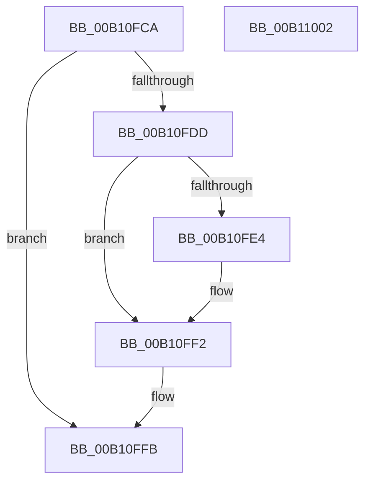

# FsRtlSetKernelEaFile$fin$0

- RVA: `0x00B10FCA`–`0x00B11003` (길이 `57` bytes)
- VA: `0x0000000140B10FCA`
- 실행 섹션: `PAGE`
- PDB 이름 있음: `예`; PDB Function 태그: `예`
- unwind 정보 RVA: `0x000A8B04`
- 디코드: `20`개 명령, `57/57` bytes 표시
- 미해석 바이트: `0` (있으면 어셈블리에 `.byte`로 보존)

> 이 문서는 커널 이미지의 기계어와 PDB 기호를 분석해 생성했습니다. 4번과 5번은 함수 원형과 자료형을 바이너리 사용 방식에서 추정한 C 해석이며 원본 소스 복구 결과는 아닙니다.

## 1. Dependencies

- 직접 호출 지점: **2**; 고유 호출 대상: **2**
- 직접 호출자로 확인된 함수: **0**
- RIP 상대 이미지 참조: **0**

### Outgoing calls
- `0x00B10FE8` → [FsRtlpFreeMdlChain](../71/FsRtlpFreeMdlChain_function_00716394.md) (function, `0x00716394`)
- `0x00B10FF5` → [IoFreeIrp](../../text/24/IoFreeIrp_function_0024DF70.md) (function, `0x0024DF70`)

### Direct callers
- 이 함수 시작 RVA로 연결되는 직접 call은 확인되지 않았습니다. 간접 호출은 완전히 역산할 수 없습니다.

### Static image references
- 디코드된 RIP-relative 메모리 참조가 없습니다.

## 2. Other-region calls and transfers

- 다른 실행 섹션으로 향하는 call: **1**
  - `0x00B10FF5` → [IoFreeIrp](../../text/24/IoFreeIrp_function_0024DF70.md) (`PAGE` → `.text`)
- 별도 외부 분기/꼬리 이동을 확인하지 못했습니다.

## 3. Assembly (complete function range)

```asm
00B10FCA  40 53                           push rbx
00B10FCC  55                              push rbp
00B10FCD  48 83 EC 38                     sub rsp, 0x38
00B10FD1  48 8B EA                        mov rbp, rdx
00B10FD4  48 8B 5D 30                     mov rbx, qword ptr [rbp + 0x30]
00B10FD8  48 85 DB                        test rbx, rbx
00B10FDB  74 1E                           je 0x140b10ffb
00B10FDD  48 83 7B 08 00                  cmp qword ptr [rbx + 8], 0
00B10FE2  74 0E                           je 0x140b10ff2
00B10FE4  48 8B 4B 08                     mov rcx, qword ptr [rbx + 8]
00B10FE8  E8 A7 53 C0 FF                  call 0x140716394
00B10FED  48 83 63 08 00                  and qword ptr [rbx + 8], 0
00B10FF2  48 8B CB                        mov rcx, rbx
00B10FF5  E8 76 CF 73 FF                  call 0x14024df70
00B10FFA  90                              nop
00B10FFB  48 83 C4 38                     add rsp, 0x38
00B10FFF  5D                              pop rbp
00B11000  5B                              pop rbx
00B11001  C3                              ret
00B11002  CC                              int3
```

## 4. C-style interpretation (structured pseudocode)

```c
__int64 __fastcall FsRtlSetKernelEaFile_fin_0(__int64 a1, __int64 a2)
{
    __int64 result;
    __int64 v_rsp;

    v_rsp = (v_rsp) - (56);
    if (*(unsigned __int64 *)(a2 + 48) == 0) goto loc_00B10FFB;
    if ((*(unsigned __int64 *)(*(unsigned __int64 *)(a2 + 48) + 8)) != 0) {
        a1 = *(unsigned __int64 *)(*(unsigned __int64 *)(a2 + 48) + 8);
        result = FsRtlpFreeMdlChain(a1, a2, a3, a4);
    }
    result = IoFreeIrp(*(unsigned __int64 *)(a2 + 48), a2, a3, a4);
loc_00B10FFB:
    v_rsp = (v_rsp) + (56);
    return result;
}
```

## 5. (Beta) C Style

```c
int64_t FsRtlSetKernelEaFile_fin_0(int64_t Arg1, void *Arg2)
{
    uint8_t *arg2 = (uint8_t *)Arg2;

    int64_t result;
    int64_t local_rsp;

    local_rsp = (local_rsp) - (56);
    if (*(uint64_t *)(arg2 + 0x30) == 0) goto loc_00B10FFB;
    if ((*(uint64_t *)(*(uint64_t *)(arg2 + 0x30) + 0x8)) != 0) {
        Arg1 = *(uint64_t *)(*(uint64_t *)(arg2 + 0x30) + 0x8);
        result = FsRtlpFreeMdlChain(Arg1, Arg2, a3, a4);
    }
    result = IoFreeIrp(*(uint64_t *)(arg2 + 0x30), Arg2, a3, a4);
loc_00B10FFB:
    local_rsp = (local_rsp) + (56);
    return result;
}
```

### 관측된 메모리 오프셋

구조체 형식이 확인되지 않은 접근은 인자 기준의 오프셋으로만 기록했습니다.

| 기준 인자 | 오프셋 표현 | 폭 (bit) | 접근 |
|---|---:|---:|---|
| `Arg2` | `+ 0x30` | `64` | `R` |

## 6. Execution-region graph

[열기: 2D/3D 그래프와 함수 탐색 컨트롤 패널](../../../control-panel.html?section=page&rva=0x00B10FCA&view=graph)

- 2D 그래프는 위에서 아래로 흐르고, 3D 그래프는 빈 공간을 드래그해 회전합니다. Shift+드래그는 이동, 휠은 확대·축소, 함수 노드 선택은 대상 보고서 이동입니다.

### Static fallback


