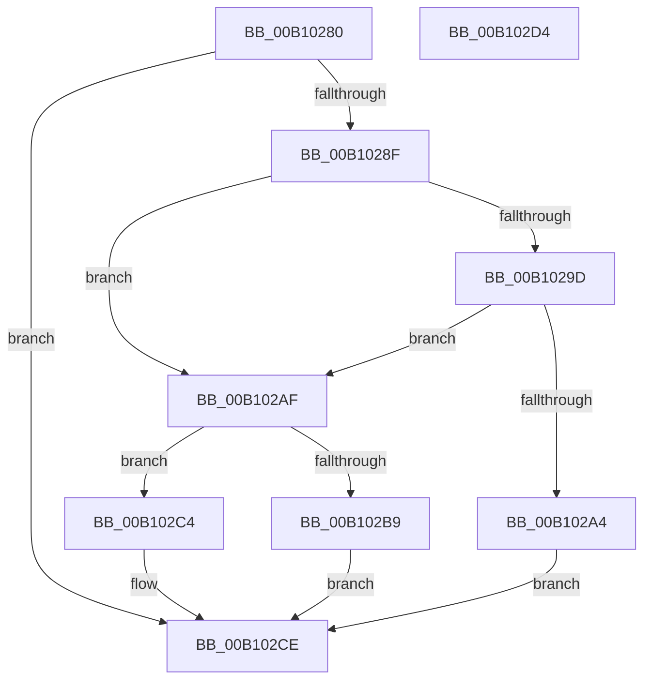

# FsRtlTeardownPerStreamContexts$fin$0

- RVA: `0x00B10280`–`0x00B102D5` (길이 `85` bytes)
- VA: `0x0000000140B10280`
- 실행 섹션: `PAGE`
- PDB 이름 있음: `예`; PDB Function 태그: `예`
- unwind 정보 RVA: `0x0009C730`
- 디코드: `29`개 명령, `85/85` bytes 표시
- 미해석 바이트: `0` (있으면 어셈블리에 `.byte`로 보존)

> 이 문서는 커널 이미지의 기계어와 PDB 기호를 분석해 생성했습니다. 4번과 5번은 함수 원형과 자료형을 바이너리 사용 방식에서 추정한 C 해석이며 원본 소스 복구 결과는 아닙니다.

## 1. Dependencies

- 직접 호출 지점: **3**; 고유 호출 대상: **3**
- 직접 호출자로 확인된 함수: **0**
- RIP 상대 이미지 참조: **0**

### Outgoing calls
- `0x00B102A8` → [FsRtlReleaseAutoExpandPushLockExclusive](../../text/26/FsRtlReleaseAutoExpandPushLockExclusive_function_00265B5C.md) (function, `0x00265B5C`)
- `0x00B102BD` → [FsRtlReleasePushLock](../../text/26/FsRtlReleasePushLock_function_00265D7C.md) (function, `0x00265D7C`)
- `0x00B102C8` → [ExReleaseFastMutex](../../text/25/ExReleaseFastMutex_function_002519C0.md) (function, `0x002519C0`)

### Direct callers
- 이 함수 시작 RVA로 연결되는 직접 call은 확인되지 않았습니다. 간접 호출은 완전히 역산할 수 없습니다.

### Static image references
- 디코드된 RIP-relative 메모리 참조가 없습니다.

## 2. Other-region calls and transfers

- 다른 실행 섹션으로 향하는 call: **3**
  - `0x00B102A8` → [FsRtlReleaseAutoExpandPushLockExclusive](../../text/26/FsRtlReleaseAutoExpandPushLockExclusive_function_00265B5C.md) (`PAGE` → `.text`)
  - `0x00B102BD` → [FsRtlReleasePushLock](../../text/26/FsRtlReleasePushLock_function_00265D7C.md) (`PAGE` → `.text`)
  - `0x00B102C8` → [ExReleaseFastMutex](../../text/25/ExReleaseFastMutex_function_002519C0.md) (`PAGE` → `.text`)
- 별도 외부 분기/꼬리 이동을 확인하지 못했습니다.

## 3. Assembly (complete function range)

```asm
00B10280  40 55                           push rbp
00B10282  48 83 EC 20                     sub rsp, 0x20
00B10286  48 8B EA                        mov rbp, rdx
00B10289  80 7D 20 00                     cmp byte ptr [rbp + 0x20], 0
00B1028D  74 3F                           je 0x140b102ce
00B1028F  48 8B 4D 40                     mov rcx, qword ptr [rbp + 0x40]
00B10293  0F B6 41 07                     movzx eax, byte ptr [rcx + 7]
00B10297  24 F0                           and al, 0xf0
00B10299  3C 30                           cmp al, 0x30
00B1029B  72 12                           jb 0x140b102af
00B1029D  48 83 79 60 00                  cmp qword ptr [rcx + 0x60], 0
00B102A2  74 0B                           je 0x140b102af
00B102A4  48 8B 49 60                     mov rcx, qword ptr [rcx + 0x60]
00B102A8  E8 AF 58 75 FF                  call 0x140265b5c
00B102AD  EB 1F                           jmp 0x140b102ce
00B102AF  0F B6 41 07                     movzx eax, byte ptr [rcx + 7]
00B102B3  24 F0                           and al, 0xf0
00B102B5  3C 10                           cmp al, 0x10
00B102B7  72 0B                           jb 0x140b102c4
00B102B9  48 83 C1 48                     add rcx, 0x48
00B102BD  E8 BA 5A 75 FF                  call 0x140265d7c
00B102C2  EB 0A                           jmp 0x140b102ce
00B102C4  48 8B 49 30                     mov rcx, qword ptr [rcx + 0x30]
00B102C8  E8 F3 16 74 FF                  call 0x1402519c0
00B102CD  90                              nop
00B102CE  48 83 C4 20                     add rsp, 0x20
00B102D2  5D                              pop rbp
00B102D3  C3                              ret
00B102D4  CC                              int3
```

## 4. C-style interpretation (structured pseudocode)

```c
__int64 __fastcall FsRtlTeardownPerStreamContexts_fin_0(__int64 a1, __int64 a2)
{
    __int64 result;
    __int64 v_rsp;

    v_rsp = (v_rsp) - (32);
    if ((*(unsigned __int8 *)(a2 + 32)) == 0) goto loc_00B102CE;
    result = (unsigned __int8)((*(unsigned __int8 *)(*(unsigned __int64 *)(a2 + 64) + 7)) & (240));
    if (((unsigned __int8)(result)) < 48) goto loc_00B102AF;
    if ((*(unsigned __int64 *)(*(unsigned __int64 *)(a2 + 64) + 96)) == 0) goto loc_00B102AF;
    result = FsRtlReleaseAutoExpandPushLockExclusive(*(unsigned __int64 *)(*(unsigned __int64 *)(a2 + 64) + 96), a2, a3, a4);
    goto loc_00B102CE;
loc_00B102AF:
    result = (unsigned __int8)((*(unsigned __int8 *)(*(unsigned __int64 *)(*(unsigned __int64 *)(a2 + 64) + 96) + 7)) & (240));
    if (((unsigned __int8)(result)) < 16) goto loc_00B102C4;
    a1 = (*(unsigned __int64 *)(*(unsigned __int64 *)(a2 + 64) + 96)) + (72);
    result = FsRtlReleasePushLock(a1, a2, a3, a4);
    goto loc_00B102CE;
loc_00B102C4:
    result = ExReleaseFastMutex(*(unsigned __int64 *)(a1 + 48), a2, a3, a4);
loc_00B102CE:
    v_rsp = (v_rsp) + (32);
    return result;
}
```

## 5. (Beta) C Style

```c
int64_t FsRtlTeardownPerStreamContexts_fin_0(int64_t Arg1, void *Arg2)
{
    uint8_t *arg2 = (uint8_t *)Arg2;

    int64_t result;
    int64_t local_rsp;

    local_rsp = (local_rsp) - (32);
    if ((*(uint8_t *)(arg2 + 0x20)) == 0) goto loc_00B102CE;
    result = (uint8_t)((*(uint8_t *)(*(uint64_t *)(arg2 + 0x40) + 0x7)) & (240));
    if (((uint8_t)(result)) < 48) goto loc_00B102AF;
    if ((*(uint64_t *)(*(uint64_t *)(arg2 + 0x40) + 0x60)) == 0) goto loc_00B102AF;
    result = FsRtlReleaseAutoExpandPushLockExclusive(*(uint64_t *)(*(uint64_t *)(arg2 + 0x40) + 0x60), Arg2, a3, a4);
    goto loc_00B102CE;
loc_00B102AF:
    result = (uint8_t)((*(uint8_t *)(*(uint64_t *)(*(uint64_t *)(arg2 + 0x40) + 0x60) + 0x7)) & (240));
    if (((uint8_t)(result)) < 16) goto loc_00B102C4;
    Arg1 = (*(uint64_t *)(*(uint64_t *)(arg2 + 0x40) + 0x60)) + (72);
    result = FsRtlReleasePushLock(Arg1, Arg2, a3, a4);
    goto loc_00B102CE;
loc_00B102C4:
    result = ExReleaseFastMutex(*(uint64_t *)(Arg1 + 0x30), Arg2, a3, a4);
loc_00B102CE:
    local_rsp = (local_rsp) + (32);
    return result;
}
```

### 관측된 메모리 오프셋

구조체 형식이 확인되지 않은 접근은 인자 기준의 오프셋으로만 기록했습니다.

| 기준 인자 | 오프셋 표현 | 폭 (bit) | 접근 |
|---|---:|---:|---|
| `Arg2` | `+ 0x20` | `8` | `R` |
| `Arg2` | `+ 0x40` | `64` | `R` |

## 6. Execution-region graph

[열기: 2D/3D 그래프와 함수 탐색 컨트롤 패널](../../../control-panel.html?section=page&rva=0x00B10280&view=graph)

- 2D 그래프는 위에서 아래로 흐르고, 3D 그래프는 빈 공간을 드래그해 회전합니다. Shift+드래그는 이동, 휠은 확대·축소, 함수 노드 선택은 대상 보고서 이동입니다.

### Static fallback


