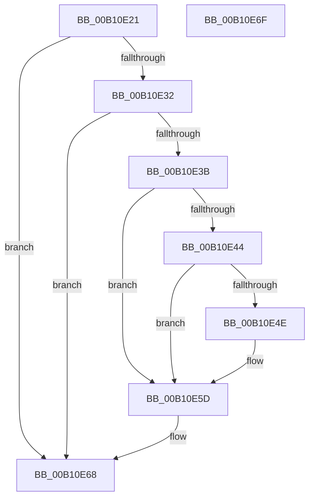

# FsRtlpAllocateOplock$fin$0

- RVA: `0x00B10E21`–`0x00B10E70` (길이 `79` bytes)
- VA: `0x0000000140B10E21`
- 실행 섹션: `PAGE`
- PDB 이름 있음: `예`; PDB Function 태그: `예`
- unwind 정보 RVA: `0x000A5F70`
- 디코드: `28`개 명령, `79/79` bytes 표시
- 미해석 바이트: `0` (있으면 어셈블리에 `.byte`로 보존)

> 이 문서는 커널 이미지의 기계어와 PDB 기호를 분석해 생성했습니다. 4번과 5번은 함수 원형과 자료형을 바이너리 사용 방식에서 추정한 C 해석이며 원본 소스 복구 결과는 아닙니다.

## 1. Dependencies

- 직접 호출 지점: **3**; 고유 호출 대상: **2**
- 직접 호출자로 확인된 함수: **0**
- RIP 상대 이미지 참조: **0**

### Outgoing calls
- `0x00B10E3B` → [Feature_3609177402__private_IsEnabledDeviceUsageNoInline](../../text/58/Feature_3609177402__private_IsEnabledDeviceUsageNoInline_function_00581D30.md) (function, `0x00581D30`)
- `0x00B10E57` → [ExFreePoolWithTag](../../poolcode/B8/ExFreePoolWithTag_function_00B82870.md) (function, `0x00B82870`)
- `0x00B10E62` → [ExFreePoolWithTag](../../poolcode/B8/ExFreePoolWithTag_function_00B82870.md) (function, `0x00B82870`)

### Direct callers
- 이 함수 시작 RVA로 연결되는 직접 call은 확인되지 않았습니다. 간접 호출은 완전히 역산할 수 없습니다.

### Static image references
- 디코드된 RIP-relative 메모리 참조가 없습니다.

## 2. Other-region calls and transfers

- 다른 실행 섹션으로 향하는 call: **3**
  - `0x00B10E3B` → [Feature_3609177402__private_IsEnabledDeviceUsageNoInline](../../text/58/Feature_3609177402__private_IsEnabledDeviceUsageNoInline_function_00581D30.md) (`PAGE` → `.text`)
  - `0x00B10E57` → [ExFreePoolWithTag](../../poolcode/B8/ExFreePoolWithTag_function_00B82870.md) (`PAGE` → `POOLCODE`)
  - `0x00B10E62` → [ExFreePoolWithTag](../../poolcode/B8/ExFreePoolWithTag_function_00B82870.md) (`PAGE` → `POOLCODE`)
- 별도 외부 분기/꼬리 이동을 확인하지 못했습니다.

## 3. Assembly (complete function range)

```asm
00B10E21  40 53                           push rbx
00B10E23  55                              push rbp
00B10E24  48 83 EC 28                     sub rsp, 0x28
00B10E28  48 8B EA                        mov rbp, rdx
00B10E2B  0F B6 C1                        movzx eax, cl
00B10E2E  84 C9                           test cl, cl
00B10E30  74 36                           je 0x140b10e68
00B10E32  48 8B 5D 20                     mov rbx, qword ptr [rbp + 0x20]
00B10E36  48 85 DB                        test rbx, rbx
00B10E39  74 2D                           je 0x140b10e68
00B10E3B  E8 F0 0E A7 FF                  call 0x140581d30
00B10E40  85 C0                           test eax, eax
00B10E42  74 19                           je 0x140b10e5d
00B10E44  48 83 BB 98 00 00 00 00         cmp qword ptr [rbx + 0x98], 0
00B10E4C  74 0F                           je 0x140b10e5d
00B10E4E  33 D2                           xor edx, edx
00B10E50  48 8B 8B 98 00 00 00            mov rcx, qword ptr [rbx + 0x98]
00B10E57  E8 14 1A 07 00                  call 0x140b82870
00B10E5C  90                              nop
00B10E5D  33 D2                           xor edx, edx
00B10E5F  48 8B CB                        mov rcx, rbx
00B10E62  E8 09 1A 07 00                  call 0x140b82870
00B10E67  90                              nop
00B10E68  48 83 C4 28                     add rsp, 0x28
00B10E6C  5D                              pop rbp
00B10E6D  5B                              pop rbx
00B10E6E  C3                              ret
00B10E6F  CC                              int3
```

## 4. C-style interpretation (structured pseudocode)

```c
__int64 __fastcall FsRtlpAllocateOplock_fin_0(unsigned __int8 a1, __int64 a2)
{
    __int64 result;
    __int64 v_rsp;

    v_rsp = (v_rsp) - (40);
    if (a1 == 0) goto loc_00B10E68;
    if (*(unsigned __int64 *)(a2 + 32) == 0) goto loc_00B10E68;
    result = Feature_3609177402__private_IsEnabledDeviceUsageNoInline(a1, a2, a3, a4);
    if ((unsigned int)(result) == 0) goto loc_00B10E5D;
    if ((*(unsigned __int64 *)(*(unsigned __int64 *)(a2 + 32) + 152)) != 0) {
        a2 = 0;
        a1 = *(unsigned __int64 *)(*(unsigned __int64 *)(a2 + 32) + 152);
        result = ExFreePoolWithTag(a1, a2, a3, a4);
    }
    a2 = 0;
    result = ExFreePoolWithTag(*(unsigned __int64 *)(a2 + 32), a2, a3, a4);
loc_00B10E68:
    v_rsp = (v_rsp) + (40);
    return result;
}
```

## 5. (Beta) C Style

```c
int64_t FsRtlpAllocateOplock_fin_0(uint8_t Arg1, void *Arg2)
{
    uint8_t *arg2 = (uint8_t *)Arg2;

    int64_t result;
    int64_t local_rsp;

    local_rsp = (local_rsp) - (40);
    if (Arg1 == 0) goto loc_00B10E68;
    if (*(uint64_t *)(arg2 + 0x20) == 0) goto loc_00B10E68;
    result = Feature_3609177402__private_IsEnabledDeviceUsageNoInline(Arg1, Arg2, a3, a4);
    if ((uint32_t)(result) == 0) goto loc_00B10E5D;
    if ((*(uint64_t *)(*(uint64_t *)(arg2 + 0x20) + 0x98)) != 0) {
        Arg2 = 0;
        Arg1 = *(uint64_t *)(*(uint64_t *)(arg2 + 0x20) + 0x98);
        result = ExFreePoolWithTag(Arg1, Arg2, a3, a4);
    }
    Arg2 = 0;
    result = ExFreePoolWithTag(*(uint64_t *)(arg2 + 0x20), Arg2, a3, a4);
loc_00B10E68:
    local_rsp = (local_rsp) + (40);
    return result;
}
```

### 관측된 메모리 오프셋

구조체 형식이 확인되지 않은 접근은 인자 기준의 오프셋으로만 기록했습니다.

| 기준 인자 | 오프셋 표현 | 폭 (bit) | 접근 |
|---|---:|---:|---|
| `Arg2` | `+ 0x20` | `64` | `R` |

## 6. Execution-region graph

[열기: 2D/3D 그래프와 함수 탐색 컨트롤 패널](../../../control-panel.html?section=page&rva=0x00B10E21&view=graph)

- 2D 그래프는 위에서 아래로 흐르고, 3D 그래프는 빈 공간을 드래그해 회전합니다. Shift+드래그는 이동, 휠은 확대·축소, 함수 노드 선택은 대상 보고서 이동입니다.

### Static fallback


