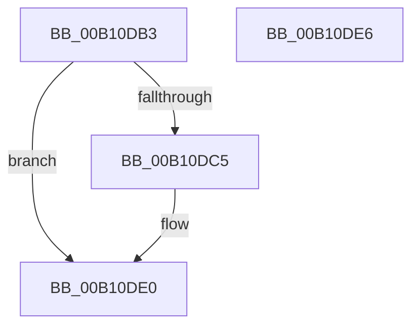

# FsRtlpOplockFsctrlInternal$fin$0

- RVA: `0x00B10DB3`–`0x00B10DE7` (길이 `52` bytes)
- VA: `0x0000000140B10DB3`
- 실행 섹션: `PAGE`
- PDB 이름 있음: `예`; PDB Function 태그: `예`
- unwind 정보 RVA: `0x000A5F24`
- 디코드: `17`개 명령, `52/52` bytes 표시
- 미해석 바이트: `0` (있으면 어셈블리에 `.byte`로 보존)

> 이 문서는 커널 이미지의 기계어와 PDB 기호를 분석해 생성했습니다. 4번과 5번은 함수 원형과 자료형을 바이너리 사용 방식에서 추정한 C 해석이며 원본 소스 복구 결과는 아닙니다.

## 1. Dependencies

- 직접 호출 지점: **2**; 고유 호출 대상: **2**
- 직접 호출자로 확인된 함수: **0**
- RIP 상대 이미지 참조: **0**

### Outgoing calls
- `0x00B10DCF` → [FsRtlpClearOwner](../../text/26/FsRtlpClearOwner_function_00265BE8.md) (function, `0x00265BE8`)
- `0x00B10DDA` → [ExFreePoolWithTag](../../poolcode/B8/ExFreePoolWithTag_function_00B82870.md) (function, `0x00B82870`)

### Direct callers
- 이 함수 시작 RVA로 연결되는 직접 call은 확인되지 않았습니다. 간접 호출은 완전히 역산할 수 없습니다.

### Static image references
- 디코드된 RIP-relative 메모리 참조가 없습니다.

## 2. Other-region calls and transfers

- 다른 실행 섹션으로 향하는 call: **2**
  - `0x00B10DCF` → [FsRtlpClearOwner](../../text/26/FsRtlpClearOwner_function_00265BE8.md) (`PAGE` → `.text`)
  - `0x00B10DDA` → [ExFreePoolWithTag](../../poolcode/B8/ExFreePoolWithTag_function_00B82870.md) (`PAGE` → `POOLCODE`)
- 별도 외부 분기/꼬리 이동을 확인하지 못했습니다.

## 3. Assembly (complete function range)

```asm
00B10DB3  40 55                           push rbp
00B10DB5  48 83 EC 40                     sub rsp, 0x40
00B10DB9  48 8B EA                        mov rbp, rdx
00B10DBC  48 8B 55 50                     mov rdx, qword ptr [rbp + 0x50]
00B10DC0  48 85 D2                        test rdx, rdx
00B10DC3  74 1B                           je 0x140b10de0
00B10DC5  48 8B 8D A0 00 00 00            mov rcx, qword ptr [rbp + 0xa0]
00B10DCC  48 8B 09                        mov rcx, qword ptr [rcx]
00B10DCF  E8 14 4E 75 FF                  call 0x140265be8
00B10DD4  33 D2                           xor edx, edx
00B10DD6  48 8B 4D 50                     mov rcx, qword ptr [rbp + 0x50]
00B10DDA  E8 91 1A 07 00                  call 0x140b82870
00B10DDF  90                              nop
00B10DE0  48 83 C4 40                     add rsp, 0x40
00B10DE4  5D                              pop rbp
00B10DE5  C3                              ret
00B10DE6  CC                              int3
```

## 4. C-style interpretation (structured pseudocode)

```c
__int64 __fastcall FsRtlpOplockFsctrlInternal_fin_0(__int64 a1, __int64 a2)
{
    __int64 result;
    __int64 v_rsp;

    v_rsp = (v_rsp) - (64);
    if (*(unsigned __int64 *)(a2 + 80) != 0) {
        a1 = *(unsigned __int64 *)(a2 + 160);
        a1 = *(unsigned __int64 *)(a1);
        result = FsRtlpClearOwner(a1, *(unsigned __int64 *)(a2 + 80), a3, a4);
        a2 = 0;
        a1 = *(unsigned __int64 *)(a2 + 80);
        result = ExFreePoolWithTag(a1, a2, a3, a4);
    }
    v_rsp = (v_rsp) + (64);
    return result;
}
```

## 5. (Beta) C Style

```c
int64_t FsRtlpOplockFsctrlInternal_fin_0(int64_t Arg1, void *Arg2)
{
    uint8_t *arg2 = (uint8_t *)Arg2;

    int64_t result;
    int64_t local_rsp;

    local_rsp = (local_rsp) - (64);
    if (*(uint64_t *)(arg2 + 0x50) != 0) {
        Arg1 = *(uint64_t *)(arg2 + 0xA0);
        Arg1 = *(uint64_t *)(Arg1);
        result = FsRtlpClearOwner(Arg1, *(uint64_t *)(arg2 + 0x50), a3, a4);
        Arg2 = 0;
        Arg1 = *(uint64_t *)(arg2 + 0x50);
        result = ExFreePoolWithTag(Arg1, Arg2, a3, a4);
    }
    local_rsp = (local_rsp) + (64);
    return result;
}
```

### 관측된 메모리 오프셋

구조체 형식이 확인되지 않은 접근은 인자 기준의 오프셋으로만 기록했습니다.

| 기준 인자 | 오프셋 표현 | 폭 (bit) | 접근 |
|---|---:|---:|---|
| `Arg2` | `+ 0x50` | `64` | `R` |
| `Arg2` | `+ 0xA0` | `64` | `R` |

## 6. Execution-region graph

[열기: 2D/3D 그래프와 함수 탐색 컨트롤 패널](../../../control-panel.html?section=page&rva=0x00B10DB3&view=graph)

- 2D 그래프는 위에서 아래로 흐르고, 3D 그래프는 빈 공간을 드래그해 회전합니다. Shift+드래그는 이동, 휠은 확대·축소, 함수 노드 선택은 대상 보고서 이동입니다.

### Static fallback


