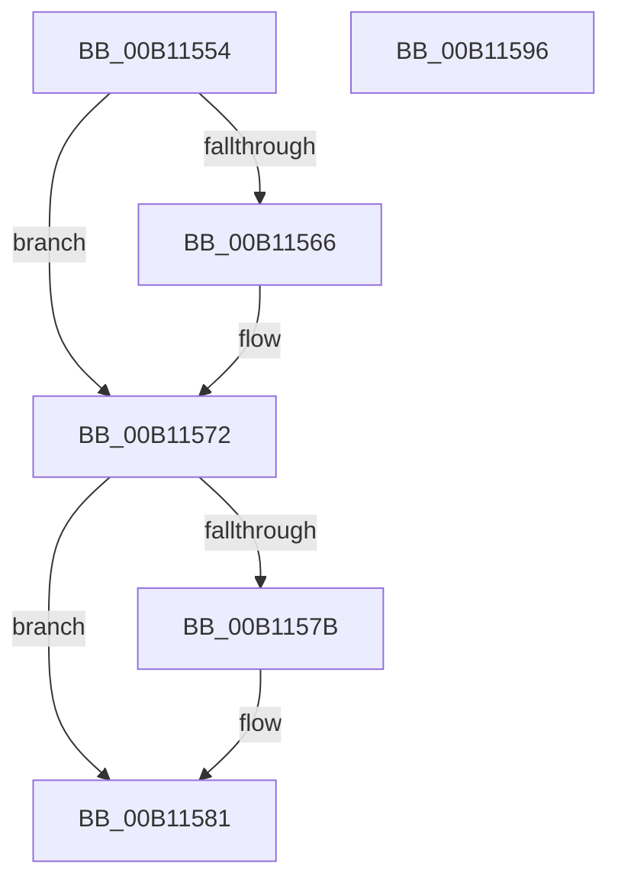

# IopTrackLink$fin$0

- RVA: `0x00B11554`–`0x00B11597` (길이 `67` bytes)
- VA: `0x0000000140B11554`
- 실행 섹션: `PAGE`
- PDB 이름 있음: `예`; PDB Function 태그: `예`
- unwind 정보 RVA: `0x000ADA2C`
- 디코드: `23`개 명령, `67/67` bytes 표시
- 미해석 바이트: `0` (있으면 어셈블리에 `.byte`로 보존)

> 이 문서는 커널 이미지의 기계어와 PDB 기호를 분석해 생성했습니다. 4번과 5번은 함수 원형과 자료형을 바이너리 사용 방식에서 추정한 C 해석이며 원본 소스 복구 결과는 아닙니다.

## 1. Dependencies

- 직접 호출 지점: **3**; 고유 호출 대상: **3**
- 직접 호출자로 확인된 함수: **0**
- RIP 상대 이미지 참조: **0**

### Outgoing calls
- `0x00B1156C` → [ExFreePoolWithTag](../../poolcode/B8/ExFreePoolWithTag_function_00B82870.md) (function, `0x00B82870`)
- `0x00B1157B` → [ObfDereferenceObject](../../text/2F/ObfDereferenceObject_function_002F9350.md) (function, `0x002F9350`)
- `0x00B1158A` → [KeSetEvent](../../text/33/KeSetEvent_function_0033F310.md) (function, `0x0033F310`)

### Direct callers
- 이 함수 시작 RVA로 연결되는 직접 call은 확인되지 않았습니다. 간접 호출은 완전히 역산할 수 없습니다.

### Static image references
- 디코드된 RIP-relative 메모리 참조가 없습니다.

## 2. Other-region calls and transfers

- 다른 실행 섹션으로 향하는 call: **3**
  - `0x00B1156C` → [ExFreePoolWithTag](../../poolcode/B8/ExFreePoolWithTag_function_00B82870.md) (`PAGE` → `POOLCODE`)
  - `0x00B1157B` → [ObfDereferenceObject](../../text/2F/ObfDereferenceObject_function_002F9350.md) (`PAGE` → `.text`)
  - `0x00B1158A` → [KeSetEvent](../../text/33/KeSetEvent_function_0033F310.md) (`PAGE` → `.text`)
- 별도 외부 분기/꼬리 이동을 확인하지 못했습니다.

## 3. Assembly (complete function range)

```asm
00B11554  40 55                           push rbp
00B11556  48 83 EC 30                     sub rsp, 0x30
00B1155A  48 8B EA                        mov rbp, rdx
00B1155D  80 BD 28 03 00 00 00            cmp byte ptr [rbp + 0x328], 0
00B11564  74 0C                           je 0x140b11572
00B11566  33 D2                           xor edx, edx
00B11568  48 8B 4D 50                     mov rcx, qword ptr [rbp + 0x50]
00B1156C  E8 FF 12 07 00                  call 0x140b82870
00B11571  90                              nop
00B11572  48 8B 4D 48                     mov rcx, qword ptr [rbp + 0x48]
00B11576  48 85 C9                        test rcx, rcx
00B11579  74 06                           je 0x140b11581
00B1157B  E8 D0 7D 7E FF                  call 0x1402f9350
00B11580  90                              nop
00B11581  45 33 C0                        xor r8d, r8d
00B11584  33 D2                           xor edx, edx
00B11586  48 8B 4D 58                     mov rcx, qword ptr [rbp + 0x58]
00B1158A  E8 81 DD 82 FF                  call 0x14033f310
00B1158F  90                              nop
00B11590  48 83 C4 30                     add rsp, 0x30
00B11594  5D                              pop rbp
00B11595  C3                              ret
00B11596  CC                              int3
```

## 4. C-style interpretation (structured pseudocode)

```c
__int64 __fastcall IopTrackLink_fin_0(__int64 a1, __int64 a2, int a3)
{
    __int64 result;
    __int64 v_rsp;

    v_rsp = (v_rsp) - (48);
    if ((*(unsigned __int8 *)(a2 + 808)) != 0) {
        a2 = 0;
        a1 = *(unsigned __int64 *)(a2 + 80);
        result = ExFreePoolWithTag(a1, a2, a3, a4);
    }
    if (*(unsigned __int64 *)(a2 + 72) != 0) {
        result = ObfDereferenceObject(*(unsigned __int64 *)(a2 + 72), a2, a3, a4);
    }
    a3 = 0;
    a2 = 0;
    result = KeSetEvent(*(unsigned __int64 *)(a2 + 88), a2, a3, a4);
    v_rsp = (v_rsp) + (48);
    return result;
}
```

## 5. (Beta) C Style

```c
int64_t IopTrackLink_fin_0(int64_t Arg1, void *Arg2, int32_t Arg3)
{
    uint8_t *arg2 = (uint8_t *)Arg2;

    int64_t result;
    int64_t local_rsp;

    local_rsp = (local_rsp) - (48);
    if ((*(uint8_t *)(arg2 + 0x328)) != 0) {
        Arg2 = 0;
        Arg1 = *(uint64_t *)(arg2 + 0x50);
        result = ExFreePoolWithTag(Arg1, Arg2, Arg3, a4);
    }
    if (*(uint64_t *)(arg2 + 0x48) != 0) {
        result = ObfDereferenceObject(*(uint64_t *)(arg2 + 0x48), Arg2, Arg3, a4);
    }
    Arg3 = 0;
    Arg2 = 0;
    result = KeSetEvent(*(uint64_t *)(arg2 + 0x58), Arg2, Arg3, a4);
    local_rsp = (local_rsp) + (48);
    return result;
}
```

### 관측된 메모리 오프셋

구조체 형식이 확인되지 않은 접근은 인자 기준의 오프셋으로만 기록했습니다.

| 기준 인자 | 오프셋 표현 | 폭 (bit) | 접근 |
|---|---:|---:|---|
| `Arg2` | `+ 0x48` | `64` | `R` |
| `Arg2` | `+ 0x50` | `64` | `R` |
| `Arg2` | `+ 0x58` | `64` | `R` |
| `Arg2` | `+ 0x328` | `8` | `R` |

## 6. Execution-region graph

[열기: 2D/3D 그래프와 함수 탐색 컨트롤 패널](../../../control-panel.html?section=page&rva=0x00B11554&view=graph)

- 2D 그래프는 위에서 아래로 흐르고, 3D 그래프는 빈 공간을 드래그해 회전합니다. Shift+드래그는 이동, 휠은 확대·축소, 함수 노드 선택은 대상 보고서 이동입니다.

### Static fallback


