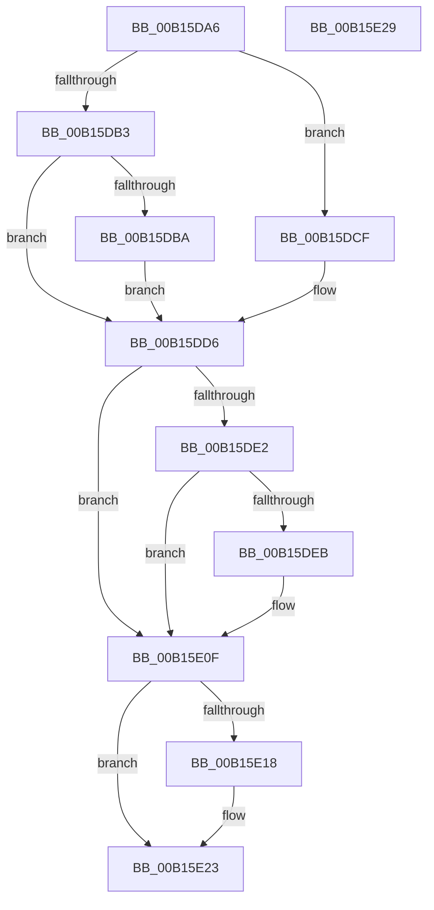

# MinCrypK_VerifySignedDataKModeEx$fin$0

- RVA: `0x00B15DA6`–`0x00B15E2A` (길이 `132` bytes)
- VA: `0x0000000140B15DA6`
- 실행 섹션: `PAGE`
- PDB 이름 있음: `예`; PDB Function 태그: `예`
- unwind 정보 RVA: `0x000BF4C0`
- 디코드: `35`개 명령, `132/132` bytes 표시
- 미해석 바이트: `0` (있으면 어셈블리에 `.byte`로 보존)

> 이 문서는 커널 이미지의 기계어와 PDB 기호를 분석해 생성했습니다. 4번과 5번은 함수 원형과 자료형을 바이너리 사용 방식에서 추정한 C 해석이며 원본 소스 복구 결과는 아닙니다.

## 1. Dependencies

- 직접 호출 지점: **3**; 고유 호출 대상: **3**
- 직접 호출자로 확인된 함수: **0**
- RIP 상대 이미지 참조: **0**

### Outgoing calls
- `0x00B15DC5` → [I_MinCryptBuildErrorPolicy](../83/I_MinCryptBuildErrorPolicy_function_008391DC.md) (function, `0x008391DC`)
- `0x00B15DF2` → [I_MincryptFreeChainInfo](../83/I_MincryptFreeChainInfo_function_008395E8.md) (function, `0x008395E8`)
- `0x00B15E1D` → [ExFreePoolWithTag](../../poolcode/B8/ExFreePoolWithTag_function_00B82870.md) (function, `0x00B82870`)

### Direct callers
- 이 함수 시작 RVA로 연결되는 직접 call은 확인되지 않았습니다. 간접 호출은 완전히 역산할 수 없습니다.

### Static image references
- 디코드된 RIP-relative 메모리 참조가 없습니다.

## 2. Other-region calls and transfers

- 다른 실행 섹션으로 향하는 call: **1**
  - `0x00B15E1D` → [ExFreePoolWithTag](../../poolcode/B8/ExFreePoolWithTag_function_00B82870.md) (`PAGE` → `POOLCODE`)
- 별도 외부 분기/꼬리 이동을 확인하지 못했습니다.

## 3. Assembly (complete function range)

```asm
00B15DA6  40 55                           push rbp
00B15DA8  48 83 EC 30                     sub rsp, 0x30
00B15DAC  48 8B EA                        mov rbp, rdx
00B15DAF  84 C9                           test cl, cl
00B15DB1  75 1C                           jne 0x140b15dcf
00B15DB3  8B 4D 30                        mov ecx, dword ptr [rbp + 0x30]
00B15DB6  85 C9                           test ecx, ecx
00B15DB8  79 1C                           jns 0x140b15dd6
00B15DBA  44 8B 45 34                     mov r8d, dword ptr [rbp + 0x34]
00B15DBE  48 8B 95 B8 00 00 00            mov rdx, qword ptr [rbp + 0xb8]
00B15DC5  E8 12 34 D2 FF                  call 0x1408391dc
00B15DCA  89 45 30                        mov dword ptr [rbp + 0x30], eax
00B15DCD  EB 07                           jmp 0x140b15dd6
00B15DCF  C7 45 30 E8 00 00 C0            mov dword ptr [rbp + 0x30], 0xc00000e8
00B15DD6  48 8D 85 80 00 00 00            lea rax, [rbp + 0x80]
00B15DDD  48 85 C0                        test rax, rax
00B15DE0  74 2D                           je 0x140b15e0f
00B15DE2  83 BD 80 00 00 00 00            cmp dword ptr [rbp + 0x80], 0
00B15DE9  74 24                           je 0x140b15e0f
00B15DEB  48 8B 8D 90 00 00 00            mov rcx, qword ptr [rbp + 0x90]
00B15DF2  E8 F1 37 D2 FF                  call 0x1408395e8
00B15DF7  0F 57 C0                        xorps xmm0, xmm0
00B15DFA  0F 11 85 80 00 00 00            movups xmmword ptr [rbp + 0x80], xmm0
00B15E01  0F 11 85 90 00 00 00            movups xmmword ptr [rbp + 0x90], xmm0
00B15E08  0F 11 85 A0 00 00 00            movups xmmword ptr [rbp + 0xa0], xmm0
00B15E0F  48 8B 4D 68                     mov rcx, qword ptr [rbp + 0x68]
00B15E13  48 85 C9                        test rcx, rcx
00B15E16  74 0B                           je 0x140b15e23
00B15E18  BA 43 49 63 72                  mov edx, 0x72634943
00B15E1D  E8 4E CA 06 00                  call 0x140b82870
00B15E22  90                              nop
00B15E23  48 83 C4 30                     add rsp, 0x30
00B15E27  5D                              pop rbp
00B15E28  C3                              ret
00B15E29  CC                              int3
```

## 4. C-style interpretation (structured pseudocode)

```c
__int64 __fastcall MinCrypK_VerifySignedDataKModeEx_fin_0(unsigned __int8 a1, __int64 a2)
{
    __int64 result;
    __int64 v_rsp;

    v_rsp = (v_rsp) - (48);
    if (a1 != 0) goto loc_00B15DCF;
    if (!sign_flag) goto loc_00B15DD6;
    result = I_MinCryptBuildErrorPolicy((unsigned int)(*(unsigned int *)(a2 + 48)), *(unsigned __int64 *)(a2 + 184), (unsigned int)(*(unsigned int *)(a2 + 52)), a4);
    *(unsigned int *)(a2 + 48) = (unsigned int)(result);
    goto loc_00B15DD6;
loc_00B15DCF:
    *(unsigned int *)(a2 + 48) = 0xC00000E8ULL;
loc_00B15DD6:
    if (a2 + 128 == 0) goto loc_00B15E0F;
    result = a2 + 128;
    if ((*(unsigned int *)(a2 + 128)) != 0) {
        a1 = *(unsigned __int64 *)(a2 + 144);
        result = I_MincryptFreeChainInfo(a1, *(unsigned __int64 *)(a2 + 184), (unsigned int)(*(unsigned int *)(a2 + 52)), a4);
        *(unsigned __int64 *)(a2 + 128) = v_xmm0;
        *(unsigned __int64 *)(a2 + 144) = v_xmm0;
        *(unsigned __int64 *)(a2 + 160) = v_xmm0;
    }
    if (*(unsigned __int64 *)(a2 + 104) != 0) {
        a2 = 0x72634943ULL;
        result = ExFreePoolWithTag(*(unsigned __int64 *)(a2 + 104), a2, (unsigned int)(*(unsigned int *)(a2 + 52)), a4);
    }
    v_rsp = (v_rsp) + (48);
    return result;
}
```

## 5. (Beta) C Style

```c
int64_t MinCrypK_VerifySignedDataKModeEx_fin_0(uint8_t Arg1, void *Arg2)
{
    uint8_t *arg2 = (uint8_t *)Arg2;

    int64_t result;
    int64_t local_rsp;

    local_rsp = (local_rsp) - (48);
    if (Arg1 != 0) goto loc_00B15DCF;
    if (!sign_flag) goto loc_00B15DD6;
    result = I_MinCryptBuildErrorPolicy((uint32_t)(*(uint32_t *)(arg2 + 0x30)), *(uint64_t *)(arg2 + 0xB8), (uint32_t)(*(uint32_t *)(arg2 + 0x34)), a4);
    *(uint32_t *)(arg2 + 0x30) = (uint32_t)(result);
    goto loc_00B15DD6;
loc_00B15DCF:
    *(uint32_t *)(arg2 + 0x30) = 0xC00000E8ULL;
loc_00B15DD6:
    if (Arg2 + 128 == 0) goto loc_00B15E0F;
    result = Arg2 + 128;
    if ((*(uint32_t *)(arg2 + 0x80)) != 0) {
        Arg1 = *(uint64_t *)(arg2 + 0x90);
        result = I_MincryptFreeChainInfo(Arg1, *(uint64_t *)(arg2 + 0xB8), (uint32_t)(*(uint32_t *)(arg2 + 0x34)), a4);
        *(uint64_t *)(arg2 + 0x80) = v_xmm0;
        *(uint64_t *)(arg2 + 0x90) = v_xmm0;
        *(uint64_t *)(arg2 + 0xA0) = v_xmm0;
    }
    if (*(uint64_t *)(arg2 + 0x68) != 0) {
        Arg2 = 0x72634943ULL;
        result = ExFreePoolWithTag(*(uint64_t *)(arg2 + 0x68), Arg2, (uint32_t)(*(uint32_t *)(arg2 + 0x34)), a4);
    }
    local_rsp = (local_rsp) + (48);
    return result;
}
```

### 관측된 메모리 오프셋

구조체 형식이 확인되지 않은 접근은 인자 기준의 오프셋으로만 기록했습니다.

| 기준 인자 | 오프셋 표현 | 폭 (bit) | 접근 |
|---|---:|---:|---|
| `Arg2` | `+ 0x30` | `32` | `R` |
| `Arg2` | `+ 0x30` | `32` | `W` |
| `Arg2` | `+ 0x34` | `32` | `R` |
| `Arg2` | `+ 0x68` | `64` | `R` |
| `Arg2` | `+ 0x80` | `32` | `R` |
| `Arg2` | `+ 0x80` | `64` | `R` |
| `Arg2` | `+ 0x80` | `128` | `R` |
| `Arg2` | `+ 0x90` | `64` | `R` |
| `Arg2` | `+ 0x90` | `128` | `R` |
| `Arg2` | `+ 0xA0` | `128` | `R` |
| `Arg2` | `+ 0xB8` | `64` | `R` |

## 6. Execution-region graph

[열기: 2D/3D 그래프와 함수 탐색 컨트롤 패널](../../../control-panel.html?section=page&rva=0x00B15DA6&view=graph)

- 2D 그래프는 위에서 아래로 흐르고, 3D 그래프는 빈 공간을 드래그해 회전합니다. Shift+드래그는 이동, 휠은 확대·축소, 함수 노드 선택은 대상 보고서 이동입니다.

### Static fallback


