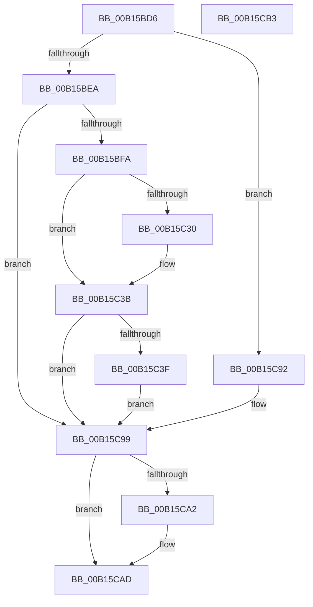

# MinCryptVerifyCertificateWithPolicy2$fin$0

- RVA: `0x00B15BD6`–`0x00B15CB4` (길이 `222` bytes)
- VA: `0x0000000140B15BD6`
- 실행 섹션: `PAGE`
- PDB 이름 있음: `예`; PDB Function 태그: `예`
- unwind 정보 RVA: `0x000C5CF8`
- 디코드: `54`개 명령, `222/222` bytes 표시
- 미해석 바이트: `0` (있으면 어셈블리에 `.byte`로 보존)

> 이 문서는 커널 이미지의 기계어와 PDB 기호를 분석해 생성했습니다. 4번과 5번은 함수 원형과 자료형을 바이너리 사용 방식에서 추정한 C 해석이며 원본 소스 복구 결과는 아닙니다.

## 1. Dependencies

- 직접 호출 지점: **2**; 고유 호출 대상: **2**
- 직접 호출자로 확인된 함수: **0**
- RIP 상대 이미지 참조: **0**

### Outgoing calls
- `0x00B15C88` → [I_MincryptAddChainInfo](../83/I_MincryptAddChainInfo_function_00839314.md) (function, `0x00839314`)
- `0x00B15CA7` → [ExFreePoolWithTag](../../poolcode/B8/ExFreePoolWithTag_function_00B82870.md) (function, `0x00B82870`)

### Direct callers
- 이 함수 시작 RVA로 연결되는 직접 call은 확인되지 않았습니다. 간접 호출은 완전히 역산할 수 없습니다.

### Static image references
- 디코드된 RIP-relative 메모리 참조가 없습니다.

## 2. Other-region calls and transfers

- 다른 실행 섹션으로 향하는 call: **1**
  - `0x00B15CA7` → [ExFreePoolWithTag](../../poolcode/B8/ExFreePoolWithTag_function_00B82870.md) (`PAGE` → `POOLCODE`)
- 별도 외부 분기/꼬리 이동을 확인하지 못했습니다.

## 3. Assembly (complete function range)

```asm
00B15BD6  40 55                           push rbp
00B15BD8  48 83 EC 50                     sub rsp, 0x50
00B15BDC  48 8B EA                        mov rbp, rdx
00B15BDF  0F B6 C1                        movzx eax, cl
00B15BE2  84 C9                           test cl, cl
00B15BE4  0F 85 A8 00 00 00               jne 0x140b15c92
00B15BEA  48 8B 8D 70 01 00 00            mov rcx, qword ptr [rbp + 0x170]
00B15BF1  48 85 C9                        test rcx, rcx
00B15BF4  0F 84 9F 00 00 00               je 0x140b15c99
00B15BFA  C7 01 30 00 00 00               mov dword ptr [rcx], 0x30
00B15C00  8B 55 50                        mov edx, dword ptr [rbp + 0x50]
00B15C03  89 51 04                        mov dword ptr [rcx + 4], edx
00B15C06  8B 45 58                        mov eax, dword ptr [rbp + 0x58]
00B15C09  89 41 08                        mov dword ptr [rcx + 8], eax
00B15C0C  48 83 61 10 00                  and qword ptr [rcx + 0x10], 0
00B15C11  48 8B 85 A0 00 00 00            mov rax, qword ptr [rbp + 0xa0]
00B15C18  48 89 41 20                     mov qword ptr [rcx + 0x20], rax
00B15C1C  48 8B 85 A8 00 00 00            mov rax, qword ptr [rbp + 0xa8]
00B15C23  48 89 41 28                     mov qword ptr [rcx + 0x28], rax
00B15C27  83 BD 88 00 00 00 00            cmp dword ptr [rbp + 0x88], 0
00B15C2E  74 0B                           je 0x140b15c3b
00B15C30  48 8B 85 C8 00 00 00            mov rax, qword ptr [rbp + 0xc8]
00B15C37  48 89 41 18                     mov qword ptr [rcx + 0x18], rax
00B15C3B  85 D2                           test edx, edx
00B15C3D  78 5A                           js 0x140b15c99
00B15C3F  48 8B 85 78 01 00 00            mov rax, qword ptr [rbp + 0x178]
00B15C46  48 89 44 24 48                  mov qword ptr [rsp + 0x48], rax
00B15C4B  48 8B 85 98 00 00 00            mov rax, qword ptr [rbp + 0x98]
00B15C52  48 89 44 24 40                  mov qword ptr [rsp + 0x40], rax
00B15C57  48 8B 85 B0 00 00 00            mov rax, qword ptr [rbp + 0xb0]
00B15C5E  48 89 44 24 38                  mov qword ptr [rsp + 0x38], rax
00B15C63  48 8B 45 68                     mov rax, qword ptr [rbp + 0x68]
00B15C67  48 89 44 24 30                  mov qword ptr [rsp + 0x30], rax
00B15C6C  8B 45 74                        mov eax, dword ptr [rbp + 0x74]
00B15C6F  89 44 24 28                     mov dword ptr [rsp + 0x28], eax
00B15C73  8B 85 80 00 00 00               mov eax, dword ptr [rbp + 0x80]
00B15C79  89 44 24 20                     mov dword ptr [rsp + 0x20], eax
00B15C7D  44 8B 4D 54                     mov r9d, dword ptr [rbp + 0x54]
00B15C81  44 8B 45 78                     mov r8d, dword ptr [rbp + 0x78]
00B15C85  8B 55 5C                        mov edx, dword ptr [rbp + 0x5c]
00B15C88  E8 87 36 D2 FF                  call 0x140839314
00B15C8D  89 45 50                        mov dword ptr [rbp + 0x50], eax
00B15C90  EB 07                           jmp 0x140b15c99
00B15C92  C7 45 50 E8 00 00 C0            mov dword ptr [rbp + 0x50], 0xc00000e8
00B15C99  48 8B 4D 68                     mov rcx, qword ptr [rbp + 0x68]
00B15C9D  48 85 C9                        test rcx, rcx
00B15CA0  74 0B                           je 0x140b15cad
00B15CA2  BA 43 49 63 72                  mov edx, 0x72634943
00B15CA7  E8 C4 CB 06 00                  call 0x140b82870
00B15CAC  90                              nop
00B15CAD  48 83 C4 50                     add rsp, 0x50
00B15CB1  5D                              pop rbp
00B15CB2  C3                              ret
00B15CB3  CC                              int3
```

## 4. C-style interpretation (structured pseudocode)

```c
__int64 __fastcall MinCryptVerifyCertificateWithPolicy2_fin_0(unsigned __int8 a1, __int64 a2)
{
    __int64 result;
    __int64 v_rsp;
    unsigned __int64 v_stack_m10;
    unsigned __int64 v_stack_m18;
    unsigned __int64 v_stack_m20;
    unsigned __int64 v_stack_m28;
    unsigned int v_stack_m30;
    unsigned int v_stack_m38;

    v_rsp = (v_rsp) - (80);
    if (a1 != 0) goto loc_00B15C92;
    if (*(unsigned __int64 *)(a2 + 368) == 0) goto loc_00B15C99;
    *(unsigned int *)(*(unsigned __int64 *)(a2 + 368)) = 48;
    *(unsigned int *)(*(unsigned __int64 *)(a2 + 368) + 4) = (unsigned int)((unsigned int)(*(unsigned int *)(a2 + 80)));
    *(unsigned int *)(*(unsigned __int64 *)(a2 + 368) + 8) = (unsigned int)((unsigned int)(*(unsigned int *)(a2 + 88)));
    *(unsigned __int64 *)(*(unsigned __int64 *)(a2 + 368) + 32) = *(unsigned __int64 *)(a2 + 160);
    *(unsigned __int64 *)(*(unsigned __int64 *)(a2 + 368) + 40) = *(unsigned __int64 *)(a2 + 168);
    result = *(unsigned __int64 *)(a2 + 168);
    if ((*(unsigned int *)(a2 + 136)) != 0) {
        result = *(unsigned __int64 *)(a2 + 200);
        *(unsigned __int64 *)(*(unsigned __int64 *)(a2 + 368) + 24) = result;
    }
    if (sign_flag) goto loc_00B15C99;
    v_stack_m10 = *(unsigned __int64 *)(a2 + 376);
    v_stack_m18 = *(unsigned __int64 *)(a2 + 152);
    v_stack_m20 = *(unsigned __int64 *)(a2 + 176);
    v_stack_m28 = *(unsigned __int64 *)(a2 + 104);
    v_stack_m30 = (unsigned int)((unsigned int)(*(unsigned int *)(a2 + 116)));
    v_stack_m38 = (unsigned int)((unsigned int)(*(unsigned int *)(a2 + 128)));
    result = I_MincryptAddChainInfo(*(unsigned __int64 *)(a2 + 368), (unsigned int)(*(unsigned int *)(a2 + 92)), (unsigned int)(*(unsigned int *)(a2 + 120)), (unsigned int)(*(unsigned int *)(a2 + 84)));
    *(unsigned int *)(a2 + 80) = (unsigned int)(result);
    goto loc_00B15C99;
loc_00B15C92:
    *(unsigned int *)(a2 + 80) = 0xC00000E8ULL;
loc_00B15C99:
    if (*(unsigned __int64 *)(a2 + 104) != 0) {
        a2 = 0x72634943ULL;
        result = ExFreePoolWithTag(*(unsigned __int64 *)(a2 + 104), a2, (unsigned int)(*(unsigned int *)(a2 + 120)), (unsigned int)(*(unsigned int *)(a2 + 84)));
    }
    v_rsp = (v_rsp) + (80);
    return result;
}
```

## 5. (Beta) C Style

```c
int64_t MinCryptVerifyCertificateWithPolicy2_fin_0(uint8_t Arg1, void *Arg2)
{
    uint8_t *arg2 = (uint8_t *)Arg2;

    int64_t result;
    int64_t local_rsp;
    uint64_t v_stack_m10;
    uint64_t v_stack_m18;
    uint64_t v_stack_m20;
    uint64_t v_stack_m28;
    uint32_t v_stack_m30;
    uint32_t v_stack_m38;

    local_rsp = (local_rsp) - (80);
    if (Arg1 != 0) goto loc_00B15C92;
    if (*(uint64_t *)(arg2 + 0x170) == 0) goto loc_00B15C99;
    *(uint32_t *)(*(uint64_t *)(arg2 + 0x170)) = 48;
    *(uint32_t *)(*(uint64_t *)(arg2 + 0x170) + 0x4) = (uint32_t)((uint32_t)(*(uint32_t *)(arg2 + 0x50)));
    *(uint32_t *)(*(uint64_t *)(arg2 + 0x170) + 0x8) = (uint32_t)((uint32_t)(*(uint32_t *)(arg2 + 0x58)));
    *(uint64_t *)(*(uint64_t *)(arg2 + 0x170) + 0x20) = *(uint64_t *)(arg2 + 0xA0);
    *(uint64_t *)(*(uint64_t *)(arg2 + 0x170) + 0x28) = *(uint64_t *)(arg2 + 0xA8);
    result = *(uint64_t *)(arg2 + 0xA8);
    if ((*(uint32_t *)(arg2 + 0x88)) != 0) {
        result = *(uint64_t *)(arg2 + 0xC8);
        *(uint64_t *)(*(uint64_t *)(arg2 + 0x170) + 0x18) = result;
    }
    if (sign_flag) goto loc_00B15C99;
    v_stack_m10 = *(uint64_t *)(arg2 + 0x178);
    v_stack_m18 = *(uint64_t *)(arg2 + 0x98);
    v_stack_m20 = *(uint64_t *)(arg2 + 0xB0);
    v_stack_m28 = *(uint64_t *)(arg2 + 0x68);
    v_stack_m30 = (uint32_t)((uint32_t)(*(uint32_t *)(arg2 + 0x74)));
    v_stack_m38 = (uint32_t)((uint32_t)(*(uint32_t *)(arg2 + 0x80)));
    result = I_MincryptAddChainInfo(*(uint64_t *)(arg2 + 0x170), (uint32_t)(*(uint32_t *)(arg2 + 0x5C)), (uint32_t)(*(uint32_t *)(arg2 + 0x78)), (uint32_t)(*(uint32_t *)(arg2 + 0x54)));
    *(uint32_t *)(arg2 + 0x50) = (uint32_t)(result);
    goto loc_00B15C99;
loc_00B15C92:
    *(uint32_t *)(arg2 + 0x50) = 0xC00000E8ULL;
loc_00B15C99:
    if (*(uint64_t *)(arg2 + 0x68) != 0) {
        Arg2 = 0x72634943ULL;
        result = ExFreePoolWithTag(*(uint64_t *)(arg2 + 0x68), Arg2, (uint32_t)(*(uint32_t *)(arg2 + 0x78)), (uint32_t)(*(uint32_t *)(arg2 + 0x54)));
    }
    local_rsp = (local_rsp) + (80);
    return result;
}
```

### 관측된 메모리 오프셋

구조체 형식이 확인되지 않은 접근은 인자 기준의 오프셋으로만 기록했습니다.

| 기준 인자 | 오프셋 표현 | 폭 (bit) | 접근 |
|---|---:|---:|---|
| `Arg2` | `+ 0x50` | `32` | `R` |
| `Arg2` | `+ 0x50` | `32` | `W` |
| `Arg2` | `+ 0x54` | `32` | `R` |
| `Arg2` | `+ 0x58` | `32` | `R` |
| `Arg2` | `+ 0x5C` | `32` | `R` |
| `Arg2` | `+ 0x68` | `64` | `R` |
| `Arg2` | `+ 0x74` | `32` | `R` |
| `Arg2` | `+ 0x78` | `32` | `R` |
| `Arg2` | `+ 0x80` | `32` | `R` |
| `Arg2` | `+ 0x88` | `32` | `R` |
| `Arg2` | `+ 0x98` | `64` | `R` |
| `Arg2` | `+ 0xA0` | `64` | `R` |
| `Arg2` | `+ 0xA8` | `64` | `R` |
| `Arg2` | `+ 0xB0` | `64` | `R` |
| `Arg2` | `+ 0xC8` | `64` | `R` |
| `Arg2` | `+ 0x170` | `64` | `R` |
| `Arg2` | `+ 0x178` | `64` | `R` |

## 6. Execution-region graph

[열기: 2D/3D 그래프와 함수 탐색 컨트롤 패널](../../../control-panel.html?section=page&rva=0x00B15BD6&view=graph)

- 2D 그래프는 위에서 아래로 흐르고, 3D 그래프는 빈 공간을 드래그해 회전합니다. Shift+드래그는 이동, 휠은 확대·축소, 함수 노드 선택은 대상 보고서 이동입니다.

### Static fallback


