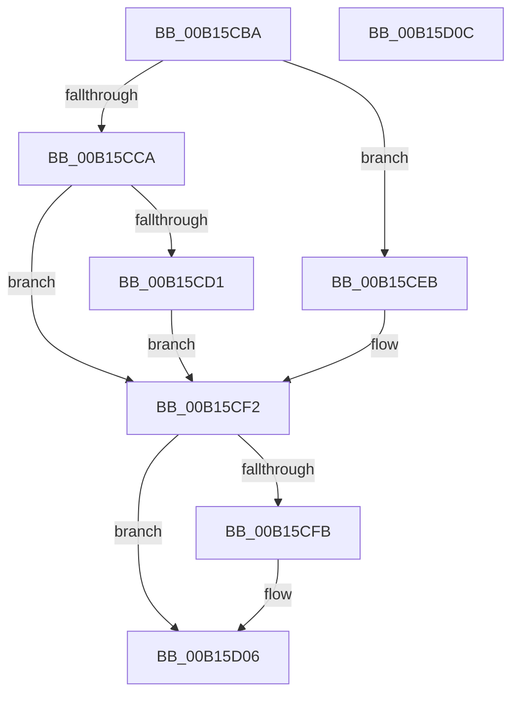

# MincrypK_ParseCertificateChainWithPolicy2$fin$0

- RVA: `0x00B15CBA`–`0x00B15D0D` (길이 `83` bytes)
- VA: `0x0000000140B15CBA`
- 실행 섹션: `PAGE`
- PDB 이름 있음: `예`; PDB Function 태그: `예`
- unwind 정보 RVA: `0x000BF4C0`
- 디코드: `26`개 명령, `83/83` bytes 표시
- 미해석 바이트: `0` (있으면 어셈블리에 `.byte`로 보존)

> 이 문서는 커널 이미지의 기계어와 PDB 기호를 분석해 생성했습니다. 4번과 5번은 함수 원형과 자료형을 바이너리 사용 방식에서 추정한 C 해석이며 원본 소스 복구 결과는 아닙니다.

## 1. Dependencies

- 직접 호출 지점: **2**; 고유 호출 대상: **2**
- 직접 호출자로 확인된 함수: **0**
- RIP 상대 이미지 참조: **0**

### Outgoing calls
- `0x00B15CE1` → [I_MinCryptBuildErrorPolicy](../83/I_MinCryptBuildErrorPolicy_function_008391DC.md) (function, `0x008391DC`)
- `0x00B15D00` → [ExFreePoolWithTag](../../poolcode/B8/ExFreePoolWithTag_function_00B82870.md) (function, `0x00B82870`)

### Direct callers
- 이 함수 시작 RVA로 연결되는 직접 call은 확인되지 않았습니다. 간접 호출은 완전히 역산할 수 없습니다.

### Static image references
- 디코드된 RIP-relative 메모리 참조가 없습니다.

## 2. Other-region calls and transfers

- 다른 실행 섹션으로 향하는 call: **1**
  - `0x00B15D00` → [ExFreePoolWithTag](../../poolcode/B8/ExFreePoolWithTag_function_00B82870.md) (`PAGE` → `POOLCODE`)
- 별도 외부 분기/꼬리 이동을 확인하지 못했습니다.

## 3. Assembly (complete function range)

```asm
00B15CBA  40 55                           push rbp
00B15CBC  48 83 EC 30                     sub rsp, 0x30
00B15CC0  48 8B EA                        mov rbp, rdx
00B15CC3  0F B6 C1                        movzx eax, cl
00B15CC6  84 C9                           test cl, cl
00B15CC8  75 21                           jne 0x140b15ceb
00B15CCA  8B 4D 30                        mov ecx, dword ptr [rbp + 0x30]
00B15CCD  85 C9                           test ecx, ecx
00B15CCF  79 21                           jns 0x140b15cf2
00B15CD1  44 8B 45 3C                     mov r8d, dword ptr [rbp + 0x3c]
00B15CD5  41 0F BA E8 10                  bts r8d, 0x10
00B15CDA  48 8B 95 A0 00 00 00            mov rdx, qword ptr [rbp + 0xa0]
00B15CE1  E8 F6 34 D2 FF                  call 0x1408391dc
00B15CE6  89 45 30                        mov dword ptr [rbp + 0x30], eax
00B15CE9  EB 07                           jmp 0x140b15cf2
00B15CEB  C7 45 30 E8 00 00 C0            mov dword ptr [rbp + 0x30], 0xc00000e8
00B15CF2  48 8B 4D 48                     mov rcx, qword ptr [rbp + 0x48]
00B15CF6  48 85 C9                        test rcx, rcx
00B15CF9  74 0B                           je 0x140b15d06
00B15CFB  BA 43 49 63 72                  mov edx, 0x72634943
00B15D00  E8 6B CB 06 00                  call 0x140b82870
00B15D05  90                              nop
00B15D06  48 83 C4 30                     add rsp, 0x30
00B15D0A  5D                              pop rbp
00B15D0B  C3                              ret
00B15D0C  CC                              int3
```

## 4. C-style interpretation (structured pseudocode)

```c
__int64 __fastcall MincrypK_ParseCertificateChainWithPolicy2_fin_0(unsigned __int8 a1, __int64 a2)
{
    __int64 result;
    __int64 v_rsp;

    v_rsp = (v_rsp) - (48);
    if (a1 != 0) goto loc_00B15CEB;
    if (!sign_flag) goto loc_00B15CF2;
    result = I_MinCryptBuildErrorPolicy((unsigned int)(*(unsigned int *)(a2 + 48)), *(unsigned __int64 *)(a2 + 160), (unsigned int)(*(unsigned int *)(a2 + 60)), a4);
    *(unsigned int *)(a2 + 48) = (unsigned int)(result);
    goto loc_00B15CF2;
loc_00B15CEB:
    *(unsigned int *)(a2 + 48) = 0xC00000E8ULL;
loc_00B15CF2:
    if (*(unsigned __int64 *)(a2 + 72) != 0) {
        a2 = 0x72634943ULL;
        result = ExFreePoolWithTag(*(unsigned __int64 *)(a2 + 72), a2, (unsigned int)(*(unsigned int *)(a2 + 60)), a4);
    }
    v_rsp = (v_rsp) + (48);
    return result;
}
```

## 5. (Beta) C Style

```c
int64_t MincrypK_ParseCertificateChainWithPolicy2_fin_0(uint8_t Arg1, void *Arg2)
{
    uint8_t *arg2 = (uint8_t *)Arg2;

    int64_t result;
    int64_t local_rsp;

    local_rsp = (local_rsp) - (48);
    if (Arg1 != 0) goto loc_00B15CEB;
    if (!sign_flag) goto loc_00B15CF2;
    result = I_MinCryptBuildErrorPolicy((uint32_t)(*(uint32_t *)(arg2 + 0x30)), *(uint64_t *)(arg2 + 0xA0), (uint32_t)(*(uint32_t *)(arg2 + 0x3C)), a4);
    *(uint32_t *)(arg2 + 0x30) = (uint32_t)(result);
    goto loc_00B15CF2;
loc_00B15CEB:
    *(uint32_t *)(arg2 + 0x30) = 0xC00000E8ULL;
loc_00B15CF2:
    if (*(uint64_t *)(arg2 + 0x48) != 0) {
        Arg2 = 0x72634943ULL;
        result = ExFreePoolWithTag(*(uint64_t *)(arg2 + 0x48), Arg2, (uint32_t)(*(uint32_t *)(arg2 + 0x3C)), a4);
    }
    local_rsp = (local_rsp) + (48);
    return result;
}
```

### 관측된 메모리 오프셋

구조체 형식이 확인되지 않은 접근은 인자 기준의 오프셋으로만 기록했습니다.

| 기준 인자 | 오프셋 표현 | 폭 (bit) | 접근 |
|---|---:|---:|---|
| `Arg2` | `+ 0x30` | `32` | `R` |
| `Arg2` | `+ 0x30` | `32` | `W` |
| `Arg2` | `+ 0x3C` | `32` | `R` |
| `Arg2` | `+ 0x48` | `64` | `R` |
| `Arg2` | `+ 0xA0` | `64` | `R` |

## 6. Execution-region graph

[열기: 2D/3D 그래프와 함수 탐색 컨트롤 패널](../../../control-panel.html?section=page&rva=0x00B15CBA&view=graph)

- 2D 그래프는 위에서 아래로 흐르고, 3D 그래프는 빈 공간을 드래그해 회전합니다. Shift+드래그는 이동, 휠은 확대·축소, 함수 노드 선택은 대상 보고서 이동입니다.

### Static fallback


