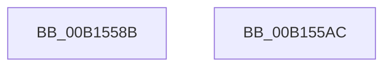

# NtMapCMFModule$fin$1

- RVA: `0x00B1558B`–`0x00B155AD` (길이 `34` bytes)
- VA: `0x0000000140B1558B`
- 실행 섹션: `PAGE`
- PDB 이름 있음: `예`; PDB Function 태그: `예`
- unwind 정보 RVA: `0x000C5CF8`
- 디코드: `11`개 명령, `34/34` bytes 표시
- 미해석 바이트: `0` (있으면 어셈블리에 `.byte`로 보존)

> 이 문서는 커널 이미지의 기계어와 PDB 기호를 분석해 생성했습니다. 4번과 5번은 함수 원형과 자료형을 바이너리 사용 방식에서 추정한 C 해석이며 원본 소스 복구 결과는 아닙니다.

## 1. Dependencies

- 직접 호출 지점: **2**; 고유 호출 대상: **2**
- 직접 호출자로 확인된 함수: **0**
- RIP 상대 이미지 참조: **1**

### Outgoing calls
- `0x00B1559B` → [ExReleaseResourceLite](../../text/25/ExReleaseResourceLite_function_0025FA10.md) (function, `0x0025FA10`)
- `0x00B155A0` → [KeLeaveCriticalRegion](../../text/25/KeLeaveCriticalRegion_function_0025D8B0.md) (function, `0x0025D8B0`)

### Direct callers
- 이 함수 시작 RVA로 연결되는 직접 call은 확인되지 않았습니다. 간접 호출은 완전히 역산할 수 없습니다.

### Static image references
- `0x00B15594` → RVA `0x00EEEF90` (`.data`; read)

## 2. Other-region calls and transfers

- 다른 실행 섹션으로 향하는 call: **2**
  - `0x00B1559B` → [ExReleaseResourceLite](../../text/25/ExReleaseResourceLite_function_0025FA10.md) (`PAGE` → `.text`)
  - `0x00B155A0` → [KeLeaveCriticalRegion](../../text/25/KeLeaveCriticalRegion_function_0025D8B0.md) (`PAGE` → `.text`)
- 별도 외부 분기/꼬리 이동을 확인하지 못했습니다.

## 3. Assembly (complete function range)

```asm
00B1558B  40 55                           push rbp
00B1558D  48 83 EC 50                     sub rsp, 0x50
00B15591  48 8B EA                        mov rbp, rdx
00B15594  48 8B 0D F5 99 3D 00            mov rcx, qword ptr [rip + 0x3d99f5]
00B1559B  E8 70 A4 74 FF                  call 0x14025fa10
00B155A0  E8 0B 83 74 FF                  call 0x14025d8b0
00B155A5  90                              nop
00B155A6  48 83 C4 50                     add rsp, 0x50
00B155AA  5D                              pop rbp
00B155AB  C3                              ret
00B155AC  CC                              int3
```

## 4. C-style interpretation (structured pseudocode)

```c
__int64 __fastcall NtMapCMFModule_fin_1(__int64 a1, __int64 a2)
{
    __int64 result;
    __int64 v_rsp;

    v_rsp = (v_rsp) - (80);
    result = ExReleaseResourceLite(*(unsigned __int64 *)(v_rip + 4037109), a2, a3, a4);
    result = KeLeaveCriticalRegion(*(unsigned __int64 *)(v_rip + 4037109), a2, a3, a4);
    v_rsp = (v_rsp) + (80);
    return result;
}
```

## 5. (Beta) C Style

```c
int64_t NtMapCMFModule_fin_1(int64_t Arg1, int64_t Arg2)
{
    int64_t result;
    int64_t local_rsp;

    local_rsp = (local_rsp) - (80);
    result = ExReleaseResourceLite(*(uint64_t *)(v_rip + 0x3D99F5), Arg2, a3, a4);
    result = KeLeaveCriticalRegion(*(uint64_t *)(v_rip + 0x3D99F5), Arg2, a3, a4);
    local_rsp = (local_rsp) + (80);
    return result;
}
```

## 6. Execution-region graph

[열기: 2D/3D 그래프와 함수 탐색 컨트롤 패널](../../../control-panel.html?section=page&rva=0x00B1558B&view=graph)

- 2D 그래프는 위에서 아래로 흐르고, 3D 그래프는 빈 공간을 드래그해 회전합니다. Shift+드래그는 이동, 휠은 확대·축소, 함수 노드 선택은 대상 보고서 이동입니다.

### Static fallback


