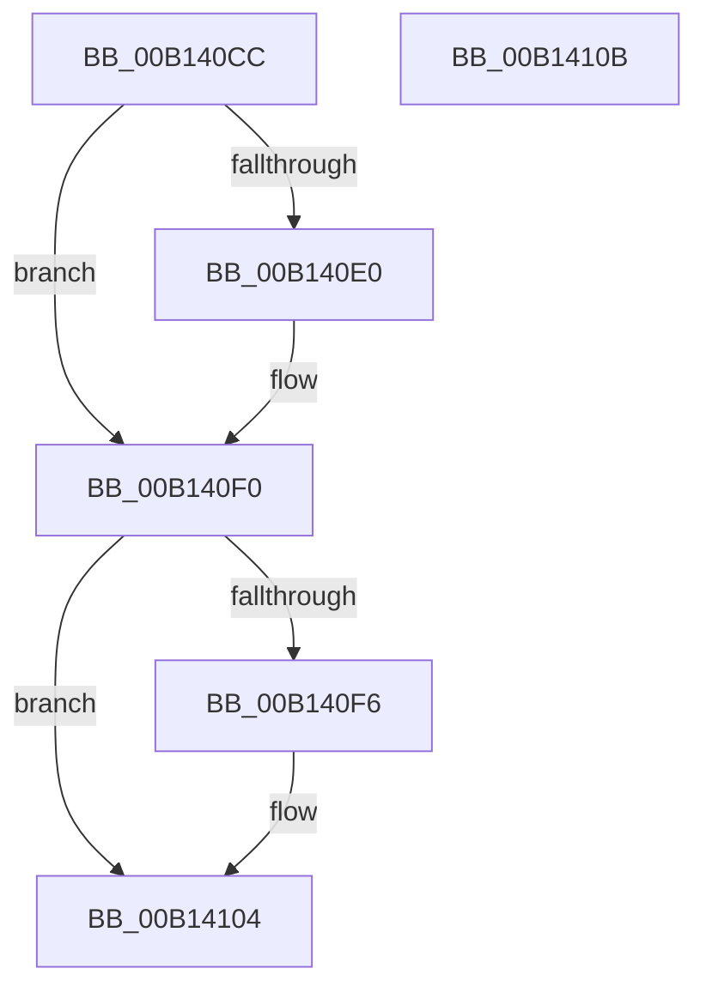

# NtQueryInformationThread$fin$2

- RVA: `0x00B140CC`–`0x00B1410C` (길이 `64` bytes)
- VA: `0x0000000140B140CC`
- 실행 섹션: `PAGE`
- PDB 이름 있음: `예`; PDB Function 태그: `예`
- unwind 정보 RVA: `0x000CED98`
- 디코드: `22`개 명령, `64/64` bytes 표시
- 미해석 바이트: `0` (있으면 어셈블리에 `.byte`로 보존)

> 이 문서는 커널 이미지의 기계어와 PDB 기호를 분석해 생성했습니다. 4번과 5번은 함수 원형과 자료형을 바이너리 사용 방식에서 추정한 C 해석이며 원본 소스 복구 결과는 아닙니다.

## 1. Dependencies

- 직접 호출 지점: **2**; 고유 호출 대상: **2**
- 직접 호출자로 확인된 함수: **0**
- RIP 상대 이미지 참조: **0**

### Outgoing calls
- `0x00B140EA` → [PspUnlockThreadSecurityShared](../../text/3C/PspUnlockThreadSecurityShared_function_003C2E40.md) (function, `0x003C2E40`)
- `0x00B140FE` → [ObfDereferenceObjectWithTag](../../text/2F/ObfDereferenceObjectWithTag_function_002F78E0.md) (function, `0x002F78E0`)

### Direct callers
- 이 함수 시작 RVA로 연결되는 직접 call은 확인되지 않았습니다. 간접 호출은 완전히 역산할 수 없습니다.

### Static image references
- 디코드된 RIP-relative 메모리 참조가 없습니다.

## 2. Other-region calls and transfers

- 다른 실행 섹션으로 향하는 call: **2**
  - `0x00B140EA` → [PspUnlockThreadSecurityShared](../../text/3C/PspUnlockThreadSecurityShared_function_003C2E40.md) (`PAGE` → `.text`)
  - `0x00B140FE` → [ObfDereferenceObjectWithTag](../../text/2F/ObfDereferenceObjectWithTag_function_002F78E0.md) (`PAGE` → `.text`)
- 별도 외부 분기/꼬리 이동을 확인하지 못했습니다.

## 3. Assembly (complete function range)

```asm
00B140CC  40 53                           push rbx
00B140CE  55                              push rbp
00B140CF  48 83 EC 48                     sub rsp, 0x48
00B140D3  48 8B EA                        mov rbp, rdx
00B140D6  48 8B 5D 40                     mov rbx, qword ptr [rbp + 0x40]
00B140DA  80 7D 4C 00                     cmp byte ptr [rbp + 0x4c], 0
00B140DE  74 10                           je 0x140b140f0
00B140E0  48 8B 95 88 00 00 00            mov rdx, qword ptr [rbp + 0x88]
00B140E7  48 8B CB                        mov rcx, rbx
00B140EA  E8 51 ED 8A FF                  call 0x1403c2e40
00B140EF  90                              nop
00B140F0  80 7D 4D 00                     cmp byte ptr [rbp + 0x4d], 0
00B140F4  74 0E                           je 0x140b14104
00B140F6  BA 50 73 51 79                  mov edx, 0x79517350
00B140FB  48 8B CB                        mov rcx, rbx
00B140FE  E8 DD 37 7E FF                  call 0x1402f78e0
00B14103  90                              nop
00B14104  48 83 C4 48                     add rsp, 0x48
00B14108  5D                              pop rbp
00B14109  5B                              pop rbx
00B1410A  C3                              ret
00B1410B  CC                              int3
```

## 4. C-style interpretation (structured pseudocode)

```c
__int64 __fastcall NtQueryInformationThread_fin_2(__int64 a1, __int64 a2)
{
    __int64 result;
    __int64 v_rsp;

    v_rsp = (v_rsp) - (72);
    if ((*(unsigned __int8 *)(a2 + 76)) != 0) {
        a2 = *(unsigned __int64 *)(a2 + 136);
        a1 = *(unsigned __int64 *)(a2 + 64);
        result = PspUnlockThreadSecurityShared(a1, a2, a3, a4);
    }
    if ((*(unsigned __int8 *)(a2 + 77)) != 0) {
        a2 = 0x79517350ULL;
        a1 = *(unsigned __int64 *)(a2 + 64);
        result = ObfDereferenceObjectWithTag(a1, a2, a3, a4);
    }
    v_rsp = (v_rsp) + (72);
    return result;
}
```

## 5. (Beta) C Style

```c
int64_t NtQueryInformationThread_fin_2(int64_t Arg1, void *Arg2)
{
    uint8_t *arg2 = (uint8_t *)Arg2;

    int64_t result;
    int64_t local_rsp;

    local_rsp = (local_rsp) - (72);
    if ((*(uint8_t *)(arg2 + 0x4C)) != 0) {
        Arg2 = *(uint64_t *)(arg2 + 0x88);
        Arg1 = *(uint64_t *)(arg2 + 0x40);
        result = PspUnlockThreadSecurityShared(Arg1, Arg2, a3, a4);
    }
    if ((*(uint8_t *)(arg2 + 0x4D)) != 0) {
        Arg2 = 0x79517350ULL;
        Arg1 = *(uint64_t *)(arg2 + 0x40);
        result = ObfDereferenceObjectWithTag(Arg1, Arg2, a3, a4);
    }
    local_rsp = (local_rsp) + (72);
    return result;
}
```

### 관측된 메모리 오프셋

구조체 형식이 확인되지 않은 접근은 인자 기준의 오프셋으로만 기록했습니다.

| 기준 인자 | 오프셋 표현 | 폭 (bit) | 접근 |
|---|---:|---:|---|
| `Arg2` | `+ 0x40` | `64` | `R` |
| `Arg2` | `+ 0x4C` | `8` | `R` |
| `Arg2` | `+ 0x4D` | `8` | `R` |
| `Arg2` | `+ 0x88` | `64` | `R` |

## 6. Execution-region graph

[열기: 2D/3D 그래프와 함수 탐색 컨트롤 패널](../../../control-panel.html?section=page&rva=0x00B140CC&view=graph)

- 2D 그래프는 위에서 아래로 흐르고, 3D 그래프는 빈 공간을 드래그해 회전합니다. Shift+드래그는 이동, 휠은 확대·축소, 함수 노드 선택은 대상 보고서 이동입니다.

### Static fallback


