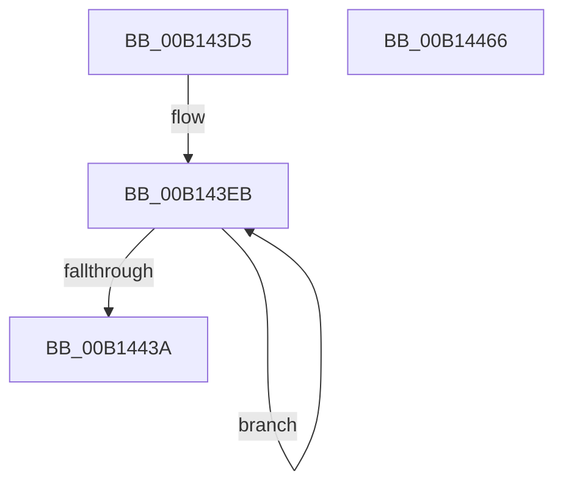

# PspCopyAndFixupParameters$fin$0

- RVA: `0x00B143D5`–`0x00B14467` (길이 `146` bytes)
- VA: `0x0000000140B143D5`
- 실행 섹션: `PAGE`
- PDB 이름 있음: `예`; PDB Function 태그: `예`
- unwind 정보 RVA: `0x000CEF84`
- 디코드: `40`개 명령, `146/146` bytes 표시
- 미해석 바이트: `0` (있으면 어셈블리에 `.byte`로 보존)

> 이 문서는 커널 이미지의 기계어와 PDB 기호를 분석해 생성했습니다. 4번과 5번은 함수 원형과 자료형을 바이너리 사용 방식에서 추정한 C 해석이며 원본 소스 복구 결과는 아닙니다.

## 1. Dependencies

- 직접 호출 지점: **0**; 고유 호출 대상: **0**
- 직접 호출자로 확인된 함수: **0**
- RIP 상대 이미지 참조: **0**

### Outgoing calls
- 직접 디코드된 call 명령이 없습니다.

### Direct callers
- 이 함수 시작 RVA로 연결되는 직접 call은 확인되지 않았습니다. 간접 호출은 완전히 역산할 수 없습니다.

### Static image references
- 디코드된 RIP-relative 메모리 참조가 없습니다.

## 2. Other-region calls and transfers

- 다른 실행 섹션으로 향하는 call: **0**
- 별도 외부 분기/꼬리 이동을 확인하지 못했습니다.

## 3. Assembly (complete function range)

```asm
00B143D5  40 55                           push rbp
00B143D7  48 83 EC 40                     sub rsp, 0x40
00B143DB  48 8B EA                        mov rbp, rdx
00B143DE  48 8B 45 50                     mov rax, qword ptr [rbp + 0x50]
00B143E2  48 8D 4D 60                     lea rcx, [rbp + 0x60]
00B143E6  BA 08 00 00 00                  mov edx, 8
00B143EB  0F 10 01                        movups xmm0, xmmword ptr [rcx]
00B143EE  0F 11 00                        movups xmmword ptr [rax], xmm0
00B143F1  0F 10 49 10                     movups xmm1, xmmword ptr [rcx + 0x10]
00B143F5  0F 11 48 10                     movups xmmword ptr [rax + 0x10], xmm1
00B143F9  0F 10 41 20                     movups xmm0, xmmword ptr [rcx + 0x20]
00B143FD  0F 11 40 20                     movups xmmword ptr [rax + 0x20], xmm0
00B14401  0F 10 49 30                     movups xmm1, xmmword ptr [rcx + 0x30]
00B14405  0F 11 48 30                     movups xmmword ptr [rax + 0x30], xmm1
00B14409  0F 10 41 40                     movups xmm0, xmmword ptr [rcx + 0x40]
00B1440D  0F 11 40 40                     movups xmmword ptr [rax + 0x40], xmm0
00B14411  0F 10 49 50                     movups xmm1, xmmword ptr [rcx + 0x50]
00B14415  0F 11 48 50                     movups xmmword ptr [rax + 0x50], xmm1
00B14419  0F 10 41 60                     movups xmm0, xmmword ptr [rcx + 0x60]
00B1441D  0F 11 40 60                     movups xmmword ptr [rax + 0x60], xmm0
00B14421  48 83 E8 80                     sub rax, -0x80
00B14425  0F 10 49 70                     movups xmm1, xmmword ptr [rcx + 0x70]
00B14429  0F 11 48 F0                     movups xmmword ptr [rax - 0x10], xmm1
00B1442D  48 8D 89 80 00 00 00            lea rcx, [rcx + 0x80]
00B14434  48 83 EA 01                     sub rdx, 1
00B14438  75 B1                           jne 0x140b143eb
00B1443A  0F 10 01                        movups xmm0, xmmword ptr [rcx]
00B1443D  0F 11 00                        movups xmmword ptr [rax], xmm0
00B14440  0F 10 49 10                     movups xmm1, xmmword ptr [rcx + 0x10]
00B14444  0F 11 48 10                     movups xmmword ptr [rax + 0x10], xmm1
00B14448  0F 10 41 20                     movups xmm0, xmmword ptr [rcx + 0x20]
00B1444C  0F 11 40 20                     movups xmmword ptr [rax + 0x20], xmm0
00B14450  0F 10 49 30                     movups xmm1, xmmword ptr [rcx + 0x30]
00B14454  0F 11 48 30                     movups xmmword ptr [rax + 0x30], xmm1
00B14458  0F 10 41 40                     movups xmm0, xmmword ptr [rcx + 0x40]
00B1445C  0F 11 40 40                     movups xmmword ptr [rax + 0x40], xmm0
00B14460  48 83 C4 40                     add rsp, 0x40
00B14464  5D                              pop rbp
00B14465  C3                              ret
00B14466  CC                              int3
```

## 4. C-style interpretation (structured pseudocode)

```c
__int64 __fastcall PspCopyAndFixupParameters_fin_0(__int64 a1, __int64 a2)
{
    __int64 result;
    __int64 v_rsp;

    v_rsp = (v_rsp) - (64);
loc_00B143EB:
    *(unsigned __int64 *)(*(unsigned __int64 *)(a2 + 80)) = v_xmm0;
    *(unsigned __int64 *)(*(unsigned __int64 *)(a2 + 80) + 16) = v_xmm1;
    *(unsigned __int64 *)(*(unsigned __int64 *)(a2 + 80) + 32) = v_xmm0;
    *(unsigned __int64 *)(*(unsigned __int64 *)(a2 + 80) + 48) = v_xmm1;
    *(unsigned __int64 *)(*(unsigned __int64 *)(a2 + 80) + 64) = v_xmm0;
    *(unsigned __int64 *)(*(unsigned __int64 *)(a2 + 80) + 80) = v_xmm1;
    *(unsigned __int64 *)(*(unsigned __int64 *)(a2 + 80) + 96) = v_xmm0;
    result = (*(unsigned __int64 *)(a2 + 80)) - (-128);
    *(unsigned __int64 *)(result - 16) = v_xmm1;
    a2 = (8) - (1);
    if (condition_is_not_equal) goto loc_00B143EB;
    *(unsigned __int64 *)(result) = v_xmm0;
    *(unsigned __int64 *)(result + 16) = v_xmm1;
    *(unsigned __int64 *)(result + 32) = v_xmm0;
    *(unsigned __int64 *)(result + 48) = v_xmm1;
    *(unsigned __int64 *)(result + 64) = v_xmm0;
    v_rsp = (v_rsp) + (64);
    return result;
}
```

## 5. (Beta) C Style

```c
int64_t PspCopyAndFixupParameters_fin_0(int64_t Arg1, void *Arg2)
{
    uint8_t *arg2 = (uint8_t *)Arg2;

    int64_t result;
    int64_t local_rsp;

    local_rsp = (local_rsp) - (64);
loc_00B143EB:
    *(uint64_t *)(*(uint64_t *)(arg2 + 0x50)) = v_xmm0;
    *(uint64_t *)(*(uint64_t *)(arg2 + 0x50) + 0x10) = v_xmm1;
    *(uint64_t *)(*(uint64_t *)(arg2 + 0x50) + 0x20) = v_xmm0;
    *(uint64_t *)(*(uint64_t *)(arg2 + 0x50) + 0x30) = v_xmm1;
    *(uint64_t *)(*(uint64_t *)(arg2 + 0x50) + 0x40) = v_xmm0;
    *(uint64_t *)(*(uint64_t *)(arg2 + 0x50) + 0x50) = v_xmm1;
    *(uint64_t *)(*(uint64_t *)(arg2 + 0x50) + 0x60) = v_xmm0;
    result = (*(uint64_t *)(arg2 + 0x50)) - (-128);
    *(uint64_t *)(result - 0x10) = v_xmm1;
    Arg2 = (8) - (1);
    if (condition_is_not_equal) goto loc_00B143EB;
    *(uint64_t *)(result) = v_xmm0;
    *(uint64_t *)(result + 0x10) = v_xmm1;
    *(uint64_t *)(result + 0x20) = v_xmm0;
    *(uint64_t *)(result + 0x30) = v_xmm1;
    *(uint64_t *)(result + 0x40) = v_xmm0;
    local_rsp = (local_rsp) + (64);
    return result;
}
```

### 관측된 메모리 오프셋

구조체 형식이 확인되지 않은 접근은 인자 기준의 오프셋으로만 기록했습니다.

| 기준 인자 | 오프셋 표현 | 폭 (bit) | 접근 |
|---|---:|---:|---|
| `Arg2` | `+ 0x0` | `128` | `R` |
| `Arg2` | `+ 0x10` | `128` | `R` |
| `Arg2` | `+ 0x20` | `128` | `R` |
| `Arg2` | `+ 0x30` | `128` | `R` |
| `Arg2` | `+ 0x40` | `128` | `R` |
| `Arg2` | `+ 0x50` | `64` | `R` |
| `Arg2` | `+ 0x50` | `128` | `R` |
| `Arg2` | `+ 0x60` | `64` | `R` |
| `Arg2` | `+ 0x60` | `128` | `R` |
| `Arg2` | `+ 0x70` | `128` | `R` |
| `Arg2` | `+ 0x80` | `64` | `R` |

## 6. Execution-region graph

[열기: 2D/3D 그래프와 함수 탐색 컨트롤 패널](../../../control-panel.html?section=page&rva=0x00B143D5&view=graph)

- 2D 그래프는 위에서 아래로 흐르고, 3D 그래프는 빈 공간을 드래그해 회전합니다. Shift+드래그는 이동, 휠은 확대·축소, 함수 노드 선택은 대상 보고서 이동입니다.

### Static fallback


