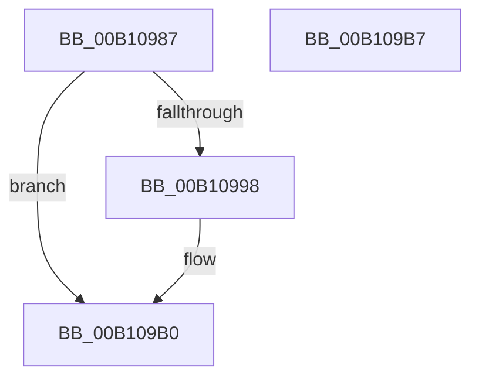

# RtlCreateUnicodeString$fin$0

- RVA: `0x00B10987`–`0x00B109B8` (길이 `49` bytes)
- VA: `0x0000000140B10987`
- 실행 섹션: `PAGE`
- PDB 이름 있음: `예`; PDB Function 태그: `예`
- unwind 정보 RVA: `0x0009F27C`
- 디코드: `18`개 명령, `49/49` bytes 표시
- 미해석 바이트: `0` (있으면 어셈블리에 `.byte`로 보존)

> 이 문서는 커널 이미지의 기계어와 PDB 기호를 분석해 생성했습니다. 4번과 5번은 함수 원형과 자료형을 바이너리 사용 방식에서 추정한 C 해석이며 원본 소스 복구 결과는 아닙니다.

## 1. Dependencies

- 직접 호출 지점: **1**; 고유 호출 대상: **1**
- 직접 호출자로 확인된 함수: **0**
- RIP 상대 이미지 참조: **0**

### Outgoing calls
- `0x00B109A0` → [ExFreePool](../../poolcode/B8/ExFreePool_function_00B82850.md) (function, `0x00B82850`)

### Direct callers
- 이 함수 시작 RVA로 연결되는 직접 call은 확인되지 않았습니다. 간접 호출은 완전히 역산할 수 없습니다.

### Static image references
- 디코드된 RIP-relative 메모리 참조가 없습니다.

## 2. Other-region calls and transfers

- 다른 실행 섹션으로 향하는 call: **1**
  - `0x00B109A0` → [ExFreePool](../../poolcode/B8/ExFreePool_function_00B82850.md) (`PAGE` → `POOLCODE`)
- 별도 외부 분기/꼬리 이동을 확인하지 못했습니다.

## 3. Assembly (complete function range)

```asm
00B10987  40 53                           push rbx
00B10989  55                              push rbp
00B1098A  48 83 EC 28                     sub rsp, 0x28
00B1098E  48 8B EA                        mov rbp, rdx
00B10991  0F B6 C1                        movzx eax, cl
00B10994  84 C9                           test cl, cl
00B10996  74 18                           je 0x140b109b0
00B10998  48 8B 5D 30                     mov rbx, qword ptr [rbp + 0x30]
00B1099C  48 8B 4B 08                     mov rcx, qword ptr [rbx + 8]
00B109A0  E8 AB 1E 07 00                  call 0x140b82850
00B109A5  48 83 63 08 00                  and qword ptr [rbx + 8], 0
00B109AA  33 C0                           xor eax, eax
00B109AC  66 89 43 02                     mov word ptr [rbx + 2], ax
00B109B0  48 83 C4 28                     add rsp, 0x28
00B109B4  5D                              pop rbp
00B109B5  5B                              pop rbx
00B109B6  C3                              ret
00B109B7  CC                              int3
```

## 4. C-style interpretation (structured pseudocode)

```c
__int64 __fastcall RtlCreateUnicodeString_fin_0(unsigned __int8 a1, __int64 a2)
{
    __int64 result;
    __int64 v_rbx;
    __int64 v_rsp;

    v_rsp = (v_rsp) - (40);
    result = a1;
    if (a1 != 0) {
        v_rbx = *(unsigned __int64 *)(a2 + 48);
        a1 = *(unsigned __int64 *)(v_rbx + 8);
        result = ExFreePool(a1, a2, a3, a4);
        result = 0;
        *(unsigned __int16 *)(v_rbx + 2) = 0;
    }
    v_rsp = (v_rsp) + (40);
    return result;
}
```

## 5. (Beta) C Style

```c
int64_t RtlCreateUnicodeString_fin_0(uint8_t Arg1, void *Arg2)
{
    uint8_t *arg2 = (uint8_t *)Arg2;

    int64_t result;
    int64_t local_rbx;
    int64_t local_rsp;

    local_rsp = (local_rsp) - (40);
    result = Arg1;
    if (Arg1 != 0) {
        local_rbx = *(uint64_t *)(arg2 + 0x30);
        Arg1 = *(uint64_t *)(local_rbx + 0x8);
        result = ExFreePool(Arg1, Arg2, a3, a4);
        result = 0;
        *(uint16_t *)(local_rbx + 0x2) = 0;
    }
    local_rsp = (local_rsp) + (40);
    return result;
}
```

### 관측된 메모리 오프셋

구조체 형식이 확인되지 않은 접근은 인자 기준의 오프셋으로만 기록했습니다.

| 기준 인자 | 오프셋 표현 | 폭 (bit) | 접근 |
|---|---:|---:|---|
| `Arg2` | `+ 0x30` | `64` | `R` |

## 6. Execution-region graph

[열기: 2D/3D 그래프와 함수 탐색 컨트롤 패널](../../../control-panel.html?section=page&rva=0x00B10987&view=graph)

- 2D 그래프는 위에서 아래로 흐르고, 3D 그래프는 빈 공간을 드래그해 회전합니다. Shift+드래그는 이동, 휠은 확대·축소, 함수 노드 선택은 대상 보고서 이동입니다.

### Static fallback


