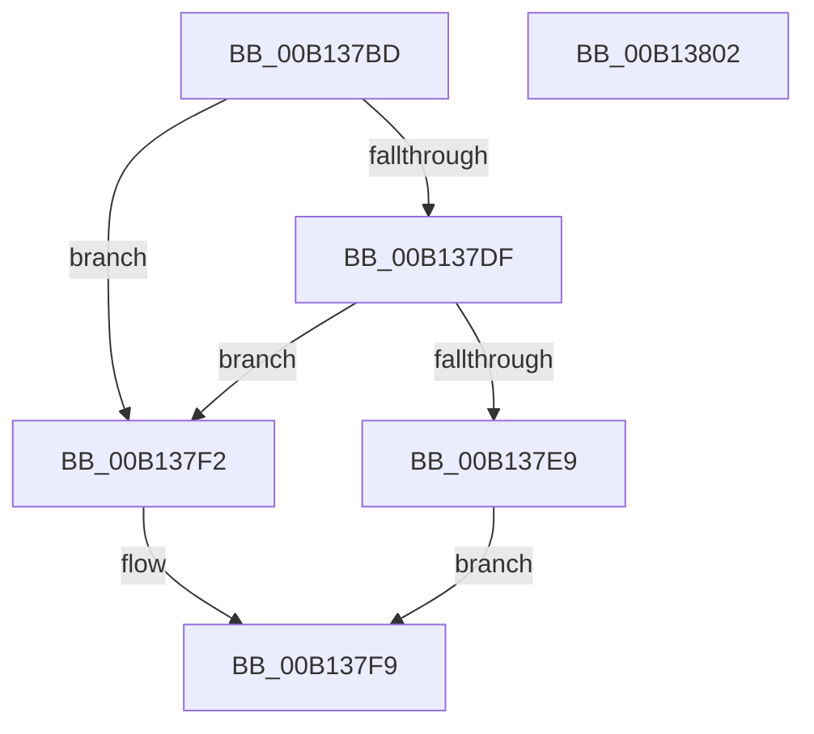

# SPCallServerHandleCallbackPaintComplete$filt$0

- RVA: `0x00B137BD`–`0x00B13803` (길이 `70` bytes)
- VA: `0x0000000140B137BD`
- 실행 섹션: `PAGE`
- PDB 이름 있음: `예`; PDB Function 태그: `예`
- unwind 정보 RVA: `0x000BACDC`
- 디코드: `22`개 명령, `70/70` bytes 표시
- 미해석 바이트: `0` (있으면 어셈블리에 `.byte`로 보존)

> 이 문서는 커널 이미지의 기계어와 PDB 기호를 분석해 생성했습니다. 4번과 5번은 함수 원형과 자료형을 바이너리 사용 방식에서 추정한 C 해석이며 원본 소스 복구 결과는 아닙니다.

## 1. Dependencies

- 직접 호출 지점: **0**; 고유 호출 대상: **0**
- 직접 호출자로 확인된 함수: **0**
- RIP 상대 이미지 참조: **0**

### Outgoing calls
- 직접 디코드된 call 명령이 없습니다.

### Direct callers
- 이 함수 시작 RVA로 연결되는 직접 call은 확인되지 않았습니다. 간접 호출은 완전히 역산할 수 없습니다.

### Static image references
- 디코드된 RIP-relative 메모리 참조가 없습니다.

## 2. Other-region calls and transfers

- 다른 실행 섹션으로 향하는 call: **0**
- 별도 외부 분기/꼬리 이동을 확인하지 못했습니다.

## 3. Assembly (complete function range)

```asm
00B137BD  40 55                           push rbp
00B137BF  48 83 EC 20                     sub rsp, 0x20
00B137C3  48 8B EA                        mov rbp, rdx
00B137C6  48 89 4D 48                     mov qword ptr [rbp + 0x48], rcx
00B137CA  48 8B 01                        mov rax, qword ptr [rcx]
00B137CD  8B 08                           mov ecx, dword ptr [rax]
00B137CF  89 4D 2C                        mov dword ptr [rbp + 0x2c], ecx
00B137D2  89 4D 20                        mov dword ptr [rbp + 0x20], ecx
00B137D5  8B 45 20                        mov eax, dword ptr [rbp + 0x20]
00B137D8  3D 80 00 00 00                  cmp eax, 0x80
00B137DD  74 13                           je 0x140b137f2
00B137DF  8B 45 20                        mov eax, dword ptr [rbp + 0x20]
00B137E2  3D 46 00 00 C0                  cmp eax, 0xc0000046
00B137E7  74 09                           je 0x140b137f2
00B137E9  C7 45 28 00 00 00 00            mov dword ptr [rbp + 0x28], 0
00B137F0  EB 07                           jmp 0x140b137f9
00B137F2  C7 45 28 01 00 00 00            mov dword ptr [rbp + 0x28], 1
00B137F9  8B 45 28                        mov eax, dword ptr [rbp + 0x28]
00B137FC  48 83 C4 20                     add rsp, 0x20
00B13800  5D                              pop rbp
00B13801  C3                              ret
00B13802  CC                              int3
```

## 4. C-style interpretation (structured pseudocode)

```c
__int64 __fastcall SPCallServerHandleCallbackPaintComplete_filt_0(__int64 a1, __int64 a2)
{
    __int64 v_rsp;

    v_rsp = (v_rsp) - (32);
    *(unsigned __int64 *)(a2 + 72) = a1;
    *(unsigned int *)(a2 + 44) = (unsigned int)((unsigned int)(*(unsigned int *)(*(unsigned __int64 *)(a1))));
    *(unsigned int *)(a2 + 32) = (unsigned int)((unsigned int)(*(unsigned int *)(*(unsigned __int64 *)(a1))));
    if (((unsigned int)((unsigned int)(*(unsigned int *)(a2 + 32)))) == 128) goto loc_00B137F2;
    if (((unsigned int)((unsigned int)(*(unsigned int *)(a2 + 32)))) == 0xC0000046ULL) goto loc_00B137F2;
    *(unsigned int *)(a2 + 40) = 0;
    goto loc_00B137F9;
loc_00B137F2:
    *(unsigned int *)(a2 + 40) = 1;
loc_00B137F9:
    v_rsp = (v_rsp) + (32);
    return (unsigned int)(*(unsigned int *)(a2 + 40));
}
```

## 5. (Beta) C Style

```c
int64_t SPCallServerHandleCallbackPaintComplete_filt_0(void *Arg1, void *Arg2)
{
    uint8_t *arg1 = (uint8_t *)Arg1;
    uint8_t *arg2 = (uint8_t *)Arg2;

    int64_t local_rsp;

    local_rsp = (local_rsp) - (32);
    *(void **)(arg2 + 0x48) = Arg1;
    *(uint32_t *)(arg2 + 0x2C) = (uint32_t)((uint32_t)(*(uint32_t *)(*(uint64_t *)(arg1))));
    *(uint32_t *)(arg2 + 0x20) = (uint32_t)((uint32_t)(*(uint32_t *)(*(uint64_t *)(arg1))));
    if (((uint32_t)((uint32_t)(*(uint32_t *)(arg2 + 0x20)))) == 128) goto loc_00B137F2;
    if (((uint32_t)((uint32_t)(*(uint32_t *)(arg2 + 0x20)))) == 0xC0000046ULL) goto loc_00B137F2;
    *(uint32_t *)(arg2 + 0x28) = 0;
    goto loc_00B137F9;
loc_00B137F2:
    *(uint32_t *)(arg2 + 0x28) = 1;
loc_00B137F9:
    local_rsp = (local_rsp) + (32);
    return (uint32_t)(*(uint32_t *)(arg2 + 0x28));
}
```

### 관측된 메모리 오프셋

구조체 형식이 확인되지 않은 접근은 인자 기준의 오프셋으로만 기록했습니다.

| 기준 인자 | 오프셋 표현 | 폭 (bit) | 접근 |
|---|---:|---:|---|
| `Arg1` | `+ 0x0` | `64` | `R` |
| `Arg2` | `+ 0x20` | `32` | `R` |
| `Arg2` | `+ 0x20` | `32` | `W` |
| `Arg2` | `+ 0x28` | `32` | `R` |
| `Arg2` | `+ 0x28` | `32` | `W` |
| `Arg2` | `+ 0x2C` | `32` | `W` |
| `Arg2` | `+ 0x48` | `64` | `W` |

## 6. Execution-region graph

[열기: 2D/3D 그래프와 함수 탐색 컨트롤 패널](../../../control-panel.html?section=page&rva=0x00B137BD&view=graph)

- 2D 그래프는 위에서 아래로 흐르고, 3D 그래프는 빈 공간을 드래그해 회전합니다. Shift+드래그는 이동, 휠은 확대·축소, 함수 노드 선택은 대상 보고서 이동입니다.

### Static fallback


