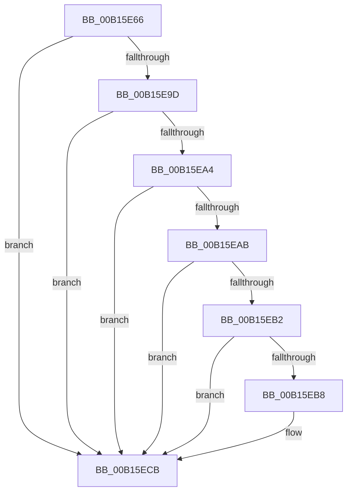

# sub_00B15E66

- RVA: `0x00B15E66`–`0x00B15ED9` (길이 `115` bytes)
- VA: `0x0000000140B15E66`
- 실행 섹션: `PAGE`
- PDB 이름 있음: `아니요`; PDB Function 태그: `아니요`
- unwind 정보 RVA: `0x00068F50`
- 디코드: `34`개 명령, `115/115` bytes 표시
- 미해석 바이트: `0` (있으면 어셈블리에 `.byte`로 보존)

> 이 문서는 커널 이미지의 기계어와 PDB 기호를 분석해 생성했습니다. 4번과 5번은 함수 원형과 자료형을 바이너리 사용 방식에서 추정한 C 해석이며 원본 소스 복구 결과는 아닙니다.

## 1. Dependencies

- 직접 호출 지점: **5**; 고유 호출 대상: **4**
- 직접 호출자로 확인된 함수: **0**
- RIP 상대 이미지 참조: **0**

### Outgoing calls
- `0x00B15E6B` → [CmpUuidCreate](../AB/CmpUuidCreate_function_00AB81F8.md) (function, `0x00AB81F8`)
- `0x00B15E88` → [CmpLockRegistryFreezeAware](../9B/CmpLockRegistryFreezeAware_function_009B4AE4.md) (function, `0x009B4AE4`)
- `0x00B15E92` → [CmpStartRMLog](../7F/CmpStartRMLog_function_007F0AFC.md) (function, `0x007F0AFC`)
- `0x00B15EC4` → [CmpStartRMLog](../7F/CmpStartRMLog_function_007F0AFC.md) (function, `0x007F0AFC`)
- `0x00B15ECB` → [CmpUnlockRegistry](../../pagecmrc/BC/CmpUnlockRegistry_function_00BC9A84.md) (function, `0x00BC9A84`)

### Direct callers
- 이 함수 시작 RVA로 연결되는 직접 call은 확인되지 않았습니다. 간접 호출은 완전히 역산할 수 없습니다.

### Static image references
- 디코드된 RIP-relative 메모리 참조가 없습니다.

## 2. Other-region calls and transfers

- 다른 실행 섹션으로 향하는 call: **1**
  - `0x00B15ECB` → [CmpUnlockRegistry](../../pagecmrc/BC/CmpUnlockRegistry_function_00BC9A84.md) (`PAGE` → `PAGECMRC`)
- call이 아닌 외부 분기/꼬리 이동: **1**
  - `0x00B15ED4` → [CmpStartRMLogs + 0x3F](../84/CmpStartRMLogs_function_008424D4.md) (`tail-transfer`)

## 3. Assembly (complete function range)

```asm
00B15E66  48 8D 4C 24 20                  lea rcx, [rsp + 0x20]
00B15E6B  E8 88 23 FA FF                  call 0x140ab81f8
00B15E70  8B E8                           mov ebp, eax
00B15E72  8B 47 68                        mov eax, dword ptr [rdi + 0x68]
00B15E75  C1 ED 1F                        shr ebp, 0x1f
00B15E78  24 02                           and al, 2
00B15E7A  40 80 F5 01                     xor bpl, 1
00B15E7E  F6 D8                           neg al
00B15E80  48 1B F6                        sbb rsi, rsi
00B15E83  33 C9                           xor ecx, ecx
00B15E85  83 E6 04                        and esi, 4
00B15E88  E8 57 EC E9 FF                  call 0x1409b4ae4
00B15E8D  33 D2                           xor edx, edx
00B15E8F  48 8B CF                        mov rcx, rdi
00B15E92  E8 65 AC CD FF                  call 0x1407f0afc
00B15E97  8B D8                           mov ebx, eax
00B15E99  85 C0                           test eax, eax
00B15E9B  79 2E                           jns 0x140b15ecb
00B15E9D  3D 7F 00 00 C0                  cmp eax, 0xc000007f
00B15EA2  74 27                           je 0x140b15ecb
00B15EA4  3D 43 00 00 C0                  cmp eax, 0xc0000043
00B15EA9  74 20                           je 0x140b15ecb
00B15EAB  3D 9A 00 00 C0                  cmp eax, 0xc000009a
00B15EB0  74 19                           je 0x140b15ecb
00B15EB2  40 80 FD 01                     cmp bpl, 1
00B15EB6  75 13                           jne 0x140b15ecb
00B15EB8  83 67 68 FD                     and dword ptr [rdi + 0x68], 0xfffffffd
00B15EBC  48 8D 54 24 20                  lea rdx, [rsp + 0x20]
00B15EC1  48 8B CF                        mov rcx, rdi
00B15EC4  E8 33 AC CD FF                  call 0x1407f0afc
00B15EC9  8B D8                           mov ebx, eax
00B15ECB  E8 B4 3B 0B 00                  call 0x140bc9a84
00B15ED0  89 5C 3E 6C                     mov dword ptr [rsi + rdi + 0x6c], ebx
00B15ED4  E9 3A C6 D2 FF                  jmp 0x140842513
```

## 4. C-style interpretation (structured pseudocode)

```c
__int64 __fastcall sub_00B15E66(__int64 a1, int a2)
{
    __int64 result;
    __int64 v_rbp;
    __int64 v_rbx;
    __int64 v_rsi;
    unsigned __int64 v_stack_p20;

    result = CmpUuidCreate(v_stack_p20, a2, a3, a4);
    v_rbp = (unsigned int)(((unsigned int)((unsigned int)(result))) >> (31));
    result = (unsigned __int8)(((unsigned int)(*(unsigned int *)(v_rdi + 104))) & (2));
    v_rbp = (unsigned __int8)((v_rbp) ^ (1));
    result = (unsigned __int8)(-(result));
    a1 = 0;
    v_rsi = (unsigned int)((v_rsi) & (4));
    result = CmpLockRegistryFreezeAware(a1, a2, a3, a4);
    a2 = 0;
    result = CmpStartRMLog(v_rdi, a2, a3, a4);
    if (!sign_flag) goto loc_00B15ECB;
    if (((unsigned int)(result)) == 0xC000007FULL) goto loc_00B15ECB;
    if (((unsigned int)(result)) == 0xC0000043ULL) goto loc_00B15ECB;
    if (((unsigned int)(result)) == 0xC000009AULL) goto loc_00B15ECB;
    v_rbx = (unsigned int)((unsigned int)(result));
    if (((unsigned __int8)(v_rbp)) == 1) {
        a2 = v_stack_p20;
        a1 = v_rdi;
        result = CmpStartRMLog(a1, a2, a3, a4);
        v_rbx = (unsigned int)(result);
    }
    result = CmpUnlockRegistry(a1, a2, a3, a4);
    *(unsigned int *)(v_rsi + v_rdi * 1 + 108) = (unsigned int)(v_rbx);
}
```

## 5. (Beta) C Style

```c
int64_t sub_00B15E66(int64_t Arg1, int32_t Arg2)
{
    int64_t result;
    int64_t local_rbp;
    int64_t local_rbx;
    int64_t local_rsi;
    uint64_t v_stack_p20;

    result = CmpUuidCreate(v_stack_p20, Arg2, a3, a4);
    local_rbp = (uint32_t)(((uint32_t)((uint32_t)(result))) >> (31));
    result = (uint8_t)(((uint32_t)(*(uint32_t *)(local_rdi + 0x68))) & (2));
    local_rbp = (uint8_t)((local_rbp) ^ (1));
    result = (uint8_t)(-(result));
    Arg1 = 0;
    local_rsi = (uint32_t)((local_rsi) & (4));
    result = CmpLockRegistryFreezeAware(Arg1, Arg2, a3, a4);
    Arg2 = 0;
    result = CmpStartRMLog(local_rdi, Arg2, a3, a4);
    if (!sign_flag) goto loc_00B15ECB;
    if (((uint32_t)(result)) == 0xC000007FULL) goto loc_00B15ECB;
    if (((uint32_t)(result)) == 0xC0000043ULL) goto loc_00B15ECB;
    if (((uint32_t)(result)) == 0xC000009AULL) goto loc_00B15ECB;
    local_rbx = (uint32_t)((uint32_t)(result));
    if (((uint8_t)(local_rbp)) == 1) {
        Arg2 = v_stack_p20;
        Arg1 = local_rdi;
        result = CmpStartRMLog(Arg1, Arg2, a3, a4);
        local_rbx = (uint32_t)(result);
    }
    result = CmpUnlockRegistry(Arg1, Arg2, a3, a4);
    *(uint32_t *)(local_rsi + local_rdi * 1 + 0x6C) = (uint32_t)(local_rbx);
}
```

## 6. Execution-region graph

[열기: 2D/3D 그래프와 함수 탐색 컨트롤 패널](../../../control-panel.html?section=page&rva=0x00B15E66&view=graph)

- 2D 그래프는 위에서 아래로 흐르고, 3D 그래프는 빈 공간을 드래그해 회전합니다. Shift+드래그는 이동, 휠은 확대·축소, 함수 노드 선택은 대상 보고서 이동입니다.

### Static fallback


