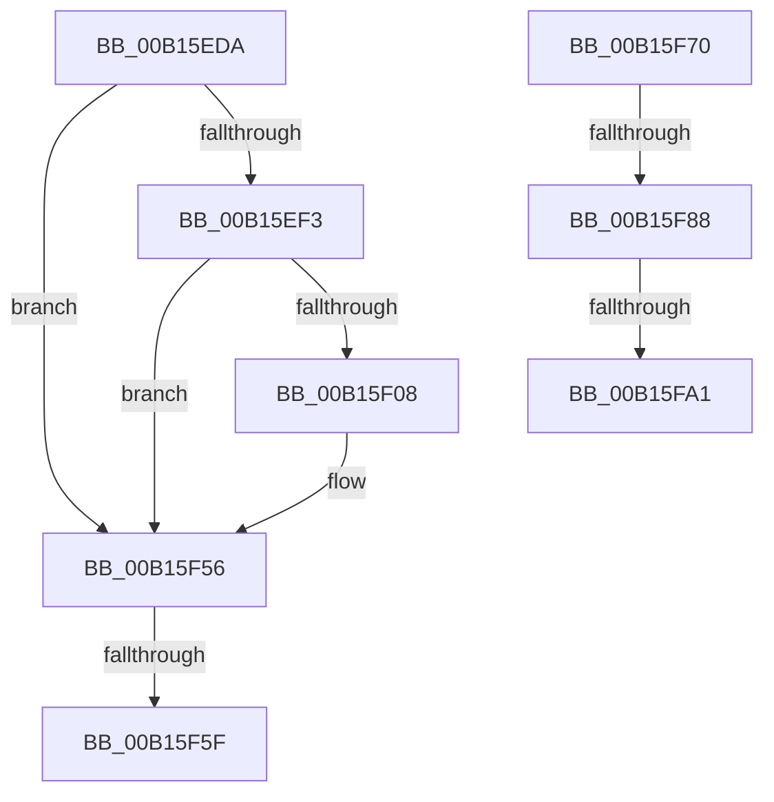

# sub_00B15EDA

- RVA: `0x00B15EDA`–`0x00B16002` (길이 `296` bytes)
- VA: `0x0000000140B15EDA`
- 실행 섹션: `PAGE`
- PDB 이름 있음: `아니요`; PDB Function 태그: `아니요`
- unwind 정보 RVA: `0x00068FF0`
- 디코드: `68`개 명령, `296/296` bytes 표시
- 미해석 바이트: `0` (있으면 어셈블리에 `.byte`로 보존)

> 이 문서는 커널 이미지의 기계어와 PDB 기호를 분석해 생성했습니다. 4번과 5번은 함수 원형과 자료형을 바이너리 사용 방식에서 추정한 C 해석이며 원본 소스 복구 결과는 아닙니다.

## 1. Dependencies

- 직접 호출 지점: **7**; 고유 호출 대상: **4**
- 직접 호출자로 확인된 함수: **0**
- RIP 상대 이미지 참조: **3**

### Outgoing calls
- `0x00B15EE2` → [CmpAddRemoveRMLogContainer](../7F/CmpAddRemoveRMLogContainer_function_007F01A0.md) (function, `0x007F01A0`)
- `0x00B15EFF` → [tlgKeywordOn](../../text/42/tlgKeywordOn_function_0042EAA0.md) (function, `0x0042EAA0`)
- `0x00B15F51` → [tlgWriteTransfer_EtwWriteTransfer](../../text/42/tlgWriteTransfer_EtwWriteTransfer_function_004260E0.md) (function, `0x004260E0`)
- `0x00B15F65` → [CmpLogCheckpoint](../84/CmpLogCheckpoint_function_00842F04.md) (function, `0x00842F04`)
- `0x00B15F73` → [CmpAddRemoveRMLogContainer](../7F/CmpAddRemoveRMLogContainer_function_007F01A0.md) (function, `0x007F01A0`)
- `0x00B15F94` → [tlgKeywordOn](../../text/42/tlgKeywordOn_function_0042EAA0.md) (function, `0x0042EAA0`)
- `0x00B15FF7` → [tlgWriteTransfer_EtwWriteTransfer](../../text/42/tlgWriteTransfer_EtwWriteTransfer_function_004260E0.md) (function, `0x004260E0`)

### Direct callers
- 이 함수 시작 RVA로 연결되는 직접 call은 확인되지 않았습니다. 간접 호출은 완전히 역산할 수 없습니다.

### Static image references
- `0x00B15EE7` → RVA `0x00E09F58` (`.data`; read)
- `0x00B15F29` → RVA `0x000572B0` (`.rdata`; read)
- `0x00B15FAD` → RVA `0x000572E3` (`.rdata`; read)

## 2. Other-region calls and transfers

- 다른 실행 섹션으로 향하는 call: **4**
  - `0x00B15EFF` → [tlgKeywordOn](../../text/42/tlgKeywordOn_function_0042EAA0.md) (`PAGE` → `.text`)
  - `0x00B15F51` → [tlgWriteTransfer_EtwWriteTransfer](../../text/42/tlgWriteTransfer_EtwWriteTransfer_function_004260E0.md) (`PAGE` → `.text`)
  - `0x00B15F94` → [tlgKeywordOn](../../text/42/tlgKeywordOn_function_0042EAA0.md) (`PAGE` → `.text`)
  - `0x00B15FF7` → [tlgWriteTransfer_EtwWriteTransfer](../../text/42/tlgWriteTransfer_EtwWriteTransfer_function_004260E0.md) (`PAGE` → `.text`)
- call이 아닌 외부 분기/꼬리 이동: **5**
  - `0x00B15F59` → [CmpTransWriteLog + 0x64](../84/CmpTransWriteLog_function_00842A7C.md) (`tail-transfer`)
  - `0x00B15F6B` → [CmpTransWriteLog + 0xED](../84/CmpTransWriteLog_function_00842A7C.md) (`tail-transfer`)
  - `0x00B15F82` → [CmpTransWriteLog + 0x9A](../84/CmpTransWriteLog_function_00842A7C.md) (`tail-transfer`)
  - `0x00B15F9B` → [CmpTransWriteLog + 0x9A](../84/CmpTransWriteLog_function_00842A7C.md) (`tail-transfer`)
  - `0x00B15FFD` → [CmpTransWriteLog + 0x9A](../84/CmpTransWriteLog_function_00842A7C.md) (`tail-transfer`)

## 3. Assembly (complete function range)

```asm
00B15EDA  FF C7                           inc edi
00B15EDC  48 8B CB                        mov rcx, rbx
00B15EDF  89 7D AF                        mov dword ptr [rbp - 0x51], edi
00B15EE2  E8 B9 A2 CD FF                  call 0x1407f01a0
00B15EE7  83 3D 6A 40 2F 00 05            cmp dword ptr [rip + 0x2f406a], 5
00B15EEE  44 8B F0                        mov r14d, eax
00B15EF1  76 63                           jbe 0x140b15f56
00B15EF3  BA 01 00 00 00                  mov edx, 1
00B15EF8  48 8D 0D 59 40 2F 00            lea rcx, [rip + 0x2f4059]
00B15EFF  E8 9C 8B 91 FF                  call 0x14042eaa0
00B15F04  84 C0                           test al, al
00B15F06  74 4E                           je 0x140b15f56
00B15F08  83 65 EB 00                     and dword ptr [rbp - 0x15], 0
00B15F0C  8D 4A 03                        lea ecx, [rdx + 3]
00B15F0F  83 65 FB 00                     and dword ptr [rbp - 5], 0
00B15F13  48 8D 45 BB                     lea rax, [rbp - 0x45]
00B15F17  48 89 45 DF                     mov qword ptr [rbp - 0x21], rax
00B15F1B  45 33 C9                        xor r9d, r9d
00B15F1E  48 8D 45 B3                     lea rax, [rbp - 0x4d]
00B15F22  89 55 BB                        mov dword ptr [rbp - 0x45], edx
00B15F25  48 89 45 EF                     mov qword ptr [rbp - 0x11], rax
00B15F29  48 8D 15 80 13 54 FF            lea rdx, [rip - 0xabec80]
00B15F30  48 8D 45 BF                     lea rax, [rbp - 0x41]
00B15F34  89 4D E7                        mov dword ptr [rbp - 0x19], ecx
00B15F37  48 89 44 24 28                  mov qword ptr [rsp + 0x28], rax
00B15F3C  45 33 C0                        xor r8d, r8d
00B15F3F  89 4C 24 20                     mov dword ptr [rsp + 0x20], ecx
00B15F43  89 4D F7                        mov dword ptr [rbp - 9], ecx
00B15F46  48 8D 0D 0B 40 2F 00            lea rcx, [rip + 0x2f400b]
00B15F4D  44 89 75 B3                     mov dword ptr [rbp - 0x4d], r14d
00B15F51  E8 8A 01 91 FF                  call 0x1404260e0
00B15F56  45 85 F6                        test r14d, r14d
00B15F59  0F 88 81 CB D2 FF               js 0x140842ae0
00B15F5F  41 B0 01                        mov r8b, 1
00B15F62  48 8B CB                        mov rcx, rbx
00B15F65  E8 9A CF D2 FF                  call 0x140842f04
00B15F6A  90                              nop
00B15F6B  E9 F9 CB D2 FF                  jmp 0x140842b69
00B15F70  48 8B CB                        mov rcx, rbx
00B15F73  E8 28 A2 CD FF                  call 0x1407f01a0
00B15F78  83 3D D9 3F 2F 00 05            cmp dword ptr [rip + 0x2f3fd9], 5
00B15F7F  44 8B C0                        mov r8d, eax
00B15F82  0F 86 8E CB D2 FF               jbe 0x140842b16
00B15F88  BA 01 00 00 00                  mov edx, 1
00B15F8D  48 8D 0D C4 3F 2F 00            lea rcx, [rip + 0x2f3fc4]
00B15F94  E8 07 8B 91 FF                  call 0x14042eaa0
00B15F99  84 C0                           test al, al
00B15F9B  0F 84 75 CB D2 FF               je 0x140842b16
00B15FA1  83 65 EB 00                     and dword ptr [rbp - 0x15], 0
00B15FA5  48 8D 45 B7                     lea rax, [rbp - 0x49]
00B15FA9  83 65 FB 00                     and dword ptr [rbp - 5], 0
00B15FAD  48 8D 15 2F 13 54 FF            lea rdx, [rip - 0xabecd1]
00B15FB4  48 89 45 DF                     mov qword ptr [rbp - 0x21], rax
00B15FB8  48 8D 0D 99 3F 2F 00            lea rcx, [rip + 0x2f3f99]
00B15FBF  48 8D 45 B3                     lea rax, [rbp - 0x4d]
00B15FC3  44 89 45 B3                     mov dword ptr [rbp - 0x4d], r8d
00B15FC7  48 89 45 EF                     mov qword ptr [rbp - 0x11], rax
00B15FCB  45 33 C9                        xor r9d, r9d
00B15FCE  48 8D 45 BF                     lea rax, [rbp - 0x41]
00B15FD2  C7 45 B7 02 00 00 00            mov dword ptr [rbp - 0x49], 2
00B15FD9  48 89 44 24 28                  mov qword ptr [rsp + 0x28], rax
00B15FDE  45 33 C0                        xor r8d, r8d
00B15FE1  C7 44 24 20 04 00 00 00         mov dword ptr [rsp + 0x20], 4
00B15FE9  C7 45 E7 04 00 00 00            mov dword ptr [rbp - 0x19], 4
00B15FF0  C7 45 F7 04 00 00 00            mov dword ptr [rbp - 9], 4
00B15FF7  E8 E4 00 91 FF                  call 0x1404260e0
00B15FFC  90                              nop
00B15FFD  E9 14 CB D2 FF                  jmp 0x140842b16
```

## 4. C-style interpretation (structured pseudocode)

```c
__int64 __fastcall sub_00B15EDA(__int64 a1, __int64 a2, int a3, int a4)
{
    __int64 result;
    __int64 v_rdi;
    unsigned int v_stack_p20;
    unsigned __int64 v_stack_p28;

    v_rdi = (unsigned int)((v_rdi) + 1);
    *(unsigned int *)(v_rbp - 81) = (unsigned int)(v_rdi);
    result = CmpAddRemoveRMLogContainer(v_rbx, a2, a3, a4);
    if ((*(unsigned int *)(v_rip + 3096682)) <= 5) goto loc_00B15F56;
    result = tlgKeywordOn(v_rip + 3096665, 1, a3, a4);
    if ((unsigned __int8)(result) != 0) {
        a1 = 1 + 3;
        result = v_rbp - 69;
        *(unsigned __int64 *)(v_rbp - 33) = result;
        a4 = 0;
        result = v_rbp - 77;
        *(unsigned int *)(v_rbp - 69) = 1;
        *(unsigned __int64 *)(v_rbp - 17) = result;
        a2 = v_rip - 11267200;
        result = v_rbp - 65;
        *(unsigned int *)(v_rbp - 25) = (unsigned int)(a1);
        v_stack_p28 = result;
        a3 = 0;
        v_stack_p20 = (unsigned int)(a1);
        *(unsigned int *)(v_rbp - 9) = (unsigned int)(a1);
        a1 = v_rip + 3096587;
        *(unsigned int *)(v_rbp - 77) = (unsigned int)((unsigned int)((unsigned int)(result)));
        result = tlgWriteTransfer_EtwWriteTransfer(a1, a2, a3, a4);
    }
    result = CmpLogCheckpoint(v_rbx, a2, 1, a4);
}
```

## 5. (Beta) C Style

```c
int64_t sub_00B15EDA(int64_t Arg1, int64_t Arg2, int32_t Arg3, int32_t Arg4)
{
    int64_t result;
    int64_t local_rdi;
    uint32_t v_stack_p20;
    uint64_t v_stack_p28;

    local_rdi = (uint32_t)((local_rdi) + 1);
    *(uint32_t *)(local_rbp - 0x51) = (uint32_t)(local_rdi);
    result = CmpAddRemoveRMLogContainer(local_rbx, Arg2, Arg3, Arg4);
    if ((*(uint32_t *)(v_rip + 0x2F406A)) <= 5) goto loc_00B15F56;
    result = tlgKeywordOn(v_rip + 3096665, 1, Arg3, Arg4);
    if ((uint8_t)(result) != 0) {
        Arg1 = 1 + 3;
        result = local_rbp - 69;
        *(uint64_t *)(local_rbp - 0x21) = result;
        Arg4 = 0;
        result = local_rbp - 77;
        *(uint32_t *)(local_rbp - 0x45) = 1;
        *(uint64_t *)(local_rbp - 0x11) = result;
        Arg2 = v_rip - 11267200;
        result = local_rbp - 65;
        *(uint32_t *)(local_rbp - 0x19) = (uint32_t)(Arg1);
        v_stack_p28 = result;
        Arg3 = 0;
        v_stack_p20 = (uint32_t)(Arg1);
        *(uint32_t *)(local_rbp - 0x9) = (uint32_t)(Arg1);
        Arg1 = v_rip + 3096587;
        *(uint32_t *)(local_rbp - 0x4D) = (uint32_t)((uint32_t)((uint32_t)(result)));
        result = tlgWriteTransfer_EtwWriteTransfer(Arg1, Arg2, Arg3, Arg4);
    }
    result = CmpLogCheckpoint(local_rbx, Arg2, 1, Arg4);
}
```

## 6. Execution-region graph

[열기: 2D/3D 그래프와 함수 탐색 컨트롤 패널](../../../control-panel.html?section=page&rva=0x00B15EDA&view=graph)

- 2D 그래프는 위에서 아래로 흐르고, 3D 그래프는 빈 공간을 드래그해 회전합니다. Shift+드래그는 이동, 휠은 확대·축소, 함수 노드 선택은 대상 보고서 이동입니다.

### Static fallback


