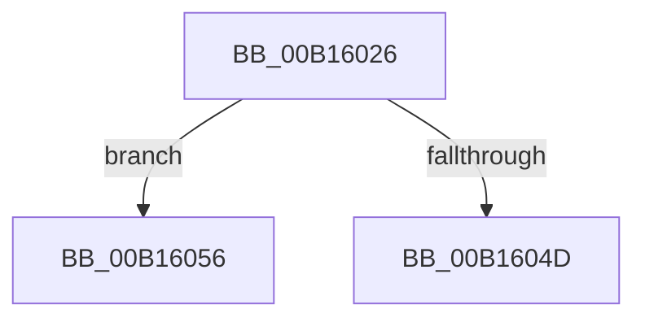

# sub_00B16026

- RVA: `0x00B16026`–`0x00B16064` (길이 `62` bytes)
- VA: `0x0000000140B16026`
- 실행 섹션: `PAGE`
- PDB 이름 있음: `아니요`; PDB Function 태그: `아니요`
- unwind 정보 RVA: `0x00069148`
- 디코드: `17`개 명령, `62/62` bytes 표시
- 미해석 바이트: `0` (있으면 어셈블리에 `.byte`로 보존)

> 이 문서는 커널 이미지의 기계어와 PDB 기호를 분석해 생성했습니다. 4번과 5번은 함수 원형과 자료형을 바이너리 사용 방식에서 추정한 C 해석이며 원본 소스 복구 결과는 아닙니다.

## 1. Dependencies

- 직접 호출 지점: **4**; 고유 호출 대상: **4**
- 직접 호출자로 확인된 함수: **0**
- RIP 상대 이미지 참조: **0**

### Outgoing calls
- `0x00B1602A` → [HvLockHiveFlusherShared](../84/HvLockHiveFlusherShared_function_0084F95C.md) (function, `0x0084F95C`)
- `0x00B16039` → [CmpPromoteSingleKeyFromKcbStacks](../94/CmpPromoteSingleKeyFromKcbStacks_function_009446E8.md) (function, `0x009446E8`)
- `0x00B16044` → [HvUnlockHiveFlusherShared](../84/HvUnlockHiveFlusherShared_function_00848738.md) (function, `0x00848738`)
- `0x00B16059` → [CmpUnlockKcbStack](../84/CmpUnlockKcbStack_function_00848460.md) (function, `0x00848460`)

### Direct callers
- 이 함수 시작 RVA로 연결되는 직접 call은 확인되지 않았습니다. 간접 호출은 완전히 역산할 수 없습니다.

### Static image references
- 디코드된 RIP-relative 메모리 참조가 없습니다.

## 2. Other-region calls and transfers

- 다른 실행 섹션으로 향하는 call: **0**
- call이 아닌 외부 분기/꼬리 이동: **2**
  - `0x00B16051` → [CmpPromoteKey + 0x13F](../84/CmpPromoteKey_function_00844388.md) (`tail-transfer`)
  - `0x00B1605F` → [CmpPromoteKey + 0x15E](../84/CmpPromoteKey_function_00844388.md) (`tail-transfer`)

## 3. Assembly (complete function range)

```asm
00B16026  48 8B 4E 20                     mov rcx, qword ptr [rsi + 0x20]
00B1602A  E8 2D 99 D3 FF                  call 0x14084f95c
00B1602F  44 8A 45 50                     mov r8b, byte ptr [rbp + 0x50]
00B16033  49 8B D4                        mov rdx, r12
00B16036  49 8B CD                        mov rcx, r13
00B16039  E8 AA E6 E2 FF                  call 0x1409446e8
00B1603E  48 8B 4E 20                     mov rcx, qword ptr [rsi + 0x20]
00B16042  8B D8                           mov ebx, eax
00B16044  E8 EF 26 D3 FF                  call 0x140848738
00B16049  85 DB                           test ebx, ebx
00B1604B  78 09                           js 0x140b16056
00B1604D  48 8B 5D 48                     mov rbx, qword ptr [rbp + 0x48]
00B16051  E9 71 E4 D2 FF                  jmp 0x1408444c7
00B16056  49 8B CC                        mov rcx, r12
00B16059  E8 02 24 D3 FF                  call 0x140848460
00B1605E  90                              nop
00B1605F  E9 82 E4 D2 FF                  jmp 0x1408444e6
```

## 4. C-style interpretation (structured pseudocode)

```c
__int64 __fastcall sub_00B16026(void)
{
    __int64 result;

    result = HvLockHiveFlusherShared(*(unsigned __int64 *)(v_rsi + 32), a2, a3, a4);
    result = CmpPromoteSingleKeyFromKcbStacks(v_r13, v_r12, *(unsigned __int8 *)(v_rbp + 80), a4);
    result = HvUnlockHiveFlusherShared(*(unsigned __int64 *)(v_rsi + 32), v_r12, *(unsigned __int8 *)(v_rbp + 80), a4);
    if (sign_flag) goto loc_00B16056;
loc_00B16056:
    result = CmpUnlockKcbStack(v_r12, v_r12, *(unsigned __int8 *)(v_rbp + 80), a4);
}
```

## 5. (Beta) C Style

```c
void sub_00B16026(void)
{
    int64_t result;

    result = HvLockHiveFlusherShared(*(uint64_t *)(local_rsi + 0x20), a2, a3, a4);
    result = CmpPromoteSingleKeyFromKcbStacks(local_r13, local_r12, *(uint8_t *)(local_rbp + 0x50), a4);
    result = HvUnlockHiveFlusherShared(*(uint64_t *)(local_rsi + 0x20), local_r12, *(uint8_t *)(local_rbp + 0x50), a4);
    if (sign_flag) goto loc_00B16056;
loc_00B16056:
    result = CmpUnlockKcbStack(local_r12, local_r12, *(uint8_t *)(local_rbp + 0x50), a4);
}
```

## 6. Execution-region graph

[열기: 2D/3D 그래프와 함수 탐색 컨트롤 패널](../../../control-panel.html?section=page&rva=0x00B16026&view=graph)

- 2D 그래프는 위에서 아래로 흐르고, 3D 그래프는 빈 공간을 드래그해 회전합니다. Shift+드래그는 이동, 휠은 확대·축소, 함수 노드 선택은 대상 보고서 이동입니다.

### Static fallback


