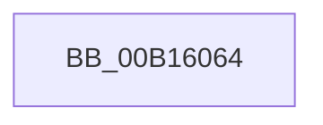

# sub_00B16064

- RVA: `0x00B16064`–`0x00B16078` (길이 `20` bytes)
- VA: `0x0000000140B16064`
- 실행 섹션: `PAGE`
- PDB 이름 있음: `아니요`; PDB Function 태그: `아니요`
- unwind 정보 RVA: `0x00069174`
- 디코드: `5`개 명령, `20/20` bytes 표시
- 미해석 바이트: `0` (있으면 어셈블리에 `.byte`로 보존)

> 이 문서는 커널 이미지의 기계어와 PDB 기호를 분석해 생성했습니다. 4번과 5번은 함수 원형과 자료형을 바이너리 사용 방식에서 추정한 C 해석이며 원본 소스 복구 결과는 아닙니다.

## 1. Dependencies

- 직접 호출 지점: **1**; 고유 호출 대상: **1**
- 직접 호출자로 확인된 함수: **0**
- RIP 상대 이미지 참조: **0**

### Outgoing calls
- `0x00B16068` → [memcpy](../../text/6C/memcpy_function_006C6840.md) (function, `0x006C6840`)

### Direct callers
- 이 함수 시작 RVA로 연결되는 직접 call은 확인되지 않았습니다. 간접 호출은 완전히 역산할 수 없습니다.

### Static image references
- 디코드된 RIP-relative 메모리 참조가 없습니다.

## 2. Other-region calls and transfers

- 다른 실행 섹션으로 향하는 call: **1**
  - `0x00B16068` → [memcpy](../../text/6C/memcpy_function_006C6840.md) (`PAGE` → `.text`)
- call이 아닌 외부 분기/꼬리 이동: **1**
  - `0x00B16073` → [CmAddLogForAction + 0x321](../84/CmAddLogForAction_function_008445AC.md) (`tail-transfer`)

## 3. Assembly (complete function range)

```asm
00B16064  48 83 C2 20                     add rdx, 0x20
00B16068  E8 D3 07 BB FF                  call 0x1406c6840
00B1606D  33 DB                           xor ebx, ebx
00B1606F  48 89 5F 38                     mov qword ptr [rdi + 0x38], rbx
00B16073  E9 55 E8 D2 FF                  jmp 0x1408448cd
```

## 4. C-style interpretation (structured pseudocode)

```c
__int64 __fastcall sub_00B16064(__int64 a1, __int64 a2)
{
    __int64 result;
    __int64 v_rbx;

    a2 = (a2) + (32);
    result = memcpy(a1, a2, a3, a4);
    v_rbx = 0;
    *(unsigned __int64 *)(v_rdi + 56) = 0;
}
```

## 5. (Beta) C Style

```c
int64_t sub_00B16064(int64_t Arg1, int64_t Arg2)
{
    int64_t result;
    int64_t local_rbx;

    Arg2 = (Arg2) + (32);
    result = memcpy(Arg1, Arg2, a3, a4);
    local_rbx = 0;
    *(uint64_t *)(local_rdi + 0x38) = 0;
}
```

## 6. Execution-region graph

[열기: 2D/3D 그래프와 함수 탐색 컨트롤 패널](../../../control-panel.html?section=page&rva=0x00B16064&view=graph)

- 2D 그래프는 위에서 아래로 흐르고, 3D 그래프는 빈 공간을 드래그해 회전합니다. Shift+드래그는 이동, 휠은 확대·축소, 함수 노드 선택은 대상 보고서 이동입니다.

### Static fallback


