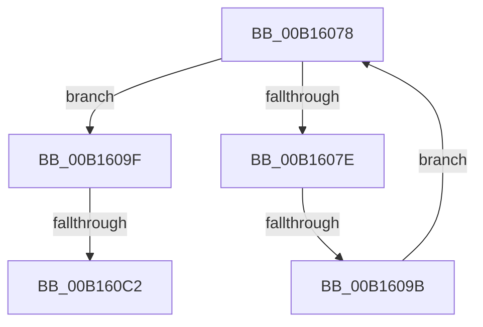

# sub_00B16078

- RVA: `0x00B16078`–`0x00B160F4` (길이 `124` bytes)
- VA: `0x0000000140B16078`
- 실행 섹션: `PAGE`
- PDB 이름 있음: `아니요`; PDB Function 태그: `아니요`
- unwind 정보 RVA: `0x00069198`
- 디코드: `33`개 명령, `124/124` bytes 표시
- 미해석 바이트: `0` (있으면 어셈블리에 `.byte`로 보존)

> 이 문서는 커널 이미지의 기계어와 PDB 기호를 분석해 생성했습니다. 4번과 5번은 함수 원형과 자료형을 바이너리 사용 방식에서 추정한 C 해석이며 원본 소스 복구 결과는 아닙니다.

## 1. Dependencies

- 직접 호출 지점: **4**; 고유 호출 대상: **4**
- 직접 호출자로 확인된 함수: **0**
- RIP 상대 이미지 참조: **0**

### Outgoing calls
- `0x00B1608E` → [CmEqualTrans](../84/CmEqualTrans_function_0084BF60.md) (function, `0x0084BF60`)
- `0x00B160B1` → [ExAllocatePool2](../../poolcode/B8/ExAllocatePool2_function_00B820F0.md) (function, `0x00B820F0`)
- `0x00B160D0` → [memcpy](../../text/6C/memcpy_function_006C6840.md) (function, `0x006C6840`)
- `0x00B160DE` → [ExFreePoolWithTag](../../poolcode/B8/ExFreePoolWithTag_function_00B82870.md) (function, `0x00B82870`)

### Direct callers
- 이 함수 시작 RVA로 연결되는 직접 call은 확인되지 않았습니다. 간접 호출은 완전히 역산할 수 없습니다.

### Static image references
- 디코드된 RIP-relative 메모리 참조가 없습니다.

## 2. Other-region calls and transfers

- 다른 실행 섹션으로 향하는 call: **3**
  - `0x00B160B1` → [ExAllocatePool2](../../poolcode/B8/ExAllocatePool2_function_00B820F0.md) (`PAGE` → `POOLCODE`)
  - `0x00B160D0` → [memcpy](../../text/6C/memcpy_function_006C6840.md) (`PAGE` → `.text`)
  - `0x00B160DE` → [ExFreePoolWithTag](../../poolcode/B8/ExFreePoolWithTag_function_00B82870.md) (`PAGE` → `POOLCODE`)
- call이 아닌 외부 분기/꼬리 이동: **3**
  - `0x00B16095` → [CmpLockIXLockIntent + 0x50](../84/CmpLockIXLockIntent_function_00844C08.md) (`tail-transfer`)
  - `0x00B160BC` → [CmpLockIXLockIntent + 0x32](../84/CmpLockIXLockIntent_function_00844C08.md) (`tail-transfer`)
  - `0x00B160EF` → [CmpLockIXLockIntent + 0x6B](../84/CmpLockIXLockIntent_function_00844C08.md) (`tail-transfer`)

## 3. Assembly (complete function range)

```asm
00B16078  8B 03                           mov eax, dword ptr [rbx]
00B1607A  3B F0                           cmp esi, eax
00B1607C  73 21                           jae 0x140b1609f
00B1607E  48 8B 43 08                     mov rax, qword ptr [rbx + 8]
00B16082  48 8B 57 38                     mov rdx, qword ptr [rdi + 0x38]
00B16086  48 8B 0C F0                     mov rcx, qword ptr [rax + rsi*8]
00B1608A  48 8B 49 38                     mov rcx, qword ptr [rcx + 0x38]
00B1608E  E8 CD 5E D3 FF                  call 0x14084bf60
00B16093  84 C0                           test al, al
00B16095  0F 85 BD EB D2 FF               jne 0x140844c58
00B1609B  FF C6                           inc esi
00B1609D  EB D9                           jmp 0x140b16078
00B1609F  8D 50 01                        lea edx, [rax + 1]
00B160A2  B9 00 01 00 00                  mov ecx, 0x100
00B160A7  48 C1 E2 03                     shl rdx, 3
00B160AB  41 B8 43 4D 49 78               mov r8d, 0x78494d43
00B160B1  E8 3A C0 06 00                  call 0x140b820f0
00B160B6  48 8B F0                        mov rsi, rax
00B160B9  48 85 C0                        test rax, rax
00B160BC  0F 84 78 EB D2 FF               je 0x140844c3a
00B160C2  44 8B 03                        mov r8d, dword ptr [rbx]
00B160C5  48 8B C8                        mov rcx, rax
00B160C8  48 8B 53 08                     mov rdx, qword ptr [rbx + 8]
00B160CC  49 C1 E0 03                     shl r8, 3
00B160D0  E8 6B 07 BB FF                  call 0x1406c6840
00B160D5  48 8B 4B 08                     mov rcx, qword ptr [rbx + 8]
00B160D9  BA 43 4D 49 78                  mov edx, 0x78494d43
00B160DE  E8 8D C7 06 00                  call 0x140b82870
00B160E3  8B 03                           mov eax, dword ptr [rbx]
00B160E5  48 89 73 08                     mov qword ptr [rbx + 8], rsi
00B160E9  48 89 3C C6                     mov qword ptr [rsi + rax*8], rdi
00B160ED  FF 03                           inc dword ptr [rbx]
00B160EF  E9 7F EB D2 FF                  jmp 0x140844c73
```

## 4. C-style interpretation (structured pseudocode)

```c
__int64 __fastcall sub_00B16078(void)
{
    __int64 result;
    __int64 v_rsi;

    if (((unsigned int)(v_rsi)) >= ((unsigned int)((unsigned int)(*(unsigned int *)(v_rbx))))) goto loc_00B1609F;
    result = CmEqualTrans(*(unsigned __int64 *)(*(unsigned __int64 *)(*(unsigned __int64 *)(v_rbx + 8) + v_rsi * 8) + 56), *(unsigned __int64 *)(v_rdi + 56), a3, a4);
    v_rsi = (unsigned int)((v_rsi) + 1);
    goto loc_00B16078;
loc_00B1609F:
    a2 = (result + 1) << (3);
    result = ExAllocatePool2(256, a2, (unsigned int)(0x78494D43ULL), a4);
    a3 = ((unsigned int)(*(unsigned int *)(v_rbx))) << (3);
    result = memcpy(result, *(unsigned __int64 *)(v_rbx + 8), a3, a4);
    result = ExFreePoolWithTag(*(unsigned __int64 *)(v_rbx + 8), (unsigned int)(0x78494D43ULL), a3, a4);
    *(unsigned __int64 *)(v_rbx + 8) = result;
    *(unsigned __int64 *)(result + (unsigned int)(*(unsigned int *)(v_rbx)) * 8) = v_rdi;
}
```

## 5. (Beta) C Style

```c
void sub_00B16078(void)
{
    int64_t result;
    int64_t local_rsi;

    if (((uint32_t)(local_rsi)) >= ((uint32_t)((uint32_t)(*(uint32_t *)(local_rbx))))) goto loc_00B1609F;
    result = CmEqualTrans(*(uint64_t *)(*(uint64_t *)(*(uint64_t *)(local_rbx + 0x8) + local_rsi * 8) + 0x38), *(uint64_t *)(local_rdi + 0x38), a3, a4);
    local_rsi = (uint32_t)((local_rsi) + 1);
    goto loc_00B16078;
loc_00B1609F:
    a2 = (result + 1) << (3);
    result = ExAllocatePool2(256, a2, (uint32_t)(0x78494D43ULL), a4);
    a3 = ((uint32_t)(*(uint32_t *)(local_rbx))) << (3);
    result = memcpy(result, *(uint64_t *)(local_rbx + 0x8), a3, a4);
    result = ExFreePoolWithTag(*(uint64_t *)(local_rbx + 0x8), (uint32_t)(0x78494D43ULL), a3, a4);
    *(uint64_t *)(local_rbx + 0x8) = result;
    *(uint64_t *)(result + (uint32_t)(*(uint32_t *)(local_rbx)) * 8) = local_rdi;
}
```

## 6. Execution-region graph

[열기: 2D/3D 그래프와 함수 탐색 컨트롤 패널](../../../control-panel.html?section=page&rva=0x00B16078&view=graph)

- 2D 그래프는 위에서 아래로 흐르고, 3D 그래프는 빈 공간을 드래그해 회전합니다. Shift+드래그는 이동, 휠은 확대·축소, 함수 노드 선택은 대상 보고서 이동입니다.

### Static fallback


