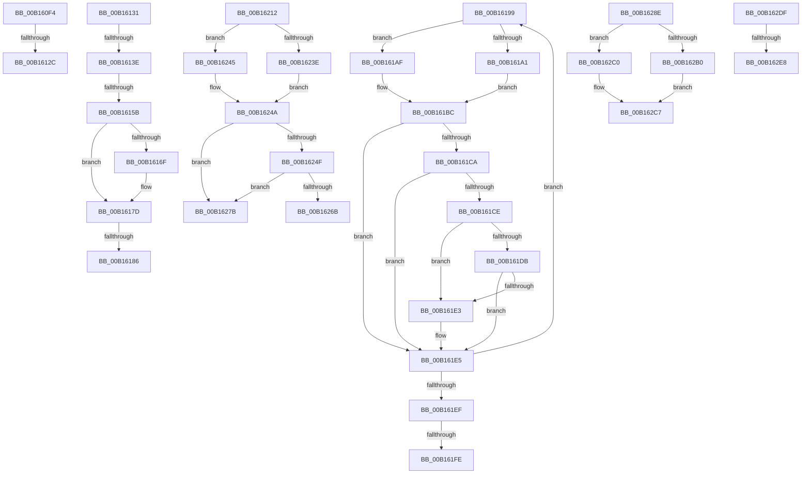

# sub_00B160F4

- RVA: `0x00B160F4`–`0x00B16338` (길이 `580` bytes)
- VA: `0x0000000140B160F4`
- 실행 섹션: `PAGE`
- PDB 이름 있음: `아니요`; PDB Function 태그: `아니요`
- unwind 정보 RVA: `0x00069234`
- 디코드: `152`개 명령, `580/580` bytes 표시
- 미해석 바이트: `0` (있으면 어셈블리에 `.byte`로 보존)

> 이 문서는 커널 이미지의 기계어와 PDB 기호를 분석해 생성했습니다. 4번과 5번은 함수 원형과 자료형을 바이너리 사용 방식에서 추정한 C 해석이며 원본 소스 복구 결과는 아닙니다.

## 1. Dependencies

- 직접 호출 지점: **21**; 고유 호출 대상: **20**
- 직접 호출자로 확인된 함수: **0**
- RIP 상대 이미지 참조: **1**

### Outgoing calls
- `0x00B1610B` → [CmpUnlockRegistry](../../pagecmrc/BC/CmpUnlockRegistry_function_00BC9A84.md) (function, `0x00BC9A84`)
- `0x00B1611D` → [CmpRollbackTransactionArray](../94/CmpRollbackTransactionArray_function_0094B3AC.md) (function, `0x0094B3AC`)
- `0x00B1614E` → [tlgKeywordOn](../../text/42/tlgKeywordOn_function_0042EAA0.md) (function, `0x0042EAA0`)
- `0x00B16162` → [CmpConstructNameFromKcbNameBlocks](../84/CmpConstructNameFromKcbNameBlocks_function_0084D510.md) (function, `0x0084D510`)
- `0x00B16178` → [CmpLogTransactionAbortedByName](../7E/CmpLogTransactionAbortedByName_function_007EFF20.md) (function, `0x007EFF20`)
- `0x00B1618E` → [CmpFreePoolWithTag](../../text/44/CmpFreePoolWithTag_function_004489E0.md) (function, `0x004489E0`)
- `0x00B161A8` → [CmpRollbackLightWeightTransaction](../9B/CmpRollbackLightWeightTransaction_function_009B1158.md) (function, `0x009B1158`)
- `0x00B161B4` → [TmRollbackEnlistment](../../text/4F/TmRollbackEnlistment_function_004FE380.md) (function, `0x004FE380`)
- `0x00B161C1` → [ObfDereferenceObject](../../text/2F/ObfDereferenceObject_function_002F9350.md) (function, `0x002F9350`)
- `0x00B16207` → [ExFreePoolWithTag](../../poolcode/B8/ExFreePoolWithTag_function_00B82870.md) (function, `0x00B82870`)
- `0x00B16212` → [HvpGetCellPaged](../85/HvpGetCellPaged_function_00854CB0.md) (function, `0x00854CB0`)
- `0x00B1621E` → [CmpIsValueTombstone](../84/CmpIsValueTombstone_function_00849900.md) (function, `0x00849900`)
- `0x00B1623E` → [HvpReleaseCellFlat](../85/HvpReleaseCellFlat_function_0085CC20.md) (function, `0x0085CC20`)
- `0x00B16245` → [HvpReleaseCellPaged](../85/HvpReleaseCellPaged_function_00855F40.md) (function, `0x00855F40`)
- `0x00B16260` → [CmpGetValueForAudit](../7F/CmpGetValueForAudit_function_007F37C0.md) (function, `0x007F37C0`)
- `0x00B1628E` → [HvpReleaseCellPaged](../85/HvpReleaseCellPaged_function_00855F40.md) (function, `0x00855F40`)
- `0x00B1629A` → [HvLockHiveFlusherShared](../84/HvLockHiveFlusherShared_function_0084F95C.md) (function, `0x0084F95C`)
- `0x00B162B9` → [CmpSwapValueInList](../../text/4A/CmpSwapValueInList_function_004A266C.md) (function, `0x004A266C`)
- `0x00B162C2` → [CmpRemoveValueFromList](../A0/CmpRemoveValueFromList_function_00A0F6D4.md) (function, `0x00A0F6D4`)
- `0x00B162CB` → [HvUnlockHiveFlusherShared](../84/HvUnlockHiveFlusherShared_function_00848738.md) (function, `0x00848738`)
- `0x00B1632D` → [SeAdtRegistryValueChangedAuditAlarm](../79/SeAdtRegistryValueChangedAuditAlarm_function_0079DDD4.md) (function, `0x0079DDD4`)

### Direct callers
- 이 함수 시작 RVA로 연결되는 직접 call은 확인되지 않았습니다. 간접 호출은 완전히 역산할 수 없습니다.

### Static image references
- `0x00B16131` → RVA `0x00E09F58` (`.data`; read)

## 2. Other-region calls and transfers

- 다른 실행 섹션으로 향하는 call: **7**
  - `0x00B1610B` → [CmpUnlockRegistry](../../pagecmrc/BC/CmpUnlockRegistry_function_00BC9A84.md) (`PAGE` → `PAGECMRC`)
  - `0x00B1614E` → [tlgKeywordOn](../../text/42/tlgKeywordOn_function_0042EAA0.md) (`PAGE` → `.text`)
  - `0x00B1618E` → [CmpFreePoolWithTag](../../text/44/CmpFreePoolWithTag_function_004489E0.md) (`PAGE` → `.text`)
  - `0x00B161B4` → [TmRollbackEnlistment](../../text/4F/TmRollbackEnlistment_function_004FE380.md) (`PAGE` → `.text`)
  - `0x00B161C1` → [ObfDereferenceObject](../../text/2F/ObfDereferenceObject_function_002F9350.md) (`PAGE` → `.text`)
  - `0x00B16207` → [ExFreePoolWithTag](../../poolcode/B8/ExFreePoolWithTag_function_00B82870.md) (`PAGE` → `POOLCODE`)
  - `0x00B162B9` → [CmpSwapValueInList](../../text/4A/CmpSwapValueInList_function_004A266C.md) (`PAGE` → `.text`)
- call이 아닌 외부 분기/꼬리 이동: **13**
  - `0x00B16126` → [CmSetValueKey + 0xE00](../84/CmSetValueKey_function_008457C0.md) (`tail-transfer`)
  - `0x00B1612C` → [CmSetValueKey + 0x399](../84/CmSetValueKey_function_008457C0.md) (`tail-transfer`)
  - `0x00B16138` → [CmSetValueKey + 0x2FA](../84/CmSetValueKey_function_008457C0.md) (`tail-transfer`)
  - `0x00B16155` → [CmSetValueKey + 0x2FA](../84/CmSetValueKey_function_008457C0.md) (`tail-transfer`)
  - `0x00B16180` → [CmSetValueKey + 0x2FA](../84/CmSetValueKey_function_008457C0.md) (`tail-transfer`)
  - `0x00B16194` → [CmSetValueKey + 0x2FA](../84/CmSetValueKey_function_008457C0.md) (`tail-transfer`)
  - `0x00B161F8` → [CmSetValueKey + 0x380](../84/CmSetValueKey_function_008457C0.md) (`tail-transfer`)
  - `0x00B1620D` → [CmSetValueKey + 0x380](../84/CmSetValueKey_function_008457C0.md) (`tail-transfer`)
  - `0x00B16276` → [CmSetValueKey + 0x72C](../84/CmSetValueKey_function_008457C0.md) (`tail-transfer`)
  - `0x00B16289` → [CmSetValueKey + 0x5D0](../84/CmSetValueKey_function_008457C0.md) (`tail-transfer`)
  - `0x00B162DA` → [CmSetValueKey + 0x72C](../84/CmSetValueKey_function_008457C0.md) (`tail-transfer`)
  - `0x00B162E2` → [CmSetValueKey + 0x7EA](../84/CmSetValueKey_function_008457C0.md) (`tail-transfer`)
  - `0x00B16333` → [CmSetValueKey + 0x7EA](../84/CmSetValueKey_function_008457C0.md) (`tail-transfer`)

## 3. Assembly (complete function range)

```asm
00B160F4  0F 57 C0                        xorps xmm0, xmm0
00B160F7  B8 FF FF FF FF                  mov eax, 0xffffffff
00B160FC  0F 11 44 24 68                  movups xmmword ptr [rsp + 0x68], xmm0
00B16101  66 89 44 24 6A                  mov word ptr [rsp + 0x6a], ax
00B16106  0F 11 44 24 78                  movups xmmword ptr [rsp + 0x78], xmm0
00B1610B  E8 74 39 0B 00                  call 0x140bc9a84
00B16110  48 8B 55 E8                     mov rdx, qword ptr [rbp - 0x18]
00B16114  4C 8D 4D A4                     lea r9, [rbp - 0x5c]
00B16118  8B CB                           mov ecx, ebx
00B1611A  45 32 F6                        xor r14b, r14b
00B1611D  E8 8A 52 E3 FF                  call 0x14094b3ac
00B16122  8B F8                           mov edi, eax
00B16124  85 C0                           test eax, eax
00B16126  0F 88 94 04 D3 FF               js 0x1408465c0
00B1612C  E9 28 FA D2 FF                  jmp 0x140845b59
00B16131  83 3D 20 3E 2F 00 04            cmp dword ptr [rip + 0x2f3e20], 4
00B16138  0F 86 7C F9 D2 FF               jbe 0x140845aba
00B1613E  41 BF 01 00 00 00               mov r15d, 1
00B16144  48 8D 0D 0D 3E 2F 00            lea rcx, [rip + 0x2f3e0d]
00B1614B  41 8B D7                        mov edx, r15d
00B1614E  E8 4D 89 91 FF                  call 0x14042eaa0
00B16153  84 C0                           test al, al
00B16155  0F 84 5F F9 D2 FF               je 0x140845aba
00B1615B  48 8D 55 10                     lea rdx, [rbp + 0x10]
00B1615F  49 8B CC                        mov rcx, r12
00B16162  E8 A9 73 D3 FF                  call 0x14084d510
00B16167  48 8B 5D 10                     mov rbx, qword ptr [rbp + 0x10]
00B1616B  85 C0                           test eax, eax
00B1616D  78 0E                           js 0x140b1617d
00B1616F  45 8B CE                        mov r9d, r14d
00B16172  41 8B D7                        mov edx, r15d
00B16175  48 8B CB                        mov rcx, rbx
00B16178  E8 A3 9D CD FF                  call 0x1407eff20
00B1617D  48 85 DB                        test rbx, rbx
00B16180  0F 84 34 F9 D2 FF               je 0x140845aba
00B16186  BA 43 4D 4E 62                  mov edx, 0x624e4d43
00B1618B  48 8B CB                        mov rcx, rbx
00B1618E  E8 4D 28 93 FF                  call 0x1404489e0
00B16193  90                              nop
00B16194  E9 21 F9 D2 FF                  jmp 0x140845aba
00B16199  49 8B 1F                        mov rbx, qword ptr [r15]
00B1619C  F6 C3 01                        test bl, 1
00B1619F  74 0E                           je 0x140b161af
00B161A1  48 83 E3 FE                     and rbx, 0xfffffffffffffffe
00B161A5  48 8B CB                        mov rcx, rbx
00B161A8  E8 AB AF E9 FF                  call 0x1409b1158
00B161AD  EB 0D                           jmp 0x140b161bc
00B161AF  33 D2                           xor edx, edx
00B161B1  48 8B CB                        mov rcx, rbx
00B161B4  E8 C7 81 9E FF                  call 0x1404fe380
00B161B9  49 8B 1F                        mov rbx, qword ptr [r15]
00B161BC  48 8B CB                        mov rcx, rbx
00B161BF  8B F0                           mov esi, eax
00B161C1  E8 8A 31 7E FF                  call 0x1402f9350
00B161C6  85 F6                           test esi, esi
00B161C8  79 1B                           jns 0x140b161e5
00B161CA  85 FF                           test edi, edi
00B161CC  78 17                           js 0x140b161e5
00B161CE  8D 86 ED FF E6 3F               lea eax, [rsi + 0x3fe6ffed]
00B161D4  A9 FC FF FF FF                  test eax, 0xfffffffc
00B161D9  75 08                           jne 0x140b161e3
00B161DB  81 FE 14 00 19 C0               cmp esi, 0xc0190014
00B161E1  75 02                           jne 0x140b161e5
00B161E3  8B FE                           mov edi, esi
00B161E5  49 83 C7 08                     add r15, 8
00B161E9  49 83 EC 01                     sub r12, 1
00B161ED  75 AA                           jne 0x140b16199
00B161EF  44 0F B6 7C 24 40               movzx r15d, byte ptr [rsp + 0x40]
00B161F5  45 85 F6                        test r14d, r14d
00B161F8  0F 84 42 F9 D2 FF               je 0x140845b40
00B161FE  48 8B 4D E8                     mov rcx, qword ptr [rbp - 0x18]
00B16202  BA 43 4D 34 36                  mov edx, 0x36344d43
00B16207  E8 64 C6 06 00                  call 0x140b82870
00B1620C  90                              nop
00B1620D  E9 2E F9 D2 FF                  jmp 0x140845b40
00B16212  E8 99 EA D3 FF                  call 0x140854cb0
00B16217  49 8B 4D 20                     mov rcx, qword ptr [r13 + 0x20]
00B1621B  48 8B D0                        mov rdx, rax
00B1621E  E8 DD 36 D3 FF                  call 0x140849900
00B16223  0F B6 F8                        movzx edi, al
00B16226  48 8D 55 98                     lea rdx, [rbp - 0x68]
00B1622A  33 C0                           xor eax, eax
00B1622C  40 84 FF                        test dil, dil
00B1622F  0F 94 C0                        sete al
00B16232  F6 81 8C 00 00 00 01            test byte ptr [rcx + 0x8c], 1
00B16239  89 45 90                        mov dword ptr [rbp - 0x70], eax
00B1623C  74 07                           je 0x140b16245
00B1623E  E8 DD 69 D4 FF                  call 0x14085cc20
00B16243  EB 05                           jmp 0x140b1624a
00B16245  E8 F6 FC D3 FF                  call 0x140855f40
00B1624A  40 84 FF                        test dil, dil
00B1624D  75 2C                           jne 0x140b1627b
00B1624F  49 8B 4D 20                     mov rcx, qword ptr [r13 + 0x20]
00B16253  4C 8D 45 38                     lea r8, [rbp + 0x38]
00B16257  41 B9 43 4D 41 34               mov r9d, 0x34414d43
00B1625D  41 8B D4                        mov edx, r12d
00B16260  E8 5B D5 CD FF                  call 0x1407f37c0
00B16265  8B F8                           mov edi, eax
00B16267  85 C0                           test eax, eax
00B16269  79 10                           jns 0x140b1627b
00B1626B  44 0F B6 64 24 42               movzx r12d, byte ptr [rsp + 0x42]
00B16271  48 8B 74 24 48                  mov rsi, qword ptr [rsp + 0x48]
00B16276  E9 71 FC D2 FF                  jmp 0x140845eec
00B1627B  48 8B 45 D0                     mov rax, qword ptr [rbp - 0x30]
00B1627F  8B 55 90                        mov edx, dword ptr [rbp - 0x70]
00B16282  48 89 45 D0                     mov qword ptr [rbp - 0x30], rax
00B16286  89 55 90                        mov dword ptr [rbp - 0x70], edx
00B16289  E9 02 FB D2 FF                  jmp 0x140845d90
00B1628E  E8 AD FC D3 FF                  call 0x140855f40
00B16293  45 33 FF                        xor r15d, r15d
00B16296  49 8B 4E 20                     mov rcx, qword ptr [r14 + 0x20]
00B1629A  E8 BD 96 D3 FF                  call 0x14084f95c
00B1629F  49 8B 4E 20                     mov rcx, qword ptr [r14 + 0x20]
00B162A3  4D 8D 86 18 01 00 00            lea r8, [r14 + 0x118]
00B162AA  41 83 FC FF                     cmp r12d, -1
00B162AE  74 10                           je 0x140b162c0
00B162B0  4D 8B C8                        mov r9, r8
00B162B3  41 8B D4                        mov edx, r12d
00B162B6  44 8B C3                        mov r8d, ebx
00B162B9  E8 AE C3 98 FF                  call 0x1404a266c
00B162BE  EB 07                           jmp 0x140b162c7
00B162C0  8B D3                           mov edx, ebx
00B162C2  E8 0D 94 EF FF                  call 0x140a0f6d4
00B162C7  49 8B 4E 20                     mov rcx, qword ptr [r14 + 0x20]
00B162CB  E8 68 24 D3 FF                  call 0x140848738
00B162D0  48 8B 75 80                     mov rsi, qword ptr [rbp - 0x80]
00B162D4  45 32 E4                        xor r12b, r12b
00B162D7  4D 8B EE                        mov r13, r14
00B162DA  E9 0D FC D2 FF                  jmp 0x140845eec
00B162DF  48 85 DB                        test rbx, rbx
00B162E2  0F 84 C2 FC D2 FF               je 0x140845faa
00B162E8  8B 45 8C                        mov eax, dword ptr [rbp - 0x74]
00B162EB  45 33 C0                        xor r8d, r8d
00B162EE  4C 8B 4D B0                     mov r9, qword ptr [rbp - 0x50]
00B162F2  48 8B D3                        mov rdx, rbx
00B162F5  89 45 48                        mov dword ptr [rbp + 0x48], eax
00B162F8  33 C9                           xor ecx, ecx
00B162FA  8B 85 30 01 00 00               mov eax, dword ptr [rbp + 0x130]
00B16300  89 45 4C                        mov dword ptr [rbp + 0x4c], eax
00B16303  48 8B 45 F0                     mov rax, qword ptr [rbp - 0x10]
00B16307  48 89 45 50                     mov qword ptr [rbp + 0x50], rax
00B1630B  8B 45 90                        mov eax, dword ptr [rbp - 0x70]
00B1630E  89 44 24 38                     mov dword ptr [rsp + 0x38], eax
00B16312  48 8D 45 38                     lea rax, [rbp + 0x38]
00B16316  48 89 44 24 30                  mov qword ptr [rsp + 0x30], rax
00B1631B  48 8B 45 20                     mov rax, qword ptr [rbp + 0x20]
00B1631F  48 89 44 24 28                  mov qword ptr [rsp + 0x28], rax
00B16324  48 8B 45 F8                     mov rax, qword ptr [rbp - 8]
00B16328  48 89 44 24 20                  mov qword ptr [rsp + 0x20], rax
00B1632D  E8 A2 7A C8 FF                  call 0x14079ddd4
00B16332  90                              nop
00B16333  E9 72 FC D2 FF                  jmp 0x140845faa
```

## 4. C-style interpretation (structured pseudocode)

```c
__int64 __fastcall sub_00B160F4(__int64 a1, __int64 a2, __int64 a3, __int64 a4, __int64 a5, __int64 a6, __int64 a7, __int64 a8, __int64 a9, __int64 a10, __int64 a11, __int64 a12, __int64 a13, __int64 a14, __int64 a15)
{
    __int64 result;
    __int64 v_r14;
    unsigned __int64 v_stack_p20;
    unsigned __int64 v_stack_p28;
    unsigned __int64 v_stack_p30;
    unsigned int v_stack_p38;
    unsigned __int8 v_stack_p40;
    unsigned __int8 v_stack_p42;
    unsigned __int64 v_stack_p48;
    unsigned __int16 v_stack_p6A;

    a13 = v_xmm0;
    v_stack_p6A = (unsigned __int16)((unsigned int)(0xFFFFFFFFULL));
    a15 = v_xmm0;
    result = CmpUnlockRegistry(a1, a2, a3, a4);
    v_r14 = 0;
    result = CmpRollbackTransactionArray((unsigned int)((unsigned int)(v_rbx)), *(unsigned __int64 *)(v_rbp - 24), a3, v_rbp - 92);
}
```

## 5. (Beta) C Style

```c
int64_t sub_00B160F4(int64_t Arg1, int64_t Arg2, int64_t Arg3, int64_t Arg4, uint64_t Arg5, uint64_t Arg6, uint64_t Arg7, uint64_t Arg8, uint64_t Arg9, uint64_t Arg10, uint64_t Arg11, uint64_t Arg12, int64_t Arg13, uint64_t Arg14, int64_t Arg15)
{
    int64_t result;
    int64_t local_r14;
    uint64_t v_stack_p20;
    uint64_t v_stack_p28;
    uint64_t v_stack_p30;
    uint32_t v_stack_p38;
    uint8_t v_stack_p40;
    uint8_t v_stack_p42;
    uint64_t v_stack_p48;
    uint16_t v_stack_p6A;

    Arg13 = v_xmm0;
    v_stack_p6A = (uint16_t)((uint32_t)(0xFFFFFFFFULL));
    Arg15 = v_xmm0;
    result = CmpUnlockRegistry(Arg1, Arg2, Arg3, Arg4);
    local_r14 = 0;
    result = CmpRollbackTransactionArray((uint32_t)((uint32_t)(local_rbx)), *(uint64_t *)(local_rbp - 0x18), Arg3, local_rbp - 92);
}
```

## 6. Execution-region graph

[열기: 2D/3D 그래프와 함수 탐색 컨트롤 패널](../../../control-panel.html?section=page&rva=0x00B160F4&view=graph)

- 2D 그래프는 위에서 아래로 흐르고, 3D 그래프는 빈 공간을 드래그해 회전합니다. Shift+드래그는 이동, 휠은 확대·축소, 함수 노드 선택은 대상 보고서 이동입니다.

### Static fallback


