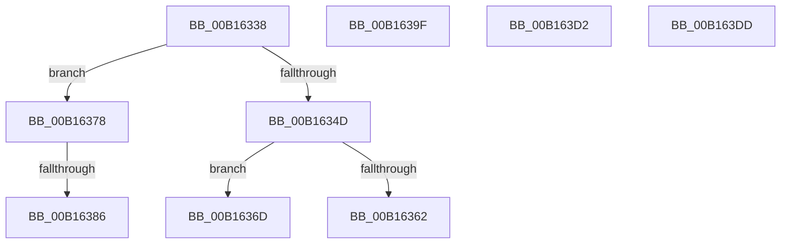

# sub_00B16338

- RVA: `0x00B16338`–`0x00B163E8` (길이 `176` bytes)
- VA: `0x0000000140B16338`
- 실행 섹션: `PAGE`
- PDB 이름 있음: `아니요`; PDB Function 태그: `아니요`
- unwind 정보 RVA: `0x000692C8`
- 디코드: `41`개 명령, `176/176` bytes 표시
- 미해석 바이트: `0` (있으면 어셈블리에 `.byte`로 보존)

> 이 문서는 커널 이미지의 기계어와 PDB 기호를 분석해 생성했습니다. 4번과 5번은 함수 원형과 자료형을 바이너리 사용 방식에서 추정한 C 해석이며 원본 소스 복구 결과는 아닙니다.

## 1. Dependencies

- 직접 호출 지점: **6**; 고유 호출 대상: **4**
- 직접 호출자로 확인된 함수: **0**
- RIP 상대 이미지 참조: **0**

### Outgoing calls
- `0x00B16338` → [HvpGetCellPaged](../85/HvpGetCellPaged_function_00854CB0.md) (function, `0x00854CB0`)
- `0x00B16362` → [HvpReleaseCellFlat](../85/HvpReleaseCellFlat_function_0085CC20.md) (function, `0x0085CC20`)
- `0x00B1636D` → [HvpReleaseCellPaged](../85/HvpReleaseCellPaged_function_00855F40.md) (function, `0x00855F40`)
- `0x00B163BB` → [CmpFindNameInList](../84/CmpFindNameInList_function_00844E54.md) (function, `0x00844E54`)
- `0x00B163D2` → [HvpReleaseCellPaged](../85/HvpReleaseCellPaged_function_00855F40.md) (function, `0x00855F40`)
- `0x00B163DD` → [HvpReleaseCellPaged](../85/HvpReleaseCellPaged_function_00855F40.md) (function, `0x00855F40`)

### Direct callers
- 이 함수 시작 RVA로 연결되는 직접 call은 확인되지 않았습니다. 간접 호출은 완전히 역산할 수 없습니다.

### Static image references
- 디코드된 RIP-relative 메모리 참조가 없습니다.

## 2. Other-region calls and transfers

- 다른 실행 섹션으로 향하는 call: **0**
- call이 아닌 외부 분기/꼬리 이동: **7**
  - `0x00B16368` → [CmQueryMultipleValueKey + 0x5CF](../84/CmQueryMultipleValueKey_function_00846EC0.md) (`tail-transfer`)
  - `0x00B16373` → [CmQueryMultipleValueKey + 0x5CF](../84/CmQueryMultipleValueKey_function_00846EC0.md) (`tail-transfer`)
  - `0x00B16380` → [CmQueryMultipleValueKey + 0x17B](../84/CmQueryMultipleValueKey_function_00846EC0.md) (`tail-transfer`)
  - `0x00B1639A` → [CmQueryMultipleValueKey + 0x17B](../84/CmQueryMultipleValueKey_function_00846EC0.md) (`tail-transfer`)
  - `0x00B163CD` → [CmQueryMultipleValueKey + 0x1E4](../84/CmQueryMultipleValueKey_function_00846EC0.md) (`tail-transfer`)
  - `0x00B163D8` → [CmQueryMultipleValueKey + 0x456](../84/CmQueryMultipleValueKey_function_00846EC0.md) (`tail-transfer`)
  - `0x00B163E3` → [CmQueryMultipleValueKey + 0x465](../84/CmQueryMultipleValueKey_function_00846EC0.md) (`tail-transfer`)

## 3. Assembly (complete function range)

```asm
00B16338  E8 73 E9 D3 FF                  call 0x140854cb0
00B1633D  4C 8B C8                        mov r9, rax
00B16340  48 89 84 24 90 00 00 00         mov qword ptr [rsp + 0x90], rax
00B16348  48 85 C0                        test rax, rax
00B1634B  75 2B                           jne 0x140b16378
00B1634D  48 8B 84 24 C8 00 00 00         mov rax, qword ptr [rsp + 0xc8]
00B16355  48 8D 54 24 68                  lea rdx, [rsp + 0x68]
00B1635A  49 8B CF                        mov rcx, r15
00B1635D  40 84 38                        test byte ptr [rax], dil
00B16360  74 0B                           je 0x140b1636d
00B16362  E8 B9 68 D4 FF                  call 0x14085cc20
00B16367  90                              nop
00B16368  E9 22 11 D3 FF                  jmp 0x14084748f
00B1636D  E8 CE FB D3 FF                  call 0x140855f40
00B16372  90                              nop
00B16373  E9 17 11 D3 FF                  jmp 0x14084748f
00B16378  44 8B 54 24 54                  mov r10d, dword ptr [rsp + 0x54]
00B1637D  48 85 F6                        test rsi, rsi
00B16380  0F 84 B5 0C D3 FF               je 0x14084703b
00B16386  45 0F B6 D2                     movzx r10d, r10b
00B1638A  49 39 B5 20 01 00 00            cmp qword ptr [r13 + 0x120], rsi
00B16391  44 0F 44 D7                     cmove r10d, edi
00B16395  44 89 54 24 54                  mov dword ptr [rsp + 0x54], r10d
00B1639A  E9 9C 0C D3 FF                  jmp 0x14084703b
00B1639F  49 8D 95 18 01 00 00            lea rdx, [r13 + 0x118]
00B163A6  48 8D 4C 24 4C                  lea rcx, [rsp + 0x4c]
00B163AB  48 89 4C 24 28                  mov qword ptr [rsp + 0x28], rcx
00B163B0  48 89 5C 24 20                  mov qword ptr [rsp + 0x20], rbx
00B163B5  45 33 C9                        xor r9d, r9d
00B163B8  48 8B C8                        mov rcx, rax
00B163BB  E8 94 EA D2 FF                  call 0x140844e54
00B163C0  8B 4C 24 4C                     mov ecx, dword ptr [rsp + 0x4c]
00B163C4  89 4C 24 44                     mov dword ptr [rsp + 0x44], ecx
00B163C8  4C 8B 44 24 58                  mov r8, qword ptr [rsp + 0x58]
00B163CD  E9 D2 0C D3 FF                  jmp 0x1408470a4
00B163D2  E8 69 FB D3 FF                  call 0x140855f40
00B163D7  90                              nop
00B163D8  E9 39 0F D3 FF                  jmp 0x140847316
00B163DD  E8 5E FB D3 FF                  call 0x140855f40
00B163E2  90                              nop
00B163E3  E9 3D 0F D3 FF                  jmp 0x140847325
```

## 4. C-style interpretation (structured pseudocode)

```c
__int64 __fastcall sub_00B16338(__int64 a1, __int64 a2, __int64 a3, __int64 a4, __int64 a5, __int64 a6, __int64 a7, __int64 a8, __int64 a9, __int64 a10, __int64 a11, __int64 a12, __int64 a13, __int64 a14, __int64 a15, __int64 a16, __int64 a17, __int64 a18, __int64 a19, __int64 a20, __int64 a21, __int64 a22, __int64 a23, __int64 a24, __int64 a25)
{
    __int64 result;
    __int64 v_r10;
    unsigned __int64 v_stack_p20;
    unsigned __int64 v_stack_p28;
    unsigned int v_stack_p44;
    unsigned __int64 v_stack_p4C;
    unsigned int v_stack_p54;
    unsigned __int64 v_stack_p58;
    unsigned __int64 v_stack_p90;

    result = HvpGetCellPaged(a1, a2, a3, a4);
    v_stack_p90 = result;
    if (result != 0) goto loc_00B16378;
    if (((*(unsigned __int8 *)(a25)) & ((unsigned __int8)(v_rdi))) == 0) goto loc_00B1636D;
    result = HvpReleaseCellFlat(v_r15, a13, a3, result);
loc_00B1636D:
    result = HvpReleaseCellPaged(v_r15, a13, a3, result);
loc_00B16378:
    v_r10 = (unsigned __int8)((unsigned int)(v_stack_p54));
    if ((*(unsigned __int64 *)(v_r13 + 288)) == v_rsi) { v_r10 = (unsigned int)(v_rdi); }
    v_stack_p54 = (unsigned int)(v_r10);
}
```

## 5. (Beta) C Style

```c
int64_t sub_00B16338(int64_t Arg1, int64_t Arg2, int64_t Arg3, int64_t Arg4, uint64_t Arg5, uint64_t Arg6, uint64_t Arg7, uint64_t Arg8, uint64_t Arg9, uint64_t Arg10, uint64_t Arg11, uint64_t Arg12, int64_t Arg13, uint64_t Arg14, uint64_t Arg15, uint64_t Arg16, uint64_t Arg17, uint64_t Arg18, uint64_t Arg19, uint64_t Arg20, uint64_t Arg21, uint64_t Arg22, uint64_t Arg23, uint64_t Arg24, void *Arg25)
{
    uint8_t *arg25 = (uint8_t *)Arg25;

    int64_t result;
    int64_t local_r10;
    uint64_t v_stack_p20;
    uint64_t v_stack_p28;
    uint32_t v_stack_p44;
    uint64_t v_stack_p4C;
    uint32_t v_stack_p54;
    uint64_t v_stack_p58;
    uint64_t v_stack_p90;

    result = HvpGetCellPaged(Arg1, Arg2, Arg3, Arg4);
    v_stack_p90 = result;
    if (result != 0) goto loc_00B16378;
    if (((*(uint8_t *)(arg25)) & ((uint8_t)(local_rdi))) == 0) goto loc_00B1636D;
    result = HvpReleaseCellFlat(local_r15, Arg13, Arg3, result);
loc_00B1636D:
    result = HvpReleaseCellPaged(local_r15, Arg13, Arg3, result);
loc_00B16378:
    local_r10 = (uint8_t)((uint32_t)(v_stack_p54));
    if ((*(uint64_t *)(local_r13 + 0x120)) == local_rsi) { local_r10 = (uint32_t)(local_rdi); }
    v_stack_p54 = (uint32_t)(local_r10);
}
```

### 관측된 메모리 오프셋

구조체 형식이 확인되지 않은 접근은 인자 기준의 오프셋으로만 기록했습니다.

| 기준 인자 | 오프셋 표현 | 폭 (bit) | 접근 |
|---|---:|---:|---|
| `Arg25` | `+ 0x0` | `8` | `R` |

## 6. Execution-region graph

[열기: 2D/3D 그래프와 함수 탐색 컨트롤 패널](../../../control-panel.html?section=page&rva=0x00B16338&view=graph)

- 2D 그래프는 위에서 아래로 흐르고, 3D 그래프는 빈 공간을 드래그해 회전합니다. Shift+드래그는 이동, 휠은 확대·축소, 함수 노드 선택은 대상 보고서 이동입니다.

### Static fallback


