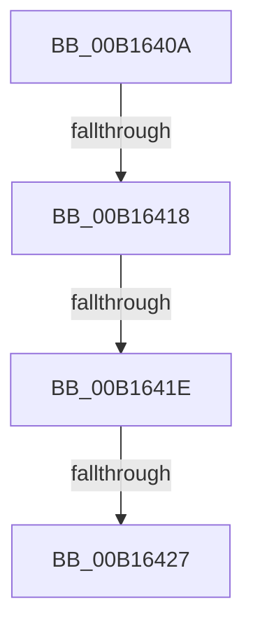

# sub_00B1640A

- RVA: `0x00B1640A`–`0x00B1642C` (길이 `34` bytes)
- VA: `0x0000000140B1640A`
- 실행 섹션: `PAGE`
- PDB 이름 있음: `아니요`; PDB Function 태그: `아니요`
- unwind 정보 RVA: `0x00069388`
- 디코드: `7`개 명령, `34/34` bytes 표시
- 미해석 바이트: `0` (있으면 어셈블리에 `.byte`로 보존)

> 이 문서는 커널 이미지의 기계어와 PDB 기호를 분석해 생성했습니다. 4번과 5번은 함수 원형과 자료형을 바이너리 사용 방식에서 추정한 C 해석이며 원본 소스 복구 결과는 아닙니다.

## 1. Dependencies

- 직접 호출 지점: **0**; 고유 호출 대상: **0**
- 직접 호출자로 확인된 함수: **0**
- RIP 상대 이미지 참조: **0**

### Outgoing calls
- 직접 디코드된 call 명령이 없습니다.

### Direct callers
- 이 함수 시작 RVA로 연결되는 직접 call은 확인되지 않았습니다. 간접 호출은 완전히 역산할 수 없습니다.

### Static image references
- 디코드된 RIP-relative 메모리 참조가 없습니다.

## 2. Other-region calls and transfers

- 다른 실행 섹션으로 향하는 call: **0**
- call이 아닌 외부 분기/꼬리 이동: **4**
  - `0x00B16412` → [CmpUnlockTwoKcbs + 0x74](../84/CmpUnlockTwoKcbs_function_0084869C.md) (`tail-transfer`)
  - `0x00B16418` → [CmpUnlockTwoKcbs + 0x4A](../84/CmpUnlockTwoKcbs_function_0084869C.md) (`tail-transfer`)
  - `0x00B16421` → [CmpUnlockTwoKcbs + 0x4A](../84/CmpUnlockTwoKcbs_function_0084869C.md) (`tail-transfer`)
  - `0x00B16427` → [CmpUnlockTwoKcbs + 0x74](../84/CmpUnlockTwoKcbs_function_0084869C.md) (`tail-transfer`)

## 3. Assembly (complete function range)

```asm
00B1640A  0F B7 41 42                     movzx eax, word ptr [rcx + 0x42]
00B1640E  66 3B 42 42                     cmp ax, word ptr [rdx + 0x42]
00B16412  0F 8F F8 22 D3 FF               jg 0x140848710
00B16418  0F 8C C8 22 D3 FF               jl 0x1408486e6
00B1641E  48 3B CA                        cmp rcx, rdx
00B16421  0F 86 BF 22 D3 FF               jbe 0x1408486e6
00B16427  E9 E4 22 D3 FF                  jmp 0x140848710
```

## 4. C-style interpretation (structured pseudocode)

```c
__int64 __fastcall sub_00B1640A(__int64 a1, __int64 a2)
{
}
```

## 5. (Beta) C Style

```c
int64_t sub_00B1640A(void *Arg1, void *Arg2)
{
    uint8_t *arg1 = (uint8_t *)Arg1;
    uint8_t *arg2 = (uint8_t *)Arg2;

}
```

### 관측된 메모리 오프셋

구조체 형식이 확인되지 않은 접근은 인자 기준의 오프셋으로만 기록했습니다.

| 기준 인자 | 오프셋 표현 | 폭 (bit) | 접근 |
|---|---:|---:|---|
| `Arg1` | `+ 0x42` | `16` | `R` |
| `Arg2` | `+ 0x42` | `16` | `R` |

## 6. Execution-region graph

[열기: 2D/3D 그래프와 함수 탐색 컨트롤 패널](../../../control-panel.html?section=page&rva=0x00B1640A&view=graph)

- 2D 그래프는 위에서 아래로 흐르고, 3D 그래프는 빈 공간을 드래그해 회전합니다. Shift+드래그는 이동, 휠은 확대·축소, 함수 노드 선택은 대상 보고서 이동입니다.

### Static fallback


