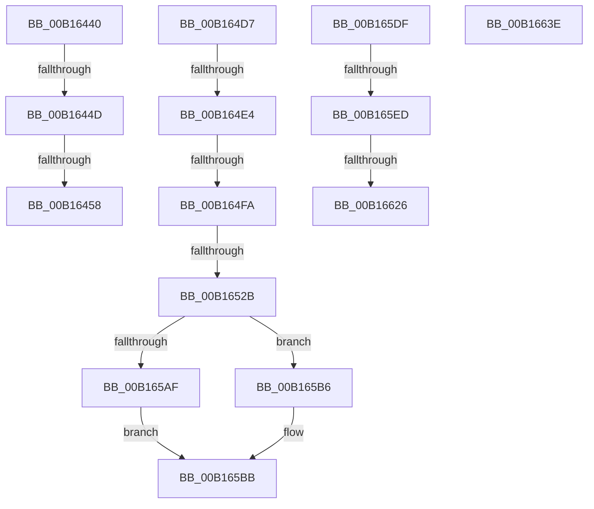

# sub_00B16440

- RVA: `0x00B16440`–`0x00B16649` (길이 `521` bytes)
- VA: `0x0000000140B16440`
- 실행 섹션: `PAGE`
- PDB 이름 있음: `아니요`; PDB Function 태그: `아니요`
- unwind 정보 RVA: `0x00069410`
- 디코드: `123`개 명령, `521/521` bytes 표시
- 미해석 바이트: `0` (있으면 어셈블리에 `.byte`로 보존)

> 이 문서는 커널 이미지의 기계어와 PDB 기호를 분석해 생성했습니다. 4번과 5번은 함수 원형과 자료형을 바이너리 사용 방식에서 추정한 C 해석이며 원본 소스 복구 결과는 아닙니다.

## 1. Dependencies

- 직접 호출 지점: **20**; 고유 호출 대상: **17**
- 직접 호출자로 확인된 함수: **0**
- RIP 상대 이미지 참조: **2**

### Outgoing calls
- `0x00B16468` → [CmpUnlockKcbStack](../84/CmpUnlockKcbStack_function_00848460.md) (function, `0x00848460`)
- `0x00B16472` → [CmpUnlockKcbStack](../84/CmpUnlockKcbStack_function_00848460.md) (function, `0x00848460`)
- `0x00B1647D` → [CmpUnlockHashEntryByKcb](../86/CmpUnlockHashEntryByKcb_function_00864370.md) (function, `0x00864370`)
- `0x00B1648B` → [CmpCleanupKcbStack](../94/CmpCleanupKcbStack_function_009470A0.md) (function, `0x009470A0`)
- `0x00B164A7` → [CmpCleanupKcbStack](../94/CmpCleanupKcbStack_function_009470A0.md) (function, `0x009470A0`)
- `0x00B164C0` → [CmpUnlockRegistry](../../pagecmrc/BC/CmpUnlockRegistry_function_00BC9A84.md) (function, `0x00BC9A84`)
- `0x00B164EB` → [CmpPrepareDiscardAndReplaceKcbAndUnbackedHigherLayers](../7F/CmpPrepareDiscardAndReplaceKcbAndUnbackedHigherLayers_function_007F1610.md) (function, `0x007F1610`)
- `0x00B1650D` → [CmpReportNotifyForKcbStack](../8C/CmpReportNotifyForKcbStack_function_008C718C.md) (function, `0x008C718C`)
- `0x00B1651C` → [CmpFreeKeyByCell](../84/CmpFreeKeyByCell_function_0084AD70.md) (function, `0x0084AD70`)
- `0x00B1653B` → [CmpFlushNotifiesOnAllUnbackedHigherLayerKcbs](../A5/CmpFlushNotifiesOnAllUnbackedHigherLayerKcbs_function_00A547AC.md) (function, `0x00A547AC`)
- `0x00B1654E` → [CmpFlushNotifiesOnKeyBodyList](../9B/CmpFlushNotifiesOnKeyBodyList_function_009B3594.md) (function, `0x009B3594`)
- `0x00B1655A` → [CmpCleanUpSubKeyInfo](../84/CmpCleanUpSubKeyInfo_function_0084C6F4.md) (function, `0x0084C6F4`)
- `0x00B1656B` → [CmpGetKeyNodeForKcb](../85/CmpGetKeyNodeForKcb_function_00856480.md) (function, `0x00856480`)
- `0x00B165AF` → [HvpReleaseCellFlat](../85/HvpReleaseCellFlat_function_0085CC20.md) (function, `0x0085CC20`)
- `0x00B165B6` → [HvpReleaseCellPaged](../85/HvpReleaseCellPaged_function_00855F40.md) (function, `0x00855F40`)
- `0x00B165C3` → [CmpMarkKeyUnbacked](../9B/CmpMarkKeyUnbacked_function_009B3C4C.md) (function, `0x009B3C4C`)
- `0x00B165D4` → [CmpCommitDiscardAndReplaceKcbAndUnbackedHigherLayers](../A5/CmpCommitDiscardAndReplaceKcbAndUnbackedHigherLayers_function_00A55070.md) (function, `0x00A55070`)
- `0x00B16613` → [CmpEnumerateAllHigherLayerKcbs](../A5/CmpEnumerateAllHigherLayerKcbs_function_00A55234.md) (function, `0x00A55234`)
- `0x00B16633` → [CmpCleanupDiscardReplacePost](../7F/CmpCleanupDiscardReplacePost_function_007F1480.md) (function, `0x007F1480`)
- `0x00B1663E` → [HvpReleaseCellPaged](../85/HvpReleaseCellPaged_function_00855F40.md) (function, `0x00855F40`)

### Direct callers
- 이 함수 시작 RVA로 연결되는 직접 call은 확인되지 않았습니다. 간접 호출은 완전히 역산할 수 없습니다.

### Static image references
- `0x00B165F8` → RVA `0x007F1480` (`CmpCleanupDiscardReplacePost`; read)
- `0x00B16607` → RVA `0x007F14F0` (`CmpCleanupDiscardReplacePre`; read)

## 2. Other-region calls and transfers

- 다른 실행 섹션으로 향하는 call: **1**
  - `0x00B164C0` → [CmpUnlockRegistry](../../pagecmrc/BC/CmpUnlockRegistry_function_00BC9A84.md) (`PAGE` → `PAGECMRC`)
- call이 아닌 외부 분기/꼬리 이동: **11**
  - `0x00B16447` → [CmDeleteKey + 0x287](../84/CmDeleteKey_function_00848E5C.md) (`tail-transfer`)
  - `0x00B16452` → [CmDeleteKey + 0x287](../84/CmDeleteKey_function_00848E5C.md) (`tail-transfer`)
  - `0x00B164D2` → [CmDeleteKey + 0x10C](../84/CmDeleteKey_function_00848E5C.md) (`tail-transfer`)
  - `0x00B164DE` → [CmDeleteKey + 0x365](../84/CmDeleteKey_function_00848E5C.md) (`tail-transfer`)
  - `0x00B164F4` → [CmDeleteKey + 0x47E](../84/CmDeleteKey_function_00848E5C.md) (`tail-transfer`)
  - `0x00B16525` → [CmDeleteKey + 0x47E](../84/CmDeleteKey_function_00848E5C.md) (`tail-transfer`)
  - `0x00B165DA` → [CmDeleteKey + 0x47B](../84/CmDeleteKey_function_00848E5C.md) (`tail-transfer`)
  - `0x00B165E7` → [CmDeleteKey + 0x495](../84/CmDeleteKey_function_00848E5C.md) (`tail-transfer`)
  - `0x00B16620` → [CmDeleteKey + 0x495](../84/CmDeleteKey_function_00848E5C.md) (`tail-transfer`)
  - `0x00B16639` → [CmDeleteKey + 0x495](../84/CmDeleteKey_function_00848E5C.md) (`tail-transfer`)
  - `0x00B16644` → [CmDeleteKey + 0x4A0](../84/CmDeleteKey_function_00848E5C.md) (`tail-transfer`)

## 3. Assembly (complete function range)

```asm
00B16440  48 83 C0 20                     add rax, 0x20
00B16444  48 39 00                        cmp qword ptr [rax], rax
00B16447  0F 84 96 2C D3 FF               je 0x1408490e3
00B1644D  40 38 7C 24 42                  cmp byte ptr [rsp + 0x42], dil
00B16452  0F 85 8B 2C D3 FF               jne 0x1408490e3
00B16458  B8 01 00 00 00                  mov eax, 1
00B1645D  48 8D 4D B8                     lea rcx, [rbp - 0x48]
00B16461  44 8A F8                        mov r15b, al
00B16464  88 44 24 42                     mov byte ptr [rsp + 0x42], al
00B16468  E8 F3 1F D3 FF                  call 0x140848460
00B1646D  48 8D 4C 24 70                  lea rcx, [rsp + 0x70]
00B16472  E8 E9 1F D3 FF                  call 0x140848460
00B16477  48 8B CE                        mov rcx, rsi
00B1647A  44 8A E7                        mov r12b, dil
00B1647D  E8 EE DE D4 FF                  call 0x140864370
00B16482  48 8D 4D B8                     lea rcx, [rbp - 0x48]
00B16486  40 88 7C 24 41                  mov byte ptr [rsp + 0x41], dil
00B1648B  E8 10 0C E3 FF                  call 0x1409470a0
00B16490  0F 57 C0                        xorps xmm0, xmm0
00B16493  48 8D 4C 24 70                  lea rcx, [rsp + 0x70]
00B16498  83 C8 FF                        or eax, 0xffffffff
00B1649B  0F 11 45 B8                     movups xmmword ptr [rbp - 0x48], xmm0
00B1649F  66 89 45 BA                     mov word ptr [rbp - 0x46], ax
00B164A3  0F 11 45 C8                     movups xmmword ptr [rbp - 0x38], xmm0
00B164A7  E8 F4 0B E3 FF                  call 0x1409470a0
00B164AC  0F 57 C0                        xorps xmm0, xmm0
00B164AF  83 C8 FF                        or eax, 0xffffffff
00B164B2  0F 11 44 24 70                  movups xmmword ptr [rsp + 0x70], xmm0
00B164B7  66 89 44 24 72                  mov word ptr [rsp + 0x72], ax
00B164BC  0F 11 45 80                     movups xmmword ptr [rbp - 0x80], xmm0
00B164C0  E8 BF 35 0B 00                  call 0x140bc9a84
00B164C5  0F 57 C0                        xorps xmm0, xmm0
00B164C8  66 0F 73 D8 08                  psrldq xmm0, 8
00B164CD  66 0F D6 45 D0                  movq qword ptr [rbp - 0x30], xmm0
00B164D2  E9 91 2A D3 FF                  jmp 0x140848f68
00B164D7  48 83 C0 20                     add rax, 0x20
00B164DB  48 39 00                        cmp qword ptr [rax], rax
00B164DE  0F 84 DD 2C D3 FF               je 0x1408491c1
00B164E4  48 8D 55 D8                     lea rdx, [rbp - 0x28]
00B164E8  48 8B CE                        mov rcx, rsi
00B164EB  E8 20 B1 CD FF                  call 0x1407f1610
00B164F0  8B F8                           mov edi, eax
00B164F2  85 C0                           test eax, eax
00B164F4  0F 88 E0 2D D3 FF               js 0x1408492da
00B164FA  BF 01 00 00 00                  mov edi, 1
00B164FF  4C 8D 4D A0                     lea r9, [rbp - 0x60]
00B16503  44 8B C7                        mov r8d, edi
00B16506  48 8D 4C 24 70                  lea rcx, [rsp + 0x70]
00B1650B  33 D2                           xor edx, edx
00B1650D  E8 7A 0C DB FF                  call 0x1408c718c
00B16512  8B 56 28                        mov edx, dword ptr [rsi + 0x28]
00B16515  44 8A C7                        mov r8b, dil
00B16518  48 8B 4E 20                     mov rcx, qword ptr [rsi + 0x20]
00B1651C  E8 4F 48 D3 FF                  call 0x14084ad70
00B16521  8B F8                           mov edi, eax
00B16523  85 C0                           test eax, eax
00B16525  0F 88 AF 2D D3 FF               js 0x1408492da
00B1652B  BF 01 00 00 00                  mov edi, 1
00B16530  4C 8D 44 24 60                  lea r8, [rsp + 0x60]
00B16535  44 8A CF                        mov r9b, dil
00B16538  48 8B CE                        mov rcx, rsi
00B1653B  E8 6C E2 F3 FF                  call 0x140a547ac
00B16540  45 33 C9                        xor r9d, r9d
00B16543  4C 8D 44 24 60                  lea r8, [rsp + 0x60]
00B16548  8D 57 07                        lea edx, [rdi + 7]
00B1654B  48 8B CE                        mov rcx, rsi
00B1654E  E8 41 D0 E9 FF                  call 0x1409b3594
00B16553  48 8B 4E 48                     mov rcx, qword ptr [rsi + 0x48]
00B16557  40 8A D7                        mov dl, dil
00B1655A  E8 95 61 D3 FF                  call 0x14084c6f4
00B1655F  48 8B 4E 48                     mov rcx, qword ptr [rsi + 0x48]
00B16563  48 8D 54 24 58                  lea rdx, [rsp + 0x58]
00B16568  44 8A C7                        mov r8b, dil
00B1656B  E8 10 FF D3 FF                  call 0x140856480
00B16570  48 8B 56 48                     mov rdx, qword ptr [rsi + 0x48]
00B16574  0F B7 48 34                     movzx ecx, word ptr [rax + 0x34]
00B16578  66 89 8A B0 00 00 00            mov word ptr [rdx + 0xb0], cx
00B1657F  48 8D 54 24 58                  lea rdx, [rsp + 0x58]
00B16584  48 8B 4E 48                     mov rcx, qword ptr [rsi + 0x48]
00B16588  48 01 B9 30 01 00 00            add qword ptr [rcx + 0x130], rdi
00B1658F  48 89 58 04                     mov qword ptr [rax + 4], rbx
00B16593  48 8B 46 48                     mov rax, qword ptr [rsi + 0x48]
00B16597  48 89 98 A8 00 00 00            mov qword ptr [rax + 0xa8], rbx
00B1659E  48 8B 46 48                     mov rax, qword ptr [rsi + 0x48]
00B165A2  48 8B 48 20                     mov rcx, qword ptr [rax + 0x20]
00B165A6  40 84 B9 8C 00 00 00            test byte ptr [rcx + 0x8c], dil
00B165AD  74 07                           je 0x140b165b6
00B165AF  E8 6C 66 D4 FF                  call 0x14085cc20
00B165B4  EB 05                           jmp 0x140b165bb
00B165B6  E8 85 F9 D3 FF                  call 0x140855f40
00B165BB  48 8D 54 24 60                  lea rdx, [rsp + 0x60]
00B165C0  48 8B CE                        mov rcx, rsi
00B165C3  E8 84 D6 E9 FF                  call 0x1409b3c4c
00B165C8  4C 8D 44 24 60                  lea r8, [rsp + 0x60]
00B165CD  48 8B CE                        mov rcx, rsi
00B165D0  48 8D 55 D8                     lea rdx, [rbp - 0x28]
00B165D4  E8 97 EA F3 FF                  call 0x140a55070
00B165D9  90                              nop
00B165DA  E9 F8 2C D3 FF                  jmp 0x1408492d7
00B165DF  48 8D 45 E8                     lea rax, [rbp - 0x18]
00B165E3  48 39 45 E8                     cmp qword ptr [rbp - 0x18], rax
00B165E7  0F 84 04 2D D3 FF               je 0x1408492f1
00B165ED  33 C0                           xor eax, eax
00B165EF  4C 8D 4C 24 60                  lea r9, [rsp + 0x60]
00B165F4  88 44 24 30                     mov byte ptr [rsp + 0x30], al
00B165F8  4C 8D 05 81 AE CD FF            lea r8, [rip - 0x32517f]
00B165FF  88 54 24 28                     mov byte ptr [rsp + 0x28], dl
00B16603  48 8D 45 D8                     lea rax, [rbp - 0x28]
00B16607  48 8D 15 E2 AE CD FF            lea rdx, [rip - 0x32511e]
00B1660E  48 89 44 24 20                  mov qword ptr [rsp + 0x20], rax
00B16613  E8 1C EC F3 FF                  call 0x140a55234
00B16618  48 8D 45 E8                     lea rax, [rbp - 0x18]
00B1661C  48 39 45 E8                     cmp qword ptr [rbp - 0x18], rax
00B16620  0F 84 CB 2C D3 FF               je 0x1408492f1
00B16626  48 8B 4D D8                     mov rcx, qword ptr [rbp - 0x28]
00B1662A  4C 8D 45 D8                     lea r8, [rbp - 0x28]
00B1662E  48 8D 54 24 60                  lea rdx, [rsp + 0x60]
00B16633  E8 48 AE CD FF                  call 0x1407f1480
00B16638  90                              nop
00B16639  E9 B3 2C D3 FF                  jmp 0x1408492f1
00B1663E  E8 FD F8 D3 FF                  call 0x140855f40
00B16643  90                              nop
00B16644  E9 B3 2C D3 FF                  jmp 0x1408492fc
```

## 4. C-style interpretation (structured pseudocode)

```c
__int64 __fastcall sub_00B16440(__int64 a1, __int64 a2, __int64 a3, __int64 a4, __int64 a5, __int64 a6, __int64 a7, __int64 a8, __int64 a9, __int64 a10, __int64 a11, __int64 a12, __int64 a13, __int64 a14)
{
    __int64 result;
    unsigned __int64 v_stack_p20;
    unsigned __int8 v_stack_p28;
    unsigned __int8 v_stack_p30;
    unsigned __int8 v_stack_p41;
    unsigned __int8 v_stack_p42;
    unsigned __int64 v_stack_p58;
    unsigned __int64 v_stack_p60;
    unsigned __int64 v_stack_p70;
    unsigned __int16 v_stack_p72;

    result = (result) + (32);
    v_stack_p42 = 1;
    result = CmpUnlockKcbStack(v_rbp - 72, a2, a3, a4);
    result = CmpUnlockKcbStack(a14, a2, a3, a4);
    result = CmpUnlockHashEntryByKcb(v_rsi, a2, a3, a4);
    v_stack_p41 = (unsigned __int8)(v_rdi);
    result = CmpCleanupKcbStack(v_rbp - 72, a2, a3, a4);
    result = (unsigned int)((result) | (0xFFFFFFFFULL));
    *(unsigned __int64 *)(v_rbp - 72) = v_xmm0;
    *(unsigned __int16 *)(v_rbp - 70) = (unsigned __int16)(result);
    *(unsigned __int64 *)(v_rbp - 56) = v_xmm0;
    result = CmpCleanupKcbStack(a14, a2, a3, a4);
    result = (unsigned int)((result) | (0xFFFFFFFFULL));
    a14 = v_xmm0;
    v_stack_p72 = (unsigned __int16)(result);
    *(unsigned __int64 *)(v_rbp - 128) = v_xmm0;
    result = CmpUnlockRegistry(a14, a2, a3, a4);
    *(unsigned __int64 *)(v_rbp - 48) = v_xmm0;
}
```

## 5. (Beta) C Style

```c
int64_t sub_00B16440(int64_t Arg1, int64_t Arg2, int64_t Arg3, int64_t Arg4, uint64_t Arg5, uint64_t Arg6, uint64_t Arg7, uint64_t Arg8, uint64_t Arg9, uint64_t Arg10, uint64_t Arg11, uint64_t Arg12, uint64_t Arg13, int64_t Arg14)
{
    int64_t result;
    uint64_t v_stack_p20;
    uint8_t v_stack_p28;
    uint8_t v_stack_p30;
    uint8_t v_stack_p41;
    uint8_t v_stack_p42;
    uint64_t v_stack_p58;
    uint64_t v_stack_p60;
    uint64_t v_stack_p70;
    uint16_t v_stack_p72;

    result = (result) + (32);
    v_stack_p42 = 1;
    result = CmpUnlockKcbStack(local_rbp - 72, Arg2, Arg3, Arg4);
    result = CmpUnlockKcbStack(Arg14, Arg2, Arg3, Arg4);
    result = CmpUnlockHashEntryByKcb(local_rsi, Arg2, Arg3, Arg4);
    v_stack_p41 = (uint8_t)(local_rdi);
    result = CmpCleanupKcbStack(local_rbp - 72, Arg2, Arg3, Arg4);
    result = (uint32_t)((result) | (0xFFFFFFFFULL));
    *(uint64_t *)(local_rbp - 0x48) = v_xmm0;
    *(uint16_t *)(local_rbp - 0x46) = (uint16_t)(result);
    *(uint64_t *)(local_rbp - 0x38) = v_xmm0;
    result = CmpCleanupKcbStack(Arg14, Arg2, Arg3, Arg4);
    result = (uint32_t)((result) | (0xFFFFFFFFULL));
    Arg14 = v_xmm0;
    v_stack_p72 = (uint16_t)(result);
    *(uint64_t *)(local_rbp - 0x80) = v_xmm0;
    result = CmpUnlockRegistry(Arg14, Arg2, Arg3, Arg4);
    *(uint64_t *)(local_rbp - 0x30) = v_xmm0;
}
```

## 6. Execution-region graph

[열기: 2D/3D 그래프와 함수 탐색 컨트롤 패널](../../../control-panel.html?section=page&rva=0x00B16440&view=graph)

- 2D 그래프는 위에서 아래로 흐르고, 3D 그래프는 빈 공간을 드래그해 회전합니다. Shift+드래그는 이동, 휠은 확대·축소, 함수 노드 선택은 대상 보고서 이동입니다.

### Static fallback


