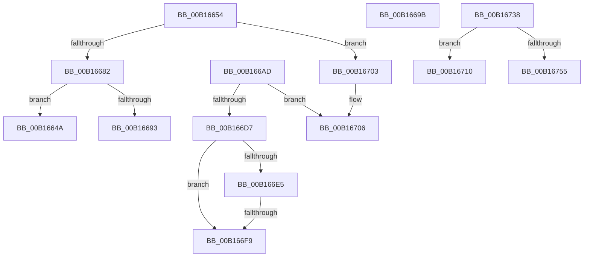

# sub_00B1664A

- RVA: `0x00B1664A`–`0x00B16760` (길이 `278` bytes)
- VA: `0x0000000140B1664A`
- 실행 섹션: `PAGE`
- PDB 이름 있음: `아니요`; PDB Function 태그: `아니요`
- unwind 정보 RVA: `0x00069464`
- 디코드: `68`개 명령, `278/278` bytes 표시
- 미해석 바이트: `0` (있으면 어셈블리에 `.byte`로 보존)

> 이 문서는 커널 이미지의 기계어와 PDB 기호를 분석해 생성했습니다. 4번과 5번은 함수 원형과 자료형을 바이너리 사용 방식에서 추정한 C 해석이며 원본 소스 복구 결과는 아닙니다.

## 1. Dependencies

- 직접 호출 지점: **9**; 고유 호출 대상: **8**
- 직접 호출자로 확인된 함수: **0**
- RIP 상대 이미지 참조: **1**

### Outgoing calls
- `0x00B16673` → [CmObReferenceObjectByHandle](../../pagecmrc/BC/CmObReferenceObjectByHandle_function_00BC9350.md) (function, `0x00BC9350`)
- `0x00B1668A` → [CmKeyBodyNeedsVirtualImage](../84/CmKeyBodyNeedsVirtualImage_function_00849864.md) (function, `0x00849864`)
- `0x00B1669E` → [KeAbPostRelease](../../text/2E/KeAbPostRelease_function_002E1600.md) (function, `0x002E1600`)
- `0x00B166C9` → [CmKeyBodyRemapToVirtual](../AC/CmKeyBodyRemapToVirtual_function_00AC9494.md) (function, `0x00AC9494`)
- `0x00B1671E` → [CmpUnlockRegistry](../../pagecmrc/BC/CmpUnlockRegistry_function_00BC9A84.md) (function, `0x00BC9A84`)
- `0x00B1672D` → [SeDeleteObjectAuditAlarmWithTransaction](../92/SeDeleteObjectAuditAlarmWithTransaction_function_00920830.md) (function, `0x00920830`)
- `0x00B1673F` → [CmpLockRegistry](../../pagecmrc/BC/CmpLockRegistry_function_00BC9B34.md) (function, `0x00BC9B34`)
- `0x00B1674C` → [CmpTransSearchAddTransFromKeyBody](../87/CmpTransSearchAddTransFromKeyBody_function_008736B8.md) (function, `0x008736B8`)
- `0x00B16755` → [CmpUnlockRegistry](../../pagecmrc/BC/CmpUnlockRegistry_function_00BC9A84.md) (function, `0x00BC9A84`)

### Direct callers
- 이 함수 시작 RVA로 연결되는 직접 call은 확인되지 않았습니다. 간접 호출은 완전히 역산할 수 없습니다.

### Static image references
- `0x00B166D7` → RVA `0x00E0ECA0` (`.data`; read)

## 2. Other-region calls and transfers

- 다른 실행 섹션으로 향하는 call: **5**
  - `0x00B16673` → [CmObReferenceObjectByHandle](../../pagecmrc/BC/CmObReferenceObjectByHandle_function_00BC9350.md) (`PAGE` → `PAGECMRC`)
  - `0x00B1669E` → [KeAbPostRelease](../../text/2E/KeAbPostRelease_function_002E1600.md) (`PAGE` → `.text`)
  - `0x00B1671E` → [CmpUnlockRegistry](../../pagecmrc/BC/CmpUnlockRegistry_function_00BC9A84.md) (`PAGE` → `PAGECMRC`)
  - `0x00B1673F` → [CmpLockRegistry](../../pagecmrc/BC/CmpLockRegistry_function_00BC9B34.md) (`PAGE` → `PAGECMRC`)
  - `0x00B16755` → [CmpUnlockRegistry](../../pagecmrc/BC/CmpUnlockRegistry_function_00BC9A84.md) (`PAGE` → `PAGECMRC`)
- call이 아닌 외부 분기/꼬리 이동: **8**
  - `0x00B1664F` → [NtDeleteKey + 0x43F](../84/NtDeleteKey_function_00849920.md) (`tail-transfer`)
  - `0x00B16696` → [NtDeleteKey + 0x117](../84/NtDeleteKey_function_00849920.md) (`tail-transfer`)
  - `0x00B166A8` → [NtDeleteKey + 0x270](../84/NtDeleteKey_function_00849920.md) (`tail-transfer`)
  - `0x00B166F3` → [NtDeleteKey + 0x257](../84/NtDeleteKey_function_00849920.md) (`tail-transfer`)
  - `0x00B166FE` → [NtDeleteKey + 0x43F](../84/NtDeleteKey_function_00849920.md) (`tail-transfer`)
  - `0x00B1670B` → [NtDeleteKey + 0x43F](../84/NtDeleteKey_function_00849920.md) (`tail-transfer`)
  - `0x00B16733` → [NtDeleteKey + 0x270](../84/NtDeleteKey_function_00849920.md) (`tail-transfer`)
  - `0x00B1675B` → [NtDeleteKey + 0x270](../84/NtDeleteKey_function_00849920.md) (`tail-transfer`)

## 3. Assembly (complete function range)

```asm
00B1664A  8B DE                           mov ebx, esi
00B1664C  45 33 FF                        xor r15d, r15d
00B1664F  E9 0B 37 D3 FF                  jmp 0x140849d5f
00B16654  48 8D 44 24 58                  lea rax, [rsp + 0x58]
00B16659  45 8A CF                        mov r9b, r15b
00B1665C  48 89 44 24 28                  mov qword ptr [rsp + 0x28], rax
00B16661  BA 19 00 02 00                  mov edx, 0x20019
00B16666  48 8D 44 24 48                  lea rax, [rsp + 0x48]
00B1666B  49 8B CE                        mov rcx, r14
00B1666E  48 89 44 24 20                  mov qword ptr [rsp + 0x20], rax
00B16673  E8 D8 2C 0B 00                  call 0x140bc9350
00B16678  8B D8                           mov ebx, eax
00B1667A  85 C0                           test eax, eax
00B1667C  0F 88 81 00 00 00               js 0x140b16703
00B16682  48 8B 7C 24 48                  mov rdi, qword ptr [rsp + 0x48]
00B16687  48 8B CF                        mov rcx, rdi
00B1668A  E8 D5 31 D3 FF                  call 0x140849864
00B1668F  84 C0                           test al, al
00B16691  74 B7                           je 0x140b1664a
00B16693  40 B6 01                        mov sil, 1
00B16696  E9 9C 33 D3 FF                  jmp 0x140849a37
00B1669B  48 8B CF                        mov rcx, rdi
00B1669E  E8 5D AF 7C FF                  call 0x1402e1600
00B166A3  48 8B 7C 24 48                  mov rdi, qword ptr [rsp + 0x48]
00B166A8  E9 E3 34 D3 FF                  jmp 0x140849b90
00B166AD  48 8D 44 24 50                  lea rax, [rsp + 0x50]
00B166B2  41 B8 00 00 01 00               mov r8d, 0x10000
00B166B8  4C 8D 4D 88                     lea r9, [rbp - 0x78]
00B166BC  48 89 44 24 20                  mov qword ptr [rsp + 0x20], rax
00B166C1  41 8A D7                        mov dl, r15b
00B166C4  48 8D 4C 24 48                  lea rcx, [rsp + 0x48]
00B166C9  E8 C6 2D FB FF                  call 0x140ac9494
00B166CE  45 33 FF                        xor r15d, r15d
00B166D1  8B D8                           mov ebx, eax
00B166D3  85 C0                           test eax, eax
00B166D5  78 2F                           js 0x140b16706
00B166D7  44 38 3D C2 85 2F 00            cmp byte ptr [rip + 0x2f85c2], r15b
00B166DE  48 8B 7C 24 48                  mov rdi, qword ptr [rsp + 0x48]
00B166E3  74 14                           je 0x140b166f9
00B166E5  48 8B 47 08                     mov rax, qword ptr [rdi + 8]
00B166E9  F7 80 B8 00 00 00 00 00 00 01   test dword ptr [rax + 0xb8], 0x1000000
00B166F3  0F 85 7E 34 D3 FF               jne 0x140849b77
00B166F9  BB 22 00 00 C0                  mov ebx, 0xc0000022
00B166FE  E9 5C 36 D3 FF                  jmp 0x140849d5f
00B16703  45 33 FF                        xor r15d, r15d
00B16706  48 8B 7C 24 48                  mov rdi, qword ptr [rsp + 0x48]
00B1670B  E9 4F 36 D3 FF                  jmp 0x140849d5f
00B16710  48 8B 44 24 78                  mov rax, qword ptr [rsp + 0x78]
00B16715  0F 10 40 58                     movups xmm0, xmmword ptr [rax + 0x58]
00B16719  F3 0F 7F 45 18                  movdqu xmmword ptr [rbp + 0x18], xmm0
00B1671E  E8 61 33 0B 00                  call 0x140bc9a84
00B16723  4C 8D 45 18                     lea r8, [rbp + 0x18]
00B16727  49 8B D6                        mov rdx, r14
00B1672A  48 8B CF                        mov rcx, rdi
00B1672D  E8 FE A0 E0 FF                  call 0x140920830
00B16732  90                              nop
00B16733  E9 58 34 D3 FF                  jmp 0x140849b90
00B16738  0F 57 C0                        xorps xmm0, xmm0
00B1673B  0F 11 45 18                     movups xmmword ptr [rbp + 0x18], xmm0
00B1673F  E8 F0 33 0B 00                  call 0x140bc9b34
00B16744  48 8D 54 24 78                  lea rdx, [rsp + 0x78]
00B16749  48 8B CF                        mov rcx, rdi
00B1674C  E8 67 CF D5 FF                  call 0x1408736b8
00B16751  85 C0                           test eax, eax
00B16753  79 BB                           jns 0x140b16710
00B16755  E8 2A 33 0B 00                  call 0x140bc9a84
00B1675A  90                              nop
00B1675B  E9 30 34 D3 FF                  jmp 0x140849b90
```

## 4. C-style interpretation (structured pseudocode)

```c
__int64 __fastcall sub_00B1664A(void)
{
    __int64 v_r15;
    unsigned __int64 v_stack_p20;
    unsigned __int64 v_stack_p28;
    unsigned __int64 v_stack_p48;
    unsigned __int64 v_stack_p50;
    unsigned __int64 v_stack_p58;
    unsigned __int64 v_stack_p78;

    v_r15 = 0;
}
```

## 5. (Beta) C Style

```c
void sub_00B1664A(void)
{
    int64_t local_r15;
    uint64_t v_stack_p20;
    uint64_t v_stack_p28;
    uint64_t v_stack_p48;
    uint64_t v_stack_p50;
    uint64_t v_stack_p58;
    uint64_t v_stack_p78;

    local_r15 = 0;
}
```

## 6. Execution-region graph

[열기: 2D/3D 그래프와 함수 탐색 컨트롤 패널](../../../control-panel.html?section=page&rva=0x00B1664A&view=graph)

- 2D 그래프는 위에서 아래로 흐르고, 3D 그래프는 빈 공간을 드래그해 회전합니다. Shift+드래그는 이동, 휠은 확대·축소, 함수 노드 선택은 대상 보고서 이동입니다.

### Static fallback


