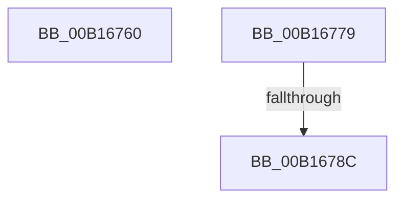

# sub_00B16760

- RVA: `0x00B16760`–`0x00B167B5` (길이 `85` bytes)
- VA: `0x0000000140B16760`
- 실행 섹션: `PAGE`
- PDB 이름 있음: `아니요`; PDB Function 태그: `아니요`
- unwind 정보 RVA: `0x000694EC`
- 디코드: `21`개 명령, `85/85` bytes 표시
- 미해석 바이트: `0` (있으면 어셈블리에 `.byte`로 보존)

> 이 문서는 커널 이미지의 기계어와 PDB 기호를 분석해 생성했습니다. 4번과 5번은 함수 원형과 자료형을 바이너리 사용 방식에서 추정한 C 해석이며 원본 소스 복구 결과는 아닙니다.

## 1. Dependencies

- 직접 호출 지점: **2**; 고유 호출 대상: **2**
- 직접 호출자로 확인된 함수: **0**
- RIP 상대 이미지 참조: **0**

### Outgoing calls
- `0x00B16760` → [HvpReleaseCellPaged](../85/HvpReleaseCellPaged_function_00855F40.md) (function, `0x00855F40`)
- `0x00B1676E` → [HvFreeCell](../85/HvFreeCell_function_0085A72C.md) (function, `0x0085A72C`)

### Direct callers
- 이 함수 시작 RVA로 연결되는 직접 call은 확인되지 않았습니다. 간접 호출은 완전히 역산할 수 없습니다.

### Static image references
- 디코드된 RIP-relative 메모리 참조가 없습니다.

## 2. Other-region calls and transfers

- 다른 실행 섹션으로 향하는 call: **0**
- call이 아닌 외부 분기/꼬리 이동: **3**
  - `0x00B16774` → [CmpRemoveSubKeyFromList + 0x190](../84/CmpRemoveSubKeyFromList_function_0084A030.md) (`tail-transfer`)
  - `0x00B16786` → [CmpRemoveSubKeyFromList + 0x190](../84/CmpRemoveSubKeyFromList_function_0084A030.md) (`tail-transfer`)
  - `0x00B167B0` → [CmpRemoveSubKeyFromList + 0x18B](../84/CmpRemoveSubKeyFromList_function_0084A030.md) (`tail-transfer`)

## 3. Assembly (complete function range)

```asm
00B16760  E8 DB F7 D3 FF                  call 0x140855f40
00B16765  41 8B D7                        mov edx, r15d
00B16768  48 8B CB                        mov rcx, rbx
00B1676B  4D 8B EC                        mov r13, r12
00B1676E  E8 B9 3F D4 FF                  call 0x14085a72c
00B16773  90                              nop
00B16774  E9 47 3A D3 FF                  jmp 0x14084a1c0
00B16779  44 8B 4D D0                     mov r9d, dword ptr [rbp - 0x30]
00B1677D  41 8B F7                        mov esi, r15d
00B16780  0F B7 C8                        movzx ecx, ax
00B16783  44 3B C9                        cmp r9d, ecx
00B16786  0F 83 34 3A D3 FF               jae 0x14084a1c0
00B1678C  41 2B C9                        sub ecx, r9d
00B1678F  41 8D 41 01                     lea eax, [r9 + 1]
00B16793  44 8B C1                        mov r8d, ecx
00B16796  48 8D 14 85 04 00 00 00         lea rdx, [rax*4 + 4]
00B1679E  49 C1 E0 02                     shl r8, 2
00B167A2  4A 8D 0C 8D 04 00 00 00         lea rcx, [r9*4 + 4]
00B167AA  49 03 D5                        add rdx, r13
00B167AD  49 03 CD                        add rcx, r13
00B167B0  E9 06 3A D3 FF                  jmp 0x14084a1bb
```

## 4. C-style interpretation (structured pseudocode)

```c
__int64 __fastcall sub_00B16760(void)
{
    __int64 result;

    result = HvpReleaseCellPaged(a1, a2, a3, a4);
    result = HvFreeCell(v_rbx, (unsigned int)((unsigned int)(v_r15)), a3, a4);
}
```

## 5. (Beta) C Style

```c
void sub_00B16760(void)
{
    int64_t result;

    result = HvpReleaseCellPaged(a1, a2, a3, a4);
    result = HvFreeCell(local_rbx, (uint32_t)((uint32_t)(local_r15)), a3, a4);
}
```

## 6. Execution-region graph

[열기: 2D/3D 그래프와 함수 탐색 컨트롤 패널](../../../control-panel.html?section=page&rva=0x00B16760&view=graph)

- 2D 그래프는 위에서 아래로 흐르고, 3D 그래프는 빈 공간을 드래그해 회전합니다. Shift+드래그는 이동, 휠은 확대·축소, 함수 노드 선택은 대상 보고서 이동입니다.

### Static fallback


