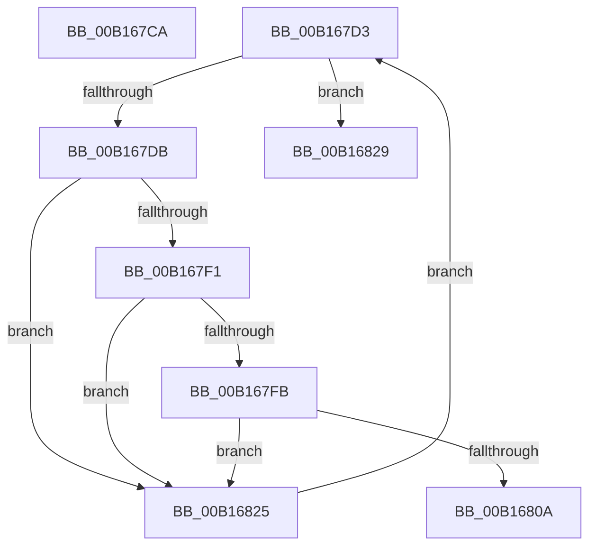

# sub_00B167CA

- RVA: `0x00B167CA`–`0x00B16833` (길이 `105` bytes)
- VA: `0x0000000140B167CA`
- 실행 섹션: `PAGE`
- PDB 이름 있음: `아니요`; PDB Function 태그: `아니요`
- unwind 정보 RVA: `0x00069544`
- 디코드: `27`개 명령, `105/105` bytes 표시
- 미해석 바이트: `0` (있으면 어셈블리에 `.byte`로 보존)

> 이 문서는 커널 이미지의 기계어와 PDB 기호를 분석해 생성했습니다. 4번과 5번은 함수 원형과 자료형을 바이너리 사용 방식에서 추정한 C 해석이며 원본 소스 복구 결과는 아닙니다.

## 1. Dependencies

- 직접 호출 지점: **1**; 고유 호출 대상: **1**
- 직접 호출자로 확인된 함수: **0**
- RIP 상대 이미지 참조: **3**

### Outgoing calls
- `0x00B16801` → [CmpCompareUnicodeString](../A1/CmpCompareUnicodeString_function_00A17340.md) (function, `0x00A17340`)

### Direct callers
- 이 함수 시작 RVA로 연결되는 직접 call은 확인되지 않았습니다. 간접 호출은 완전히 역산할 수 없습니다.

### Static image references
- `0x00B167D3` → RVA `0x00EEFC08` (`.data`; read)
- `0x00B167DB` → RVA `0x00EEFC10` (`.data`; read)
- `0x00B16811` → RVA `0x00E0EC9C` (`.data`; write)

## 2. Other-region calls and transfers

- 다른 실행 섹션으로 향하는 call: **0**
- call이 아닌 외부 분기/꼬리 이동: **3**
  - `0x00B167CE` → [CmpGetMappingHiveForString + 0xFE](../84/CmpGetMappingHiveForString_function_0084A5C8.md) (`tail-transfer`)
  - `0x00B16820` → [CmpGetMappingHiveForString + 0x13C](../84/CmpGetMappingHiveForString_function_0084A5C8.md) (`tail-transfer`)
  - `0x00B1682E` → [CmpGetMappingHiveForString + 0x13C](../84/CmpGetMappingHiveForString_function_0084A5C8.md) (`tail-transfer`)

## 3. Assembly (complete function range)

```asm
00B167CA  66 44 03 FA                     add r15w, dx
00B167CE  E9 F3 3E D3 FF                  jmp 0x14084a6c6
00B167D3  3B 3D 2F 94 3D 00               cmp edi, dword ptr [rip + 0x3d942f]
00B167D9  73 4E                           jae 0x140b16829
00B167DB  48 8B 0D 2E 94 3D 00            mov rcx, qword ptr [rip + 0x3d942e]
00B167E2  44 8B F7                        mov r14d, edi
00B167E5  49 C1 E6 05                     shl r14, 5
00B167E9  49 03 CE                        add rcx, r14
00B167EC  39 59 10                        cmp dword ptr [rcx + 0x10], ebx
00B167EF  75 34                           jne 0x140b16825
00B167F1  41 0F B7 04 24                  movzx eax, word ptr [r12]
00B167F6  66 39 01                        cmp word ptr [rcx], ax
00B167F9  75 2A                           jne 0x140b16825
00B167FB  45 33 C0                        xor r8d, r8d
00B167FE  49 8B D4                        mov rdx, r12
00B16801  E8 3A 0B F0 FF                  call 0x140a17340
00B16806  85 C0                           test eax, eax
00B16808  75 1B                           jne 0x140b16825
00B1680A  48 8B 05 FF 93 3D 00            mov rax, qword ptr [rip + 0x3d93ff]
00B16811  89 3D 85 84 2F 00               mov dword ptr [rip + 0x2f8485], edi
00B16817  49 8B 4C 06 18                  mov rcx, qword ptr [r14 + rax + 0x18]
00B1681C  49 89 4D 00                     mov qword ptr [r13], rcx
00B16820  E9 DF 3E D3 FF                  jmp 0x14084a704
00B16825  FF C7                           inc edi
00B16827  EB AA                           jmp 0x140b167d3
00B16829  BE 25 02 00 C0                  mov esi, 0xc0000225
00B1682E  E9 D1 3E D3 FF                  jmp 0x14084a704
```

## 4. C-style interpretation (structured pseudocode)

```c
__int64 __fastcall sub_00B167CA(__int64 a1, unsigned __int16 a2, int a3)
{
    __int64 v_r15;

    v_r15 = (unsigned __int16)((v_r15) + (a2));
}
```

## 5. (Beta) C Style

```c
int64_t sub_00B167CA(int64_t Arg1, uint16_t Arg2, int32_t Arg3)
{
    int64_t local_r15;

    local_r15 = (uint16_t)((local_r15) + (Arg2));
}
```

## 6. Execution-region graph

[열기: 2D/3D 그래프와 함수 탐색 컨트롤 패널](../../../control-panel.html?section=page&rva=0x00B167CA&view=graph)

- 2D 그래프는 위에서 아래로 흐르고, 3D 그래프는 빈 공간을 드래그해 회전합니다. Shift+드래그는 이동, 휠은 확대·축소, 함수 노드 선택은 대상 보고서 이동입니다.

### Static fallback


