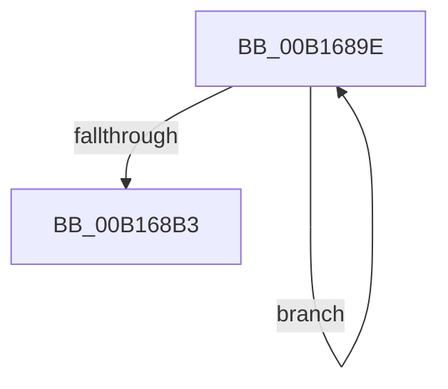

# sub_00B1689E

- RVA: `0x00B1689E`–`0x00B168BC` (길이 `30` bytes)
- VA: `0x0000000140B1689E`
- 실행 섹션: `PAGE`
- PDB 이름 있음: `아니요`; PDB Function 태그: `아니요`
- unwind 정보 RVA: `0x00069828`
- 디코드: `9`개 명령, `30/30` bytes 표시
- 미해석 바이트: `0` (있으면 어셈블리에 `.byte`로 보존)

> 이 문서는 커널 이미지의 기계어와 PDB 기호를 분석해 생성했습니다. 4번과 5번은 함수 원형과 자료형을 바이너리 사용 방식에서 추정한 C 해석이며 원본 소스 복구 결과는 아닙니다.

## 1. Dependencies

- 직접 호출 지점: **0**; 고유 호출 대상: **0**
- 직접 호출자로 확인된 함수: **0**
- RIP 상대 이미지 참조: **0**

### Outgoing calls
- 직접 디코드된 call 명령이 없습니다.

### Direct callers
- 이 함수 시작 RVA로 연결되는 직접 call은 확인되지 않았습니다. 간접 호출은 완전히 역산할 수 없습니다.

### Static image references
- 디코드된 RIP-relative 메모리 참조가 없습니다.

## 2. Other-region calls and transfers

- 다른 실행 섹션으로 향하는 call: **0**
- call이 아닌 외부 분기/꼬리 이동: **1**
  - `0x00B168B7` → [CmpAddSubKeyEx + 0x29E](../84/CmpAddSubKeyEx_function_0084C940.md) (`tail-transfer`)

## 3. Assembly (complete function range)

```asm
00B1689E  8B CA                           mov ecx, edx
00B168A0  41 03 D4                        add edx, r12d
00B168A3  8B 44 CF 04                     mov eax, dword ptr [rdi + rcx*8 + 4]
00B168A7  89 44 8F 04                     mov dword ptr [rdi + rcx*4 + 4], eax
00B168AB  0F B7 47 02                     movzx eax, word ptr [rdi + 2]
00B168AF  3B D0                           cmp edx, eax
00B168B1  72 EB                           jb 0x140b1689e
00B168B3  44 8B 65 D4                     mov r12d, dword ptr [rbp - 0x2c]
00B168B7  E9 22 63 D3 FF                  jmp 0x14084cbde
```

## 4. C-style interpretation (structured pseudocode)

```c
__int64 __fastcall sub_00B1689E(__int64 a1, int a2)
{
    a2 = (unsigned int)((a2) + ((unsigned int)(v_r12)));
    *(unsigned int *)(v_rdi + (unsigned int)(a2) * 4 + 4) = (unsigned int)((unsigned int)(*(unsigned int *)(v_rdi + (unsigned int)(a2) * 8 + 4)));
    if (a2 < ((unsigned int)(*(unsigned __int16 *)(v_rdi + 2)))) goto loc_00B1689E;
}
```

## 5. (Beta) C Style

```c
int64_t sub_00B1689E(int64_t Arg1, int32_t Arg2)
{
    Arg2 = (uint32_t)((Arg2) + ((uint32_t)(local_r12)));
    *(uint32_t *)(local_rdi + (uint32_t)(Arg2) * 4 + 0x4) = (uint32_t)((uint32_t)(*(uint32_t *)(local_rdi + (uint32_t)(Arg2) * 8 + 0x4)));
    if (Arg2 < ((uint32_t)(*(uint16_t *)(local_rdi + 0x2)))) goto loc_00B1689E;
}
```

## 6. Execution-region graph

[열기: 2D/3D 그래프와 함수 탐색 컨트롤 패널](../../../control-panel.html?section=page&rva=0x00B1689E&view=graph)

- 2D 그래프는 위에서 아래로 흐르고, 3D 그래프는 빈 공간을 드래그해 회전합니다. Shift+드래그는 이동, 휠은 확대·축소, 함수 노드 선택은 대상 보고서 이동입니다.

### Static fallback


