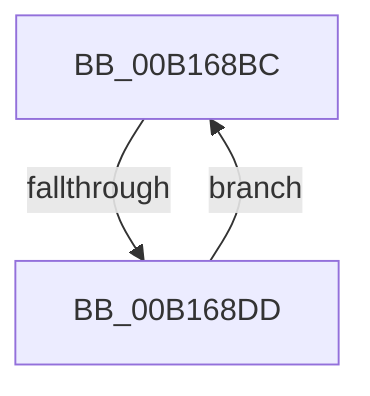

# sub_00B168BC

- RVA: `0x00B168BC`–`0x00B168E2` (길이 `38` bytes)
- VA: `0x0000000140B168BC`
- 실행 섹션: `PAGE`
- PDB 이름 있음: `아니요`; PDB Function 태그: `아니요`
- unwind 정보 RVA: `0x00069854`
- 디코드: `10`개 명령, `38/38` bytes 표시
- 미해석 바이트: `0` (있으면 어셈블리에 `.byte`로 보존)

> 이 문서는 커널 이미지의 기계어와 PDB 기호를 분석해 생성했습니다. 4번과 5번은 함수 원형과 자료형을 바이너리 사용 방식에서 추정한 C 해석이며 원본 소스 복구 결과는 아닙니다.

## 1. Dependencies

- 직접 호출 지점: **3**; 고유 호출 대상: **3**
- 직접 호출자로 확인된 함수: **0**
- RIP 상대 이미지 참조: **0**

### Outgoing calls
- `0x00B168BC` → [CmpGetNextHive](../84/CmpGetNextHive_function_0084E330.md) (function, `0x0084E330`)
- `0x00B168C7` → [HvUnlockHiveFlusherExclusive](../../pagecmrc/BC/HvUnlockHiveFlusherExclusive_function_00BC9C34.md) (function, `0x00BC9C34`)
- `0x00B168CF` → [CmpDereferenceHive](../86/CmpDereferenceHive_function_008632B0.md) (function, `0x008632B0`)

### Direct callers
- 이 함수 시작 RVA로 연결되는 직접 call은 확인되지 않았습니다. 간접 호출은 완전히 역산할 수 없습니다.

### Static image references
- 디코드된 RIP-relative 메모리 참조가 없습니다.

## 2. Other-region calls and transfers

- 다른 실행 섹션으로 향하는 call: **1**
  - `0x00B168C7` → [HvUnlockHiveFlusherExclusive](../../pagecmrc/BC/HvUnlockHiveFlusherExclusive_function_00BC9C34.md) (`PAGE` → `PAGECMRC`)
- call이 아닌 외부 분기/꼬리 이동: **1**
  - `0x00B168D7` → [CmpVEExecuteRealStoreParseLogic + 0x174](../84/CmpVEExecuteRealStoreParseLogic_function_0084CCD4.md) (`tail-transfer`)

## 3. Assembly (complete function range)

```asm
00B168BC  E8 6F 7A D3 FF                  call 0x14084e330
00B168C1  48 8B C8                        mov rcx, rax
00B168C4  48 8B D8                        mov rbx, rax
00B168C7  E8 68 33 0B 00                  call 0x140bc9c34
00B168CC  48 8B CB                        mov rcx, rbx
00B168CF  E8 DC C9 D4 FF                  call 0x1408632b0
00B168D4  48 85 DB                        test rbx, rbx
00B168D7  0F 84 6B 65 D3 FF               je 0x14084ce48
00B168DD  48 8B CB                        mov rcx, rbx
00B168E0  EB DA                           jmp 0x140b168bc
```

## 4. C-style interpretation (structured pseudocode)

```c
__int64 __fastcall sub_00B168BC(void)
{
    __int64 result;

    result = CmpGetNextHive(a1, a2, a3, a4);
    result = HvUnlockHiveFlusherExclusive(result, a2, a3, a4);
    result = CmpDereferenceHive(result, a2, a3, a4);
    goto loc_00B168BC;
}
```

## 5. (Beta) C Style

```c
void sub_00B168BC(void)
{
    int64_t result;

    result = CmpGetNextHive(a1, a2, a3, a4);
    result = HvUnlockHiveFlusherExclusive(result, a2, a3, a4);
    result = CmpDereferenceHive(result, a2, a3, a4);
    goto loc_00B168BC;
}
```

## 6. Execution-region graph

[열기: 2D/3D 그래프와 함수 탐색 컨트롤 패널](../../../control-panel.html?section=page&rva=0x00B168BC&view=graph)

- 2D 그래프는 위에서 아래로 흐르고, 3D 그래프는 빈 공간을 드래그해 회전합니다. Shift+드래그는 이동, 휠은 확대·축소, 함수 노드 선택은 대상 보고서 이동입니다.

### Static fallback


