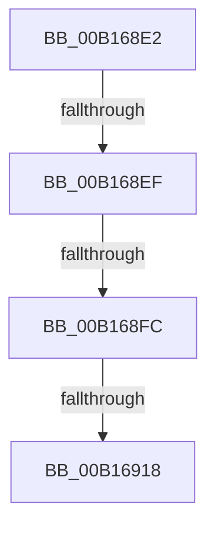

# sub_00B168E2

- RVA: `0x00B168E2`–`0x00B16945` (길이 `99` bytes)
- VA: `0x0000000140B168E2`
- 실행 섹션: `PAGE`
- PDB 이름 있음: `아니요`; PDB Function 태그: `아니요`
- unwind 정보 RVA: `0x00069B28`
- 디코드: `20`개 명령, `99/99` bytes 표시
- 미해석 바이트: `0` (있으면 어셈블리에 `.byte`로 보존)

> 이 문서는 커널 이미지의 기계어와 PDB 기호를 분석해 생성했습니다. 4번과 5번은 함수 원형과 자료형을 바이너리 사용 방식에서 추정한 C 해석이며 원본 소스 복구 결과는 아닙니다.

## 1. Dependencies

- 직접 호출 지점: **2**; 고유 호출 대상: **2**
- 직접 호출자로 확인된 함수: **0**
- RIP 상대 이미지 참조: **4**

### Outgoing calls
- `0x00B1690A` → [ExAllocatePool2](../../poolcode/B8/ExAllocatePool2_function_00B820F0.md) (function, `0x00B820F0`)
- `0x00B1693A` → [ExQueueWorkItem](../../text/2F/ExQueueWorkItem_function_002F9520.md) (function, `0x002F9520`)

### Direct callers
- 이 함수 시작 RVA로 연결되는 직접 call은 확인되지 않았습니다. 간접 호출은 완전히 역산할 수 없습니다.

### Static image references
- `0x00B168E2` → RVA `0x00FD9A75` (`PAGEDATA`; read)
- `0x00B168EF` → RVA `0x00E685D0` (`.data`; read)
- `0x00B1691C` → RVA `0x007E2360` (`CmpQuotaWarningWorker`; read)
- `0x00B1692F` → RVA `0x00FD9A75` (`PAGEDATA`; write)

## 2. Other-region calls and transfers

- 다른 실행 섹션으로 향하는 call: **2**
  - `0x00B1690A` → [ExAllocatePool2](../../poolcode/B8/ExAllocatePool2_function_00B820F0.md) (`PAGE` → `POOLCODE`)
  - `0x00B1693A` → [ExQueueWorkItem](../../text/2F/ExQueueWorkItem_function_002F9520.md) (`PAGE` → `.text`)
- call이 아닌 외부 분기/꼬리 이동: **4**
  - `0x00B168E9` → [CmpClaimGlobalQuota + 0x40](../84/CmpClaimGlobalQuota_function_0084DDAC.md) (`tail-transfer`)
  - `0x00B168F6` → [CmpClaimGlobalQuota + 0x40](../84/CmpClaimGlobalQuota_function_0084DDAC.md) (`tail-transfer`)
  - `0x00B16912` → [CmpClaimGlobalQuota + 0x40](../84/CmpClaimGlobalQuota_function_0084DDAC.md) (`tail-transfer`)
  - `0x00B16940` → [CmpClaimGlobalQuota + 0x40](../84/CmpClaimGlobalQuota_function_0084DDAC.md) (`tail-transfer`)

## 3. Assembly (complete function range)

```asm
00B168E2  80 3D 8C 31 4C 00 00            cmp byte ptr [rip + 0x4c318c], 0
00B168E9  0F 85 FD 74 D3 FF               jne 0x14084ddec
00B168EF  80 3D DA 1C 35 00 00            cmp byte ptr [rip + 0x351cda], 0
00B168F6  0F 84 F0 74 D3 FF               je 0x14084ddec
00B168FC  BA 20 00 00 00                  mov edx, 0x20
00B16901  41 B8 43 4D 20 20               mov r8d, 0x20204d43
00B16907  8D 4A 20                        lea ecx, [rdx + 0x20]
00B1690A  E8 E1 B7 06 00                  call 0x140b820f0
00B1690F  48 85 C0                        test rax, rax
00B16912  0F 84 D4 74 D3 FF               je 0x14084ddec
00B16918  48 83 20 00                     and qword ptr [rax], 0
00B1691C  48 8D 0D 3D BA CC FF            lea rcx, [rip - 0x3345c3]
00B16923  48 89 48 10                     mov qword ptr [rax + 0x10], rcx
00B16927  BA 01 00 00 00                  mov edx, 1
00B1692C  48 8B C8                        mov rcx, rax
00B1692F  C6 05 3F 31 4C 00 01            mov byte ptr [rip + 0x4c313f], 1
00B16936  48 89 40 18                     mov qword ptr [rax + 0x18], rax
00B1693A  E8 E1 2B 7E FF                  call 0x1402f9520
00B1693F  90                              nop
00B16940  E9 A7 74 D3 FF                  jmp 0x14084ddec
```

## 4. C-style interpretation (structured pseudocode)

```c
__int64 __fastcall sub_00B168E2(void)
{
    __int64 result;

    result = ExAllocatePool2(32 + 32, 32, (unsigned int)(0x20204D43ULL), a4);
    *(unsigned __int64 *)(result + 16) = v_rip - 3360195;
    *(unsigned __int8 *)(v_rip + 4993343) = 1;
    *(unsigned __int64 *)(result + 24) = result;
    result = ExQueueWorkItem(result, 1, (unsigned int)(0x20204D43ULL), a4);
}
```

## 5. (Beta) C Style

```c
void sub_00B168E2(void)
{
    int64_t result;

    result = ExAllocatePool2(32 + 32, 32, (uint32_t)(0x20204D43ULL), a4);
    *(uint64_t *)(result + 0x10) = v_rip - 3360195;
    *(uint8_t *)(v_rip + 0x4C313F) = 1;
    *(uint64_t *)(result + 0x18) = result;
    result = ExQueueWorkItem(result, 1, (uint32_t)(0x20204D43ULL), a4);
}
```

## 6. Execution-region graph

[열기: 2D/3D 그래프와 함수 탐색 컨트롤 패널](../../../control-panel.html?section=page&rva=0x00B168E2&view=graph)

- 2D 그래프는 위에서 아래로 흐르고, 3D 그래프는 빈 공간을 드래그해 회전합니다. Shift+드래그는 이동, 휠은 확대·축소, 함수 노드 선택은 대상 보고서 이동입니다.

### Static fallback


