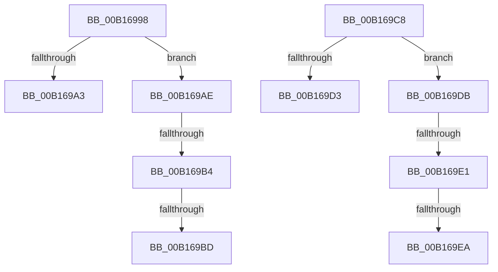

# sub_00B16998

- RVA: `0x00B16998`–`0x00B169F2` (길이 `90` bytes)
- VA: `0x0000000140B16998`
- 실행 섹션: `PAGE`
- PDB 이름 있음: `아니요`; PDB Function 태그: `아니요`
- unwind 정보 RVA: `0x00069CA0`
- 디코드: `22`개 명령, `90/90` bytes 표시
- 미해석 바이트: `0` (있으면 어셈블리에 `.byte`로 보존)

> 이 문서는 커널 이미지의 기계어와 PDB 기호를 분석해 생성했습니다. 4번과 5번은 함수 원형과 자료형을 바이너리 사용 방식에서 추정한 C 해석이며 원본 소스 복구 결과는 아닙니다.

## 1. Dependencies

- 직접 호출 지점: **0**; 고유 호출 대상: **0**
- 직접 호출자로 확인된 함수: **0**
- RIP 상대 이미지 참조: **0**

### Outgoing calls
- 직접 디코드된 call 명령이 없습니다.

### Direct callers
- 이 함수 시작 RVA로 연결되는 직접 call은 확인되지 않았습니다. 간접 호출은 완전히 역산할 수 없습니다.

### Static image references
- 디코드된 RIP-relative 메모리 참조가 없습니다.

## 2. Other-region calls and transfers

- 다른 실행 섹션으로 향하는 call: **0**
- call이 아닌 외부 분기/꼬리 이동: **8**
  - `0x00B169A9` → [sub_0084E7D5 + 0x210](../84/Unknown_function_0084E7D5.md) (`tail-transfer`)
  - `0x00B169AE` → [sub_0084E7D5 + 0x20A](../84/Unknown_function_0084E7D5.md) (`tail-transfer`)
  - `0x00B169B7` → [sub_0084E7D5 + 0x20A](../84/Unknown_function_0084E7D5.md) (`tail-transfer`)
  - `0x00B169C3` → [sub_0084E7D5 + 0x210](../84/Unknown_function_0084E7D5.md) (`tail-transfer`)
  - `0x00B169D6` → [sub_0084E7D5 + 0x137](../84/Unknown_function_0084E7D5.md) (`tail-transfer`)
  - `0x00B169DB` → [sub_0084E7D5 + 0x131](../84/Unknown_function_0084E7D5.md) (`tail-transfer`)
  - `0x00B169E4` → [sub_0084E7D5 + 0x131](../84/Unknown_function_0084E7D5.md) (`tail-transfer`)
  - `0x00B169ED` → [sub_0084E7D5 + 0x137](../84/Unknown_function_0084E7D5.md) (`tail-transfer`)

## 3. Assembly (complete function range)

```asm
00B16998  41 0F B7 45 42                  movzx eax, word ptr [r13 + 0x42]
00B1699D  66 3B 46 42                     cmp ax, word ptr [rsi + 0x42]
00B169A1  7E 0B                           jle 0x140b169ae
00B169A3  48 8B CE                        mov rcx, rsi
00B169A6  49 8B DD                        mov rbx, r13
00B169A9  E9 37 80 D3 FF                  jmp 0x14084e9e5
00B169AE  0F 8C 2B 80 D3 FF               jl 0x14084e9df
00B169B4  4C 3B EE                        cmp r13, rsi
00B169B7  0F 86 22 80 D3 FF               jbe 0x14084e9df
00B169BD  48 8B CE                        mov rcx, rsi
00B169C0  49 8B DD                        mov rbx, r13
00B169C3  E9 1D 80 D3 FF                  jmp 0x14084e9e5
00B169C8  41 0F B7 45 42                  movzx eax, word ptr [r13 + 0x42]
00B169CD  66 3B 46 42                     cmp ax, word ptr [rsi + 0x42]
00B169D1  7E 08                           jle 0x140b169db
00B169D3  4C 8B F6                        mov r14, rsi
00B169D6  E9 31 7F D3 FF                  jmp 0x14084e90c
00B169DB  0F 8C 25 7F D3 FF               jl 0x14084e906
00B169E1  4C 3B EE                        cmp r13, rsi
00B169E4  0F 86 1C 7F D3 FF               jbe 0x14084e906
00B169EA  4C 8B F6                        mov r14, rsi
00B169ED  E9 1A 7F D3 FF                  jmp 0x14084e90c
```

## 4. C-style interpretation (structured pseudocode)

```c
__int64 __fastcall sub_00B16998(void)
{
    if (((unsigned __int16)(*(unsigned __int16 *)(v_r13 + 66))) <= (*(unsigned __int16 *)(v_rsi + 66))) goto loc_00B169AE;
loc_00B169AE:
}
```

## 5. (Beta) C Style

```c
void sub_00B16998(void)
{
    if (((uint16_t)(*(uint16_t *)(local_r13 + 0x42))) <= (*(uint16_t *)(local_rsi + 0x42))) goto loc_00B169AE;
loc_00B169AE:
}
```

## 6. Execution-region graph

[열기: 2D/3D 그래프와 함수 탐색 컨트롤 패널](../../../control-panel.html?section=page&rva=0x00B16998&view=graph)

- 2D 그래프는 위에서 아래로 흐르고, 3D 그래프는 빈 공간을 드래그해 회전합니다. Shift+드래그는 이동, 휠은 확대·축소, 함수 노드 선택은 대상 보고서 이동입니다.

### Static fallback


