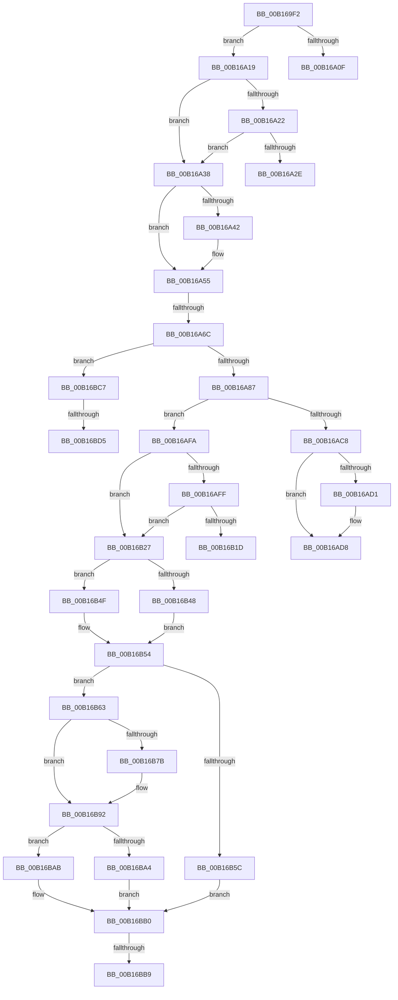

# sub_00B169F2

- RVA: `0x00B169F2`–`0x00B16BE7` (길이 `501` bytes)
- VA: `0x0000000140B169F2`
- 실행 섹션: `PAGE`
- PDB 이름 있음: `아니요`; PDB Function 태그: `아니요`
- unwind 정보 RVA: `0x00069FB8`
- 디코드: `125`개 명령, `501/501` bytes 표시
- 미해석 바이트: `0` (있으면 어셈블리에 `.byte`로 보존)

> 이 문서는 커널 이미지의 기계어와 PDB 기호를 분석해 생성했습니다. 4번과 5번은 함수 원형과 자료형을 바이너리 사용 방식에서 추정한 C 해석이며 원본 소스 복구 결과는 아닙니다.

## 1. Dependencies

- 직접 호출 지점: **19**; 고유 호출 대상: **18**
- 직접 호출자로 확인된 함수: **0**
- RIP 상대 이미지 참조: **1**

### Outgoing calls
- `0x00B16A06` → [CmpIsSystemEntity](../8B/CmpIsSystemEntity_function_008B4E90.md) (function, `0x008B4E90`)
- `0x00B16A49` → [CmpAttachToRegistryProcess](../../pagecmrc/BC/CmpAttachToRegistryProcess_function_00BC98E0.md) (function, `0x00BC98E0`)
- `0x00B16A5D` → [CmVirtualKCBToRealPath](../A7/CmVirtualKCBToRealPath_function_00A76BE8.md) (function, `0x00A76BE8`)
- `0x00B16A78` → [CmpBlockHiveWrites](../84/CmpBlockHiveWrites_function_0084CF94.md) (function, `0x0084CF94`)
- `0x00B16AAB` → [CmpFindPathByNameEx](../84/CmpFindPathByNameEx_function_0084BAAC.md) (function, `0x0084BAAC`)
- `0x00B16ABF` → [CmpUnblockHiveWrites](../A5/CmpUnblockHiveWrites_function_00A5E4B0.md) (function, `0x00A5E4B0`)
- `0x00B16AD3` → [ExFreePoolWithTag](../../poolcode/B8/ExFreePoolWithTag_function_00B82870.md) (function, `0x00B82870`)
- `0x00B16AE8` → [RtlInitUnicodeString](../../text/42/RtlInitUnicodeString_function_0042A780.md) (function, `0x0042A780`)
- `0x00B16B02` → [CmpUnlockKcb](../../pagecmrc/BC/CmpUnlockKcb_function_00BC92C0.md) (function, `0x00BC92C0`)
- `0x00B16B0A` → [CmpLockKcbExclusive](../86/CmpLockKcbExclusive_function_00861EB0.md) (function, `0x00861EB0`)
- `0x00B16B14` → [CmpIsKeyDeleted](../84/CmpIsKeyDeleted_function_0084BDB0.md) (function, `0x0084BDB0`)
- `0x00B16B2B` → [HvLockHiveFlusherShared](../84/HvLockHiveFlusherShared_function_0084F95C.md) (function, `0x0084F95C`)
- `0x00B16B48` → [HvpGetCellFlat](../85/HvpGetCellFlat_function_00854C60.md) (function, `0x00854C60`)
- `0x00B16B4F` → [HvpGetCellPaged](../85/HvpGetCellPaged_function_00854CB0.md) (function, `0x00854CB0`)
- `0x00B16B70` → [HvpMarkCellDirty](../85/HvpMarkCellDirty_function_00858080.md) (function, `0x00858080`)
- `0x00B16BA4` → [HvpReleaseCellFlat](../85/HvpReleaseCellFlat_function_0085CC20.md) (function, `0x0085CC20`)
- `0x00B16BAB` → [HvpReleaseCellPaged](../85/HvpReleaseCellPaged_function_00855F40.md) (function, `0x00855F40`)
- `0x00B16BBC` → [HvUnlockHiveFlusherShared](../84/HvUnlockHiveFlusherShared_function_00848738.md) (function, `0x00848738`)
- `0x00B16BDC` → [CmpUnblockHiveWrites](../A5/CmpUnblockHiveWrites_function_00A5E4B0.md) (function, `0x00A5E4B0`)

### Direct callers
- 이 함수 시작 RVA로 연결되는 직접 call은 확인되지 않았습니다. 간접 호출은 완전히 역산할 수 없습니다.

### Static image references
- `0x00B16A19` → RVA `0x00E0ECA0` (`.data`; read)

## 2. Other-region calls and transfers

- 다른 실행 섹션으로 향하는 call: **4**
  - `0x00B16A49` → [CmpAttachToRegistryProcess](../../pagecmrc/BC/CmpAttachToRegistryProcess_function_00BC98E0.md) (`PAGE` → `PAGECMRC`)
  - `0x00B16AD3` → [ExFreePoolWithTag](../../poolcode/B8/ExFreePoolWithTag_function_00B82870.md) (`PAGE` → `POOLCODE`)
  - `0x00B16AE8` → [RtlInitUnicodeString](../../text/42/RtlInitUnicodeString_function_0042A780.md) (`PAGE` → `.text`)
  - `0x00B16B02` → [CmpUnlockKcb](../../pagecmrc/BC/CmpUnlockKcb_function_00BC92C0.md) (`PAGE` → `PAGECMRC`)
- call이 아닌 외부 분기/꼬리 이동: **9**
  - `0x00B16A14` → [sub_00854D98 + 0x74](../85/Unknown_function_00854D98.md) (`tail-transfer`)
  - `0x00B16A33` → [sub_00854D98 + 0x74](../85/Unknown_function_00854D98.md) (`tail-transfer`)
  - `0x00B16A66` → [sub_00854D98 + 0x74](../85/Unknown_function_00854D98.md) (`tail-transfer`)
  - `0x00B16AF5` → [sub_00854D98 + 0x74](../85/Unknown_function_00854D98.md) (`tail-transfer`)
  - `0x00B16B22` → [sub_00854D98 + 0x74](../85/Unknown_function_00854D98.md) (`tail-transfer`)
  - `0x00B16BB3` → [sub_00854D98 + 0x74](../85/Unknown_function_00854D98.md) (`tail-transfer`)
  - `0x00B16BC2` → [sub_00854D98 + 0x74](../85/Unknown_function_00854D98.md) (`tail-transfer`)
  - `0x00B16BCF` → [sub_00854D98 + 0x74](../85/Unknown_function_00854D98.md) (`tail-transfer`)
  - `0x00B16BE2` → [sub_00854D98 + 0x74](../85/Unknown_function_00854D98.md) (`tail-transfer`)

## 3. Assembly (complete function range)

```asm
00B169F2  48 8B 94 24 98 00 00 00         mov rdx, qword ptr [rsp + 0x98]
00B169FA  4C 8D 46 10                     lea r8, [rsi + 0x10]
00B169FE  0F B6 8C 24 90 00 00 00         movzx ecx, byte ptr [rsp + 0x90]
00B16A06  E8 85 E4 D9 FF                  call 0x1408b4e90
00B16A0B  84 C0                           test al, al
00B16A0D  74 0A                           je 0x140b16a19
00B16A0F  BB 71 02 00 C0                  mov ebx, 0xc0000271
00B16A14  E9 F3 E3 D3 FF                  jmp 0x140854e0c
00B16A19  80 3D 80 82 2F 00 00            cmp byte ptr [rip + 0x2f8280], 0
00B16A20  74 16                           je 0x140b16a38
00B16A22  F7 87 B8 00 00 00 00 00 00 01   test dword ptr [rdi + 0xb8], 0x1000000
00B16A2C  74 0A                           je 0x140b16a38
00B16A2E  BB 71 02 00 C0                  mov ebx, 0xc0000271
00B16A33  E9 D4 E3 D3 FF                  jmp 0x140854e0c
00B16A38  8B 86 A0 00 00 00               mov eax, dword ptr [rsi + 0xa0]
00B16A3E  A8 01                           test al, 1
00B16A40  75 13                           jne 0x140b16a55
00B16A42  48 8D 8E A8 00 00 00            lea rcx, [rsi + 0xa8]
00B16A49  E8 92 2E 0B 00                  call 0x140bc98e0
00B16A4E  83 8E A0 00 00 00 01            or dword ptr [rsi + 0xa0], 1
00B16A55  48 8D 54 24 50                  lea rdx, [rsp + 0x50]
00B16A5A  48 8B CF                        mov rcx, rdi
00B16A5D  E8 86 01 F6 FF                  call 0x140a76be8
00B16A62  8B D8                           mov ebx, eax
00B16A64  85 C0                           test eax, eax
00B16A66  0F 88 A0 E3 D3 FF               js 0x140854e0c
00B16A6C  4C 8D 44 24 40                  lea r8, [rsp + 0x40]
00B16A71  BA 10 00 00 00                  mov edx, 0x10
00B16A76  33 C9                           xor ecx, ecx
00B16A78  E8 17 65 D3 FF                  call 0x14084cf94
00B16A7D  8B D8                           mov ebx, eax
00B16A7F  85 C0                           test eax, eax
00B16A81  0F 88 40 01 00 00               js 0x140b16bc7
00B16A87  48 8D 44 24 48                  lea rax, [rsp + 0x48]
00B16A8C  41 B9 10 00 00 00               mov r9d, 0x10
00B16A92  48 89 44 24 28                  mov qword ptr [rsp + 0x28], rax
00B16A97  48 8D 54 24 50                  lea rdx, [rsp + 0x50]
00B16A9C  48 8D 44 24 30                  lea rax, [rsp + 0x30]
00B16AA1  45 33 C0                        xor r8d, r8d
00B16AA4  33 C9                           xor ecx, ecx
00B16AA6  48 89 44 24 20                  mov qword ptr [rsp + 0x20], rax
00B16AAB  E8 FC 4F D3 FF                  call 0x14084baac
00B16AB0  4C 8B 44 24 40                  mov r8, qword ptr [rsp + 0x40]
00B16AB5  BA 10 00 00 00                  mov edx, 0x10
00B16ABA  33 C9                           xor ecx, ecx
00B16ABC  0F B6 D8                        movzx ebx, al
00B16ABF  E8 EC 79 F4 FF                  call 0x140a5e4b0
00B16AC4  84 DB                           test bl, bl
00B16AC6  74 32                           je 0x140b16afa
00B16AC8  48 8B 4D 08                     mov rcx, qword ptr [rbp + 8]
00B16ACC  48 85 C9                        test rcx, rcx
00B16ACF  74 07                           je 0x140b16ad8
00B16AD1  33 D2                           xor edx, edx
00B16AD3  E8 98 BD 06 00                  call 0x140b82870
00B16AD8  0F 10 44 24 50                  movups xmm0, xmmword ptr [rsp + 0x50]
00B16ADD  33 D2                           xor edx, edx
00B16ADF  48 8D 4C 24 50                  lea rcx, [rsp + 0x50]
00B16AE4  0F 11 45 00                     movups xmmword ptr [rbp], xmm0
00B16AE8  E8 93 3C 91 FF                  call 0x14042a780
00B16AED  83 0E 08                        or dword ptr [rsi], 8
00B16AF0  BB 04 01 00 00                  mov ebx, 0x104
00B16AF5  E9 12 E3 D3 FF                  jmp 0x140854e0c
00B16AFA  45 84 F6                        test r14b, r14b
00B16AFD  75 28                           jne 0x140b16b27
00B16AFF  48 8B CF                        mov rcx, rdi
00B16B02  E8 B9 27 0B 00                  call 0x140bc92c0
00B16B07  48 8B CF                        mov rcx, rdi
00B16B0A  E8 A1 B3 D4 FF                  call 0x140861eb0
00B16B0F  33 D2                           xor edx, edx
00B16B11  48 8B CF                        mov rcx, rdi
00B16B14  E8 97 52 D3 FF                  call 0x14084bdb0
00B16B19  84 C0                           test al, al
00B16B1B  74 0A                           je 0x140b16b27
00B16B1D  BB 34 00 00 C0                  mov ebx, 0xc0000034
00B16B22  E9 E5 E2 D3 FF                  jmp 0x140854e0c
00B16B27  48 8B 4F 20                     mov rcx, qword ptr [rdi + 0x20]
00B16B2B  E8 2C 8E D3 FF                  call 0x14084f95c
00B16B30  48 8B 6F 20                     mov rbp, qword ptr [rdi + 0x20]
00B16B34  4C 8D 44 24 38                  lea r8, [rsp + 0x38]
00B16B39  8B 57 28                        mov edx, dword ptr [rdi + 0x28]
00B16B3C  48 8B CD                        mov rcx, rbp
00B16B3F  F6 85 8C 00 00 00 01            test byte ptr [rbp + 0x8c], 1
00B16B46  74 07                           je 0x140b16b4f
00B16B48  E8 13 E1 D3 FF                  call 0x140854c60
00B16B4D  EB 05                           jmp 0x140b16b54
00B16B4F  E8 5C E1 D3 FF                  call 0x140854cb0
00B16B54  4C 8B F0                        mov r14, rax
00B16B57  48 85 C0                        test rax, rax
00B16B5A  75 07                           jne 0x140b16b63
00B16B5C  BB 9A 00 00 C0                  mov ebx, 0xc000009a
00B16B61  EB 4D                           jmp 0x140b16bb0
00B16B63  8B 57 28                        mov edx, dword ptr [rdi + 0x28]
00B16B66  45 33 C9                        xor r9d, r9d
00B16B69  48 8B 4F 20                     mov rcx, qword ptr [rdi + 0x20]
00B16B6D  41 B0 01                        mov r8b, 1
00B16B70  E8 0B 15 D4 FF                  call 0x140858080
00B16B75  8B D8                           mov ebx, eax
00B16B77  85 C0                           test eax, eax
00B16B79  78 17                           js 0x140b16b92
00B16B7B  B8 00 01 00 00                  mov eax, 0x100
00B16B80  66 41 09 46 02                  or word ptr [r14 + 2], ax
00B16B85  66 09 87 BA 00 00 00            or word ptr [rdi + 0xba], ax
00B16B8C  83 0E 08                        or dword ptr [rsi], 8
00B16B8F  8D 58 04                        lea ebx, [rax + 4]
00B16B92  48 8B 4F 20                     mov rcx, qword ptr [rdi + 0x20]
00B16B96  48 8D 54 24 38                  lea rdx, [rsp + 0x38]
00B16B9B  F6 81 8C 00 00 00 01            test byte ptr [rcx + 0x8c], 1
00B16BA2  74 07                           je 0x140b16bab
00B16BA4  E8 77 60 D4 FF                  call 0x14085cc20
00B16BA9  EB 05                           jmp 0x140b16bb0
00B16BAB  E8 90 F3 D3 FF                  call 0x140855f40
00B16BB0  48 85 ED                        test rbp, rbp
00B16BB3  0F 84 53 E2 D3 FF               je 0x140854e0c
00B16BB9  48 8B CD                        mov rcx, rbp
00B16BBC  E8 77 1B D3 FF                  call 0x140848738
00B16BC1  90                              nop
00B16BC2  E9 45 E2 D3 FF                  jmp 0x140854e0c
00B16BC7  4C 8B 44 24 40                  mov r8, qword ptr [rsp + 0x40]
00B16BCC  4D 85 C0                        test r8, r8
00B16BCF  0F 84 37 E2 D3 FF               je 0x140854e0c
00B16BD5  BA 10 00 00 00                  mov edx, 0x10
00B16BDA  33 C9                           xor ecx, ecx
00B16BDC  E8 CF 78 F4 FF                  call 0x140a5e4b0
00B16BE1  90                              nop
00B16BE2  E9 25 E2 D3 FF                  jmp 0x140854e0c
```

## 4. C-style interpretation (structured pseudocode)

```c
__int64 __fastcall sub_00B169F2(__int64 a1, __int64 a2, __int64 a3, __int64 a4, __int64 a5, __int64 a6, __int64 a7, __int64 a8, __int64 a9, __int64 a10, __int64 a11, __int64 a12, __int64 a13, __int64 a14, __int64 a15, __int64 a16, __int64 a17, unsigned __int8 a18, __int64 a19)
{
    __int64 result;
    __int64 v_rbx;
    unsigned __int64 v_stack_p20;
    unsigned __int64 v_stack_p28;

    result = CmpIsSystemEntity(a18, a19, v_rsi + 16, a4);
    if ((unsigned __int8)(result) == 0) goto loc_00B16A19;
loc_00B16A19:
    if ((*(unsigned __int8 *)(v_rip + 3113600)) == 0) goto loc_00B16A38;
    if (((*(unsigned int *)(v_rdi + 184)) & (0x1000000ULL)) == 0) goto loc_00B16A38;
loc_00B16A38:
    result = (unsigned int)(*(unsigned int *)(v_rsi + 160));
    if ((((unsigned __int8)((unsigned int)(*(unsigned int *)(v_rsi + 160)))) & (1)) == 0) {
        a1 = v_rsi + 168;
        result = CmpAttachToRegistryProcess(a1, a19, v_rsi + 16, a4);
    }
    result = CmVirtualKCBToRealPath(v_rdi, a10, v_rsi + 16, a4);
    a1 = 0;
    result = CmpBlockHiveWrites(a1, 16, a8, a4);
    if (sign_flag) goto loc_00B16BC7;
    v_stack_p28 = a9;
    a3 = 0;
    a1 = 0;
    v_stack_p20 = a6;
    result = CmpFindPathByNameEx(a1, a10, a3, 16);
    a1 = 0;
    result = CmpUnblockHiveWrites(a1, 16, a8, 16);
    if ((unsigned __int8)((unsigned __int8)(result)) == 0) goto loc_00B16AFA;
    if (*(unsigned __int64 *)(v_rbp + 8) != 0) {
        a2 = 0;
        result = ExFreePoolWithTag(*(unsigned __int64 *)(v_rbp + 8), a2, a8, 16);
    }
    a2 = 0;
    *(unsigned __int64 *)(v_rbp) = v_xmm0;
    result = RtlInitUnicodeString(a10, a2, a8, 16);
loc_00B16AFA:
    if ((unsigned __int8)(v_r14) != 0) goto loc_00B16B27;
    result = CmpUnlockKcb(v_rdi, a2, a8, 16);
    result = CmpLockKcbExclusive(v_rdi, a2, a8, 16);
    a2 = 0;
    result = CmpIsKeyDeleted(v_rdi, a2, a8, 16);
    if ((unsigned __int8)(result) == 0) goto loc_00B16B27;
loc_00B16B27:
    result = HvLockHiveFlusherShared(*(unsigned __int64 *)(v_rdi + 32), a2, a8, 16);
    if (((*(unsigned __int8 *)(*(unsigned __int64 *)(v_rdi + 32) + 140)) & (1)) == 0) goto loc_00B16B4F;
    result = HvpGetCellFlat(*(unsigned __int64 *)(v_rdi + 32), (unsigned int)(*(unsigned int *)(v_rdi + 40)), a7, 16);
    goto loc_00B16B54;
loc_00B16B4F:
    result = HvpGetCellPaged(*(unsigned __int64 *)(v_rdi + 32), (unsigned int)(*(unsigned int *)(v_rdi + 40)), a7, 16);
loc_00B16B54:
    if (result != 0) goto loc_00B16B63;
    goto loc_00B16BB0;
loc_00B16B63:
    a4 = 0;
    result = HvpMarkCellDirty(*(unsigned __int64 *)(v_rdi + 32), (unsigned int)(*(unsigned int *)(v_rdi + 40)), 1, a4);
    v_rbx = (unsigned int)((unsigned int)(result));
    if (!(sign_flag)) {
        result = 256;
        v_rbx = result + 4;
    }
    if (((*(unsigned __int8 *)(*(unsigned __int64 *)(v_rdi + 32) + 140)) & (1)) == 0) goto loc_00B16BAB;
    result = HvpReleaseCellFlat(*(unsigned __int64 *)(v_rdi + 32), a7, 1, a4);
    goto loc_00B16BB0;
loc_00B16BAB:
    result = HvpReleaseCellPaged(*(unsigned __int64 *)(v_rdi + 32), a7, 1, a4);
loc_00B16BB0:
    result = HvUnlockHiveFlusherShared(*(unsigned __int64 *)(v_rdi + 32), a7, 1, a4);
loc_00B16BC7:
    a1 = 0;
    result = CmpUnblockHiveWrites(a1, 16, a8, a4);
}
```

## 5. (Beta) C Style

```c
int64_t sub_00B169F2(int64_t Arg1, int64_t Arg2, int64_t Arg3, int64_t Arg4, uint64_t Arg5, int64_t Arg6, int64_t Arg7, int64_t Arg8, int64_t Arg9, int64_t Arg10, uint64_t Arg11, uint64_t Arg12, uint64_t Arg13, uint64_t Arg14, uint64_t Arg15, uint64_t Arg16, uint64_t Arg17, uint8_t Arg18, int64_t Arg19)
{
    int64_t result;
    int64_t local_rbx;
    uint64_t v_stack_p20;
    uint64_t v_stack_p28;

    result = CmpIsSystemEntity(Arg18, Arg19, local_rsi + 16, Arg4);
    if ((uint8_t)(result) == 0) goto loc_00B16A19;
loc_00B16A19:
    if ((*(uint8_t *)(v_rip + 0x2F8280)) == 0) goto loc_00B16A38;
    if (((*(uint32_t *)(local_rdi + 0xB8)) & (0x1000000ULL)) == 0) goto loc_00B16A38;
loc_00B16A38:
    result = (uint32_t)(*(uint32_t *)(local_rsi + 0xA0));
    if ((((uint8_t)((uint32_t)(*(uint32_t *)(local_rsi + 0xA0)))) & (1)) == 0) {
        Arg1 = local_rsi + 168;
        result = CmpAttachToRegistryProcess(Arg1, Arg19, local_rsi + 16, Arg4);
    }
    result = CmVirtualKCBToRealPath(local_rdi, Arg10, local_rsi + 16, Arg4);
    Arg1 = 0;
    result = CmpBlockHiveWrites(Arg1, 16, Arg8, Arg4);
    if (sign_flag) goto loc_00B16BC7;
    v_stack_p28 = Arg9;
    Arg3 = 0;
    Arg1 = 0;
    v_stack_p20 = Arg6;
    result = CmpFindPathByNameEx(Arg1, Arg10, Arg3, 16);
    Arg1 = 0;
    result = CmpUnblockHiveWrites(Arg1, 16, Arg8, 16);
    if ((uint8_t)((uint8_t)(result)) == 0) goto loc_00B16AFA;
    if (*(uint64_t *)(local_rbp + 0x8) != 0) {
        Arg2 = 0;
        result = ExFreePoolWithTag(*(uint64_t *)(local_rbp + 0x8), Arg2, Arg8, 16);
    }
    Arg2 = 0;
    *(uint64_t *)(local_rbp) = v_xmm0;
    result = RtlInitUnicodeString(Arg10, Arg2, Arg8, 16);
loc_00B16AFA:
    if ((uint8_t)(local_r14) != 0) goto loc_00B16B27;
    result = CmpUnlockKcb(local_rdi, Arg2, Arg8, 16);
    result = CmpLockKcbExclusive(local_rdi, Arg2, Arg8, 16);
    Arg2 = 0;
    result = CmpIsKeyDeleted(local_rdi, Arg2, Arg8, 16);
    if ((uint8_t)(result) == 0) goto loc_00B16B27;
loc_00B16B27:
    result = HvLockHiveFlusherShared(*(uint64_t *)(local_rdi + 0x20), Arg2, Arg8, 16);
    if (((*(uint8_t *)(*(uint64_t *)(local_rdi + 0x20) + 0x8C)) & (1)) == 0) goto loc_00B16B4F;
    result = HvpGetCellFlat(*(uint64_t *)(local_rdi + 0x20), (uint32_t)(*(uint32_t *)(local_rdi + 0x28)), Arg7, 16);
    goto loc_00B16B54;
loc_00B16B4F:
    result = HvpGetCellPaged(*(uint64_t *)(local_rdi + 0x20), (uint32_t)(*(uint32_t *)(local_rdi + 0x28)), Arg7, 16);
loc_00B16B54:
    if (result != 0) goto loc_00B16B63;
    goto loc_00B16BB0;
loc_00B16B63:
    Arg4 = 0;
    result = HvpMarkCellDirty(*(uint64_t *)(local_rdi + 0x20), (uint32_t)(*(uint32_t *)(local_rdi + 0x28)), 1, Arg4);
    local_rbx = (uint32_t)((uint32_t)(result));
    if (!(sign_flag)) {
        result = 256;
        local_rbx = result + 4;
    }
    if (((*(uint8_t *)(*(uint64_t *)(local_rdi + 0x20) + 0x8C)) & (1)) == 0) goto loc_00B16BAB;
    result = HvpReleaseCellFlat(*(uint64_t *)(local_rdi + 0x20), Arg7, 1, Arg4);
    goto loc_00B16BB0;
loc_00B16BAB:
    result = HvpReleaseCellPaged(*(uint64_t *)(local_rdi + 0x20), Arg7, 1, Arg4);
loc_00B16BB0:
    result = HvUnlockHiveFlusherShared(*(uint64_t *)(local_rdi + 0x20), Arg7, 1, Arg4);
loc_00B16BC7:
    Arg1 = 0;
    result = CmpUnblockHiveWrites(Arg1, 16, Arg8, Arg4);
}
```

## 6. Execution-region graph

[열기: 2D/3D 그래프와 함수 탐색 컨트롤 패널](../../../control-panel.html?section=page&rva=0x00B169F2&view=graph)

- 2D 그래프는 위에서 아래로 흐르고, 3D 그래프는 빈 공간을 드래그해 회전합니다. Shift+드래그는 이동, 휠은 확대·축소, 함수 노드 선택은 대상 보고서 이동입니다.

### Static fallback


