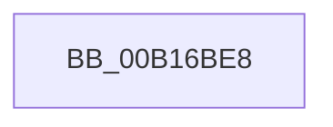

# sub_00B16BE8

- RVA: `0x00B16BE8`–`0x00B16C17` (길이 `47` bytes)
- VA: `0x0000000140B16BE8`
- 실행 섹션: `PAGE`
- PDB 이름 있음: `아니요`; PDB Function 태그: `아니요`
- unwind 정보 RVA: `0x0006A7B4`
- 디코드: `11`개 명령, `47/47` bytes 표시
- 미해석 바이트: `0` (있으면 어셈블리에 `.byte`로 보존)

> 이 문서는 커널 이미지의 기계어와 PDB 기호를 분석해 생성했습니다. 4번과 5번은 함수 원형과 자료형을 바이너리 사용 방식에서 추정한 C 해석이며 원본 소스 복구 결과는 아닙니다.

## 1. Dependencies

- 직접 호출 지점: **1**; 고유 호출 대상: **1**
- 직접 호출자로 확인된 함수: **0**
- RIP 상대 이미지 참조: **1**

### Outgoing calls
- `0x00B16C0B` → [CmpFindNameInListWithStatus](../84/CmpFindNameInListWithStatus_function_00846B80.md) (function, `0x00846B80`)

### Direct callers
- 이 함수 시작 RVA로 연결되는 직접 call은 확인되지 않았습니다. 간접 호출은 완전히 역산할 수 없습니다.

### Static image references
- `0x00B16BF6` → RVA `0x00FD9C00` (`PAGEDATA`; read)

## 2. Other-region calls and transfers

- 다른 실행 섹션으로 향하는 call: **0**
- call이 아닌 외부 분기/꼬리 이동: **1**
  - `0x00B16C12` → [CmpGetSymbolicLinkTarget + 0x6B2](../85/CmpGetSymbolicLinkTarget_function_008570A0.md) (`tail-transfer`)

## 3. Assembly (complete function range)

```asm
00B16BE8  48 8B 4B 20                     mov rcx, qword ptr [rbx + 0x20]
00B16BEC  48 8D 44 24 44                  lea rax, [rsp + 0x44]
00B16BF1  48 89 44 24 28                  mov qword ptr [rsp + 0x28], rax
00B16BF6  4C 8D 05 03 30 4C 00            lea r8, [rip + 0x4c3003]
00B16BFD  48 83 C3 20                     add rbx, 0x20
00B16C01  33 C0                           xor eax, eax
00B16C03  45 33 C9                        xor r9d, r9d
00B16C06  48 89 44 24 20                  mov qword ptr [rsp + 0x20], rax
00B16C0B  E8 70 FF D2 FF                  call 0x140846b80
00B16C10  8B F8                           mov edi, eax
00B16C12  E9 3B 0B D4 FF                  jmp 0x140857752
```

## 4. C-style interpretation (structured pseudocode)

```c
__int64 __fastcall sub_00B16BE8(__int64 a1, __int64 a2, __int64 a3, int a4)
{
    __int64 result;
    __int64 v_rbx;
    unsigned __int64 v_stack_p20;
    unsigned __int64 v_stack_p28;
    unsigned __int64 v_stack_p44;

    v_stack_p28 = v_stack_p44;
    v_rbx = (v_rbx) + (32);
    result = 0;
    a4 = 0;
    v_stack_p20 = 0;
    result = CmpFindNameInListWithStatus(*(unsigned __int64 *)(v_rbx + 32), a2, v_rip + 4993027, a4);
}
```

## 5. (Beta) C Style

```c
int64_t sub_00B16BE8(int64_t Arg1, int64_t Arg2, int64_t Arg3, int32_t Arg4)
{
    int64_t result;
    int64_t local_rbx;
    uint64_t v_stack_p20;
    uint64_t v_stack_p28;
    uint64_t v_stack_p44;

    v_stack_p28 = v_stack_p44;
    local_rbx = (local_rbx) + (32);
    result = 0;
    Arg4 = 0;
    v_stack_p20 = 0;
    result = CmpFindNameInListWithStatus(*(uint64_t *)(local_rbx + 0x20), Arg2, v_rip + 4993027, Arg4);
}
```

## 6. Execution-region graph

[열기: 2D/3D 그래프와 함수 탐색 컨트롤 패널](../../../control-panel.html?section=page&rva=0x00B16BE8&view=graph)

- 2D 그래프는 위에서 아래로 흐르고, 3D 그래프는 빈 공간을 드래그해 회전합니다. Shift+드래그는 이동, 휠은 확대·축소, 함수 노드 선택은 대상 보고서 이동입니다.

### Static fallback


