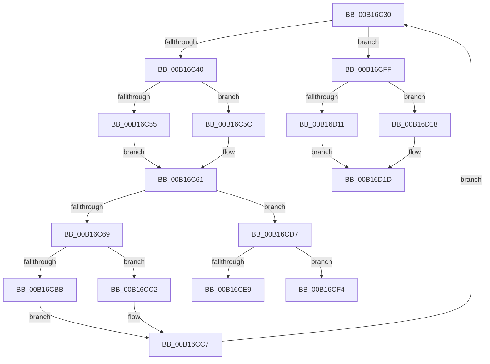

# sub_00B16C30

- RVA: `0x00B16C30`–`0x00B16D2A` (길이 `250` bytes)
- VA: `0x0000000140B16C30`
- 실행 섹션: `PAGE`
- PDB 이름 있음: `아니요`; PDB Function 태그: `아니요`
- unwind 정보 RVA: `0x0006A978`
- 디코드: `60`개 명령, `250/250` bytes 표시
- 미해석 바이트: `0` (있으면 어셈블리에 `.byte`로 보존)

> 이 문서는 커널 이미지의 기계어와 PDB 기호를 분석해 생성했습니다. 4번과 5번은 함수 원형과 자료형을 바이너리 사용 방식에서 추정한 C 해석이며 원본 소스 복구 결과는 아닙니다.

## 1. Dependencies

- 직접 호출 지점: **8**; 고유 호출 대상: **4**
- 직접 호출자로 확인된 함수: **0**
- RIP 상대 이미지 참조: **0**

### Outgoing calls
- `0x00B16C55` → [HvpGetCellFlat](../85/HvpGetCellFlat_function_00854C60.md) (function, `0x00854C60`)
- `0x00B16C5C` → [HvpGetCellPaged](../85/HvpGetCellPaged_function_00854CB0.md) (function, `0x00854CB0`)
- `0x00B16CBB` → [HvpReleaseCellFlat](../85/HvpReleaseCellFlat_function_0085CC20.md) (function, `0x0085CC20`)
- `0x00B16CC2` → [HvpReleaseCellPaged](../85/HvpReleaseCellPaged_function_00855F40.md) (function, `0x00855F40`)
- `0x00B16CE9` → [HvpReleaseCellFlat](../85/HvpReleaseCellFlat_function_0085CC20.md) (function, `0x0085CC20`)
- `0x00B16CF4` → [HvpReleaseCellPaged](../85/HvpReleaseCellPaged_function_00855F40.md) (function, `0x00855F40`)
- `0x00B16D11` → [HvpReleaseCellFlat](../85/HvpReleaseCellFlat_function_0085CC20.md) (function, `0x0085CC20`)
- `0x00B16D18` → [HvpReleaseCellPaged](../85/HvpReleaseCellPaged_function_00855F40.md) (function, `0x00855F40`)

### Direct callers
- 이 함수 시작 RVA로 연결되는 직접 call은 확인되지 않았습니다. 간접 호출은 완전히 역산할 수 없습니다.

### Static image references
- 디코드된 RIP-relative 메모리 참조가 없습니다.

## 2. Other-region calls and transfers

- 다른 실행 섹션으로 향하는 call: **0**
- call이 아닌 외부 분기/꼬리 이동: **3**
  - `0x00B16CEF` → [CmpQueryKeyDataFromCache + 0x3FE](../85/CmpQueryKeyDataFromCache_function_00858F70.md) (`tail-transfer`)
  - `0x00B16CFA` → [CmpQueryKeyDataFromCache + 0x3FE](../85/CmpQueryKeyDataFromCache_function_00858F70.md) (`tail-transfer`)
  - `0x00B16D25` → [CmpQueryKeyDataFromCache + 0xBD](../85/CmpQueryKeyDataFromCache_function_00858F70.md) (`tail-transfer`)

## 3. Assembly (complete function range)

```asm
00B16C30  89 44 24 48                     mov dword ptr [rsp + 0x48], eax
00B16C34  3B 87 18 01 00 00               cmp eax, dword ptr [rdi + 0x118]
00B16C3A  0F 83 BF 00 00 00               jae 0x140b16cff
00B16C40  8B 14 81                        mov edx, dword ptr [rcx + rax*4]
00B16C43  48 8B 4F 20                     mov rcx, qword ptr [rdi + 0x20]
00B16C47  4C 8D 44 24 28                  lea r8, [rsp + 0x28]
00B16C4C  F6 81 8C 00 00 00 01            test byte ptr [rcx + 0x8c], 1
00B16C53  74 07                           je 0x140b16c5c
00B16C55  E8 06 E0 D3 FF                  call 0x140854c60
00B16C5A  EB 05                           jmp 0x140b16c61
00B16C5C  E8 4F E0 D3 FF                  call 0x140854cb0
00B16C61  4C 8B C0                        mov r8, rax
00B16C64  48 85 C0                        test rax, rax
00B16C67  74 6E                           je 0x140b16cd7
00B16C69  0F B7 50 02                     movzx edx, word ptr [rax + 2]
00B16C6D  0F B7 CA                        movzx ecx, dx
00B16C70  66 03 C9                        add cx, cx
00B16C73  F6 40 10 01                     test byte ptr [rax + 0x10], 1
00B16C77  66 0F 44 CA                     cmove cx, dx
00B16C7B  0F B7 C1                        movzx eax, cx
00B16C7E  39 44 24 30                     cmp dword ptr [rsp + 0x30], eax
00B16C82  0F 43 44 24 30                  cmovae eax, dword ptr [rsp + 0x30]
00B16C87  89 44 24 30                     mov dword ptr [rsp + 0x30], eax
00B16C8B  41 8B 40 04                     mov eax, dword ptr [r8 + 4]
00B16C8F  8D 88 00 00 00 80               lea ecx, [rax - 0x80000000]
00B16C95  3D 00 00 00 80                  cmp eax, 0x80000000
00B16C9A  0F 42 C8                        cmovb ecx, eax
00B16C9D  44 3B E9                        cmp r13d, ecx
00B16CA0  44 0F 42 E9                     cmovb r13d, ecx
00B16CA4  44 89 6C 24 34                  mov dword ptr [rsp + 0x34], r13d
00B16CA9  48 8B 4F 20                     mov rcx, qword ptr [rdi + 0x20]
00B16CAD  48 8D 54 24 28                  lea rdx, [rsp + 0x28]
00B16CB2  F6 81 8C 00 00 00 01            test byte ptr [rcx + 0x8c], 1
00B16CB9  74 07                           je 0x140b16cc2
00B16CBB  E8 60 5F D4 FF                  call 0x14085cc20
00B16CC0  EB 05                           jmp 0x140b16cc7
00B16CC2  E8 79 F2 D3 FF                  call 0x140855f40
00B16CC7  8B 44 24 48                     mov eax, dword ptr [rsp + 0x48]
00B16CCB  FF C0                           inc eax
00B16CCD  48 8B 4C 24 40                  mov rcx, qword ptr [rsp + 0x40]
00B16CD2  E9 59 FF FF FF                  jmp 0x140b16c30
00B16CD7  48 8B 4F 20                     mov rcx, qword ptr [rdi + 0x20]
00B16CDB  48 8D 54 24 20                  lea rdx, [rsp + 0x20]
00B16CE0  F6 81 8C 00 00 00 01            test byte ptr [rcx + 0x8c], 1
00B16CE7  74 0B                           je 0x140b16cf4
00B16CE9  E8 32 5F D4 FF                  call 0x14085cc20
00B16CEE  90                              nop
00B16CEF  E9 7A 26 D4 FF                  jmp 0x14085936e
00B16CF4  E8 47 F2 D3 FF                  call 0x140855f40
00B16CF9  90                              nop
00B16CFA  E9 6F 26 D4 FF                  jmp 0x14085936e
00B16CFF  48 8B 4F 20                     mov rcx, qword ptr [rdi + 0x20]
00B16D03  48 8D 54 24 20                  lea rdx, [rsp + 0x20]
00B16D08  F6 81 8C 00 00 00 01            test byte ptr [rcx + 0x8c], 1
00B16D0F  74 07                           je 0x140b16d18
00B16D11  E8 0A 5F D4 FF                  call 0x14085cc20
00B16D16  EB 05                           jmp 0x140b16d1d
00B16D18  E8 23 F2 D3 FF                  call 0x140855f40
00B16D1D  44 8B 8C 24 90 00 00 00         mov r9d, dword ptr [rsp + 0x90]
00B16D25  E9 03 23 D4 FF                  jmp 0x14085902d
```

## 4. C-style interpretation (structured pseudocode)

```c
__int64 __fastcall sub_00B16C30(__int64 a1, __int64 a2, __int64 a3, __int64 a4, __int64 a5, unsigned int a6, __int64 a7, __int64 a8, unsigned int a9, __int64 a10, __int64 a11, __int64 a12, __int64 a13, __int64 a14, __int64 a15, __int64 a16, __int64 a17, unsigned int a18)
{
    __int64 result;
    __int64 v_r13;
    unsigned __int64 v_stack_p20;
    unsigned int v_stack_p30;
    unsigned int v_stack_p34;
    unsigned int v_stack_p48;

    v_stack_p48 = (unsigned int)(result);
    if (((unsigned int)(result)) >= (*(unsigned int *)(v_rdi + 280))) goto loc_00B16CFF;
    if (((*(unsigned __int8 *)(*(unsigned __int64 *)(v_rdi + 32) + 140)) & (1)) == 0) goto loc_00B16C5C;
    result = HvpGetCellFlat(*(unsigned __int64 *)(v_rdi + 32), (unsigned int)(*(unsigned int *)(a1 + result * 4)), a5, a4);
    goto loc_00B16C61;
loc_00B16C5C:
    result = HvpGetCellPaged(*(unsigned __int64 *)(v_rdi + 32), (unsigned int)(*(unsigned int *)(a1 + result * 4)), a5, a4);
loc_00B16C61:
    if (result == 0) goto loc_00B16CD7;
    a1 = (unsigned __int16)(((unsigned __int16)(*(unsigned __int16 *)(result + 2))) + ((unsigned __int16)((unsigned __int16)(*(unsigned __int16 *)(result + 2)))));
    if (((*(unsigned __int8 *)(result + 16)) & (1)) == 0) { a1 = (unsigned __int16)(*(unsigned __int16 *)(result + 2)); }
    result = (unsigned __int16)(a1);
    if (a6 >= ((unsigned int)((unsigned __int16)(a1)))) { result = a6; }
    v_stack_p30 = (unsigned int)(result);
    a1 = (unsigned int)(*(unsigned int *)(result + 4)) - 2147483648;
    if (((unsigned int)((unsigned int)(*(unsigned int *)(result + 4)))) < 0x80000000ULL) { a1 = (unsigned int)((unsigned int)(*(unsigned int *)(result + 4))); }
    if (((unsigned int)(v_r13)) < ((unsigned int)(a1))) { v_r13 = (unsigned int)(a1); }
    v_stack_p34 = (unsigned int)(v_r13);
    if (((*(unsigned __int8 *)(*(unsigned __int64 *)(v_rdi + 32) + 140)) & (1)) == 0) goto loc_00B16CC2;
    result = HvpReleaseCellFlat(*(unsigned __int64 *)(v_rdi + 32), a5, result, a4);
    goto loc_00B16CC7;
loc_00B16CC2:
    result = HvpReleaseCellPaged(*(unsigned __int64 *)(v_rdi + 32), a5, result, a4);
loc_00B16CC7:
    result = (unsigned int)(((unsigned int)(a9)) + 1);
    goto loc_00B16C30;
loc_00B16CD7:
    if (((*(unsigned __int8 *)(*(unsigned __int64 *)(v_rdi + 32) + 140)) & (1)) == 0) goto loc_00B16CF4;
    result = HvpReleaseCellFlat(*(unsigned __int64 *)(v_rdi + 32), v_stack_p20, result, a4);
loc_00B16CF4:
    result = HvpReleaseCellPaged(*(unsigned __int64 *)(v_rdi + 32), v_stack_p20, result, a4);
loc_00B16CFF:
    if (((*(unsigned __int8 *)(*(unsigned __int64 *)(v_rdi + 32) + 140)) & (1)) == 0) goto loc_00B16D18;
    result = HvpReleaseCellFlat(*(unsigned __int64 *)(v_rdi + 32), v_stack_p20, result, a4);
    goto loc_00B16D1D;
loc_00B16D18:
    result = HvpReleaseCellPaged(*(unsigned __int64 *)(v_rdi + 32), v_stack_p20, result, a4);
loc_00B16D1D:
}
```

## 5. (Beta) C Style

```c
int64_t sub_00B16C30(int64_t Arg1, int64_t Arg2, int64_t Arg3, int64_t Arg4, int64_t Arg5, uint32_t Arg6, uint64_t Arg7, int64_t Arg8, uint32_t Arg9, uint64_t Arg10, uint64_t Arg11, uint64_t Arg12, uint64_t Arg13, uint64_t Arg14, uint64_t Arg15, uint64_t Arg16, uint64_t Arg17, uint32_t Arg18)
{
    int64_t result;
    int64_t local_r13;
    uint64_t v_stack_p20;
    uint32_t v_stack_p30;
    uint32_t v_stack_p34;
    uint32_t v_stack_p48;

    v_stack_p48 = (uint32_t)(result);
    if (((uint32_t)(result)) >= (*(uint32_t *)(local_rdi + 0x118))) goto loc_00B16CFF;
    if (((*(uint8_t *)(*(uint64_t *)(local_rdi + 0x20) + 0x8C)) & (1)) == 0) goto loc_00B16C5C;
    result = HvpGetCellFlat(*(uint64_t *)(local_rdi + 0x20), (uint32_t)(*(uint32_t *)(Arg1 + result * 4)), Arg5, Arg4);
    goto loc_00B16C61;
loc_00B16C5C:
    result = HvpGetCellPaged(*(uint64_t *)(local_rdi + 0x20), (uint32_t)(*(uint32_t *)(Arg1 + result * 4)), Arg5, Arg4);
loc_00B16C61:
    if (result == 0) goto loc_00B16CD7;
    Arg1 = (uint16_t)(((uint16_t)(*(uint16_t *)(result + 0x2))) + ((uint16_t)((uint16_t)(*(uint16_t *)(result + 0x2)))));
    if (((*(uint8_t *)(result + 0x10)) & (1)) == 0) { Arg1 = (uint16_t)(*(uint16_t *)(result + 0x2)); }
    result = (uint16_t)(Arg1);
    if (Arg6 >= ((uint32_t)((uint16_t)(Arg1)))) { result = Arg6; }
    v_stack_p30 = (uint32_t)(result);
    Arg1 = (uint32_t)(*(uint32_t *)(result + 0x4)) - 2147483648;
    if (((uint32_t)((uint32_t)(*(uint32_t *)(result + 0x4)))) < 0x80000000ULL) { Arg1 = (uint32_t)((uint32_t)(*(uint32_t *)(result + 0x4))); }
    if (((uint32_t)(local_r13)) < ((uint32_t)(Arg1))) { local_r13 = (uint32_t)(Arg1); }
    v_stack_p34 = (uint32_t)(local_r13);
    if (((*(uint8_t *)(*(uint64_t *)(local_rdi + 0x20) + 0x8C)) & (1)) == 0) goto loc_00B16CC2;
    result = HvpReleaseCellFlat(*(uint64_t *)(local_rdi + 0x20), Arg5, result, Arg4);
    goto loc_00B16CC7;
loc_00B16CC2:
    result = HvpReleaseCellPaged(*(uint64_t *)(local_rdi + 0x20), Arg5, result, Arg4);
loc_00B16CC7:
    result = (uint32_t)(((uint32_t)(Arg9)) + 1);
    goto loc_00B16C30;
loc_00B16CD7:
    if (((*(uint8_t *)(*(uint64_t *)(local_rdi + 0x20) + 0x8C)) & (1)) == 0) goto loc_00B16CF4;
    result = HvpReleaseCellFlat(*(uint64_t *)(local_rdi + 0x20), v_stack_p20, result, Arg4);
loc_00B16CF4:
    result = HvpReleaseCellPaged(*(uint64_t *)(local_rdi + 0x20), v_stack_p20, result, Arg4);
loc_00B16CFF:
    if (((*(uint8_t *)(*(uint64_t *)(local_rdi + 0x20) + 0x8C)) & (1)) == 0) goto loc_00B16D18;
    result = HvpReleaseCellFlat(*(uint64_t *)(local_rdi + 0x20), v_stack_p20, result, Arg4);
    goto loc_00B16D1D;
loc_00B16D18:
    result = HvpReleaseCellPaged(*(uint64_t *)(local_rdi + 0x20), v_stack_p20, result, Arg4);
loc_00B16D1D:
}
```

## 6. Execution-region graph

[열기: 2D/3D 그래프와 함수 탐색 컨트롤 패널](../../../control-panel.html?section=page&rva=0x00B16C30&view=graph)

- 2D 그래프는 위에서 아래로 흐르고, 3D 그래프는 빈 공간을 드래그해 회전합니다. Shift+드래그는 이동, 휠은 확대·축소, 함수 노드 선택은 대상 보고서 이동입니다.

### Static fallback


