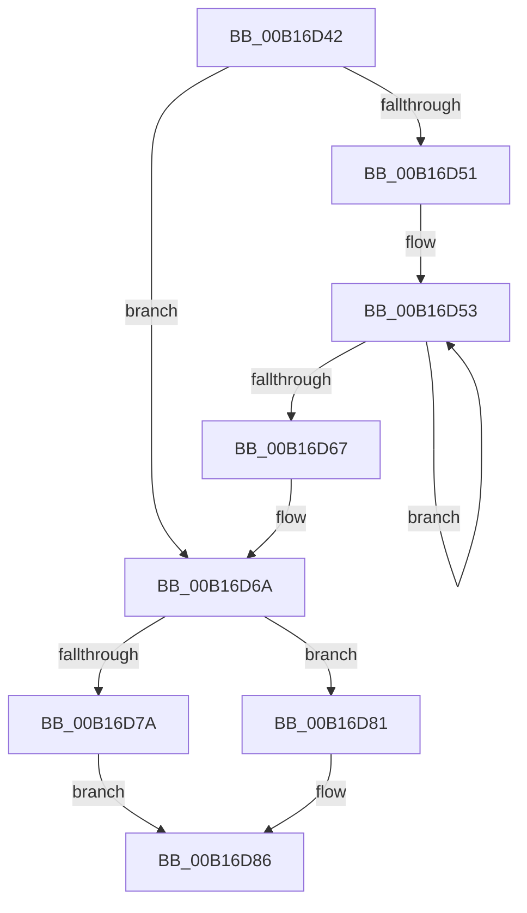

# sub_00B16D42

- RVA: `0x00B16D42`–`0x00B16D97` (길이 `85` bytes)
- VA: `0x0000000140B16D42`
- 실행 섹션: `PAGE`
- PDB 이름 있음: `아니요`; PDB Function 태그: `아니요`
- unwind 정보 RVA: `0x0006ADB0`
- 디코드: `25`개 명령, `85/85` bytes 표시
- 미해석 바이트: `0` (있으면 어셈블리에 `.byte`로 보존)

> 이 문서는 커널 이미지의 기계어와 PDB 기호를 분석해 생성했습니다. 4번과 5번은 함수 원형과 자료형을 바이너리 사용 방식에서 추정한 C 해석이며 원본 소스 복구 결과는 아닙니다.

## 1. Dependencies

- 직접 호출 지점: **5**; 고유 호출 대상: **4**
- 직접 호출자로 확인된 함수: **0**
- RIP 상대 이미지 참조: **0**

### Outgoing calls
- `0x00B16D42` → [HvpGetCellPaged](../85/HvpGetCellPaged_function_00854CB0.md) (function, `0x00854CB0`)
- `0x00B16D58` → [HvFreeCell](../85/HvFreeCell_function_0085A72C.md) (function, `0x0085A72C`)
- `0x00B16D7A` → [HvpReleaseCellFlat](../85/HvpReleaseCellFlat_function_0085CC20.md) (function, `0x0085CC20`)
- `0x00B16D81` → [HvpReleaseCellPaged](../85/HvpReleaseCellPaged_function_00855F40.md) (function, `0x00855F40`)
- `0x00B16D8C` → [HvFreeCell](../85/HvFreeCell_function_0085A72C.md) (function, `0x0085A72C`)

### Direct callers
- 이 함수 시작 RVA로 연결되는 직접 call은 확인되지 않았습니다. 간접 호출은 완전히 역산할 수 없습니다.

### Static image references
- 디코드된 RIP-relative 메모리 참조가 없습니다.

## 2. Other-region calls and transfers

- 다른 실행 섹션으로 향하는 call: **0**
- call이 아닌 외부 분기/꼬리 이동: **1**
  - `0x00B16D92` → [CmpCopyKeyPartial + 0x33B](../85/CmpCopyKeyPartial_function_0085AFF4.md) (`tail-transfer`)

## 3. Assembly (complete function range)

```asm
00B16D42  E8 69 DF D3 FF                  call 0x140854cb0
00B16D47  48 8B F8                        mov rdi, rax
00B16D4A  8B 45 BF                        mov eax, dword ptr [rbp - 0x41]
00B16D4D  85 C0                           test eax, eax
00B16D4F  74 19                           je 0x140b16d6a
00B16D51  8B F0                           mov esi, eax
00B16D53  8B 17                           mov edx, dword ptr [rdi]
00B16D55  48 8B CB                        mov rcx, rbx
00B16D58  E8 CF 39 D4 FF                  call 0x14085a72c
00B16D5D  48 8D 7F 04                     lea rdi, [rdi + 4]
00B16D61  48 83 EE 01                     sub rsi, 1
00B16D65  75 EC                           jne 0x140b16d53
00B16D67  83 CE FF                        or esi, 0xffffffff
00B16D6A  F6 83 8C 00 00 00 01            test byte ptr [rbx + 0x8c], 1
00B16D71  48 8D 55 DF                     lea rdx, [rbp - 0x21]
00B16D75  48 8B CB                        mov rcx, rbx
00B16D78  74 07                           je 0x140b16d81
00B16D7A  E8 A1 5E D4 FF                  call 0x14085cc20
00B16D7F  EB 05                           jmp 0x140b16d86
00B16D81  E8 BA F1 D3 FF                  call 0x140855f40
00B16D86  41 8B D7                        mov edx, r15d
00B16D89  48 8B CB                        mov rcx, rbx
00B16D8C  E8 9B 39 D4 FF                  call 0x14085a72c
00B16D91  90                              nop
00B16D92  E9 98 45 D4 FF                  jmp 0x14085b32f
```

## 4. C-style interpretation (structured pseudocode)

```c
__int64 __fastcall sub_00B16D42(void)
{
    __int64 result;
    __int64 v_rsi;

    result = HvpGetCellPaged(a1, a2, a3, a4);
    if ((unsigned int)((unsigned int)(*(unsigned int *)(v_rbp - 65))) == 0) goto loc_00B16D6A;
loc_00B16D53:
    result = HvFreeCell(v_rbx, (unsigned int)(*(unsigned int *)(result)), a3, a4);
    v_rsi = ((unsigned int)((unsigned int)((unsigned int)(*(unsigned int *)(v_rbp - 65))))) - (1);
    if (condition_is_not_equal) goto loc_00B16D53;
    v_rsi = (unsigned int)((v_rsi) | (0xFFFFFFFFULL));
loc_00B16D6A:
    if (((*(unsigned __int8 *)(v_rbx + 140)) & (1)) == 0) goto loc_00B16D81;
    result = HvpReleaseCellFlat(v_rbx, v_rbp - 33, a3, a4);
    goto loc_00B16D86;
loc_00B16D81:
    result = HvpReleaseCellPaged(v_rbx, v_rbp - 33, a3, a4);
loc_00B16D86:
    result = HvFreeCell(v_rbx, (unsigned int)((unsigned int)(v_r15)), a3, a4);
}
```

## 5. (Beta) C Style

```c
void sub_00B16D42(void)
{
    int64_t result;
    int64_t local_rsi;

    result = HvpGetCellPaged(a1, a2, a3, a4);
    if ((uint32_t)((uint32_t)(*(uint32_t *)(local_rbp - 0x41))) == 0) goto loc_00B16D6A;
loc_00B16D53:
    result = HvFreeCell(local_rbx, (uint32_t)(*(uint32_t *)(result)), a3, a4);
    local_rsi = ((uint32_t)((uint32_t)((uint32_t)(*(uint32_t *)(local_rbp - 0x41))))) - (1);
    if (condition_is_not_equal) goto loc_00B16D53;
    local_rsi = (uint32_t)((local_rsi) | (0xFFFFFFFFULL));
loc_00B16D6A:
    if (((*(uint8_t *)(local_rbx + 0x8C)) & (1)) == 0) goto loc_00B16D81;
    result = HvpReleaseCellFlat(local_rbx, local_rbp - 33, a3, a4);
    goto loc_00B16D86;
loc_00B16D81:
    result = HvpReleaseCellPaged(local_rbx, local_rbp - 33, a3, a4);
loc_00B16D86:
    result = HvFreeCell(local_rbx, (uint32_t)((uint32_t)(local_r15)), a3, a4);
}
```

## 6. Execution-region graph

[열기: 2D/3D 그래프와 함수 탐색 컨트롤 패널](../../../control-panel.html?section=page&rva=0x00B16D42&view=graph)

- 2D 그래프는 위에서 아래로 흐르고, 3D 그래프는 빈 공간을 드래그해 회전합니다. Shift+드래그는 이동, 휠은 확대·축소, 함수 노드 선택은 대상 보고서 이동입니다.

### Static fallback


