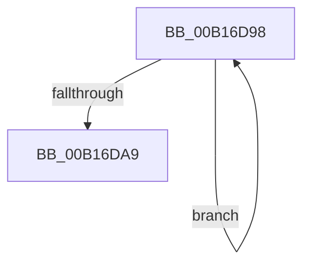

# sub_00B16D98

- RVA: `0x00B16D98`–`0x00B16DAE` (길이 `22` bytes)
- VA: `0x0000000140B16D98`
- 실행 섹션: `PAGE`
- PDB 이름 있음: `아니요`; PDB Function 태그: `아니요`
- unwind 정보 RVA: `0x0006ADE0`
- 디코드: `7`개 명령, `22/22` bytes 표시
- 미해석 바이트: `0` (있으면 어셈블리에 `.byte`로 보존)

> 이 문서는 커널 이미지의 기계어와 PDB 기호를 분석해 생성했습니다. 4번과 5번은 함수 원형과 자료형을 바이너리 사용 방식에서 추정한 C 해석이며 원본 소스 복구 결과는 아닙니다.

## 1. Dependencies

- 직접 호출 지점: **0**; 고유 호출 대상: **0**
- 직접 호출자로 확인된 함수: **0**
- RIP 상대 이미지 참조: **0**

### Outgoing calls
- 직접 디코드된 call 명령이 없습니다.

### Direct callers
- 이 함수 시작 RVA로 연결되는 직접 call은 확인되지 않았습니다. 간접 호출은 완전히 역산할 수 없습니다.

### Static image references
- 디코드된 RIP-relative 메모리 참조가 없습니다.

## 2. Other-region calls and transfers

- 다른 실행 섹션으로 향하는 call: **0**
- call이 아닌 외부 분기/꼬리 이동: **1**
  - `0x00B16DA9` → [CmpAddValueToListEx + 0xAA](../85/CmpAddValueToListEx_function_0085B460.md) (`tail-transfer`)

## 3. Assembly (complete function range)

```asm
00B16D98  FF CB                           dec ebx
00B16D9A  8B 0C 9A                        mov ecx, dword ptr [rdx + rbx*4]
00B16D9D  41 89 08                        mov dword ptr [r8], ecx
00B16DA0  4D 8D 40 FC                     lea r8, [r8 - 4]
00B16DA4  41 3B DC                        cmp ebx, r12d
00B16DA7  77 EF                           ja 0x140b16d98
00B16DA9  E9 5C 47 D4 FF                  jmp 0x14085b50a
```

## 4. C-style interpretation (structured pseudocode)

```c
void __fastcall sub_00B16D98(__int64 a1, __int64 a2, __int64 a3)
{
    __int64 v_rbx;

    v_rbx = (unsigned int)((v_rbx) - 1);
    *(unsigned int *)(a3) = (unsigned int)((unsigned int)(*(unsigned int *)(a2 + v_rbx * 4)));
    if (((unsigned int)(v_rbx)) > ((unsigned int)(v_r12))) goto loc_00B16D98;
}
```

## 5. (Beta) C Style

```c
void sub_00B16D98(int64_t Arg1, void *Arg2, void *Arg3)
{
    uint8_t *arg2 = (uint8_t *)Arg2;
    uint8_t *arg3 = (uint8_t *)Arg3;

    int64_t local_rbx;

    local_rbx = (uint32_t)((local_rbx) - 1);
    *(uint32_t *)(arg3) = (uint32_t)((uint32_t)(*(uint32_t *)(arg2 + local_rbx * 4)));
    if (((uint32_t)(local_rbx)) > ((uint32_t)(local_r12))) goto loc_00B16D98;
}
```

### 관측된 메모리 오프셋

구조체 형식이 확인되지 않은 접근은 인자 기준의 오프셋으로만 기록했습니다.

| 기준 인자 | 오프셋 표현 | 폭 (bit) | 접근 |
|---|---:|---:|---|
| `Arg2` | `+ 0x0 + rbx*4` | `32` | `R` |
| `Arg3` | `- 0x4` | `64` | `R` |
| `Arg3` | `+ 0x0` | `32` | `W` |

## 6. Execution-region graph

[열기: 2D/3D 그래프와 함수 탐색 컨트롤 패널](../../../control-panel.html?section=page&rva=0x00B16D98&view=graph)

- 2D 그래프는 위에서 아래로 흐르고, 3D 그래프는 빈 공간을 드래그해 회전합니다. Shift+드래그는 이동, 휠은 확대·축소, 함수 노드 선택은 대상 보고서 이동입니다.

### Static fallback


