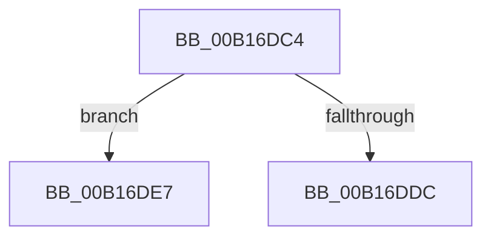

# sub_00B16DC4

- RVA: `0x00B16DC4`–`0x00B16DF2` (길이 `46` bytes)
- VA: `0x0000000140B16DC4`
- 실행 섹션: `PAGE`
- PDB 이름 있음: `아니요`; PDB Function 태그: `아니요`
- unwind 정보 RVA: `0x0006AE38`
- 디코드: `12`개 명령, `46/46` bytes 표시
- 미해석 바이트: `0` (있으면 어셈블리에 `.byte`로 보존)

> 이 문서는 커널 이미지의 기계어와 PDB 기호를 분석해 생성했습니다. 4번과 5번은 함수 원형과 자료형을 바이너리 사용 방식에서 추정한 C 해석이며 원본 소스 복구 결과는 아닙니다.

## 1. Dependencies

- 직접 호출 지점: **3**; 고유 호출 대상: **3**
- 직접 호출자로 확인된 함수: **0**
- RIP 상대 이미지 참조: **0**

### Outgoing calls
- `0x00B16DC4` → [HvpReleaseCellPaged](../85/HvpReleaseCellPaged_function_00855F40.md) (function, `0x00855F40`)
- `0x00B16DDC` → [HvpGetCellFlat](../85/HvpGetCellFlat_function_00854C60.md) (function, `0x00854C60`)
- `0x00B16DE7` → [HvpGetCellPaged](../85/HvpGetCellPaged_function_00854CB0.md) (function, `0x00854CB0`)

### Direct callers
- 이 함수 시작 RVA로 연결되는 직접 call은 확인되지 않았습니다. 간접 호출은 완전히 역산할 수 없습니다.

### Static image references
- 디코드된 RIP-relative 메모리 참조가 없습니다.

## 2. Other-region calls and transfers

- 다른 실행 섹션으로 향하는 call: **0**
- call이 아닌 외부 분기/꼬리 이동: **2**
  - `0x00B16DE2` → [CmpCopyValue + 0x207](../85/CmpCopyValue_function_0085B798.md) (`tail-transfer`)
  - `0x00B16DED` → [CmpCopyValue + 0x207](../85/CmpCopyValue_function_0085B798.md) (`tail-transfer`)

## 3. Assembly (complete function range)

```asm
00B16DC4  E8 77 F1 D3 FF                  call 0x140855f40
00B16DC9  4C 8D 45 E8                     lea r8, [rbp - 0x18]
00B16DCD  41 8B D7                        mov edx, r15d
00B16DD0  48 8B CB                        mov rcx, rbx
00B16DD3  44 84 A3 8C 00 00 00            test byte ptr [rbx + 0x8c], r12b
00B16DDA  74 0B                           je 0x140b16de7
00B16DDC  E8 7F DE D3 FF                  call 0x140854c60
00B16DE1  90                              nop
00B16DE2  E9 B8 4B D4 FF                  jmp 0x14085b99f
00B16DE7  E8 C4 DE D3 FF                  call 0x140854cb0
00B16DEC  90                              nop
00B16DED  E9 AD 4B D4 FF                  jmp 0x14085b99f
```

## 4. C-style interpretation (structured pseudocode)

```c
__int64 __fastcall sub_00B16DC4(void)
{
    __int64 result;

    result = HvpReleaseCellPaged(a1, a2, a3, a4);
    if (((*(unsigned __int8 *)(v_rbx + 140)) & ((unsigned __int8)(v_r12))) == 0) goto loc_00B16DE7;
    result = HvpGetCellFlat(v_rbx, (unsigned int)((unsigned int)(v_r15)), v_rbp - 24, a4);
loc_00B16DE7:
    result = HvpGetCellPaged(v_rbx, (unsigned int)((unsigned int)(v_r15)), v_rbp - 24, a4);
}
```

## 5. (Beta) C Style

```c
void sub_00B16DC4(void)
{
    int64_t result;

    result = HvpReleaseCellPaged(a1, a2, a3, a4);
    if (((*(uint8_t *)(local_rbx + 0x8C)) & ((uint8_t)(local_r12))) == 0) goto loc_00B16DE7;
    result = HvpGetCellFlat(local_rbx, (uint32_t)((uint32_t)(local_r15)), local_rbp - 24, a4);
loc_00B16DE7:
    result = HvpGetCellPaged(local_rbx, (uint32_t)((uint32_t)(local_r15)), local_rbp - 24, a4);
}
```

## 6. Execution-region graph

[열기: 2D/3D 그래프와 함수 탐색 컨트롤 패널](../../../control-panel.html?section=page&rva=0x00B16DC4&view=graph)

- 2D 그래프는 위에서 아래로 흐르고, 3D 그래프는 빈 공간을 드래그해 회전합니다. Shift+드래그는 이동, 휠은 확대·축소, 함수 노드 선택은 대상 보고서 이동입니다.

### Static fallback


