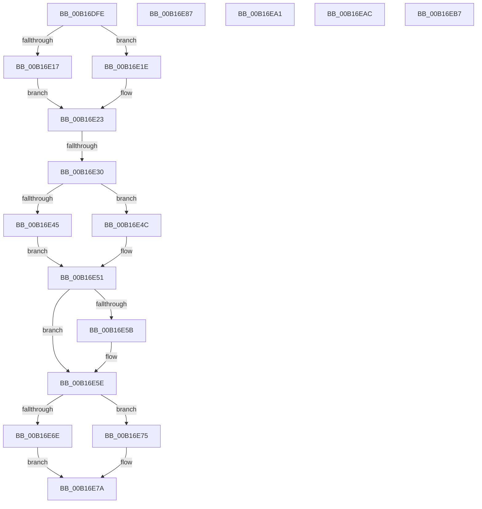

# sub_00B16DFE

- RVA: `0x00B16DFE`–`0x00B16EC2` (길이 `196` bytes)
- VA: `0x0000000140B16DFE`
- 실행 섹션: `PAGE`
- PDB 이름 있음: `아니요`; PDB Function 태그: `아니요`
- unwind 정보 RVA: `0x0006AEB4`
- 디코드: `51`개 명령, `196/196` bytes 표시
- 미해석 바이트: `0` (있으면 어셈블리에 `.byte`로 보존)

> 이 문서는 커널 이미지의 기계어와 PDB 기호를 분석해 생성했습니다. 4번과 5번은 함수 원형과 자료형을 바이너리 사용 방식에서 추정한 C 해석이며 원본 소스 복구 결과는 아닙니다.

## 1. Dependencies

- 직접 호출 지점: **9**; 고유 호출 대상: **6**
- 직접 호출자로 확인된 함수: **0**
- RIP 상대 이미지 참조: **0**

### Outgoing calls
- `0x00B16E17` → [CmpMergeKeyValues](../7F/CmpMergeKeyValues_function_007F2304.md) (function, `0x007F2304`)
- `0x00B16E1E` → [CmpSyncKeyValues](../7F/CmpSyncKeyValues_function_007F2DF4.md) (function, `0x007F2DF4`)
- `0x00B16E45` → [HvpGetCellFlat](../85/HvpGetCellFlat_function_00854C60.md) (function, `0x00854C60`)
- `0x00B16E4C` → [HvpGetCellPaged](../85/HvpGetCellPaged_function_00854CB0.md) (function, `0x00854CB0`)
- `0x00B16E6E` → [HvpReleaseCellFlat](../85/HvpReleaseCellFlat_function_0085CC20.md) (function, `0x0085CC20`)
- `0x00B16E75` → [HvpReleaseCellPaged](../85/HvpReleaseCellPaged_function_00855F40.md) (function, `0x00855F40`)
- `0x00B16EA1` → [HvpReleaseCellPaged](../85/HvpReleaseCellPaged_function_00855F40.md) (function, `0x00855F40`)
- `0x00B16EAC` → [HvpReleaseCellPaged](../85/HvpReleaseCellPaged_function_00855F40.md) (function, `0x00855F40`)
- `0x00B16EB7` → [HvpReleaseCellPaged](../85/HvpReleaseCellPaged_function_00855F40.md) (function, `0x00855F40`)

### Direct callers
- 이 함수 시작 RVA로 연결되는 직접 call은 확인되지 않았습니다. 간접 호출은 완전히 역산할 수 없습니다.

### Static image references
- 디코드된 RIP-relative 메모리 참조가 없습니다.

## 2. Other-region calls and transfers

- 다른 실행 섹션으로 향하는 call: **0**
- call이 아닌 외부 분기/꼬리 이동: **6**
  - `0x00B16E2A` → [CmpCopySyncTree2 + 0x810](../85/CmpCopySyncTree2_function_0085BF78.md) (`tail-transfer`)
  - `0x00B16E82` → [CmpCopySyncTree2 + 0x79E](../85/CmpCopySyncTree2_function_0085BF78.md) (`tail-transfer`)
  - `0x00B16E9C` → [CmpCopySyncTree2 + 0x815](../85/CmpCopySyncTree2_function_0085BF78.md) (`tail-transfer`)
  - `0x00B16EA7` → [CmpCopySyncTree2 + 0x81F](../85/CmpCopySyncTree2_function_0085BF78.md) (`tail-transfer`)
  - `0x00B16EB2` → [CmpCopySyncTree2 + 0x828](../85/CmpCopySyncTree2_function_0085BF78.md) (`tail-transfer`)
  - `0x00B16EBD` → [CmpCopySyncTree2 + 0x831](../85/CmpCopySyncTree2_function_0085BF78.md) (`tail-transfer`)

## 3. Assembly (complete function range)

```asm
00B16DFE  83 7D 7F 02                     cmp dword ptr [rbp + 0x7f], 2
00B16E02  4C 8B CB                        mov r9, rbx
00B16E05  4C 89 74 24 28                  mov qword ptr [rsp + 0x28], r14
00B16E0A  4C 8B C6                        mov r8, rsi
00B16E0D  44 89 6C 24 20                  mov dword ptr [rsp + 0x20], r13d
00B16E12  49 8B CF                        mov rcx, r15
00B16E15  75 07                           jne 0x140b16e1e
00B16E17  E8 E8 B4 CD FF                  call 0x1407f2304
00B16E1C  EB 05                           jmp 0x140b16e23
00B16E1E  E8 D1 BF CD FF                  call 0x1407f2df4
00B16E23  45 33 C9                        xor r9d, r9d
00B16E26  8B F8                           mov edi, eax
00B16E28  85 C0                           test eax, eax
00B16E2A  0F 88 58 59 D4 FF               js 0x14085c788
00B16E30  F6 83 8C 00 00 00 01            test byte ptr [rbx + 0x8c], 1
00B16E37  4C 8D 45 87                     lea r8, [rbp - 0x79]
00B16E3B  41 8B 54 24 04                  mov edx, dword ptr [r12 + 4]
00B16E40  48 8B CB                        mov rcx, rbx
00B16E43  74 07                           je 0x140b16e4c
00B16E45  E8 16 DE D3 FF                  call 0x140854c60
00B16E4A  EB 05                           jmp 0x140b16e51
00B16E4C  E8 5F DE D3 FF                  call 0x140854cb0
00B16E51  41 0F B7 4E 4A                  movzx ecx, word ptr [r14 + 0x4a]
00B16E56  3B 48 38                        cmp ecx, dword ptr [rax + 0x38]
00B16E59  76 03                           jbe 0x140b16e5e
00B16E5B  89 48 38                        mov dword ptr [rax + 0x38], ecx
00B16E5E  F6 83 8C 00 00 00 01            test byte ptr [rbx + 0x8c], 1
00B16E65  48 8D 55 87                     lea rdx, [rbp - 0x79]
00B16E69  48 8B CB                        mov rcx, rbx
00B16E6C  74 07                           je 0x140b16e75
00B16E6E  E8 AD 5D D4 FF                  call 0x14085cc20
00B16E73  EB 05                           jmp 0x140b16e7a
00B16E75  E8 C6 F0 D3 FF                  call 0x140855f40
00B16E7A  48 8B 46 04                     mov rax, qword ptr [rsi + 4]
00B16E7E  49 89 46 04                     mov qword ptr [r14 + 4], rax
00B16E82  E9 8F 58 D4 FF                  jmp 0x14085c716
00B16E87  8B 83 18 01 00 00               mov eax, dword ptr [rbx + 0x118]
00B16E8D  89 83 98 12 00 00               mov dword ptr [rbx + 0x1298], eax
00B16E93  41 8B F9                        mov edi, r9d
00B16E96  4D 8B F1                        mov r14, r9
00B16E99  49 8B F1                        mov rsi, r9
00B16E9C  E9 EC 58 D4 FF                  jmp 0x14085c78d
00B16EA1  E8 9A F0 D3 FF                  call 0x140855f40
00B16EA6  90                              nop
00B16EA7  E9 EB 58 D4 FF                  jmp 0x14085c797
00B16EAC  E8 8F F0 D3 FF                  call 0x140855f40
00B16EB1  90                              nop
00B16EB2  E9 E9 58 D4 FF                  jmp 0x14085c7a0
00B16EB7  E8 84 F0 D3 FF                  call 0x140855f40
00B16EBC  90                              nop
00B16EBD  E9 E7 58 D4 FF                  jmp 0x14085c7a9
```

## 4. C-style interpretation (structured pseudocode)

```c
__int64 __fastcall sub_00B16DFE(void)
{
    __int64 result;
    unsigned int v_stack_p20;
    unsigned __int64 v_stack_p28;

    v_stack_p28 = v_r14;
    v_stack_p20 = (unsigned int)(v_r13);
    if ((*(unsigned int *)(v_rbp + 127)) != 2) goto loc_00B16E1E;
    result = CmpMergeKeyValues(v_r15, a2, v_rsi, v_rbx);
    goto loc_00B16E23;
loc_00B16E1E:
    result = CmpSyncKeyValues(v_r15, a2, v_rsi, v_rbx);
loc_00B16E23:
    a4 = 0;
    if (((*(unsigned __int8 *)(v_rbx + 140)) & (1)) == 0) goto loc_00B16E4C;
    result = HvpGetCellFlat(v_rbx, (unsigned int)(*(unsigned int *)(v_r12 + 4)), v_rbp - 121, a4);
    goto loc_00B16E51;
loc_00B16E4C:
    result = HvpGetCellPaged(v_rbx, (unsigned int)(*(unsigned int *)(v_r12 + 4)), v_rbp - 121, a4);
loc_00B16E51:
    if (((unsigned int)(*(unsigned __int16 *)(v_r14 + 74))) >= = (*(unsigned int *)(result + 56))) {
        *(unsigned int *)(result + 56) = (unsigned int)(*(unsigned __int16 *)(v_r14 + 74));
    }
    if (((*(unsigned __int8 *)(v_rbx + 140)) & (1)) == 0) goto loc_00B16E75;
    result = HvpReleaseCellFlat(v_rbx, v_rbp - 121, v_rbp - 121, a4);
    goto loc_00B16E7A;
loc_00B16E75:
    result = HvpReleaseCellPaged(v_rbx, v_rbp - 121, v_rbp - 121, a4);
loc_00B16E7A:
    *(unsigned __int64 *)(v_r14 + 4) = *(unsigned __int64 *)(v_rsi + 4);
}
```

## 5. (Beta) C Style

```c
void sub_00B16DFE(void)
{
    int64_t result;
    uint32_t v_stack_p20;
    uint64_t v_stack_p28;

    v_stack_p28 = local_r14;
    v_stack_p20 = (uint32_t)(local_r13);
    if ((*(uint32_t *)(local_rbp + 0x7F)) != 2) goto loc_00B16E1E;
    result = CmpMergeKeyValues(local_r15, a2, local_rsi, local_rbx);
    goto loc_00B16E23;
loc_00B16E1E:
    result = CmpSyncKeyValues(local_r15, a2, local_rsi, local_rbx);
loc_00B16E23:
    a4 = 0;
    if (((*(uint8_t *)(local_rbx + 0x8C)) & (1)) == 0) goto loc_00B16E4C;
    result = HvpGetCellFlat(local_rbx, (uint32_t)(*(uint32_t *)(local_r12 + 0x4)), local_rbp - 121, a4);
    goto loc_00B16E51;
loc_00B16E4C:
    result = HvpGetCellPaged(local_rbx, (uint32_t)(*(uint32_t *)(local_r12 + 0x4)), local_rbp - 121, a4);
loc_00B16E51:
    if (((uint32_t)(*(uint16_t *)(local_r14 + 0x4A))) >= = (*(uint32_t *)(result + 0x38))) {
        *(uint32_t *)(result + 0x38) = (uint32_t)(*(uint16_t *)(local_r14 + 0x4A));
    }
    if (((*(uint8_t *)(local_rbx + 0x8C)) & (1)) == 0) goto loc_00B16E75;
    result = HvpReleaseCellFlat(local_rbx, local_rbp - 121, local_rbp - 121, a4);
    goto loc_00B16E7A;
loc_00B16E75:
    result = HvpReleaseCellPaged(local_rbx, local_rbp - 121, local_rbp - 121, a4);
loc_00B16E7A:
    *(uint64_t *)(local_r14 + 0x4) = *(uint64_t *)(local_rsi + 0x4);
}
```

## 6. Execution-region graph

[열기: 2D/3D 그래프와 함수 탐색 컨트롤 패널](../../../control-panel.html?section=page&rva=0x00B16DFE&view=graph)

- 2D 그래프는 위에서 아래로 흐르고, 3D 그래프는 빈 공간을 드래그해 회전합니다. Shift+드래그는 이동, 휠은 확대·축소, 함수 노드 선택은 대상 보고서 이동입니다.

### Static fallback


