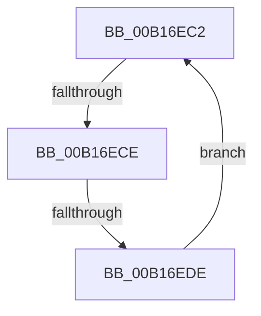

# sub_00B16EC2

- RVA: `0x00B16EC2`–`0x00B16EE0` (길이 `30` bytes)
- VA: `0x0000000140B16EC2`
- 실행 섹션: `PAGE`
- PDB 이름 있음: `아니요`; PDB Function 태그: `아니요`
- unwind 정보 RVA: `0x0006B0BC`
- 디코드: `8`개 명령, `30/30` bytes 표시
- 미해석 바이트: `0` (있으면 어셈블리에 `.byte`로 보존)

> 이 문서는 커널 이미지의 기계어와 PDB 기호를 분석해 생성했습니다. 4번과 5번은 함수 원형과 자료형을 바이너리 사용 방식에서 추정한 C 해석이며 원본 소스 복구 결과는 아닙니다.

## 1. Dependencies

- 직접 호출 지점: **0**; 고유 호출 대상: **0**
- 직접 호출자로 확인된 함수: **0**
- RIP 상대 이미지 참조: **0**

### Outgoing calls
- 직접 디코드된 call 명령이 없습니다.

### Direct callers
- 이 함수 시작 RVA로 연결되는 직접 call은 확인되지 않았습니다. 간접 호출은 완전히 역산할 수 없습니다.

### Static image references
- 디코드된 RIP-relative 메모리 참조가 없습니다.

## 2. Other-region calls and transfers

- 다른 실행 섹션으로 향하는 call: **0**
- call이 아닌 외부 분기/꼬리 이동: **2**
  - `0x00B16EC8` → [VrpFindDiffHiveEntryForMountPointWithLock + 0x161](../85/VrpFindDiffHiveEntryForMountPointWithLock_function_0085E484.md) (`tail-transfer`)
  - `0x00B16ED8` → [VrpFindDiffHiveEntryForMountPointWithLock + 0x115](../85/VrpFindDiffHiveEntryForMountPointWithLock_function_0085E484.md) (`tail-transfer`)

## 3. Assembly (complete function range)

```asm
00B16EC2  48 8B 1B                        mov rbx, qword ptr [rbx]
00B16EC5  F6 C3 01                        test bl, 1
00B16EC8  0F 85 17 77 D4 FF               jne 0x14085e5e5
00B16ECE  48 8B 43 08                     mov rax, qword ptr [rbx + 8]
00B16ED2  48 23 C2                        and rax, rdx
00B16ED5  48 3B C8                        cmp rcx, rax
00B16ED8  0F 84 BB 76 D4 FF               je 0x14085e599
00B16EDE  EB E2                           jmp 0x140b16ec2
```

## 4. C-style interpretation (structured pseudocode)

```c
__int64 __fastcall sub_00B16EC2(__int64 a1, __int64 a2)
{
    __int64 result;

    result = (*(unsigned __int64 *)(*(unsigned __int64 *)(v_rbx) + 8)) & (a2);
    goto loc_00B16EC2;
}
```

## 5. (Beta) C Style

```c
int64_t sub_00B16EC2(int64_t Arg1, int64_t Arg2)
{
    int64_t result;

    result = (*(uint64_t *)(*(uint64_t *)(local_rbx) + 0x8)) & (Arg2);
    goto loc_00B16EC2;
}
```

## 6. Execution-region graph

[열기: 2D/3D 그래프와 함수 탐색 컨트롤 패널](../../../control-panel.html?section=page&rva=0x00B16EC2&view=graph)

- 2D 그래프는 위에서 아래로 흐르고, 3D 그래프는 빈 공간을 드래그해 회전합니다. Shift+드래그는 이동, 휠은 확대·축소, 함수 노드 선택은 대상 보고서 이동입니다.

### Static fallback


