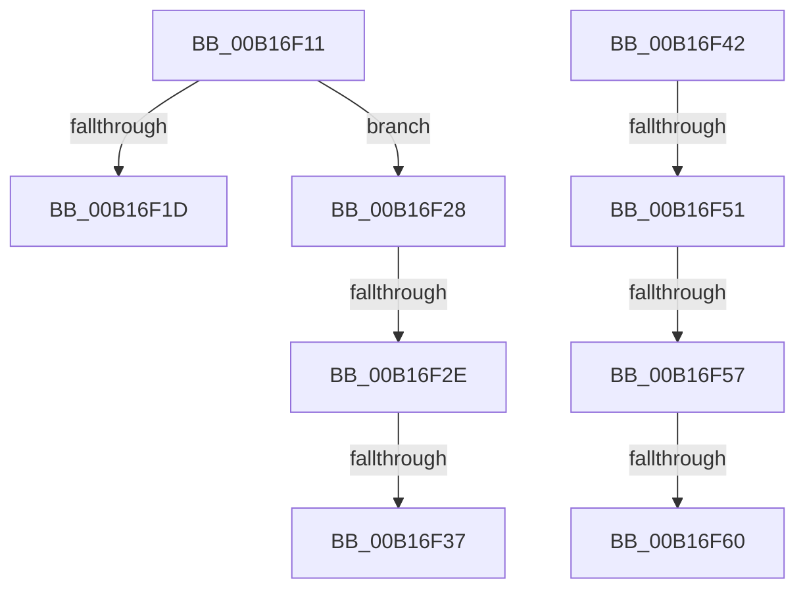

# sub_00B16F11

- RVA: `0x00B16F11`–`0x00B16F65` (길이 `84` bytes)
- VA: `0x0000000140B16F11`
- 실행 섹션: `PAGE`
- PDB 이름 있음: `아니요`; PDB Function 태그: `아니요`
- unwind 정보 RVA: `0x0006B238`
- 디코드: `19`개 명령, `84/84` bytes 표시
- 미해석 바이트: `0` (있으면 어셈블리에 `.byte`로 보존)

> 이 문서는 커널 이미지의 기계어와 PDB 기호를 분석해 생성했습니다. 4번과 5번은 함수 원형과 자료형을 바이너리 사용 방식에서 추정한 C 해석이며 원본 소스 복구 결과는 아닙니다.

## 1. Dependencies

- 직접 호출 지점: **0**; 고유 호출 대상: **0**
- 직접 호출자로 확인된 함수: **0**
- RIP 상대 이미지 참조: **0**

### Outgoing calls
- 직접 디코드된 call 명령이 없습니다.

### Direct callers
- 이 함수 시작 RVA로 연결되는 직접 call은 확인되지 않았습니다. 간접 호출은 완전히 역산할 수 없습니다.

### Static image references
- 디코드된 RIP-relative 메모리 참조가 없습니다.

## 2. Other-region calls and transfers

- 다른 실행 섹션으로 향하는 call: **0**
- call이 아닌 외부 분기/꼬리 이동: **8**
  - `0x00B16F23` → [sub_0085E9A1 + 0x4F](../85/Unknown_function_0085E9A1.md) (`tail-transfer`)
  - `0x00B16F28` → [sub_0085E9A1 + 0x49](../85/Unknown_function_0085E9A1.md) (`tail-transfer`)
  - `0x00B16F31` → [sub_0085E9A1 + 0x49](../85/Unknown_function_0085E9A1.md) (`tail-transfer`)
  - `0x00B16F3D` → [sub_0085E9A1 + 0x4F](../85/Unknown_function_0085E9A1.md) (`tail-transfer`)
  - `0x00B16F4B` → [sub_0085E942 + 0x30](../85/Unknown_function_0085E942.md) (`tail-transfer`)
  - `0x00B16F51` → [sub_0085E7B7 + 0xB7](../85/Unknown_function_0085E7B7.md) (`tail-transfer`)
  - `0x00B16F5A` → [sub_0085E7B7 + 0xB7](../85/Unknown_function_0085E7B7.md) (`tail-transfer`)
  - `0x00B16F60` → [sub_0085E942 + 0x30](../85/Unknown_function_0085E942.md) (`tail-transfer`)

## 3. Assembly (complete function range)

```asm
00B16F11  41 0F B7 47 42                  movzx eax, word ptr [r15 + 0x42]
00B16F16  66 41 3B 45 42                  cmp ax, word ptr [r13 + 0x42]
00B16F1B  7E 0B                           jle 0x140b16f28
00B16F1D  49 8B CD                        mov rcx, r13
00B16F20  49 8B FF                        mov rdi, r15
00B16F23  E9 C8 7A D4 FF                  jmp 0x14085e9f0
00B16F28  0F 8C BC 7A D4 FF               jl 0x14085e9ea
00B16F2E  4D 3B FD                        cmp r15, r13
00B16F31  0F 86 B3 7A D4 FF               jbe 0x14085e9ea
00B16F37  49 8B CD                        mov rcx, r13
00B16F3A  49 8B FF                        mov rdi, r15
00B16F3D  E9 AE 7A D4 FF                  jmp 0x14085e9f0
00B16F42  41 0F B7 47 42                  movzx eax, word ptr [r15 + 0x42]
00B16F47  66 3B 47 42                     cmp ax, word ptr [rdi + 0x42]
00B16F4B  0F 8F 21 7A D4 FF               jg 0x14085e972
00B16F51  0F 8C 17 79 D4 FF               jl 0x14085e86e
00B16F57  4C 3B FF                        cmp r15, rdi
00B16F5A  0F 86 0E 79 D4 FF               jbe 0x14085e86e
00B16F60  E9 0D 7A D4 FF                  jmp 0x14085e972
```

## 4. C-style interpretation (structured pseudocode)

```c
__int64 __fastcall sub_00B16F11(void)
{
    if (((unsigned __int16)(*(unsigned __int16 *)(v_r15 + 66))) <= (*(unsigned __int16 *)(v_r13 + 66))) goto loc_00B16F28;
loc_00B16F28:
}
```

## 5. (Beta) C Style

```c
void sub_00B16F11(void)
{
    if (((uint16_t)(*(uint16_t *)(local_r15 + 0x42))) <= (*(uint16_t *)(local_r13 + 0x42))) goto loc_00B16F28;
loc_00B16F28:
}
```

## 6. Execution-region graph

[열기: 2D/3D 그래프와 함수 탐색 컨트롤 패널](../../../control-panel.html?section=page&rva=0x00B16F11&view=graph)

- 2D 그래프는 위에서 아래로 흐르고, 3D 그래프는 빈 공간을 드래그해 회전합니다. Shift+드래그는 이동, 휠은 확대·축소, 함수 노드 선택은 대상 보고서 이동입니다.

### Static fallback


