# sub_00B16F66

- RVA: `0x00B16F66`–`0x00B174A5` (길이 `1,343` bytes)
- VA: `0x0000000140B16F66`
- 실행 섹션: `PAGE`
- PDB 이름 있음: `아니요`; PDB Function 태그: `아니요`
- unwind 정보 RVA: `0x0006B4D8`
- 디코드: `318`개 명령, `1,343/1,343` bytes 표시
- 미해석 바이트: `0` (있으면 어셈블리에 `.byte`로 보존)

> 이 문서는 커널 이미지의 기계어와 PDB 기호를 분석해 생성했습니다. 4번과 5번은 함수 원형과 자료형을 바이너리 사용 방식에서 추정한 C 해석이며 원본 소스 복구 결과는 아닙니다.

## 1. Dependencies

- 직접 호출 지점: **39**; 고유 호출 대상: **18**
- 직접 호출자로 확인된 함수: **0**
- RIP 상대 이미지 참조: **4**

### Outgoing calls
- `0x00B16FAC` → [CmpGetComponentNameAtIndex](../9A/CmpGetComponentNameAtIndex_function_009A7A50.md) (function, `0x009A7A50`)
- `0x00B16FBE` → [CmpWaitForHiveMount](../AC/CmpWaitForHiveMount_function_00ACB524.md) (function, `0x00ACB524`)
- `0x00B1703C` → [CmpGetComponentNameAtIndex](../9A/CmpGetComponentNameAtIndex_function_009A7A50.md) (function, `0x009A7A50`)
- `0x00B1704E` → [CmpWaitForHiveMount](../AC/CmpWaitForHiveMount_function_00ACB524.md) (function, `0x00ACB524`)
- `0x00B170ED` → [CmpCheckCreateAccessOnKcbStack](../8C/CmpCheckCreateAccessOnKcbStack_function_008C7010.md) (function, `0x008C7010`)
- `0x00B17110` → [PsGetCurrentThreadProcess](../../text/47/PsGetCurrentThreadProcess_function_0047C7E0.md) (function, `0x0047C7E0`)
- `0x00B1711B` → [PsGetProcessServerSilo](../../text/44/PsGetProcessServerSilo_function_0044BEE0.md) (function, `0x0044BEE0`)
- `0x00B17123` → [PsGetServerSiloServiceSessionId](../../text/45/PsGetServerSiloServiceSessionId_function_0045ED00.md) (function, `0x0045ED00`)
- `0x00B1712D` → [PsGetProcessSessionIdEx](../../text/22/PsGetProcessSessionIdEx_function_0022F8F0.md) (function, `0x0022F8F0`)
- `0x00B1713E` → [CmpCheckKeyOwnerForPca](../8C/CmpCheckKeyOwnerForPca_function_008C7130.md) (function, `0x008C7130`)
- `0x00B17150` → [CmpConstructName](../85/CmpConstructName_function_00856BE0.md) (function, `0x00856BE0`)
- `0x00B1716B` → [CmpUnlockKcbStack](../84/CmpUnlockKcbStack_function_00848460.md) (function, `0x00848460`)
- `0x00B17173` → [CmpUnlockKcbStack](../84/CmpUnlockKcbStack_function_00848460.md) (function, `0x00848460`)
- `0x00B17187` → [CmpUnlockKcb](../../pagecmrc/BC/CmpUnlockKcb_function_00BC92C0.md) (function, `0x00BC92C0`)
- `0x00B17199` → [CmpPromoteKey](../84/CmpPromoteKey_function_00844388.md) (function, `0x00844388`)
- `0x00B171CF` → [CmpRecordParseFailure](../85/CmpRecordParseFailure_function_00851280.md) (function, `0x00851280`)
- `0x00B171F6` → [PsGetCurrentThreadProcess](../../text/47/PsGetCurrentThreadProcess_function_0047C7E0.md) (function, `0x0047C7E0`)
- `0x00B17201` → [PsGetProcessServerSilo](../../text/44/PsGetProcessServerSilo_function_0044BEE0.md) (function, `0x0044BEE0`)
- `0x00B17209` → [PsGetServerSiloServiceSessionId](../../text/45/PsGetServerSiloServiceSessionId_function_0045ED00.md) (function, `0x0045ED00`)
- `0x00B17213` → [PsGetProcessSessionIdEx](../../text/22/PsGetProcessSessionIdEx_function_0022F8F0.md) (function, `0x0022F8F0`)
- `0x00B17224` → [CmpCheckKeyOwnerForPca](../8C/CmpCheckKeyOwnerForPca_function_008C7130.md) (function, `0x008C7130`)
- `0x00B17236` → [CmpConstructName](../85/CmpConstructName_function_00856BE0.md) (function, `0x00856BE0`)
- `0x00B17251` → [CmpRecordParseFailure](../85/CmpRecordParseFailure_function_00851280.md) (function, `0x00851280`)
- `0x00B17260` → [CmpUnlockKcbStack](../84/CmpUnlockKcbStack_function_00848460.md) (function, `0x00848460`)
- `0x00B17274` → [CmpUnlockKcb](../../pagecmrc/BC/CmpUnlockKcb_function_00BC92C0.md) (function, `0x00BC92C0`)
- `0x00B17288` → [CmpUnlockHashEntryByKcb](../86/CmpUnlockHashEntryByKcb_function_00864370.md) (function, `0x00864370`)
- `0x00B172D9` → [CmpGetSymbolicLinkTarget](../85/CmpGetSymbolicLinkTarget_function_008570A0.md) (function, `0x008570A0`)
- `0x00B172F1` → [CmpRecordParseFailure](../85/CmpRecordParseFailure_function_00851280.md) (function, `0x00851280`)
- `0x00B17333` → [CmpRecordParseFailure](../85/CmpRecordParseFailure_function_00851280.md) (function, `0x00851280`)
- `0x00B17368` → [CmpRecordParseFailure](../85/CmpRecordParseFailure_function_00851280.md) (function, `0x00851280`)
- `0x00B17396` → [CmpRecordParseFailure](../85/CmpRecordParseFailure_function_00851280.md) (function, `0x00851280`)
- `0x00B173C1` → [CmpDoWritethroughReparse](../94/CmpDoWritethroughReparse_function_0094AC70.md) (function, `0x0094AC70`)
- `0x00B173E1` → [CmpRecordParseFailure](../85/CmpRecordParseFailure_function_00851280.md) (function, `0x00851280`)
- `0x00B1740F` → [CmpVEExecuteOpenLogic](../85/CmpVEExecuteOpenLogic_function_00854D90.md) (function, `0x00854D90`)
- `0x00B1742A` → [CmpRecordParseFailure](../85/CmpRecordParseFailure_function_00851280.md) (function, `0x00851280`)
- `0x00B17449` → [CmpEnlistKeyBody](../84/CmpEnlistKeyBody_function_008425C0.md) (function, `0x008425C0`)
- `0x00B17465` → [CmpRecordParseFailure](../85/CmpRecordParseFailure_function_00851280.md) (function, `0x00851280`)
- `0x00B1747E` → [CmpConstructName](../85/CmpConstructName_function_00856BE0.md) (function, `0x00856BE0`)
- `0x00B17497` → [CmpRecordParseFailure](../85/CmpRecordParseFailure_function_00851280.md) (function, `0x00851280`)

### Direct callers
- 이 함수 시작 RVA로 연결되는 직접 call은 확인되지 않았습니다. 간접 호출은 완전히 역산할 수 없습니다.

### Static image references
- `0x00B16F6F` → RVA `0x00EEFB48` (`.data`; read)
- `0x00B16F7C` → RVA `0x00FD9A90` (`PAGEDATA`; read)
- `0x00B16FF6` → RVA `0x00FD9A77` (`PAGEDATA`; read)
- `0x00B17015` → RVA `0x00EEFB44` (`.data`; read)

## 2. Other-region calls and transfers

- 다른 실행 섹션으로 향하는 call: **10**
  - `0x00B17110` → [PsGetCurrentThreadProcess](../../text/47/PsGetCurrentThreadProcess_function_0047C7E0.md) (`PAGE` → `.text`)
  - `0x00B1711B` → [PsGetProcessServerSilo](../../text/44/PsGetProcessServerSilo_function_0044BEE0.md) (`PAGE` → `.text`)
  - `0x00B17123` → [PsGetServerSiloServiceSessionId](../../text/45/PsGetServerSiloServiceSessionId_function_0045ED00.md) (`PAGE` → `.text`)
  - `0x00B1712D` → [PsGetProcessSessionIdEx](../../text/22/PsGetProcessSessionIdEx_function_0022F8F0.md) (`PAGE` → `.text`)
  - `0x00B17187` → [CmpUnlockKcb](../../pagecmrc/BC/CmpUnlockKcb_function_00BC92C0.md) (`PAGE` → `PAGECMRC`)
  - `0x00B171F6` → [PsGetCurrentThreadProcess](../../text/47/PsGetCurrentThreadProcess_function_0047C7E0.md) (`PAGE` → `.text`)
  - `0x00B17201` → [PsGetProcessServerSilo](../../text/44/PsGetProcessServerSilo_function_0044BEE0.md) (`PAGE` → `.text`)
  - `0x00B17209` → [PsGetServerSiloServiceSessionId](../../text/45/PsGetServerSiloServiceSessionId_function_0045ED00.md) (`PAGE` → `.text`)
  - `0x00B17213` → [PsGetProcessSessionIdEx](../../text/22/PsGetProcessSessionIdEx_function_0022F8F0.md) (`PAGE` → `.text`)
  - `0x00B17274` → [CmpUnlockKcb](../../pagecmrc/BC/CmpUnlockKcb_function_00BC92C0.md) (`PAGE` → `PAGECMRC`)
- call이 아닌 외부 분기/꼬리 이동: **24**
  - `0x00B16F8B` → [CmpDoParseKey + 0x188D](../85/CmpDoParseKey_function_0085F750.md) (`tail-transfer`)
  - `0x00B16F9F` → [CmpDoParseKey + 0x188D](../85/CmpDoParseKey_function_0085F750.md) (`tail-transfer`)
  - `0x00B16FC5` → [CmpDoParseKey + 0x1890](../85/CmpDoParseKey_function_0085F750.md) (`tail-transfer`)
  - `0x00B16FE4` → [CmpDoParseKey + 0x18A3](../85/CmpDoParseKey_function_0085F750.md) (`tail-transfer`)
  - `0x00B16FF1` → [CmpDoParseKey + 0x188D](../85/CmpDoParseKey_function_0085F750.md) (`tail-transfer`)
  - `0x00B16FFD` → [CmpDoParseKey + 0x1A5F](../85/CmpDoParseKey_function_0085F750.md) (`tail-transfer`)
  - `0x00B17070` → [CmpDoParseKey + 0x18A3](../85/CmpDoParseKey_function_0085F750.md) (`tail-transfer`)
  - `0x00B17089` → [CmpDoParseKey + 0x18A3](../85/CmpDoParseKey_function_0085F750.md) (`tail-transfer`)
  - `0x00B1709E` → [CmpDoParseKey + 0x1A5F](../85/CmpDoParseKey_function_0085F750.md) (`tail-transfer`)
  - `0x00B17163` → [CmpDoParseKey + 0x22E1](../85/CmpDoParseKey_function_0085F750.md) (`tail-transfer`)
  - `0x00B171A7` → [CmpDoParseKey + 0x1B1F](../85/CmpDoParseKey_function_0085F750.md) (`tail-transfer`)
  - `0x00B171D7` → [CmpDoParseKey + 0xA9D](../85/CmpDoParseKey_function_0085F750.md) (`tail-transfer`)
  - `0x00B17258` → [CmpDoParseKey + 0xA18](../85/CmpDoParseKey_function_0085F750.md) (`tail-transfer`)
  - `0x00B172F9` → [CmpDoParseKey + 0xAA1](../85/CmpDoParseKey_function_0085F750.md) (`tail-transfer`)
  - `0x00B1733B` → [CmpDoParseKey + 0xAA1](../85/CmpDoParseKey_function_0085F750.md) (`tail-transfer`)
  - `0x00B1736F` → [CmpDoParseKey + 0xA18](../85/CmpDoParseKey_function_0085F750.md) (`tail-transfer`)
  - `0x00B1739D` → [CmpDoParseKey + 0xA18](../85/CmpDoParseKey_function_0085F750.md) (`tail-transfer`)
  - `0x00B173E8` → [CmpDoParseKey + 0xA18](../85/CmpDoParseKey_function_0085F750.md) (`tail-transfer`)
  - `0x00B17431` → [CmpDoParseKey + 0xA18](../85/CmpDoParseKey_function_0085F750.md) (`tail-transfer`)
  - `0x00B17457` → [CmpDoParseKey + 0x1CD0](../85/CmpDoParseKey_function_0085F750.md) (`tail-transfer`)
  - `0x00B1746C` → [CmpDoParseKey + 0xA18](../85/CmpDoParseKey_function_0085F750.md) (`tail-transfer`)
  - `0x00B17476` → [CmpDoParseKey + 0x18A3](../85/CmpDoParseKey_function_0085F750.md) (`tail-transfer`)
  - `0x00B17487` → [CmpDoParseKey + 0x9F6](../85/CmpDoParseKey_function_0085F750.md) (`tail-transfer`)
  - `0x00B174A0` → [CmpDoParseKey + 0xABA](../85/CmpDoParseKey_function_0085F750.md) (`tail-transfer`)

## 3. Assembly (complete function range)

```asm
00B16F66  65 48 8B 04 25 88 01 00 00      mov rax, qword ptr gs:[0x188]
00B16F6F  48 39 05 D2 8B 3D 00            cmp qword ptr [rip + 0x3d8bd2], rax
00B16F76  74 71                           je 0x140b16fe9
00B16F78  4C 8B 6D A0                     mov r13, qword ptr [rbp - 0x60]
00B16F7C  48 8B 05 0D 2B 4C 00            mov rax, qword ptr [rip + 0x4c2b0d]
00B16F83  4C 89 6D 90                     mov qword ptr [rbp - 0x70], r13
00B16F87  49 39 45 20                     cmp qword ptr [r13 + 0x20], rax
00B16F8B  0F 85 4C A0 D4 FF               jne 0x140860fdd
00B16F91  41 8B 45 08                     mov eax, dword ptr [r13 + 8]
00B16F95  25 00 00 E0 7F                  and eax, 0x7fe00000
00B16F9A  3D 00 00 60 00                  cmp eax, 0x600000
00B16F9F  0F 85 38 A0 D4 FF               jne 0x140860fdd
00B16FA5  48 8B 4D C0                     mov rcx, qword ptr [rbp - 0x40]
00B16FA9  0F BF D7                        movsx edx, di
00B16FAC  E8 9F 0A E9 FF                  call 0x1409a7a50
00B16FB1  48 8B C8                        mov rcx, rax
00B16FB4  4D 8D 88 88 00 00 00            lea r9, [r8 + 0x88]
00B16FBB  49 8B F8                        mov rdi, r8
00B16FBE  E8 61 45 FB FF                  call 0x140acb524
00B16FC3  84 C0                           test al, al
00B16FC5  0F 84 15 A0 D4 FF               je 0x140860fe0
00B16FCB  81 0F 00 01 00 00               or dword ptr [rdi], 0x100
00B16FD1  BA 00 29 00 00                  mov edx, 0x2900
00B16FD6  C7 44 24 64 03 01 00 00         mov dword ptr [rsp + 0x64], 0x103
00B16FDE  41 B8 03 01 00 00               mov r8d, 0x103
00B16FE4  E9 0A A0 D4 FF                  jmp 0x140860ff3
00B16FE9  48 8B 45 A0                     mov rax, qword ptr [rbp - 0x60]
00B16FED  48 89 45 90                     mov qword ptr [rbp - 0x70], rax
00B16FF1  E9 E7 9F D4 FF                  jmp 0x140860fdd
00B16FF6  40 38 35 7A 2A 4C 00            cmp byte ptr [rip + 0x4c2a7a], sil
00B16FFD  0F 84 AC A1 D4 FF               je 0x1408611af
00B17003  65 48 8B 04 25 88 01 00 00      mov rax, qword ptr gs:[0x188]
00B1700C  48 39 05 35 8B 3D 00            cmp qword ptr [rip + 0x3d8b35], rax
00B17013  74 79                           je 0x140b1708e
00B17015  40 38 35 28 8B 3D 00            cmp byte ptr [rip + 0x3d8b28], sil
00B1701C  48 8B 45 A0                     mov rax, qword ptr [rbp - 0x60]
00B17020  48 89 45 90                     mov qword ptr [rbp - 0x70], rax
00B17024  74 4F                           je 0x140b17075
00B17026  8B 40 08                        mov eax, dword ptr [rax + 8]
00B17029  25 00 00 E0 7F                  and eax, 0x7fe00000
00B1702E  3D 00 00 60 00                  cmp eax, 0x600000
00B17033  75 40                           jne 0x140b17075
00B17035  48 8B 4D C0                     mov rcx, qword ptr [rbp - 0x40]
00B17039  0F BF D7                        movsx edx, di
00B1703C  E8 0F 0A E9 FF                  call 0x1409a7a50
00B17041  48 8B C8                        mov rcx, rax
00B17044  4D 8D 88 88 00 00 00            lea r9, [r8 + 0x88]
00B1704B  49 8B F8                        mov rdi, r8
00B1704E  E8 D1 44 FB FF                  call 0x140acb524
00B17053  84 C0                           test al, al
00B17055  74 21                           je 0x140b17078
00B17057  81 0F 00 01 00 00               or dword ptr [rdi], 0x100
00B1705D  BA 00 2B 00 00                  mov edx, 0x2b00
00B17062  C7 44 24 64 03 01 00 00         mov dword ptr [rsp + 0x64], 0x103
00B1706A  41 B8 03 01 00 00               mov r8d, 0x103
00B17070  E9 7E 9F D4 FF                  jmp 0x140860ff3
00B17075  49 8B F8                        mov rdi, r8
00B17078  B8 0D 00 00 C0                  mov eax, 0xc000000d
00B1707D  BA 00 2C 00 00                  mov edx, 0x2c00
00B17082  89 44 24 64                     mov dword ptr [rsp + 0x64], eax
00B17086  44 8B C0                        mov r8d, eax
00B17089  E9 65 9F D4 FF                  jmp 0x140860ff3
00B1708E  4C 8B 6D A0                     mov r13, qword ptr [rbp - 0x60]
00B17092  4C 8B 65 B8                     mov r12, qword ptr [rbp - 0x48]
00B17096  4C 89 6D 90                     mov qword ptr [rbp - 0x70], r13
00B1709A  4C 89 65 80                     mov qword ptr [rbp - 0x80], r12
00B1709E  E9 0C A1 D4 FF                  jmp 0x1408611af
00B170A3  41 8B 50 18                     mov edx, dword ptr [r8 + 0x18]
00B170A7  48 8D 44 24 64                  lea rax, [rsp + 0x64]
00B170AC  4C 8B 4D E0                     mov r9, qword ptr [rbp - 0x20]
00B170B0  8B CA                           mov ecx, edx
00B170B2  48 89 44 24 50                  mov qword ptr [rsp + 0x50], rax
00B170B7  83 E2 02                        and edx, 2
00B170BA  48 8B 45 D0                     mov rax, qword ptr [rbp - 0x30]
00B170BE  C7 44 24 48 01 00 00 00         mov dword ptr [rsp + 0x48], 1
00B170C6  48 89 44 24 40                  mov qword ptr [rsp + 0x40], rax
00B170CB  0F B6 44 24 72                  movzx eax, byte ptr [rsp + 0x72]
00B170D0  4C 89 64 24 38                  mov qword ptr [rsp + 0x38], r12
00B170D5  C1 E2 04                        shl edx, 4
00B170D8  C1 E9 02                        shr ecx, 2
00B170DB  80 E1 01                        and cl, 1
00B170DE  88 4C 24 30                     mov byte ptr [rsp + 0x30], cl
00B170E2  89 54 24 28                     mov dword ptr [rsp + 0x28], edx
00B170E6  48 8B D7                        mov rdx, rdi
00B170E9  88 44 24 20                     mov byte ptr [rsp + 0x20], al
00B170ED  E8 1E FF DA FF                  call 0x1408c7010
00B170F2  84 C0                           test al, al
00B170F4  75 72                           jne 0x140b17168
00B170F6  65 48 8B 04 25 88 01 00 00      mov rax, qword ptr gs:[0x188]
00B170FF  4C 8B 6D A0                     mov r13, qword ptr [rbp - 0x60]
00B17103  4C 89 6D 90                     mov qword ptr [rbp - 0x70], r13
00B17107  80 B8 32 02 00 00 01            cmp byte ptr [rax + 0x232], 1
00B1710E  75 49                           jne 0x140b17159
00B17110  E8 CB 56 96 FF                  call 0x14047c7e0
00B17115  48 8B C8                        mov rcx, rax
00B17118  48 8B F8                        mov rdi, rax
00B1711B  E8 C0 4D 93 FF                  call 0x14044bee0
00B17120  48 8B C8                        mov rcx, rax
00B17123  E8 D8 7B 94 FF                  call 0x14045ed00
00B17128  48 8B CF                        mov rcx, rdi
00B1712B  8B D8                           mov ebx, eax
00B1712D  E8 BE 87 71 FF                  call 0x14022f8f0
00B17132  3B C3                           cmp eax, ebx
00B17134  74 23                           je 0x140b17159
00B17136  48 8B 55 B8                     mov rdx, qword ptr [rbp - 0x48]
00B1713A  48 8B 4D A8                     mov rcx, qword ptr [rbp - 0x58]
00B1713E  E8 ED FF DA FF                  call 0x1408c7130
00B17143  84 C0                           test al, al
00B17145  74 12                           je 0x140b17159
00B17147  49 8B 4D 48                     mov rcx, qword ptr [r13 + 0x48]
00B1714B  C6 44 24 77 01                  mov byte ptr [rsp + 0x77], 1
00B17150  E8 8B FA D3 FF                  call 0x140856be0
00B17155  48 89 45 C8                     mov qword ptr [rbp - 0x38], rax
00B17159  44 8B 44 24 64                  mov r8d, dword ptr [rsp + 0x64]
00B1715E  BA 00 2D 00 00                  mov edx, 0x2d00
00B17163  E9 C9 A8 D4 FF                  jmp 0x140861a31
00B17168  49 8B CE                        mov rcx, r14
00B1716B  E8 F0 12 D3 FF                  call 0x140848460
00B17170  48 8B CF                        mov rcx, rdi
00B17173  E8 E8 12 D3 FF                  call 0x140848460
00B17178  40 38 74 24 73                  cmp byte ptr [rsp + 0x73], sil
00B1717D  74 12                           je 0x140b17191
00B1717F  48 8B 45 B0                     mov rax, qword ptr [rbp - 0x50]
00B17183  48 8B 48 08                     mov rcx, qword ptr [rax + 8]
00B17187  E8 34 21 0B 00                  call 0x140bc92c0
00B1718C  40 88 74 24 73                  mov byte ptr [rsp + 0x73], sil
00B17191  41 B0 01                        mov r8b, 1
00B17194  33 D2                           xor edx, edx
00B17196  48 8B CF                        mov rcx, rdi
00B17199  E8 EA D1 D2 FF                  call 0x140844388
00B1719E  89 44 24 64                     mov dword ptr [rsp + 0x64], eax
00B171A2  44 8B C0                        mov r8d, eax
00B171A5  85 C0                           test eax, eax
00B171A7  0F 89 C2 A0 D4 FF               jns 0x14086126f
00B171AD  B8 7C 01 00 C0                  mov eax, 0xc000017c
00B171B2  44 3B C0                        cmp r8d, eax
00B171B5  75 0B                           jne 0x140b171c2
00B171B7  41 B8 34 00 00 C0               mov r8d, 0xc0000034
00B171BD  44 89 44 24 64                  mov dword ptr [rsp + 0x64], r8d
00B171C2  48 8B 7C 24 68                  mov rdi, qword ptr [rsp + 0x68]
00B171C7  BA 00 2E 00 00                  mov edx, 0x2e00
00B171CC  48 8B CF                        mov rcx, rdi
00B171CF  E8 AC A0 D3 FF                  call 0x140851280
00B171D4  45 32 F6                        xor r14b, r14b
00B171D7  E9 11 90 D4 FF                  jmp 0x1408601ed
00B171DC  65 48 8B 04 25 88 01 00 00      mov rax, qword ptr gs:[0x188]
00B171E5  4C 8B 6D A0                     mov r13, qword ptr [rbp - 0x60]
00B171E9  4C 89 6D 90                     mov qword ptr [rbp - 0x70], r13
00B171ED  80 B8 32 02 00 00 01            cmp byte ptr [rax + 0x232], 1
00B171F4  75 49                           jne 0x140b1723f
00B171F6  E8 E5 55 96 FF                  call 0x14047c7e0
00B171FB  48 8B C8                        mov rcx, rax
00B171FE  48 8B F8                        mov rdi, rax
00B17201  E8 DA 4C 93 FF                  call 0x14044bee0
00B17206  48 8B C8                        mov rcx, rax
00B17209  E8 F2 7A 94 FF                  call 0x14045ed00
00B1720E  48 8B CF                        mov rcx, rdi
00B17211  8B D8                           mov ebx, eax
00B17213  E8 D8 86 71 FF                  call 0x14022f8f0
00B17218  3B C3                           cmp eax, ebx
00B1721A  74 23                           je 0x140b1723f
00B1721C  48 8B 55 B8                     mov rdx, qword ptr [rbp - 0x48]
00B17220  48 8B 4D A8                     mov rcx, qword ptr [rbp - 0x58]
00B17224  E8 07 FF DA FF                  call 0x1408c7130
00B17229  84 C0                           test al, al
00B1722B  74 12                           je 0x140b1723f
00B1722D  49 8B 4D 48                     mov rcx, qword ptr [r13 + 0x48]
00B17231  C6 44 24 77 01                  mov byte ptr [rsp + 0x77], 1
00B17236  E8 A5 F9 D3 FF                  call 0x140856be0
00B1723B  48 89 45 C8                     mov qword ptr [rbp - 0x38], rax
00B1723F  48 8B 7C 24 68                  mov rdi, qword ptr [rsp + 0x68]
00B17244  BA 00 32 00 00                  mov edx, 0x3200
00B17249  44 8B 44 24 64                  mov r8d, dword ptr [rsp + 0x64]
00B1724E  48 8B CF                        mov rcx, rdi
00B17251  E8 2A A0 D3 FF                  call 0x140851280
00B17256  B3 01                           mov bl, 1
00B17258  E9 0B 8F D4 FF                  jmp 0x140860168
00B1725D  48 8B CF                        mov rcx, rdi
00B17260  E8 FB 11 D3 FF                  call 0x140848460
00B17265  48 8B 5D B0                     mov rbx, qword ptr [rbp - 0x50]
00B17269  40 38 74 24 73                  cmp byte ptr [rsp + 0x73], sil
00B1726E  74 0E                           je 0x140b1727e
00B17270  48 8B 4B 08                     mov rcx, qword ptr [rbx + 8]
00B17274  E8 47 20 0B 00                  call 0x140bc92c0
00B17279  40 88 74 24 73                  mov byte ptr [rsp + 0x73], sil
00B1727E  40 38 74 24 70                  cmp byte ptr [rsp + 0x70], sil
00B17283  74 0D                           je 0x140b17292
00B17285  49 8B CD                        mov rcx, r13
00B17288  E8 E3 D0 D4 FF                  call 0x140864370
00B1728D  40 88 74 24 70                  mov byte ptr [rsp + 0x70], sil
00B17292  48 8B 7C 24 68                  mov rdi, qword ptr [rsp + 0x68]
00B17297  48 8D 4D 08                     lea rcx, [rbp + 8]
00B1729B  48 89 4C 24 48                  mov qword ptr [rsp + 0x48], rcx
00B172A0  45 33 C9                        xor r9d, r9d
00B172A3  45 33 C0                        xor r8d, r8d
00B172A6  49 8B CE                        mov rcx, r14
00B172A9  48 8D 47 58                     lea rax, [rdi + 0x58]
00B172AD  48 89 44 24 40                  mov qword ptr [rsp + 0x40], rax
00B172B2  48 8D 97 D8 00 00 00            lea rdx, [rdi + 0xd8]
00B172B9  48 8B 45 E8                     mov rax, qword ptr [rbp - 0x18]
00B172BD  48 89 44 24 38                  mov qword ptr [rsp + 0x38], rax
00B172C2  48 8D 45 28                     lea rax, [rbp + 0x28]
00B172C6  48 89 44 24 30                  mov qword ptr [rsp + 0x30], rax
00B172CB  48 8B 45 80                     mov rax, qword ptr [rbp - 0x80]
00B172CF  48 89 7C 24 28                  mov qword ptr [rsp + 0x28], rdi
00B172D4  48 89 44 24 20                  mov qword ptr [rsp + 0x20], rax
00B172D9  E8 C2 FD D3 FF                  call 0x1408570a0
00B172DE  89 44 24 64                     mov dword ptr [rsp + 0x64], eax
00B172E2  85 C0                           test eax, eax
00B172E4  79 18                           jns 0x140b172fe
00B172E6  44 8B C0                        mov r8d, eax
00B172E9  BA 00 34 00 00                  mov edx, 0x3400
00B172EE  48 8B CF                        mov rcx, rdi
00B172F1  E8 8A 9F D3 FF                  call 0x140851280
00B172F6  45 32 F6                        xor r14b, r14b
00B172F9  E9 F3 8E D4 FF                  jmp 0x1408601f1
00B172FE  83 27 F7                        and dword ptr [rdi], 0xfffffff7
00B17301  48 39 77 40                     cmp qword ptr [rdi + 0x40], rsi
00B17305  75 16                           jne 0x140b1731d
00B17307  48 8B 45 08                     mov rax, qword ptr [rbp + 8]
00B1730B  48 8B 48 20                     mov rcx, qword ptr [rax + 0x20]
00B1730F  8B 81 10 10 00 00               mov eax, dword ptr [rcx + 0x1010]
00B17315  A8 01                           test al, 1
00B17317  74 04                           je 0x140b1731d
00B17319  48 89 4F 40                     mov qword ptr [rdi + 0x40], rcx
00B1731D  BA 80 34 00 00                  mov edx, 0x3480
00B17322  C7 44 24 64 04 01 00 00         mov dword ptr [rsp + 0x64], 0x104
00B1732A  41 B8 04 01 00 00               mov r8d, 0x104
00B17330  48 8B CF                        mov rcx, rdi
00B17333  E8 48 9F D3 FF                  call 0x140851280
00B17338  45 32 F6                        xor r14b, r14b
00B1733B  E9 B1 8E D4 FF                  jmp 0x1408601f1
00B17340  41 F7 85 B8 00 00 00 00 00 02 00  test dword ptr [r13 + 0xb8], 0x20000
00B1734B  74 27                           je 0x140b17374
00B1734D  48 8B 7C 24 68                  mov rdi, qword ptr [rsp + 0x68]
00B17352  BA 00 35 00 00                  mov edx, 0x3500
00B17357  48 8B CF                        mov rcx, rdi
00B1735A  C7 44 24 64 34 00 00 C0         mov dword ptr [rsp + 0x64], 0xc0000034
00B17362  41 B8 34 00 00 C0               mov r8d, 0xc0000034
00B17368  E8 13 9F D3 FF                  call 0x140851280
00B1736D  B3 01                           mov bl, 1
00B1736F  E9 F4 8D D4 FF                  jmp 0x140860168
00B17374  8B 41 18                        mov eax, dword ptr [rcx + 0x18]
00B17377  A8 02                           test al, 2
00B17379  74 27                           je 0x140b173a2
00B1737B  48 8B 7C 24 68                  mov rdi, qword ptr [rsp + 0x68]
00B17380  BA 00 36 00 00                  mov edx, 0x3600
00B17385  48 8B CF                        mov rcx, rdi
00B17388  C7 44 24 64 35 00 00 C0         mov dword ptr [rsp + 0x64], 0xc0000035
00B17390  41 B8 35 00 00 C0               mov r8d, 0xc0000035
00B17396  E8 E5 9E D3 FF                  call 0x140851280
00B1739B  B3 01                           mov bl, 1
00B1739D  E9 C6 8D D4 FF                  jmp 0x140860168
00B173A2  48 8B 5D E8                     mov rbx, qword ptr [rbp - 0x18]
00B173A6  45 33 C9                        xor r9d, r9d
00B173A9  48 89 5C 24 30                  mov qword ptr [rsp + 0x30], rbx
00B173AE  4C 8B C7                        mov r8, rdi
00B173B1  48 89 4C 24 28                  mov qword ptr [rsp + 0x28], rcx
00B173B6  49 8B D6                        mov rdx, r14
00B173B9  49 8B CD                        mov rcx, r13
00B173BC  48 89 74 24 20                  mov qword ptr [rsp + 0x20], rsi
00B173C1  E8 AA 38 E3 FF                  call 0x14094ac70
00B173C6  48 8B 7C 24 68                  mov rdi, qword ptr [rsp + 0x68]
00B173CB  89 44 24 64                     mov dword ptr [rsp + 0x64], eax
00B173CF  3D 71 02 00 C0                  cmp eax, 0xc0000271
00B173D4  74 17                           je 0x140b173ed
00B173D6  44 8B C0                        mov r8d, eax
00B173D9  BA 40 36 00 00                  mov edx, 0x3640
00B173DE  48 8B CF                        mov rcx, rdi
00B173E1  E8 9A 9E D3 FF                  call 0x140851280
00B173E6  B3 01                           mov bl, 1
00B173E8  E9 7B 8D D4 FF                  jmp 0x140860168
00B173ED  48 8B 45 E0                     mov rax, qword ptr [rbp - 0x20]
00B173F1  4C 8B CB                        mov r9, rbx
00B173F4  48 83 C0 20                     add rax, 0x20
00B173F8  41 B0 01                        mov r8b, 1
00B173FB  48 89 44 24 28                  mov qword ptr [rsp + 0x28], rax
00B17400  48 8B D7                        mov rdx, rdi
00B17403  0F B6 44 24 72                  movzx eax, byte ptr [rsp + 0x72]
00B17408  49 8B CD                        mov rcx, r13
00B1740B  88 44 24 20                     mov byte ptr [rsp + 0x20], al
00B1740F  E8 7C D9 D3 FF                  call 0x140854d90
00B17414  89 44 24 64                     mov dword ptr [rsp + 0x64], eax
00B17418  3D 71 02 00 C0                  cmp eax, 0xc0000271
00B1741D  74 17                           je 0x140b17436
00B1741F  44 8B C0                        mov r8d, eax
00B17422  BA 80 36 00 00                  mov edx, 0x3680
00B17427  48 8B CF                        mov rcx, rdi
00B1742A  E8 51 9E D3 FF                  call 0x140851280
00B1742F  B3 01                           mov bl, 1
00B17431  E9 32 8D D4 FF                  jmp 0x140860168
00B17436  4C 8B 45 80                     mov r8, qword ptr [rbp - 0x80]
00B1743A  41 B1 01                        mov r9b, 1
00B1743D  48 8B 4D D0                     mov rcx, qword ptr [rbp - 0x30]
00B17441  49 8B D5                        mov rdx, r13
00B17444  4C 89 74 24 20                  mov qword ptr [rsp + 0x20], r14
00B17449  E8 72 B1 D2 FF                  call 0x1408425c0
00B1744E  89 44 24 64                     mov dword ptr [rsp + 0x64], eax
00B17452  48 8B CF                        mov rcx, rdi
00B17455  85 C0                           test eax, eax
00B17457  0F 89 C3 9F D4 FF               jns 0x140861420
00B1745D  44 8B C0                        mov r8d, eax
00B17460  BA C0 36 00 00                  mov edx, 0x36c0
00B17465  E8 16 9E D3 FF                  call 0x140851280
00B1746A  B3 01                           mov bl, 1
00B1746C  E9 F7 8C D4 FF                  jmp 0x140860168
00B17471  BA C0 3C 00 00                  mov edx, 0x3cc0
00B17476  E9 78 9B D4 FF                  jmp 0x140860ff3
00B1747B  49 8B CD                        mov rcx, r13
00B1747E  E8 5D F7 D3 FF                  call 0x140856be0
00B17483  48 89 45 C8                     mov qword ptr [rbp - 0x38], rax
00B17487  E9 BA 8C D4 FF                  jmp 0x140860146
00B1748C  48 8B 7C 24 68                  mov rdi, qword ptr [rsp + 0x68]
00B17491  44 8B C0                        mov r8d, eax
00B17494  48 8B CF                        mov rcx, rdi
00B17497  E8 E4 9D D3 FF                  call 0x140851280
00B1749C  4C 8B 6D A0                     mov r13, qword ptr [rbp - 0x60]
00B174A0  E9 65 8D D4 FF                  jmp 0x14086020a
```

## 4. C-style interpretation (structured pseudocode)

```c
__int64 __fastcall sub_00B16F66(__int64 a1, __int64 a2, __int64 a3)
{
    __int64 result;
    unsigned __int8 v_stack_p20;
    unsigned int v_stack_p28;
    unsigned __int8 v_stack_p30;
    unsigned __int64 v_stack_p38;
    unsigned __int64 v_stack_p40;
    unsigned int v_stack_p48;
    unsigned __int64 v_stack_p50;
    unsigned int v_stack_p64;
    unsigned __int64 v_stack_p68;
    unsigned __int8 v_stack_p70;
    unsigned __int8 v_stack_p72;
    unsigned __int8 v_stack_p73;
    unsigned __int8 v_stack_p77;

    if ((*(unsigned __int64 *)(v_rip + 4033490)) == (*(unsigned __int64 *)(gs_base + (0 + 392)))) goto loc_00B16FE9;
    *(unsigned __int64 *)(v_rbp - 112) = *(unsigned __int64 *)(v_rbp - 96);
    result = (unsigned int)(((unsigned int)(*(unsigned int *)(*(unsigned __int64 *)(v_rbp - 96) + 8))) & (0x7FE00000ULL));
    result = CmpGetComponentNameAtIndex(*(unsigned __int64 *)(v_rbp - 64), (__int16)((unsigned __int16)(v_rdi)), a3, a4);
    result = CmpWaitForHiveMount(result, (__int16)((unsigned __int16)(v_rdi)), a3, a3 + 136);
    v_stack_p64 = 259;
loc_00B16FE9:
    *(unsigned __int64 *)(v_rbp - 112) = *(unsigned __int64 *)(v_rbp - 96);
}
```

## 5. (Beta) C Style

```c
int64_t sub_00B16F66(int64_t Arg1, int64_t Arg2, int64_t Arg3)
{
    int64_t result;
    uint8_t v_stack_p20;
    uint32_t v_stack_p28;
    uint8_t v_stack_p30;
    uint64_t v_stack_p38;
    uint64_t v_stack_p40;
    uint32_t v_stack_p48;
    uint64_t v_stack_p50;
    uint32_t v_stack_p64;
    uint64_t v_stack_p68;
    uint8_t v_stack_p70;
    uint8_t v_stack_p72;
    uint8_t v_stack_p73;
    uint8_t v_stack_p77;

    if ((*(uint64_t *)(v_rip + 0x3D8BD2)) == (*(uint64_t *)(gs_base + (0 + 0x188)))) goto loc_00B16FE9;
    *(uint64_t *)(local_rbp - 0x70) = *(uint64_t *)(local_rbp - 0x60);
    result = (uint32_t)(((uint32_t)(*(uint32_t *)(*(uint64_t *)(local_rbp - 0x60) + 0x8))) & (0x7FE00000ULL));
    result = CmpGetComponentNameAtIndex(*(uint64_t *)(local_rbp - 0x40), (int16_t)((uint16_t)(local_rdi)), Arg3, a4);
    result = CmpWaitForHiveMount(result, (int16_t)((uint16_t)(local_rdi)), Arg3, Arg3 + 136);
    v_stack_p64 = 259;
loc_00B16FE9:
    *(uint64_t *)(local_rbp - 0x70) = *(uint64_t *)(local_rbp - 0x60);
}
```

## 6. Execution-region graph

[열기: 2D/3D 그래프와 함수 탐색 컨트롤 패널](../../../control-panel.html?section=page&rva=0x00B16F66&view=graph)

- 2D 그래프는 위에서 아래로 흐르고, 3D 그래프는 빈 공간을 드래그해 회전합니다. Shift+드래그는 이동, 휠은 확대·축소, 함수 노드 선택은 대상 보고서 이동입니다.

### Static fallback

```mermaid
flowchart TD
  bb_00B16F66[BB_00B16F66]
  bb_00B16F78[BB_00B16F78]
  bb_00B16F91[BB_00B16F91]
  bb_00B16FA5[BB_00B16FA5]
  bb_00B16FCB[BB_00B16FCB]
  bb_00B16FE9[BB_00B16FE9]
  bb_00B16FF6[BB_00B16FF6]
  bb_00B17003[BB_00B17003]
  bb_00B17015[BB_00B17015]
  bb_00B17026[BB_00B17026]
  bb_00B17035[BB_00B17035]
  bb_00B17057[BB_00B17057]
  bb_00B17075[BB_00B17075]
  bb_00B17078[BB_00B17078]
  bb_00B1708E[BB_00B1708E]
  bb_00B170A3[BB_00B170A3]
  bb_00B170F6[BB_00B170F6]
  bb_00B17110[BB_00B17110]
  bb_00B17136[BB_00B17136]
  bb_00B17147[BB_00B17147]
  bb_00B17159[BB_00B17159]
  bb_00B17168[BB_00B17168]
  bb_00B1717F[BB_00B1717F]
  bb_00B17191[BB_00B17191]
  bb_00B171AD[BB_00B171AD]
  bb_00B171B7[BB_00B171B7]
  bb_00B171C2[BB_00B171C2]
  bb_00B171DC[BB_00B171DC]
  bb_00B171F6[BB_00B171F6]
  bb_00B1721C[BB_00B1721C]
  bb_00B1722D[BB_00B1722D]
  bb_00B1723F[BB_00B1723F]
  bb_00B1725D[BB_00B1725D]
  bb_00B17270[BB_00B17270]
  bb_00B1727E[BB_00B1727E]
  bb_00B17285[BB_00B17285]
  bb_00B17292[BB_00B17292]
  bb_00B172E6[BB_00B172E6]
  bb_00B172FE[BB_00B172FE]
  bb_00B17307[BB_00B17307]
  bb_00B17319[BB_00B17319]
  bb_00B1731D[BB_00B1731D]
  bb_00B17340[BB_00B17340]
  bb_00B1734D[BB_00B1734D]
  bb_00B17374[BB_00B17374]
  bb_00B1737B[BB_00B1737B]
  bb_00B173A2[BB_00B173A2]
  bb_00B173D6[BB_00B173D6]
  bb_00B173ED[BB_00B173ED]
  bb_00B1741F[BB_00B1741F]
  bb_00B17436[BB_00B17436]
  bb_00B1745D[BB_00B1745D]
  bb_00B17471[BB_00B17471]
  bb_00B1747B[BB_00B1747B]
  bb_00B1748C[BB_00B1748C]
  bb_00B16F66 -->|branch| bb_00B16FE9
  bb_00B16F66 -->|fallthrough| bb_00B16F78
  bb_00B16F78 -->|fallthrough| bb_00B16F91
  bb_00B16F91 -->|fallthrough| bb_00B16FA5
  bb_00B16FA5 -->|fallthrough| bb_00B16FCB
  bb_00B16FF6 -->|fallthrough| bb_00B17003
  bb_00B17003 -->|branch| bb_00B1708E
  bb_00B17003 -->|fallthrough| bb_00B17015
  bb_00B17015 -->|branch| bb_00B17075
  bb_00B17015 -->|fallthrough| bb_00B17026
  bb_00B17026 -->|branch| bb_00B17075
  bb_00B17026 -->|fallthrough| bb_00B17035
  bb_00B17035 -->|branch| bb_00B17078
  bb_00B17035 -->|fallthrough| bb_00B17057
  bb_00B17075 -->|flow| bb_00B17078
  bb_00B170A3 -->|branch| bb_00B17168
  bb_00B170A3 -->|fallthrough| bb_00B170F6
  bb_00B170F6 -->|branch| bb_00B17159
  bb_00B170F6 -->|fallthrough| bb_00B17110
  bb_00B17110 -->|branch| bb_00B17159
  bb_00B17110 -->|fallthrough| bb_00B17136
  bb_00B17136 -->|branch| bb_00B17159
  bb_00B17136 -->|fallthrough| bb_00B17147
  bb_00B17147 -->|flow| bb_00B17159
  bb_00B17168 -->|branch| bb_00B17191
  bb_00B17168 -->|fallthrough| bb_00B1717F
  bb_00B1717F -->|flow| bb_00B17191
  bb_00B17191 -->|fallthrough| bb_00B171AD
  bb_00B171AD -->|branch| bb_00B171C2
  bb_00B171AD -->|fallthrough| bb_00B171B7
  bb_00B171B7 -->|flow| bb_00B171C2
  bb_00B171DC -->|branch| bb_00B1723F
  bb_00B171DC -->|fallthrough| bb_00B171F6
  bb_00B171F6 -->|branch| bb_00B1723F
  bb_00B171F6 -->|fallthrough| bb_00B1721C
  bb_00B1721C -->|branch| bb_00B1723F
  bb_00B1721C -->|fallthrough| bb_00B1722D
  bb_00B1722D -->|flow| bb_00B1723F
  bb_00B1725D -->|branch| bb_00B1727E
  bb_00B1725D -->|fallthrough| bb_00B17270
  bb_00B17270 -->|flow| bb_00B1727E
  bb_00B1727E -->|branch| bb_00B17292
  bb_00B1727E -->|fallthrough| bb_00B17285
  bb_00B17285 -->|flow| bb_00B17292
  bb_00B17292 -->|branch| bb_00B172FE
  bb_00B17292 -->|fallthrough| bb_00B172E6
  bb_00B172FE -->|branch| bb_00B1731D
  bb_00B172FE -->|fallthrough| bb_00B17307
  bb_00B17307 -->|branch| bb_00B1731D
  bb_00B17307 -->|fallthrough| bb_00B17319
  bb_00B17319 -->|flow| bb_00B1731D
  bb_00B17340 -->|branch| bb_00B17374
  bb_00B17340 -->|fallthrough| bb_00B1734D
  bb_00B17374 -->|branch| bb_00B173A2
  bb_00B17374 -->|fallthrough| bb_00B1737B
  bb_00B173A2 -->|branch| bb_00B173ED
  bb_00B173A2 -->|fallthrough| bb_00B173D6
  bb_00B173ED -->|branch| bb_00B17436
  bb_00B173ED -->|fallthrough| bb_00B1741F
  bb_00B17436 -->|fallthrough| bb_00B1745D
```


