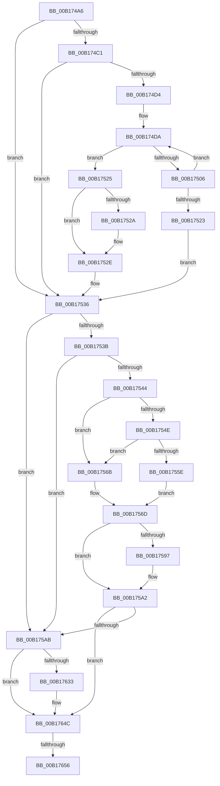

# sub_00B174A6

- RVA: `0x00B174A6`–`0x00B17664` (길이 `446` bytes)
- VA: `0x0000000140B174A6`
- 실행 섹션: `PAGE`
- PDB 이름 있음: `아니요`; PDB Function 태그: `아니요`
- unwind 정보 RVA: `0x0006B94C`
- 디코드: `114`개 명령, `446/446` bytes 표시
- 미해석 바이트: `0` (있으면 어셈블리에 `.byte`로 보존)

> 이 문서는 커널 이미지의 기계어와 PDB 기호를 분석해 생성했습니다. 4번과 5번은 함수 원형과 자료형을 바이너리 사용 방식에서 추정한 C 해석이며 원본 소스 복구 결과는 아닙니다.

## 1. Dependencies

- 직접 호출 지점: **15**; 고유 호출 대상: **14**
- 직접 호출자로 확인된 함수: **0**
- RIP 상대 이미지 참조: **1**

### Outgoing calls
- `0x00B174AA` → [IoGetAttachedDevice](../../text/41/IoGetAttachedDevice_function_00410810.md) (function, `0x00410810`)
- `0x00B174F7` → [KeAbPreAcquire](../../text/21/KeAbPreAcquire_function_00210230.md) (function, `0x00210230`)
- `0x00B1751A` → [IopWaitAndAcquireFileObjectLock](../8A/IopWaitAndAcquireFileObjectLock_function_008AE6D8.md) (function, `0x008AE6D8`)
- `0x00B17531` → [ObfReferenceObject](../../text/20/ObfReferenceObject_function_0020FA20.md) (function, `0x0020FA20`)
- `0x00B17555` → [MmIsDriverVerifying](../../text/4A/MmIsDriverVerifying_function_004A8770.md) (function, `0x004A8770`)
- `0x00B17561` → [VfFastIoSnapState](../../pagevrfy/BB/VfFastIoSnapState_function_00BB97BC.md) (function, `0x00BB97BC`)
- `0x00B1758A` → [guard_dispatch_icall](../../text/6B/guard_dispatch_icall_function_006BAAD0.md) (function, `0x006BAAD0`)
- `0x00B1759D` → [VfFastIoCheckState](../../pagevrfy/BB/VfFastIoCheckState_function_00BB9440.md) (function, `0x00BB9440`)
- `0x00B175B6` → [KeInitializeEvent](../../text/40/KeInitializeEvent_function_0040DD10.md) (function, `0x0040DD10`)
- `0x00B175C1` → [IopAllocateIrpMustSucceed](../../text/20/IopAllocateIrpMustSucceed_function_002076C0.md) (function, `0x002076C0`)
- `0x00B17614` → [ObfReferenceObject](../../text/20/ObfReferenceObject_function_0020FA20.md) (function, `0x0020FA20`)
- `0x00B1761C` → [IopQueueThreadIrp](../../text/20/IopQueueThreadIrp_function_002075C0.md) (function, `0x002075C0`)
- `0x00B17627` → [IofCallDriver](../../text/29/IofCallDriver_function_0029B4B0.md) (function, `0x0029B4B0`)
- `0x00B17647` → [KeWaitForSingleObject](../../text/20/KeWaitForSingleObject_function_0020E6B0.md) (function, `0x0020E6B0`)
- `0x00B17659` → [IopReleaseFileObjectLock](../../text/25/IopReleaseFileObjectLock_function_00250A90.md) (function, `0x00250A90`)

### Direct callers
- 이 함수 시작 RVA로 연결되는 직접 call은 확인되지 않았습니다. 간접 호출은 완전히 역산할 수 없습니다.

### Static image references
- `0x00B17544` → RVA `0x00F04A20` (`.data`; read)

## 2. Other-region calls and transfers

- 다른 실행 섹션으로 향하는 call: **14**
  - `0x00B174AA` → [IoGetAttachedDevice](../../text/41/IoGetAttachedDevice_function_00410810.md) (`PAGE` → `.text`)
  - `0x00B174F7` → [KeAbPreAcquire](../../text/21/KeAbPreAcquire_function_00210230.md) (`PAGE` → `.text`)
  - `0x00B17531` → [ObfReferenceObject](../../text/20/ObfReferenceObject_function_0020FA20.md) (`PAGE` → `.text`)
  - `0x00B17555` → [MmIsDriverVerifying](../../text/4A/MmIsDriverVerifying_function_004A8770.md) (`PAGE` → `.text`)
  - `0x00B17561` → [VfFastIoSnapState](../../pagevrfy/BB/VfFastIoSnapState_function_00BB97BC.md) (`PAGE` → `PAGEVRFY`)
  - `0x00B1758A` → [guard_dispatch_icall](../../text/6B/guard_dispatch_icall_function_006BAAD0.md) (`PAGE` → `.text`)
  - `0x00B1759D` → [VfFastIoCheckState](../../pagevrfy/BB/VfFastIoCheckState_function_00BB9440.md) (`PAGE` → `PAGEVRFY`)
  - `0x00B175B6` → [KeInitializeEvent](../../text/40/KeInitializeEvent_function_0040DD10.md) (`PAGE` → `.text`)
  - `0x00B175C1` → [IopAllocateIrpMustSucceed](../../text/20/IopAllocateIrpMustSucceed_function_002076C0.md) (`PAGE` → `.text`)
  - `0x00B17614` → [ObfReferenceObject](../../text/20/ObfReferenceObject_function_0020FA20.md) (`PAGE` → `.text`)
  - `0x00B1761C` → [IopQueueThreadIrp](../../text/20/IopQueueThreadIrp_function_002075C0.md) (`PAGE` → `.text`)
  - `0x00B17627` → [IofCallDriver](../../text/29/IofCallDriver_function_0029B4B0.md) (`PAGE` → `.text`)
  - `0x00B17647` → [KeWaitForSingleObject](../../text/20/KeWaitForSingleObject_function_0020E6B0.md) (`PAGE` → `.text`)
  - `0x00B17659` → [IopReleaseFileObjectLock](../../text/25/IopReleaseFileObjectLock_function_00250A90.md) (`PAGE` → `.text`)
- call이 아닌 외부 분기/꼬리 이동: **2**
  - `0x00B17650` → [IopCloseFile + 0x198](../86/IopCloseFile_function_008640C0.md) (`tail-transfer`)
  - `0x00B1765F` → [IopCloseFile + 0x198](../86/IopCloseFile_function_008640C0.md) (`tail-transfer`)

## 3. Assembly (complete function range)

```asm
00B174A6  48 8B 4F 08                     mov rcx, qword ptr [rdi + 8]
00B174AA  E8 61 93 8F FF                  call 0x140410810
00B174AF  48 8B F0                        mov rsi, rax
00B174B2  48 8B 40 08                     mov rax, qword ptr [rax + 8]
00B174B6  4C 8B 70 50                     mov r14, qword ptr [rax + 0x50]
00B174BA  8B 47 50                        mov eax, dword ptr [rdi + 0x50]
00B174BD  A8 02                           test al, 2
00B174BF  74 75                           je 0x140b17536
00B174C1  65 48 8B 04 25 88 01 00 00      mov rax, qword ptr gs:[0x188]
00B174CA  8B 80 A0 05 00 00               mov eax, dword ptr [rax + 0x5a0]
00B174D0  A8 01                           test al, 1
00B174D2  75 62                           jne 0x140b17536
00B174D4  41 BF 01 00 00 00               mov r15d, 1
00B174DA  65 48 8B 04 25 88 01 00 00      mov rax, qword ptr gs:[0x188]
00B174E3  48 8D 8F 80 00 00 00            lea rcx, [rdi + 0x80]
00B174EA  45 33 C0                        xor r8d, r8d
00B174ED  33 D2                           xor edx, edx
00B174EF  66 FF 88 E4 01 00 00            dec word ptr [rax + 0x1e4]
00B174F6  90                              nop
00B174F7  E8 34 8D 6F FF                  call 0x140210230
00B174FC  41 8B CF                        mov ecx, r15d
00B174FF  87 4F 74                        xchg dword ptr [rdi + 0x74], ecx
00B17502  85 C9                           test ecx, ecx
00B17504  74 1F                           je 0x140b17525
00B17506  48 8D 4D 40                     lea rcx, [rbp + 0x40]
00B1750A  4C 8B C8                        mov r9, rax
00B1750D  48 89 4C 24 20                  mov qword ptr [rsp + 0x20], rcx
00B17512  45 33 C0                        xor r8d, r8d
00B17515  48 8B CF                        mov rcx, rdi
00B17518  33 D2                           xor edx, edx
00B1751A  E8 B9 71 D9 FF                  call 0x1408ae6d8
00B1751F  85 C0                           test eax, eax
00B17521  75 B7                           jne 0x140b174da
00B17523  EB 11                           jmp 0x140b17536
00B17525  48 85 C0                        test rax, rax
00B17528  74 04                           je 0x140b1752e
00B1752A  44 88 78 0A                     mov byte ptr [rax + 0xa], r15b
00B1752E  48 8B CF                        mov rcx, rdi
00B17531  E8 EA 84 6F FF                  call 0x14020fa20
00B17536  4D 85 F6                        test r14, r14
00B17539  74 70                           je 0x140b175ab
00B1753B  4D 8B 76 40                     mov r14, qword ptr [r14 + 0x40]
00B1753F  4D 85 F6                        test r14, r14
00B17542  74 67                           je 0x140b175ab
00B17544  8B 05 D6 D4 3E 00               mov eax, dword ptr [rip + 0x3ed4d6]
00B1754A  A8 10                           test al, 0x10
00B1754C  74 1D                           je 0x140b1756b
00B1754E  48 8B 5E 08                     mov rbx, qword ptr [rsi + 8]
00B17552  48 8B CB                        mov rcx, rbx
00B17555  E8 16 12 99 FF                  call 0x1404a8770
00B1755A  85 C0                           test eax, eax
00B1755C  74 0D                           je 0x140b1756b
00B1755E  48 8B CB                        mov rcx, rbx
00B17561  E8 56 22 0A 00                  call 0x140bb97bc
00B17566  48 8B D8                        mov rbx, rax
00B17569  EB 02                           jmp 0x140b1756d
00B1756B  33 DB                           xor ebx, ebx
00B1756D  65 48 8B 04 25 88 01 00 00      mov rax, qword ptr gs:[0x188]
00B17576  4C 8D 45 D8                     lea r8, [rbp - 0x28]
00B1757A  4C 8B CE                        mov r9, rsi
00B1757D  48 8B CF                        mov rcx, rdi
00B17580  48 8B 90 B8 00 00 00            mov rdx, qword ptr [rax + 0xb8]
00B17587  49 8B C6                        mov rax, r14
00B1758A  E8 41 35 BA FF                  call 0x1406baad0
00B1758F  44 8A E0                        mov r12b, al
00B17592  48 85 DB                        test rbx, rbx
00B17595  74 0B                           je 0x140b175a2
00B17597  49 8B D6                        mov rdx, r14
00B1759A  48 8B CB                        mov rcx, rbx
00B1759D  E8 9E 1E 0A 00                  call 0x140bb9440
00B175A2  45 84 E4                        test r12b, r12b
00B175A5  0F 85 A1 00 00 00               jne 0x140b1764c
00B175AB  45 33 C0                        xor r8d, r8d
00B175AE  48 8D 4D E8                     lea rcx, [rbp - 0x18]
00B175B2  41 8D 50 01                     lea edx, [r8 + 1]
00B175B6  E8 55 67 8F FF                  call 0x14040dd10
00B175BB  8A 56 4C                        mov dl, byte ptr [rsi + 0x4c]
00B175BE  48 8B CE                        mov rcx, rsi
00B175C1  E8 FA 00 6F FF                  call 0x1402076c0
00B175C6  48 8B D8                        mov rbx, rax
00B175C9  48 89 B8 C0 00 00 00            mov qword ptr [rax + 0xc0], rdi
00B175D0  65 48 8B 0C 25 88 01 00 00      mov rcx, qword ptr gs:[0x188]
00B175D9  48 83 63 58 00                  and qword ptr [rbx + 0x58], 0
00B175DE  48 89 88 98 00 00 00            mov qword ptr [rax + 0x98], rcx
00B175E5  48 8D 4B 30                     lea rcx, [rbx + 0x30]
00B175E9  48 89 4B 48                     mov qword ptr [rbx + 0x48], rcx
00B175ED  48 8B 8B B8 00 00 00            mov rcx, qword ptr [rbx + 0xb8]
00B175F4  C6 40 40 00                     mov byte ptr [rax + 0x40], 0
00B175F8  48 8D 45 E8                     lea rax, [rbp - 0x18]
00B175FC  48 89 43 50                     mov qword ptr [rbx + 0x50], rax
00B17600  C7 43 10 04 10 00 00            mov dword ptr [rbx + 0x10], 0x1004
00B17607  66 C7 41 B8 11 03               mov word ptr [rcx - 0x48], 0x311
00B1760D  48 89 79 E8                     mov qword ptr [rcx - 0x18], rdi
00B17611  48 8B CF                        mov rcx, rdi
00B17614  E8 07 84 6F FF                  call 0x14020fa20
00B17619  48 8B CB                        mov rcx, rbx
00B1761C  E8 9F FF 6E FF                  call 0x1402075c0
00B17621  48 8B D3                        mov rdx, rbx
00B17624  48 8B CE                        mov rcx, rsi
00B17627  E8 84 3E 78 FF                  call 0x14029b4b0
00B1762C  3D 03 01 00 00                  cmp eax, 0x103
00B17631  75 19                           jne 0x140b1764c
00B17633  48 83 64 24 20 00               and qword ptr [rsp + 0x20], 0
00B17639  48 8D 4D E8                     lea rcx, [rbp - 0x18]
00B1763D  45 33 C9                        xor r9d, r9d
00B17640  45 33 C0                        xor r8d, r8d
00B17643  41 8D 51 06                     lea edx, [r9 + 6]
00B17647  E8 64 70 6F FF                  call 0x14020e6b0
00B1764C  41 83 FF 01                     cmp r15d, 1
00B17650  0F 85 02 CC D4 FF               jne 0x140864258
00B17656  48 8B CF                        mov rcx, rdi
00B17659  E8 32 94 73 FF                  call 0x140250a90
00B1765E  90                              nop
00B1765F  E9 F4 CB D4 FF                  jmp 0x140864258
```

## 4. C-style interpretation (structured pseudocode)

```c
__int64 __fastcall sub_00B174A6(__int64 a1, int a2, int a3)
{
    __int64 result;
    __int64 v_rbx;
    unsigned __int64 v_stack_p20;

    result = IoGetAttachedDevice(*(unsigned __int64 *)(v_rdi + 8), a2, a3, a4);
    if ((((unsigned __int8)((unsigned int)(*(unsigned int *)(v_rdi + 80)))) & (2)) == 0) goto loc_00B17536;
    if ((((unsigned __int8)((unsigned int)(*(unsigned int *)(*(unsigned __int64 *)(gs_base + (0 + 392)) + 1440)))) & (1)) != 0) goto loc_00B17536;
loc_00B174DA:
    a3 = 0;
    a2 = 0;
    result = KeAbPreAcquire(v_rdi + 128, a2, a3, a4);
    if (1 == 0) goto loc_00B17525;
    v_stack_p20 = v_rbp + 64;
    a3 = 0;
    a2 = 0;
    result = IopWaitAndAcquireFileObjectLock(v_rdi, a2, a3, result);
    if ((unsigned int)(result) != 0) goto loc_00B174DA;
    goto loc_00B17536;
loc_00B17525:
    if (result != 0) {
        *(unsigned __int8 *)(result + 10) = 1;
    }
    result = ObfReferenceObject(v_rdi, a2, a3, result);
loc_00B17536:
    if (*(unsigned __int64 *)(*(unsigned __int64 *)(result + 8) + 80) == 0) goto loc_00B175AB;
    if (*(unsigned __int64 *)(*(unsigned __int64 *)(*(unsigned __int64 *)(result + 8) + 80) + 64) == 0) goto loc_00B175AB;
    if ((((unsigned __int8)((unsigned int)(*(unsigned int *)(v_rip + 4117718)))) & (16)) == 0) goto loc_00B1756B;
    result = MmIsDriverVerifying(*(unsigned __int64 *)(result + 8), a2, a3, result);
    if ((unsigned int)(result) == 0) goto loc_00B1756B;
    result = VfFastIoSnapState(*(unsigned __int64 *)(result + 8), a2, a3, result);
    goto loc_00B1756D;
loc_00B1756B:
    v_rbx = 0;
loc_00B1756D:
    result = guard_dispatch_icall(v_rdi, *(unsigned __int64 *)(*(unsigned __int64 *)(gs_base + (0 + 392)) + 184), v_rbp - 40, result);
    if (0 != 0) {
        a2 = *(unsigned __int64 *)(*(unsigned __int64 *)(*(unsigned __int64 *)(result + 8) + 80) + 64);
        a1 = 0;
        result = VfFastIoCheckState(a1, a2, v_rbp - 40, result);
    }
    if ((unsigned __int8)((unsigned __int8)(result)) != 0) goto loc_00B1764C;
loc_00B175AB:
    a3 = 0;
    result = KeInitializeEvent(v_rbp - 24, a3 + 1, a3, result);
    result = IopAllocateIrpMustSucceed(result, *(unsigned __int8 *)(result + 76), a3, result);
    *(unsigned __int64 *)(result + 192) = v_rdi;
    *(unsigned __int64 *)(result + 152) = *(unsigned __int64 *)(gs_base + (0 + 392));
    *(unsigned __int64 *)(result + 72) = result + 48;
    *(unsigned __int8 *)(result + 64) = 0;
    *(unsigned __int64 *)(result + 80) = v_rbp - 24;
    *(unsigned int *)(result + 16) = 0x1004ULL;
    *(unsigned __int16 *)(*(unsigned __int64 *)(result + 184) - 72) = 785;
    *(unsigned __int64 *)(*(unsigned __int64 *)(result + 184) - 24) = v_rdi;
    result = ObfReferenceObject(v_rdi, *(unsigned __int8 *)(result + 76), a3, result);
    result = IopQueueThreadIrp(result, *(unsigned __int8 *)(result + 76), a3, result);
    result = IofCallDriver(result, result, a3, result);
    if (((unsigned int)(result)) == 259) {
        a1 = v_rbp - 24;
        a4 = 0;
        a3 = 0;
        a2 = a4 + 6;
        result = KeWaitForSingleObject(a1, a2, a3, a4);
    }
    result = IopReleaseFileObjectLock(v_rdi, a2, a3, a4);
}
```

## 5. (Beta) C Style

```c
int64_t sub_00B174A6(int64_t Arg1, int32_t Arg2, int32_t Arg3)
{
    int64_t result;
    int64_t local_rbx;
    uint64_t v_stack_p20;

    result = IoGetAttachedDevice(*(uint64_t *)(local_rdi + 0x8), Arg2, Arg3, a4);
    if ((((uint8_t)((uint32_t)(*(uint32_t *)(local_rdi + 0x50)))) & (2)) == 0) goto loc_00B17536;
    if ((((uint8_t)((uint32_t)(*(uint32_t *)(*(uint64_t *)(gs_base + (0 + 0x188)) + 0x5A0)))) & (1)) != 0) goto loc_00B17536;
loc_00B174DA:
    Arg3 = 0;
    Arg2 = 0;
    result = KeAbPreAcquire(local_rdi + 128, Arg2, Arg3, a4);
    if (1 == 0) goto loc_00B17525;
    v_stack_p20 = local_rbp + 64;
    Arg3 = 0;
    Arg2 = 0;
    result = IopWaitAndAcquireFileObjectLock(local_rdi, Arg2, Arg3, result);
    if ((uint32_t)(result) != 0) goto loc_00B174DA;
    goto loc_00B17536;
loc_00B17525:
    if (result != 0) {
        *(uint8_t *)(result + 0xA) = 1;
    }
    result = ObfReferenceObject(local_rdi, Arg2, Arg3, result);
loc_00B17536:
    if (*(uint64_t *)(*(uint64_t *)(result + 0x8) + 0x50) == 0) goto loc_00B175AB;
    if (*(uint64_t *)(*(uint64_t *)(*(uint64_t *)(result + 0x8) + 0x50) + 0x40) == 0) goto loc_00B175AB;
    if ((((uint8_t)((uint32_t)(*(uint32_t *)(v_rip + 0x3ED4D6)))) & (16)) == 0) goto loc_00B1756B;
    result = MmIsDriverVerifying(*(uint64_t *)(result + 0x8), Arg2, Arg3, result);
    if ((uint32_t)(result) == 0) goto loc_00B1756B;
    result = VfFastIoSnapState(*(uint64_t *)(result + 0x8), Arg2, Arg3, result);
    goto loc_00B1756D;
loc_00B1756B:
    local_rbx = 0;
loc_00B1756D:
    result = guard_dispatch_icall(local_rdi, *(uint64_t *)(*(uint64_t *)(gs_base + (0 + 0x188)) + 0xB8), local_rbp - 40, result);
    if (0 != 0) {
        Arg2 = *(uint64_t *)(*(uint64_t *)(*(uint64_t *)(result + 0x8) + 0x50) + 0x40);
        Arg1 = 0;
        result = VfFastIoCheckState(Arg1, Arg2, local_rbp - 40, result);
    }
    if ((uint8_t)((uint8_t)(result)) != 0) goto loc_00B1764C;
loc_00B175AB:
    Arg3 = 0;
    result = KeInitializeEvent(local_rbp - 24, Arg3 + 1, Arg3, result);
    result = IopAllocateIrpMustSucceed(result, *(uint8_t *)(result + 0x4C), Arg3, result);
    *(uint64_t *)(result + 0xC0) = local_rdi;
    *(uint64_t *)(result + 0x98) = *(uint64_t *)(gs_base + (0 + 0x188));
    *(uint64_t *)(result + 0x48) = result + 48;
    *(uint8_t *)(result + 0x40) = 0;
    *(uint64_t *)(result + 0x50) = local_rbp - 24;
    *(uint32_t *)(result + 0x10) = 0x1004ULL;
    *(uint16_t *)(*(uint64_t *)(result + 0xB8) - 0x48) = 785;
    *(uint64_t *)(*(uint64_t *)(result + 0xB8) - 0x18) = local_rdi;
    result = ObfReferenceObject(local_rdi, *(uint8_t *)(result + 0x4C), Arg3, result);
    result = IopQueueThreadIrp(result, *(uint8_t *)(result + 0x4C), Arg3, result);
    result = IofCallDriver(result, result, Arg3, result);
    if (((uint32_t)(result)) == 259) {
        Arg1 = local_rbp - 24;
        a4 = 0;
        Arg3 = 0;
        Arg2 = a4 + 6;
        result = KeWaitForSingleObject(Arg1, Arg2, Arg3, a4);
    }
    result = IopReleaseFileObjectLock(local_rdi, Arg2, Arg3, a4);
}
```

## 6. Execution-region graph

[열기: 2D/3D 그래프와 함수 탐색 컨트롤 패널](../../../control-panel.html?section=page&rva=0x00B174A6&view=graph)

- 2D 그래프는 위에서 아래로 흐르고, 3D 그래프는 빈 공간을 드래그해 회전합니다. Shift+드래그는 이동, 휠은 확대·축소, 함수 노드 선택은 대상 보고서 이동입니다.

### Static fallback


