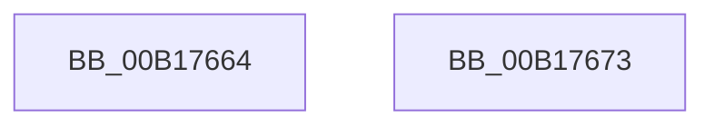

# sub_00B17664

- RVA: `0x00B17664`–`0x00B17685` (길이 `33` bytes)
- VA: `0x0000000140B17664`
- 실행 섹션: `PAGE`
- PDB 이름 있음: `아니요`; PDB Function 태그: `아니요`
- unwind 정보 RVA: `0x0006BC6C`
- 디코드: `9`개 명령, `33/33` bytes 표시
- 미해석 바이트: `0` (있으면 어셈블리에 `.byte`로 보존)

> 이 문서는 커널 이미지의 기계어와 PDB 기호를 분석해 생성했습니다. 4번과 5번은 함수 원형과 자료형을 바이너리 사용 방식에서 추정한 C 해석이며 원본 소스 복구 결과는 아닙니다.

## 1. Dependencies

- 직접 호출 지점: **2**; 고유 호출 대상: **2**
- 직접 호출자로 확인된 함수: **0**
- RIP 상대 이미지 참조: **0**

### Outgoing calls
- `0x00B17668` → [VrpPreFlushKey](../AD/VrpPreFlushKey_function_00AD6154.md) (function, `0x00AD6154`)
- `0x00B1767A` → [VrpPreUnloadKey](../93/VrpPreUnloadKey_function_00937950.md) (function, `0x00937950`)

### Direct callers
- 이 함수 시작 RVA로 연결되는 직접 call은 확인되지 않았습니다. 간접 호출은 완전히 역산할 수 없습니다.

### Static image references
- 디코드된 RIP-relative 메모리 참조가 없습니다.

## 2. Other-region calls and transfers

- 다른 실행 섹션으로 향하는 call: **0**
- call이 아닌 외부 분기/꼬리 이동: **2**
  - `0x00B1766E` → [VrpRegistryCallback + 0x9F](../86/VrpRegistryCallback_function_00867450.md) (`tail-transfer`)
  - `0x00B17680` → [VrpRegistryCallback + 0x9F](../86/VrpRegistryCallback_function_00867450.md) (`tail-transfer`)

## 3. Assembly (complete function range)

```asm
00B17664  48 8B 55 D0                     mov rdx, qword ptr [rbp - 0x30]
00B17668  E8 E7 EA FB FF                  call 0x140ad6154
00B1766D  90                              nop
00B1766E  E9 7C FE D4 FF                  jmp 0x1408674ef
00B17673  48 8B 55 D0                     mov rdx, qword ptr [rbp - 0x30]
00B17677  48 8B CE                        mov rcx, rsi
00B1767A  E8 D1 02 E2 FF                  call 0x140937950
00B1767F  90                              nop
00B17680  E9 6A FE D4 FF                  jmp 0x1408674ef
```

## 4. C-style interpretation (structured pseudocode)

```c
__int64 __fastcall sub_00B17664(void)
{
    __int64 result;

    result = VrpPreFlushKey(a1, *(unsigned __int64 *)(v_rbp - 48), a3, a4);
}
```

## 5. (Beta) C Style

```c
void sub_00B17664(void)
{
    int64_t result;

    result = VrpPreFlushKey(a1, *(uint64_t *)(local_rbp - 0x30), a3, a4);
}
```

## 6. Execution-region graph

[열기: 2D/3D 그래프와 함수 탐색 컨트롤 패널](../../../control-panel.html?section=page&rva=0x00B17664&view=graph)

- 2D 그래프는 위에서 아래로 흐르고, 3D 그래프는 빈 공간을 드래그해 회전합니다. Shift+드래그는 이동, 휠은 확대·축소, 함수 노드 선택은 대상 보고서 이동입니다.

### Static fallback


