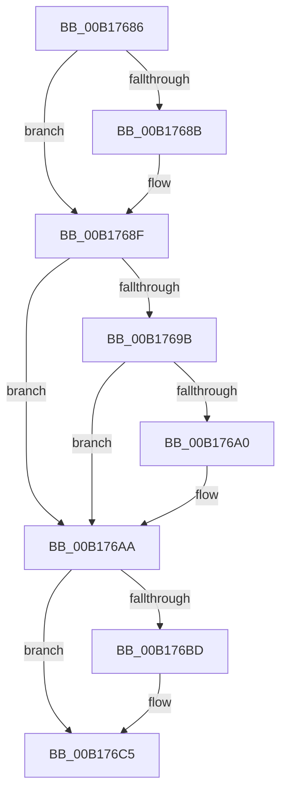

# sub_00B17686

- RVA: `0x00B17686`–`0x00B176D5` (길이 `79` bytes)
- VA: `0x0000000140B17686`
- 실행 섹션: `PAGE`
- PDB 이름 있음: `아니요`; PDB Function 태그: `아니요`
- unwind 정보 RVA: `0x0006BD2C`
- 디코드: `22`개 명령, `79/79` bytes 표시
- 미해석 바이트: `0` (있으면 어셈블리에 `.byte`로 보존)

> 이 문서는 커널 이미지의 기계어와 PDB 기호를 분석해 생성했습니다. 4번과 5번은 함수 원형과 자료형을 바이너리 사용 방식에서 추정한 C 해석이며 원본 소스 복구 결과는 아닙니다.

## 1. Dependencies

- 직접 호출 지점: **3**; 고유 호출 대상: **3**
- 직접 호출자로 확인된 함수: **0**
- RIP 상대 이미지 참조: **0**

### Outgoing calls
- `0x00B176A5` → [KeSetEvent](../../text/33/KeSetEvent_function_0033F310.md) (function, `0x0033F310`)
- `0x00B176C0` → [ExfTryToWakePushLock](../../text/26/ExfTryToWakePushLock_function_00265DD0.md) (function, `0x00265DD0`)
- `0x00B176C8` → [KeAbPostRelease](../../text/2E/KeAbPostRelease_function_002E1600.md) (function, `0x002E1600`)

### Direct callers
- 이 함수 시작 RVA로 연결되는 직접 call은 확인되지 않았습니다. 간접 호출은 완전히 역산할 수 없습니다.

### Static image references
- 디코드된 RIP-relative 메모리 참조가 없습니다.

## 2. Other-region calls and transfers

- 다른 실행 섹션으로 향하는 call: **3**
  - `0x00B176A5` → [KeSetEvent](../../text/33/KeSetEvent_function_0033F310.md) (`PAGE` → `.text`)
  - `0x00B176C0` → [ExfTryToWakePushLock](../../text/26/ExfTryToWakePushLock_function_00265DD0.md) (`PAGE` → `.text`)
  - `0x00B176C8` → [KeAbPostRelease](../../text/2E/KeAbPostRelease_function_002E1600.md) (`PAGE` → `.text`)
- call이 아닌 외부 분기/꼬리 이동: **1**
  - `0x00B176D0` → [sub_00868255 + 0x4C](../86/Unknown_function_00868255.md) (`tail-transfer`)

## 3. Assembly (complete function range)

```asm
00B17686  48 85 C0                        test rax, rax
00B17689  74 04                           je 0x140b1768f
00B1768B  C6 40 0A 01                     mov byte ptr [rax + 0xa], 1
00B1768F  48 8B 8D 98 01 00 00            mov rcx, qword ptr [rbp + 0x198]
00B17696  48 85 C9                        test rcx, rcx
00B17699  74 0F                           je 0x140b176aa
00B1769B  3B 71 18                        cmp esi, dword ptr [rcx + 0x18]
00B1769E  75 0A                           jne 0x140b176aa
00B176A0  45 33 C0                        xor r8d, r8d
00B176A3  33 D2                           xor edx, edx
00B176A5  E8 66 7C 82 FF                  call 0x14033f310
00B176AA  48 C7 C0 FF FF FF FF            mov rax, 0xffffffffffffffff
00B176B1  F0 49 0F C1 45 00               lock xadd qword ptr [r13], rax
00B176B7  24 06                           and al, 6
00B176B9  3C 02                           cmp al, 2
00B176BB  75 08                           jne 0x140b176c5
00B176BD  49 8B CD                        mov rcx, r13
00B176C0  E8 0B E7 74 FF                  call 0x140265dd0
00B176C5  49 8B CD                        mov rcx, r13
00B176C8  E8 33 9F 7C FF                  call 0x1402e1600
00B176CD  45 33 ED                        xor r13d, r13d
00B176D0  E9 CC 0B D5 FF                  jmp 0x1408682a1
```

## 4. C-style interpretation (structured pseudocode)

```c
__int64 __fastcall sub_00B17686(__int64 a1, int a2, int a3)
{
    __int64 result;
    __int64 v_r13;

    if (result != 0) {
        *(unsigned __int8 *)(result + 10) = 1;
    }
    if (*(unsigned __int64 *)(v_rbp + 408) == 0) goto loc_00B176AA;
    if (((unsigned int)(v_rsi)) == (*(unsigned int *)(*(unsigned __int64 *)(v_rbp + 408) + 24))) {
        a3 = 0;
        a2 = 0;
        result = KeSetEvent(*(unsigned __int64 *)(v_rbp + 408), a2, a3, a4);
    }
    result = (unsigned __int8)((-1) & (6));
    if (((unsigned __int8)(result)) == 2) {
        a1 = v_r13;
        result = ExfTryToWakePushLock(a1, a2, a3, a4);
    }
    result = KeAbPostRelease(v_r13, a2, a3, a4);
    v_r13 = 0;
}
```

## 5. (Beta) C Style

```c
int64_t sub_00B17686(int64_t Arg1, int32_t Arg2, int32_t Arg3)
{
    int64_t result;
    int64_t local_r13;

    if (result != 0) {
        *(uint8_t *)(result + 0xA) = 1;
    }
    if (*(uint64_t *)(local_rbp + 0x198) == 0) goto loc_00B176AA;
    if (((uint32_t)(local_rsi)) == (*(uint32_t *)(*(uint64_t *)(local_rbp + 0x198) + 0x18))) {
        Arg3 = 0;
        Arg2 = 0;
        result = KeSetEvent(*(uint64_t *)(local_rbp + 0x198), Arg2, Arg3, a4);
    }
    result = (uint8_t)((-1) & (6));
    if (((uint8_t)(result)) == 2) {
        Arg1 = local_r13;
        result = ExfTryToWakePushLock(Arg1, Arg2, Arg3, a4);
    }
    result = KeAbPostRelease(local_r13, Arg2, Arg3, a4);
    local_r13 = 0;
}
```

## 6. Execution-region graph

[열기: 2D/3D 그래프와 함수 탐색 컨트롤 패널](../../../control-panel.html?section=page&rva=0x00B17686&view=graph)

- 2D 그래프는 위에서 아래로 흐르고, 3D 그래프는 빈 공간을 드래그해 회전합니다. Shift+드래그는 이동, 휠은 확대·축소, 함수 노드 선택은 대상 보고서 이동입니다.

### Static fallback


