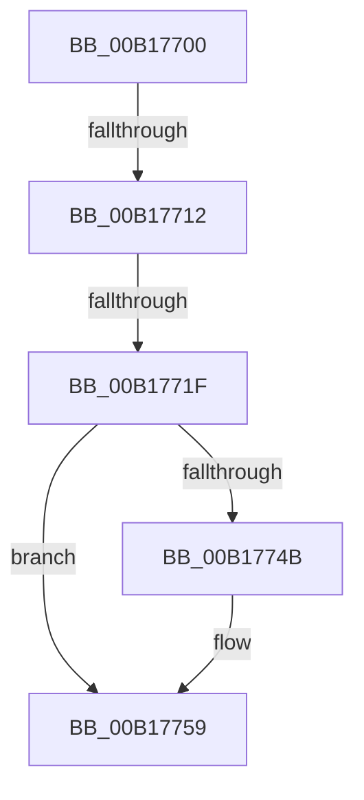

# sub_00B17700

- RVA: `0x00B17700`–`0x00B1776C` (길이 `108` bytes)
- VA: `0x0000000140B17700`
- 실행 섹션: `PAGE`
- PDB 이름 있음: `아니요`; PDB Function 태그: `아니요`
- unwind 정보 RVA: `0x0006C878`
- 디코드: `24`개 명령, `108/108` bytes 표시
- 미해석 바이트: `0` (있으면 어셈블리에 `.byte`로 보존)

> 이 문서는 커널 이미지의 기계어와 PDB 기호를 분석해 생성했습니다. 4번과 5번은 함수 원형과 자료형을 바이너리 사용 방식에서 추정한 C 해석이며 원본 소스 복구 결과는 아닙니다.

## 1. Dependencies

- 직접 호출 지점: **5**; 고유 호출 대상: **5**
- 직접 호출자로 확인된 함수: **0**
- RIP 상대 이미지 참조: **3**

### Outgoing calls
- `0x00B17700` → [LOCK_TRANSACTION_LIST](../87/LOCK_TRANSACTION_LIST_function_00874AD4.md) (function, `0x00874AD4`)
- `0x00B17733` → [ExReleaseFastMutexUnsafe](../../text/25/ExReleaseFastMutexUnsafe_function_002503A0.md) (function, `0x002503A0`)
- `0x00B17738` → [KeLeaveCriticalRegion](../../text/25/KeLeaveCriticalRegion_function_0025D8B0.md) (function, `0x0025D8B0`)
- `0x00B17754` → [ExfUnblockPushLock](../../text/2A/ExfUnblockPushLock_function_002A3FE0.md) (function, `0x002A3FE0`)
- `0x00B17761` → [ExFreePoolWithTag](../../poolcode/B8/ExFreePoolWithTag_function_00B82870.md) (function, `0x00B82870`)

### Direct callers
- 이 함수 시작 RVA로 연결되는 직접 call은 확인되지 않았습니다. 간접 호출은 완전히 역산할 수 없습니다.

### Static image references
- `0x00B17722` → RVA `0x00EF5820` (`.data`; read)
- `0x00B1772D` → RVA `0x00EEFC38` (`.data`; read/write)
- `0x00B17742` → RVA `0x00EF5810` (`.data`; read)

## 2. Other-region calls and transfers

- 다른 실행 섹션으로 향하는 call: **4**
  - `0x00B17733` → [ExReleaseFastMutexUnsafe](../../text/25/ExReleaseFastMutexUnsafe_function_002503A0.md) (`PAGE` → `.text`)
  - `0x00B17738` → [KeLeaveCriticalRegion](../../text/25/KeLeaveCriticalRegion_function_0025D8B0.md) (`PAGE` → `.text`)
  - `0x00B17754` → [ExfUnblockPushLock](../../text/2A/ExfUnblockPushLock_function_002A3FE0.md) (`PAGE` → `.text`)
  - `0x00B17761` → [ExFreePoolWithTag](../../poolcode/B8/ExFreePoolWithTag_function_00B82870.md) (`PAGE` → `POOLCODE`)
- call이 아닌 외부 분기/꼬리 이동: **3**
  - `0x00B1770C` → [CmpTransSearchAddTrans + 0x10E](../87/CmpTransSearchAddTrans_function_008743FC.md) (`tail-transfer`)
  - `0x00B17719` → [CmpTransSearchAddTrans + 0x10E](../87/CmpTransSearchAddTrans_function_008743FC.md) (`tail-transfer`)
  - `0x00B17767` → [CmpTransSearchAddTrans + 0xAB](../87/CmpTransSearchAddTrans_function_008743FC.md) (`tail-transfer`)

## 3. Assembly (complete function range)

```asm
00B17700  E8 CF D3 D5 FF                  call 0x140874ad4
00B17705  48 8B 16                        mov rdx, qword ptr [rsi]
00B17708  48 39 72 08                     cmp qword ptr [rdx + 8], rsi
00B1770C  0F 85 F8 CD D5 FF               jne 0x14087450a
00B17712  48 8B 46 08                     mov rax, qword ptr [rsi + 8]
00B17716  48 39 30                        cmp qword ptr [rax], rsi
00B17719  0F 85 EB CD D5 FF               jne 0x14087450a
00B1771F  48 89 10                        mov qword ptr [rax], rdx
00B17722  48 8D 0D F7 E0 3D 00            lea rcx, [rip + 0x3de0f7]
00B17729  48 89 42 08                     mov qword ptr [rdx + 8], rax
00B1772D  FF 0D 05 85 3D 00               dec dword ptr [rip + 0x3d8505]
00B17733  E8 68 8C 73 FF                  call 0x1402503a0
00B17738  E8 73 61 74 FF                  call 0x14025d8b0
00B1773D  F0 44 09 34 24                  lock or dword ptr [rsp], r14d
00B17742  4C 39 35 C7 E0 3D 00            cmp qword ptr [rip + 0x3de0c7], r14
00B17749  74 0E                           je 0x140b17759
00B1774B  33 D2                           xor edx, edx
00B1774D  48 8D 0D BC E0 3D 00            lea rcx, [rip + 0x3de0bc]
00B17754  E8 87 C8 78 FF                  call 0x1402a3fe0
00B17759  BA 43 4D 54 72                  mov edx, 0x72544d43
00B1775E  48 8B CE                        mov rcx, rsi
00B17761  E8 0A B1 06 00                  call 0x140b82870
00B17766  90                              nop
00B17767  E9 3B CD D5 FF                  jmp 0x1408744a7
```

## 4. C-style interpretation (structured pseudocode)

```c
__int64 __fastcall sub_00B17700(void)
{
    __int64 result;
    unsigned int v_stack_p0;

    result = LOCK_TRANSACTION_LIST(a1, a2, a3, a4);
    *(unsigned __int64 *)(*(unsigned __int64 *)(v_rsi + 8)) = *(unsigned __int64 *)(v_rsi);
    *(unsigned __int64 *)(*(unsigned __int64 *)(v_rsi) + 8) = *(unsigned __int64 *)(v_rsi + 8);
    result = ExReleaseFastMutexUnsafe(v_rip + 4055287, *(unsigned __int64 *)(v_rsi), a3, a4);
    result = KeLeaveCriticalRegion(v_rip + 4055287, *(unsigned __int64 *)(v_rsi), a3, a4);
    if ((*(unsigned __int64 *)(v_rip + 4055239)) != v_r14) {
        a2 = 0;
        a1 = v_rip + 4055228;
        result = ExfUnblockPushLock(a1, a2, a3, a4);
    }
    result = ExFreePoolWithTag(v_rsi, (unsigned int)(0x72544D43ULL), a3, a4);
}
```

## 5. (Beta) C Style

```c
void sub_00B17700(void)
{
    int64_t result;
    uint32_t v_stack_p0;

    result = LOCK_TRANSACTION_LIST(a1, a2, a3, a4);
    *(uint64_t *)(*(uint64_t *)(local_rsi + 0x8)) = *(uint64_t *)(local_rsi);
    *(uint64_t *)(*(uint64_t *)(local_rsi) + 0x8) = *(uint64_t *)(local_rsi + 0x8);
    result = ExReleaseFastMutexUnsafe(v_rip + 4055287, *(uint64_t *)(local_rsi), a3, a4);
    result = KeLeaveCriticalRegion(v_rip + 4055287, *(uint64_t *)(local_rsi), a3, a4);
    if ((*(uint64_t *)(v_rip + 0x3DE0C7)) != local_r14) {
        a2 = 0;
        a1 = v_rip + 4055228;
        result = ExfUnblockPushLock(a1, a2, a3, a4);
    }
    result = ExFreePoolWithTag(local_rsi, (uint32_t)(0x72544D43ULL), a3, a4);
}
```

## 6. Execution-region graph

[열기: 2D/3D 그래프와 함수 탐색 컨트롤 패널](../../../control-panel.html?section=page&rva=0x00B17700&view=graph)

- 2D 그래프는 위에서 아래로 흐르고, 3D 그래프는 빈 공간을 드래그해 회전합니다. Shift+드래그는 이동, 휠은 확대·축소, 함수 노드 선택은 대상 보고서 이동입니다.

### Static fallback


