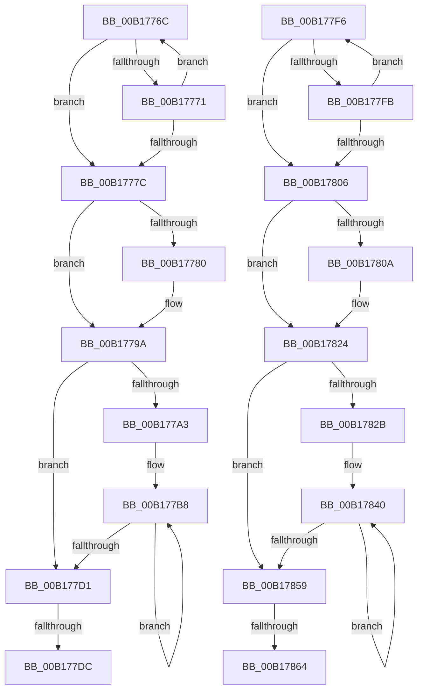

# sub_00B1776C

- RVA: `0x00B1776C`–`0x00B1787E` (길이 `274` bytes)
- VA: `0x0000000140B1776C`
- 실행 섹션: `PAGE`
- PDB 이름 있음: `아니요`; PDB Function 태그: `아니요`
- unwind 정보 RVA: `0x0006C8D8`
- 디코드: `78`개 명령, `274/274` bytes 표시
- 미해석 바이트: `0` (있으면 어셈블리에 `.byte`로 보존)

> 이 문서는 커널 이미지의 기계어와 PDB 기호를 분석해 생성했습니다. 4번과 5번은 함수 원형과 자료형을 바이너리 사용 방식에서 추정한 C 해석이며 원본 소스 복구 결과는 아닙니다.

## 1. Dependencies

- 직접 호출 지점: **4**; 고유 호출 대상: **2**
- 직접 호출자로 확인된 함수: **0**
- RIP 상대 이미지 참조: **0**

### Outgoing calls
- `0x00B17794` → [KeBugCheckEx](../../text/4F/KeBugCheckEx_function_004FD660.md) (function, `0x004FD660`)
- `0x00B177E8` → [ExFreePoolWithTag](../../poolcode/B8/ExFreePoolWithTag_function_00B82870.md) (function, `0x00B82870`)
- `0x00B1781E` → [KeBugCheckEx](../../text/4F/KeBugCheckEx_function_004FD660.md) (function, `0x004FD660`)
- `0x00B17870` → [ExFreePoolWithTag](../../poolcode/B8/ExFreePoolWithTag_function_00B82870.md) (function, `0x00B82870`)

### Direct callers
- 이 함수 시작 RVA로 연결되는 직접 call은 확인되지 않았습니다. 간접 호출은 완전히 역산할 수 없습니다.

### Static image references
- 디코드된 RIP-relative 메모리 참조가 없습니다.

## 2. Other-region calls and transfers

- 다른 실행 섹션으로 향하는 call: **4**
  - `0x00B17794` → [KeBugCheckEx](../../text/4F/KeBugCheckEx_function_004FD660.md) (`PAGE` → `.text`)
  - `0x00B177E8` → [ExFreePoolWithTag](../../poolcode/B8/ExFreePoolWithTag_function_00B82870.md) (`PAGE` → `POOLCODE`)
  - `0x00B1781E` → [KeBugCheckEx](../../text/4F/KeBugCheckEx_function_004FD660.md) (`PAGE` → `.text`)
  - `0x00B17870` → [ExFreePoolWithTag](../../poolcode/B8/ExFreePoolWithTag_function_00B82870.md) (`PAGE` → `POOLCODE`)
- call이 아닌 외부 분기/꼬리 이동: **4**
  - `0x00B177D6` → [CmpRundownUnitOfWork + 0x4D](../87/CmpRundownUnitOfWork_function_0087497C.md) (`tail-transfer`)
  - `0x00B177F1` → [CmpRundownUnitOfWork + 0x4D](../87/CmpRundownUnitOfWork_function_0087497C.md) (`tail-transfer`)
  - `0x00B1785E` → [CmpRundownUnitOfWork + 0x7C](../87/CmpRundownUnitOfWork_function_0087497C.md) (`tail-transfer`)
  - `0x00B17879` → [CmpRundownUnitOfWork + 0x7C](../87/CmpRundownUnitOfWork_function_0087497C.md) (`tail-transfer`)

## 3. Assembly (complete function range)

```asm
00B1776C  48 39 3A                        cmp qword ptr [rdx], rdi
00B1776F  74 0B                           je 0x140b1777c
00B17771  41 03 CE                        add ecx, r14d
00B17774  48 83 C2 08                     add rdx, 8
00B17778  3B C8                           cmp ecx, eax
00B1777A  72 F0                           jb 0x140b1776c
00B1777C  3B C8                           cmp ecx, eax
00B1777E  75 1A                           jne 0x140b1779a
00B17780  BA 12 00 00 00                  mov edx, 0x12
00B17785  48 89 7C 24 20                  mov qword ptr [rsp + 0x20], rdi
00B1778A  4C 8B CE                        mov r9, rsi
00B1778D  8D 4A 3F                        lea ecx, [rdx + 0x3f]
00B17790  44 8D 42 F0                     lea r8d, [rdx - 0x10]
00B17794  E8 C7 5E 9E FF                  call 0x1404fd660
00B17799  CC                              int3
00B1779A  44 8D 40 FF                     lea r8d, [rax - 1]
00B1779E  41 3B C8                        cmp ecx, r8d
00B177A1  73 2E                           jae 0x140b177d1
00B177A3  8D 51 01                        lea edx, [rcx + 1]
00B177A6  48 C1 E2 03                     shl rdx, 3
00B177AA  4C 8D 0C CD 00 00 00 00         lea r9, [rcx*8]
00B177B2  44 2B C1                        sub r8d, ecx
00B177B5  45 8B D0                        mov r10d, r8d
00B177B8  48 8B 4E 08                     mov rcx, qword ptr [rsi + 8]
00B177BC  48 8B 04 0A                     mov rax, qword ptr [rdx + rcx]
00B177C0  48 8D 52 08                     lea rdx, [rdx + 8]
00B177C4  49 89 04 09                     mov qword ptr [r9 + rcx], rax
00B177C8  4D 8D 49 08                     lea r9, [r9 + 8]
00B177CC  4D 2B D6                        sub r10, r14
00B177CF  75 E7                           jne 0x140b177b8
00B177D1  FF 0E                           dec dword ptr [rsi]
00B177D3  44 39 36                        cmp dword ptr [rsi], r14d
00B177D6  0F 85 ED D1 D5 FF               jne 0x1408749c9
00B177DC  48 8B 4E 08                     mov rcx, qword ptr [rsi + 8]
00B177E0  BA 43 4D 49 78                  mov edx, 0x78494d43
00B177E5  48 8B 19                        mov rbx, qword ptr [rcx]
00B177E8  E8 83 B0 06 00                  call 0x140b82870
00B177ED  48 89 5E 08                     mov qword ptr [rsi + 8], rbx
00B177F1  E9 D3 D1 D5 FF                  jmp 0x1408749c9
00B177F6  48 39 3A                        cmp qword ptr [rdx], rdi
00B177F9  74 0B                           je 0x140b17806
00B177FB  41 03 CE                        add ecx, r14d
00B177FE  48 83 C2 08                     add rdx, 8
00B17802  3B C8                           cmp ecx, eax
00B17804  72 F0                           jb 0x140b177f6
00B17806  3B C8                           cmp ecx, eax
00B17808  75 1A                           jne 0x140b17824
00B1780A  BA 12 00 00 00                  mov edx, 0x12
00B1780F  48 89 7C 24 20                  mov qword ptr [rsp + 0x20], rdi
00B17814  4C 8B CE                        mov r9, rsi
00B17817  8D 4A 3F                        lea ecx, [rdx + 0x3f]
00B1781A  44 8D 42 F0                     lea r8d, [rdx - 0x10]
00B1781E  E8 3D 5E 9E FF                  call 0x1404fd660
00B17823  CC                              int3
00B17824  8D 50 FF                        lea edx, [rax - 1]
00B17827  3B CA                           cmp ecx, edx
00B17829  73 2E                           jae 0x140b17859
00B1782B  44 8D 41 01                     lea r8d, [rcx + 1]
00B1782F  49 C1 E0 03                     shl r8, 3
00B17833  4C 8D 0C CD 00 00 00 00         lea r9, [rcx*8]
00B1783B  2B D1                           sub edx, ecx
00B1783D  44 8B D2                        mov r10d, edx
00B17840  48 8B 4E 08                     mov rcx, qword ptr [rsi + 8]
00B17844  49 8B 04 08                     mov rax, qword ptr [r8 + rcx]
00B17848  4D 8D 40 08                     lea r8, [r8 + 8]
00B1784C  49 89 04 09                     mov qword ptr [r9 + rcx], rax
00B17850  4D 8D 49 08                     lea r9, [r9 + 8]
00B17854  4D 2B D6                        sub r10, r14
00B17857  75 E7                           jne 0x140b17840
00B17859  FF 0E                           dec dword ptr [rsi]
00B1785B  44 39 36                        cmp dword ptr [rsi], r14d
00B1785E  0F 85 94 D1 D5 FF               jne 0x1408749f8
00B17864  48 8B 4E 08                     mov rcx, qword ptr [rsi + 8]
00B17868  BA 43 4D 49 78                  mov edx, 0x78494d43
00B1786D  48 8B 19                        mov rbx, qword ptr [rcx]
00B17870  E8 FB AF 06 00                  call 0x140b82870
00B17875  48 89 5E 08                     mov qword ptr [rsi + 8], rbx
00B17879  E9 7A D1 D5 FF                  jmp 0x1408749f8
```

## 4. C-style interpretation (structured pseudocode)

```c
__int64 __fastcall sub_00B1776C(int a1, __int64 a2)
{
    __int64 result;
    __int64 v_r10;
    unsigned __int64 v_stack_p20;

    if ((*(unsigned __int64 *)(a2)) == v_rdi) goto loc_00B1777C;
    a1 = (unsigned int)((a1) + ((unsigned int)(v_r14)));
    a2 = (a2) + (8);
    if (a1 < ((unsigned int)(result))) goto loc_00B1776C;
loc_00B1777C:
    if (a1 == ((unsigned int)(result))) {
        a2 = 18;
        v_stack_p20 = v_rdi;
        a4 = v_rsi;
        a1 = a2 + 63;
        a3 = a2 - 16;
        result = KeBugCheckEx(a1, a2, a3, a4);
    }
    if (a1 >= ((unsigned int)(result - 1))) goto loc_00B177D1;
    a2 = (a1 + 1) << (3);
    a3 = (unsigned int)((result - 1) - (a1));
loc_00B177B8:
    *(unsigned __int64 *)(a1 * 8 + *(unsigned __int64 *)(v_rsi + 8) * 1) = *(unsigned __int64 *)(a2 + *(unsigned __int64 *)(v_rsi + 8) * 1);
    v_r10 = ((unsigned int)((unsigned int)(a3))) - (v_r14);
    if (condition_is_not_equal) goto loc_00B177B8;
loc_00B177D1:
    result = ExFreePoolWithTag(*(unsigned __int64 *)(v_rsi + 8), (unsigned int)(0x78494D43ULL), a3, a1 * 8 + 8);
    *(unsigned __int64 *)(v_rsi + 8) = *(unsigned __int64 *)(*(unsigned __int64 *)(v_rsi + 8));
}
```

## 5. (Beta) C Style

```c
int64_t sub_00B1776C(int32_t Arg1, void *Arg2)
{
    uint8_t *arg2 = (uint8_t *)Arg2;

    int64_t result;
    int64_t local_r10;
    uint64_t v_stack_p20;

    if ((*(uint64_t *)(arg2)) == local_rdi) goto loc_00B1777C;
    Arg1 = (uint32_t)((Arg1) + ((uint32_t)(local_r14)));
    Arg2 = (Arg2) + (8);
    if (Arg1 < ((uint32_t)(result))) goto loc_00B1776C;
loc_00B1777C:
    if (Arg1 == ((uint32_t)(result))) {
        Arg2 = 18;
        v_stack_p20 = local_rdi;
        a4 = local_rsi;
        Arg1 = Arg2 + 63;
        a3 = Arg2 - 16;
        result = KeBugCheckEx(Arg1, Arg2, a3, a4);
    }
    if (Arg1 >= ((uint32_t)(result - 1))) goto loc_00B177D1;
    Arg2 = (Arg1 + 1) << (3);
    a3 = (uint32_t)((result - 1) - (Arg1));
loc_00B177B8:
    *(uint64_t *)(Arg1 * 8 + *(uint64_t *)(local_rsi + 0x8) * 1) = *(uint64_t *)(arg2 + *(uint64_t *)(local_rsi + 0x8) * 1);
    local_r10 = ((uint32_t)((uint32_t)(a3))) - (local_r14);
    if (condition_is_not_equal) goto loc_00B177B8;
loc_00B177D1:
    result = ExFreePoolWithTag(*(uint64_t *)(local_rsi + 0x8), (uint32_t)(0x78494D43ULL), a3, Arg1 * 8 + 8);
    *(uint64_t *)(local_rsi + 0x8) = *(uint64_t *)(*(uint64_t *)(local_rsi + 0x8));
}
```

### 관측된 메모리 오프셋

구조체 형식이 확인되지 않은 접근은 인자 기준의 오프셋으로만 기록했습니다.

| 기준 인자 | 오프셋 표현 | 폭 (bit) | 접근 |
|---|---:|---:|---|
| `Arg2` | `+ 0x0` | `64` | `R` |

## 6. Execution-region graph

[열기: 2D/3D 그래프와 함수 탐색 컨트롤 패널](../../../control-panel.html?section=page&rva=0x00B1776C&view=graph)

- 2D 그래프는 위에서 아래로 흐르고, 3D 그래프는 빈 공간을 드래그해 회전합니다. Shift+드래그는 이동, 휠은 확대·축소, 함수 노드 선택은 대상 보고서 이동입니다.

### Static fallback


