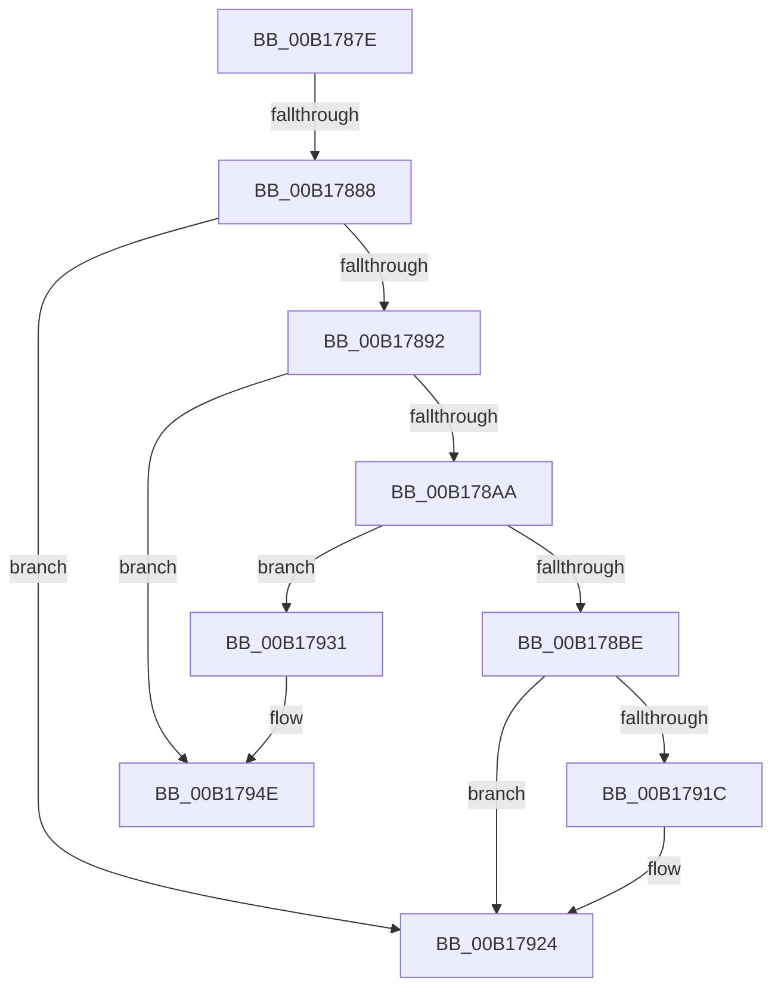

# sub_00B1787E

- RVA: `0x00B1787E`–`0x00B1796B` (길이 `237` bytes)
- VA: `0x0000000140B1787E`
- 실행 섹션: `PAGE`
- PDB 이름 있음: `아니요`; PDB Function 태그: `아니요`
- unwind 정보 RVA: `0x0006C920`
- 디코드: `56`개 명령, `237/237` bytes 표시
- 미해석 바이트: `0` (있으면 어셈블리에 `.byte`로 보존)

> 이 문서는 커널 이미지의 기계어와 PDB 기호를 분석해 생성했습니다. 4번과 5번은 함수 원형과 자료형을 바이너리 사용 방식에서 추정한 C 해석이며 원본 소스 복구 결과는 아닙니다.

## 1. Dependencies

- 직접 호출 지점: **9**; 고유 호출 대상: **8**
- 직접 호출자로 확인된 함수: **0**
- RIP 상대 이미지 참조: **0**

### Outgoing calls
- `0x00B1789D` → [CmpPrepareToInvalidateAllHigherLayerKcbs](../7F/CmpPrepareToInvalidateAllHigherLayerKcbs_function_007F174C.md) (function, `0x007F174C`)
- `0x00B178B5` → [CmpPrepareForSubtreeInvalidation](../9B/CmpPrepareForSubtreeInvalidation_function_009B01B0.md) (function, `0x009B01B0`)
- `0x00B178CE` → [CmpInvalidateAllHigherLayerKcbs](../7F/CmpInvalidateAllHigherLayerKcbs_function_007F1560.md) (function, `0x007F1560`)
- `0x00B178E9` → [CmpInvalidateSubtree](../7E/CmpInvalidateSubtree_function_007EAEC0.md) (function, `0x007EAEC0`)
- `0x00B178FC` → [CmpFlushNotifiesOnKeyBodyList](../9B/CmpFlushNotifiesOnKeyBodyList_function_009B3594.md) (function, `0x009B3594`)
- `0x00B1790E` → [CmpMarkKeyUnbacked](../9B/CmpMarkKeyUnbacked_function_009B3C4C.md) (function, `0x009B3C4C`)
- `0x00B1791F` → [CmpDiscardKcb](../9B/CmpDiscardKcb_function_009B2F34.md) (function, `0x009B2F34`)
- `0x00B17948` → [KeBugCheckEx](../../text/4F/KeBugCheckEx_function_004FD660.md) (function, `0x004FD660`)
- `0x00B17965` → [KeBugCheckEx](../../text/4F/KeBugCheckEx_function_004FD660.md) (function, `0x004FD660`)

### Direct callers
- 이 함수 시작 RVA로 연결되는 직접 call은 확인되지 않았습니다. 간접 호출은 완전히 역산할 수 없습니다.

### Static image references
- 디코드된 RIP-relative 메모리 참조가 없습니다.

## 2. Other-region calls and transfers

- 다른 실행 섹션으로 향하는 call: **2**
  - `0x00B17948` → [KeBugCheckEx](../../text/4F/KeBugCheckEx_function_004FD660.md) (`PAGE` → `.text`)
  - `0x00B17965` → [KeBugCheckEx](../../text/4F/KeBugCheckEx_function_004FD660.md) (`PAGE` → `.text`)
- call이 아닌 외부 분기/꼬리 이동: **2**
  - `0x00B17882` → [CmpTransMgrFreeVolatileData + 0xAF](../87/CmpTransMgrFreeVolatileData_function_00874BDC.md) (`tail-transfer`)
  - `0x00B1792C` → [CmpTransMgrFreeVolatileData + 0xAF](../87/CmpTransMgrFreeVolatileData_function_00874BDC.md) (`tail-transfer`)

## 3. Assembly (complete function range)

```asm
00B1787E  83 7F 44 00                     cmp dword ptr [rdi + 0x44], 0
00B17882  0F 85 03 D4 D5 FF               jne 0x140874c8b
00B17888  41 83 FC 08                     cmp r12d, 8
00B1788C  0F 85 92 00 00 00               jne 0x140b17924
00B17892  45 33 C0                        xor r8d, r8d
00B17895  41 8D 54 24 FE                  lea edx, [r12 - 2]
00B1789A  48 8B CB                        mov rcx, rbx
00B1789D  E8 AA 9E CD FF                  call 0x1407f174c
00B178A2  85 C0                           test eax, eax
00B178A4  0F 88 A4 00 00 00               js 0x140b1794e
00B178AA  45 33 C0                        xor r8d, r8d
00B178AD  41 8D 54 24 FC                  lea edx, [r12 - 4]
00B178B2  48 8B CB                        mov rcx, rbx
00B178B5  E8 F6 88 E9 FF                  call 0x1409b01b0
00B178BA  85 C0                           test eax, eax
00B178BC  78 73                           js 0x140b17931
00B178BE  4C 8D 4C 24 30                  lea r9, [rsp + 0x30]
00B178C3  41 8B D4                        mov edx, r12d
00B178C6  45 8D 44 24 FE                  lea r8d, [r12 - 2]
00B178CB  48 8B CB                        mov rcx, rbx
00B178CE  E8 8D 9C CD FF                  call 0x1407f1560
00B178D3  48 83 64 24 20 00               and qword ptr [rsp + 0x20], 0
00B178D9  4C 8D 4C 24 30                  lea r9, [rsp + 0x30]
00B178DE  41 8B D4                        mov edx, r12d
00B178E1  45 8D 44 24 FC                  lea r8d, [r12 - 4]
00B178E6  48 8B CB                        mov rcx, rbx
00B178E9  E8 D2 35 CD FF                  call 0x1407eaec0
00B178EE  45 33 C9                        xor r9d, r9d
00B178F1  4C 8D 44 24 30                  lea r8, [rsp + 0x30]
00B178F6  41 8B D4                        mov edx, r12d
00B178F9  48 8B CB                        mov rcx, rbx
00B178FC  E8 93 BC E9 FF                  call 0x1409b3594
00B17901  66 83 4B 08 20                  or word ptr [rbx + 8], 0x20
00B17906  48 8D 54 24 30                  lea rdx, [rsp + 0x30]
00B1790B  48 8B CB                        mov rcx, rbx
00B1790E  E8 39 C3 E9 FF                  call 0x1409b3c4c
00B17913  F7 43 08 00 00 02 00            test dword ptr [rbx + 8], 0x20000
00B1791A  75 08                           jne 0x140b17924
00B1791C  48 8B CB                        mov rcx, rbx
00B1791F  E8 10 B6 E9 FF                  call 0x1409b2f34
00B17924  48 83 A3 F0 00 00 00 00         and qword ptr [rbx + 0xf0], 0
00B1792C  E9 5A D3 D5 FF                  jmp 0x140874c8b
00B17931  BA 33 00 00 00                  mov edx, 0x33
00B17936  48 C7 44 24 20 00 01 01 00      mov qword ptr [rsp + 0x20], 0x10100
00B1793F  4C 8B CB                        mov r9, rbx
00B17942  4C 8B C6                        mov r8, rsi
00B17945  8D 4A 1E                        lea ecx, [rdx + 0x1e]
00B17948  E8 13 5D 9E FF                  call 0x1404fd660
00B1794D  CC                              int3
00B1794E  BA 33 00 00 00                  mov edx, 0x33
00B17953  48 C7 44 24 20 00 00 01 00      mov qword ptr [rsp + 0x20], 0x10000
00B1795C  4C 8B CB                        mov r9, rbx
00B1795F  4C 8B C6                        mov r8, rsi
00B17962  8D 4A 1E                        lea ecx, [rdx + 0x1e]
00B17965  E8 F6 5C 9E FF                  call 0x1404fd660
00B1796A  CC                              int3
```

## 4. C-style interpretation (structured pseudocode)

```c
__int64 __fastcall sub_00B1787E(__int64 a1, __int64 a2, int a3, __int64 a4, __int64 a5, __int64 a6)
{
    __int64 result;
    unsigned __int64 v_stack_p20;

    if (((unsigned int)(v_r12)) != 8) goto loc_00B17924;
    a3 = 0;
    result = CmpPrepareToInvalidateAllHigherLayerKcbs(v_rbx, v_r12 - 2, a3, a4);
    if (sign_flag) goto loc_00B1794E;
    a3 = 0;
    result = CmpPrepareForSubtreeInvalidation(v_rbx, v_r12 - 4, a3, a4);
    if (sign_flag) goto loc_00B17931;
    result = CmpInvalidateAllHigherLayerKcbs(v_rbx, (unsigned int)((unsigned int)(v_r12)), v_r12 - 2, a6);
    result = CmpInvalidateSubtree(v_rbx, (unsigned int)((unsigned int)(v_r12)), v_r12 - 4, a6);
    a4 = 0;
    result = CmpFlushNotifiesOnKeyBodyList(v_rbx, (unsigned int)((unsigned int)(v_r12)), a6, a4);
    result = CmpMarkKeyUnbacked(v_rbx, a6, a6, a4);
    if (((*(unsigned int *)(v_rbx + 8)) & (0x20000ULL)) == 0) {
        a1 = v_rbx;
        result = CmpDiscardKcb(a1, a6, a6, a4);
    }
loc_00B17931:
    v_stack_p20 = 0x10100ULL;
    result = KeBugCheckEx(51 + 30, 51, v_rsi, v_rbx);
loc_00B1794E:
    v_stack_p20 = 0x10000ULL;
    result = KeBugCheckEx(51 + 30, 51, v_rsi, v_rbx);
    return result;
}
```

## 5. (Beta) C Style

```c
int64_t sub_00B1787E(int64_t Arg1, int64_t Arg2, int32_t Arg3, int64_t Arg4, uint64_t Arg5, int64_t Arg6)
{
    int64_t result;
    uint64_t v_stack_p20;

    if (((uint32_t)(local_r12)) != 8) goto loc_00B17924;
    Arg3 = 0;
    result = CmpPrepareToInvalidateAllHigherLayerKcbs(local_rbx, local_r12 - 2, Arg3, Arg4);
    if (sign_flag) goto loc_00B1794E;
    Arg3 = 0;
    result = CmpPrepareForSubtreeInvalidation(local_rbx, local_r12 - 4, Arg3, Arg4);
    if (sign_flag) goto loc_00B17931;
    result = CmpInvalidateAllHigherLayerKcbs(local_rbx, (uint32_t)((uint32_t)(local_r12)), local_r12 - 2, Arg6);
    result = CmpInvalidateSubtree(local_rbx, (uint32_t)((uint32_t)(local_r12)), local_r12 - 4, Arg6);
    Arg4 = 0;
    result = CmpFlushNotifiesOnKeyBodyList(local_rbx, (uint32_t)((uint32_t)(local_r12)), Arg6, Arg4);
    result = CmpMarkKeyUnbacked(local_rbx, Arg6, Arg6, Arg4);
    if (((*(uint32_t *)(local_rbx + 0x8)) & (0x20000ULL)) == 0) {
        Arg1 = local_rbx;
        result = CmpDiscardKcb(Arg1, Arg6, Arg6, Arg4);
    }
loc_00B17931:
    v_stack_p20 = 0x10100ULL;
    result = KeBugCheckEx(51 + 30, 51, local_rsi, local_rbx);
loc_00B1794E:
    v_stack_p20 = 0x10000ULL;
    result = KeBugCheckEx(51 + 30, 51, local_rsi, local_rbx);
    return result;
}
```

## 6. Execution-region graph

[열기: 2D/3D 그래프와 함수 탐색 컨트롤 패널](../../../control-panel.html?section=page&rva=0x00B1787E&view=graph)

- 2D 그래프는 위에서 아래로 흐르고, 3D 그래프는 빈 공간을 드래그해 회전합니다. Shift+드래그는 이동, 휠은 확대·축소, 함수 노드 선택은 대상 보고서 이동입니다.

### Static fallback


