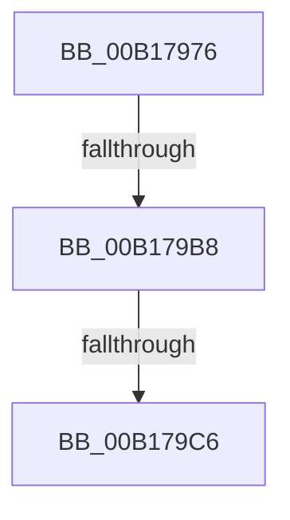

# sub_00B17976

- RVA: `0x00B17976`–`0x00B179D0` (길이 `90` bytes)
- VA: `0x0000000140B17976`
- 실행 섹션: `PAGE`
- PDB 이름 있음: `아니요`; PDB Function 태그: `아니요`
- unwind 정보 RVA: `0x0006CA0C`
- 디코드: `18`개 명령, `90/90` bytes 표시
- 미해석 바이트: `0` (있으면 어셈블리에 `.byte`로 보존)

> 이 문서는 커널 이미지의 기계어와 PDB 기호를 분석해 생성했습니다. 4번과 5번은 함수 원형과 자료형을 바이너리 사용 방식에서 추정한 C 해석이며 원본 소스 복구 결과는 아닙니다.

## 1. Dependencies

- 직접 호출 지점: **1**; 고유 호출 대상: **1**
- 직접 호출자로 확인된 함수: **0**
- RIP 상대 이미지 참조: **1**

### Outgoing calls
- `0x00B1799C` → [ObReferenceObjectByHandle](../86/ObReferenceObjectByHandle_function_00868DB0.md) (function, `0x00868DB0`)

### Direct callers
- 이 함수 시작 RVA로 연결되는 직접 call은 확인되지 않았습니다. 간접 호출은 완전히 역산할 수 없습니다.

### Static image references
- `0x00B17976` → RVA `0x00FD8020` (`PAGEDATA`; read)

## 2. Other-region calls and transfers

- 다른 실행 섹션으로 향하는 call: **0**
- call이 아닌 외부 분기/꼬리 이동: **3**
  - `0x00B179B2` → [CmLoadDifferencingKey + 0x805](../87/CmLoadDifferencingKey_function_00875670.md) (`tail-transfer`)
  - `0x00B179C0` → [CmLoadDifferencingKey + 0x4A2](../87/CmLoadDifferencingKey_function_00875670.md) (`tail-transfer`)
  - `0x00B179CB` → [CmLoadDifferencingKey + 0x805](../87/CmLoadDifferencingKey_function_00875670.md) (`tail-transfer`)

## 3. Assembly (complete function range)

```asm
00B17976  4C 8B 05 A3 06 4C 00            mov r8, qword ptr [rip + 0x4c06a3]
00B1797D  48 89 7C 24 78                  mov qword ptr [rsp + 0x78], rdi
00B17982  48 89 7C 24 28                  mov qword ptr [rsp + 0x28], rdi
00B17987  48 8D 4C 24 78                  lea rcx, [rsp + 0x78]
00B1798C  48 89 4C 24 20                  mov qword ptr [rsp + 0x20], rcx
00B17991  45 8A CF                        mov r9b, r15b
00B17994  BA 04 00 00 00                  mov edx, 4
00B17999  48 8B C8                        mov rcx, rax
00B1799C  E8 0F 14 D5 FF                  call 0x140868db0
00B179A1  8B F0                           mov esi, eax
00B179A3  4C 8B 6C 24 78                  mov r13, qword ptr [rsp + 0x78]
00B179A8  4C 89 AC 24 08 01 00 00         mov qword ptr [rsp + 0x108], r13
00B179B0  85 C0                           test eax, eax
00B179B2  0F 88 BD E4 D5 FF               js 0x140875e75
00B179B8  41 83 BD C0 00 00 00 02         cmp dword ptr [r13 + 0xc0], 2
00B179C0  0F 84 4C E1 D5 FF               je 0x140875b12
00B179C6  BE A8 00 00 C0                  mov esi, 0xc00000a8
00B179CB  E9 A5 E4 D5 FF                  jmp 0x140875e75
```

## 4. C-style interpretation (structured pseudocode)

```c
__int64 __fastcall sub_00B17976(__int64 a1, __int64 a2, __int64 a3, __int64 a4, __int64 a5, __int64 a6, __int64 a7, __int64 a8, __int64 a9, __int64 a10, __int64 a11, __int64 a12, __int64 a13, __int64 a14, __int64 a15)
{
    __int64 result;
    unsigned __int64 v_stack_p108;
    unsigned __int64 v_stack_p20;
    unsigned __int64 v_stack_p28;
    unsigned __int64 v_stack_p78;

    v_stack_p78 = v_rdi;
    v_stack_p28 = v_rdi;
    v_stack_p20 = a15;
    result = ObReferenceObjectByHandle(result, 4, *(unsigned __int64 *)(v_rip + 4982435), (unsigned __int8)(v_r15));
    v_stack_p108 = a15;
}
```

## 5. (Beta) C Style

```c
int64_t sub_00B17976(int64_t Arg1, int64_t Arg2, int64_t Arg3, int64_t Arg4, uint64_t Arg5, uint64_t Arg6, uint64_t Arg7, uint64_t Arg8, uint64_t Arg9, uint64_t Arg10, uint64_t Arg11, uint64_t Arg12, uint64_t Arg13, uint64_t Arg14, void *Arg15)
{
    uint8_t *arg15 = (uint8_t *)Arg15;

    int64_t result;
    uint64_t v_stack_p108;
    uint64_t v_stack_p20;
    uint64_t v_stack_p28;
    uint64_t v_stack_p78;

    v_stack_p78 = local_rdi;
    v_stack_p28 = local_rdi;
    v_stack_p20 = Arg15;
    result = ObReferenceObjectByHandle(result, 4, *(uint64_t *)(v_rip + 0x4C06A3), (uint8_t)(local_r15));
    v_stack_p108 = Arg15;
}
```

### 관측된 메모리 오프셋

구조체 형식이 확인되지 않은 접근은 인자 기준의 오프셋으로만 기록했습니다.

| 기준 인자 | 오프셋 표현 | 폭 (bit) | 접근 |
|---|---:|---:|---|
| `Arg15` | `+ 0xC0` | `32` | `R` |

## 6. Execution-region graph

[열기: 2D/3D 그래프와 함수 탐색 컨트롤 패널](../../../control-panel.html?section=page&rva=0x00B17976&view=graph)

- 2D 그래프는 위에서 아래로 흐르고, 3D 그래프는 빈 공간을 드래그해 회전합니다. Shift+드래그는 이동, 휠은 확대·축소, 함수 노드 선택은 대상 보고서 이동입니다.

### Static fallback


