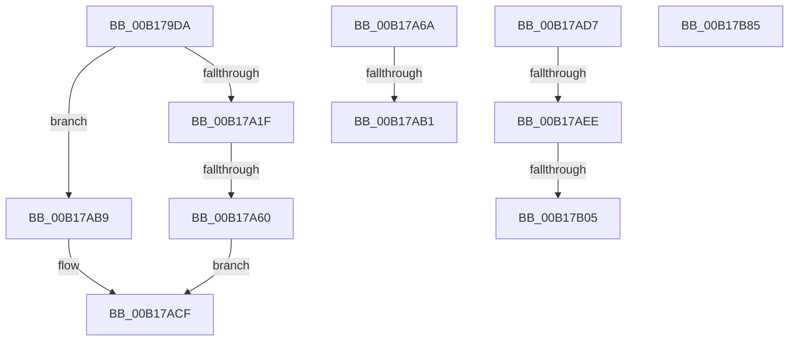

# sub_00B179DA

- RVA: `0x00B179DA`–`0x00B17CD7` (길이 `765` bytes)
- VA: `0x0000000140B179DA`
- 실행 섹션: `PAGE`
- PDB 이름 있음: `아니요`; PDB Function 태그: `아니요`
- unwind 정보 RVA: `0x0006CB68`
- 디코드: `140`개 명령, `765/765` bytes 표시
- 미해석 바이트: `0` (있으면 어셈블리에 `.byte`로 보존)

> 이 문서는 커널 이미지의 기계어와 PDB 기호를 분석해 생성했습니다. 4번과 5번은 함수 원형과 자료형을 바이너리 사용 방식에서 추정한 C 해석이며 원본 소스 복구 결과는 아닙니다.

## 1. Dependencies

- 직접 호출 지점: **12**; 고유 호출 대상: **12**
- 직접 호출자로 확인된 함수: **0**
- RIP 상대 이미지 참조: **4**

### Outgoing calls
- `0x00B17A10` → [CmpOpenHiveFile](../87/CmpOpenHiveFile_function_0087A71C.md) (function, `0x0087A71C`)
- `0x00B17A44` → [ObReferenceObjectByHandle](../86/ObReferenceObjectByHandle_function_00868DB0.md) (function, `0x00868DB0`)
- `0x00B17A53` → [ZwClose](../../text/6A/ZwClose_function_006AD2B0.md) (function, `0x006AD2B0`)
- `0x00B17A6A` → [CmpUnlockRegistry](../../pagecmrc/BC/CmpUnlockRegistry_function_00BC9A84.md) (function, `0x00BC9A84`)
- `0x00B17A6F` → [UNLOCK_HIVE_LOAD](../9B/UNLOCK_HIVE_LOAD_function_009B2EBC.md) (function, `0x009B2EBC`)
- `0x00B17A8E` → [ExBlockOnAddressPushLock](../../text/2A/ExBlockOnAddressPushLock_function_002A43A0.md) (function, `0x002A43A0`)
- `0x00B17A93` → [LOCK_HIVE_LOAD](../9B/LOCK_HIVE_LOAD_function_009B2300.md) (function, `0x009B2300`)
- `0x00B17A9B` → [CmpLockRegistryFreezeAware](../9B/CmpLockRegistryFreezeAware_function_009B4AE4.md) (function, `0x009B4AE4`)
- `0x00B17AA3` → [CmpDereferenceHive](../86/CmpDereferenceHive_function_008632B0.md) (function, `0x008632B0`)
- `0x00B17AF8` → [tlgKeywordOn](../../text/42/tlgKeywordOn_function_0042EAA0.md) (function, `0x0042EAA0`)
- `0x00B17B7A` → [tlgWriteAgg](../../text/2F/tlgWriteAgg_function_002F0F7C.md) (function, `0x002F0F7C`)
- `0x00B17CCC` → [tlgWriteTransfer_EtwWriteTransfer](../../text/42/tlgWriteTransfer_EtwWriteTransfer_function_004260E0.md) (function, `0x004260E0`)

### Direct callers
- 이 함수 시작 RVA로 연결되는 직접 call은 확인되지 않았습니다. 간접 호출은 완전히 역산할 수 없습니다.

### Static image references
- `0x00B17A1F` → RVA `0x00EF7C68` (`.data`; read)
- `0x00B17AE1` → RVA `0x00E09F58` (`.data`; read)
- `0x00B17B14` → RVA `0x000563B1` (`.rdata`; read)
- `0x00B17C26` → RVA `0x0005646C` (`.rdata`; read)

## 2. Other-region calls and transfers

- 다른 실행 섹션으로 향하는 call: **6**
  - `0x00B17A53` → [ZwClose](../../text/6A/ZwClose_function_006AD2B0.md) (`PAGE` → `.text`)
  - `0x00B17A6A` → [CmpUnlockRegistry](../../pagecmrc/BC/CmpUnlockRegistry_function_00BC9A84.md) (`PAGE` → `PAGECMRC`)
  - `0x00B17A8E` → [ExBlockOnAddressPushLock](../../text/2A/ExBlockOnAddressPushLock_function_002A43A0.md) (`PAGE` → `.text`)
  - `0x00B17AF8` → [tlgKeywordOn](../../text/42/tlgKeywordOn_function_0042EAA0.md) (`PAGE` → `.text`)
  - `0x00B17B7A` → [tlgWriteAgg](../../text/2F/tlgWriteAgg_function_002F0F7C.md) (`PAGE` → `.text`)
  - `0x00B17CCC` → [tlgWriteTransfer_EtwWriteTransfer](../../text/42/tlgWriteTransfer_EtwWriteTransfer_function_004260E0.md) (`PAGE` → `.text`)
- call이 아닌 외부 분기/꼬리 이동: **8**
  - `0x00B17A5A` → [CmLoadAppKey + 0x74C](../87/CmLoadAppKey_function_00876FFC.md) (`tail-transfer`)
  - `0x00B17AAB` → [CmLoadAppKey + 0xA97](../87/CmLoadAppKey_function_00876FFC.md) (`tail-transfer`)
  - `0x00B17AB4` → [CmLoadAppKey + 0x76A](../87/CmLoadAppKey_function_00876FFC.md) (`tail-transfer`)
  - `0x00B17AD2` → [CmLoadAppKey + 0xB0F](../87/CmLoadAppKey_function_00876FFC.md) (`tail-transfer`)
  - `0x00B17AE8` → [CmLoadAppKey + 0x480](../87/CmLoadAppKey_function_00876FFC.md) (`tail-transfer`)
  - `0x00B17AFF` → [CmLoadAppKey + 0x480](../87/CmLoadAppKey_function_00876FFC.md) (`tail-transfer`)
  - `0x00B17B80` → [CmLoadAppKey + 0x480](../87/CmLoadAppKey_function_00876FFC.md) (`tail-transfer`)
  - `0x00B17CD2` → [CmLoadAppKey + 0x480](../87/CmLoadAppKey_function_00876FFC.md) (`tail-transfer`)

## 3. Assembly (complete function range)

```asm
00B179DA  48 89 74 24 48                  mov qword ptr [rsp + 0x48], rsi
00B179DF  48 8D 45 98                     lea rax, [rbp - 0x68]
00B179E3  48 89 44 24 40                  mov qword ptr [rsp + 0x40], rax
00B179E8  4C 8D 4D 90                     lea r9, [rbp - 0x70]
00B179EC  48 8B 45 18                     mov rax, qword ptr [rbp + 0x18]
00B179F0  4C 8D 45 88                     lea r8, [rbp - 0x78]
00B179F4  4C 89 7C 24 38                  mov qword ptr [rsp + 0x38], r15
00B179F9  33 D2                           xor edx, edx
00B179FB  4C 89 7C 24 30                  mov qword ptr [rsp + 0x30], r15
00B17A00  48 8B CF                        mov rcx, rdi
00B17A03  48 89 44 24 28                  mov qword ptr [rsp + 0x28], rax
00B17A08  C7 44 24 20 08 00 00 00         mov dword ptr [rsp + 0x20], 8
00B17A10  E8 07 2D D6 FF                  call 0x14087a71c
00B17A15  8B D8                           mov ebx, eax
00B17A17  85 C0                           test eax, eax
00B17A19  0F 88 9A 00 00 00               js 0x140b17ab9
00B17A1F  48 8B 05 42 02 3E 00            mov rax, qword ptr [rip + 0x3e0242]
00B17A26  45 33 C9                        xor r9d, r9d
00B17A29  48 8B 4D 88                     mov rcx, qword ptr [rbp - 0x78]
00B17A2D  33 D2                           xor edx, edx
00B17A2F  4C 89 7C 24 28                  mov qword ptr [rsp + 0x28], r15
00B17A34  4C 89 7D 20                     mov qword ptr [rbp + 0x20], r15
00B17A38  4C 8B 00                        mov r8, qword ptr [rax]
00B17A3B  48 8D 45 20                     lea rax, [rbp + 0x20]
00B17A3F  48 89 44 24 20                  mov qword ptr [rsp + 0x20], rax
00B17A44  E8 67 13 D5 FF                  call 0x140868db0
00B17A49  48 8B 4D 88                     mov rcx, qword ptr [rbp - 0x78]
00B17A4D  8B D8                           mov ebx, eax
00B17A4F  4C 8B 6D 20                     mov r13, qword ptr [rbp + 0x20]
00B17A53  E8 58 58 B9 FF                  call 0x1406ad2b0
00B17A58  85 DB                           test ebx, ebx
00B17A5A  0F 89 E8 FC D5 FF               jns 0x140877748
00B17A60  C7 44 24 20 50 00 00 00         mov dword ptr [rsp + 0x20], 0x50
00B17A68  EB 65                           jmp 0x140b17acf
00B17A6A  E8 15 20 0B 00                  call 0x140bc9a84
00B17A6F  E8 48 B4 E9 FF                  call 0x1409b2ebc
00B17A74  48 83 64 24 20 00               and qword ptr [rsp + 0x20], 0
00B17A7A  48 8D 8F A8 12 00 00            lea rcx, [rdi + 0x12a8]
00B17A81  41 B9 04 00 00 00               mov r9d, 4
00B17A87  4C 8D 45 A8                     lea r8, [rbp - 0x58]
00B17A8B  49 8B D7                        mov rdx, r15
00B17A8E  E8 0D C9 78 FF                  call 0x1402a43a0
00B17A93  E8 68 A8 E9 FF                  call 0x1409b2300
00B17A98  41 8A CE                        mov cl, r14b
00B17A9B  E8 44 D0 E9 FF                  call 0x1409b4ae4
00B17AA0  48 8B CF                        mov rcx, rdi
00B17AA3  E8 08 B8 D4 FF                  call 0x1408632b0
00B17AA8  49 3B FC                        cmp rdi, r12
00B17AAB  0F 84 E2 FF D5 FF               je 0x140877a93
00B17AB1  45 33 FF                        xor r15d, r15d
00B17AB4  E9 AD FC D5 FF                  jmp 0x140877766
00B17AB9  81 FB 34 00 00 C0               cmp ebx, 0xc0000034
00B17ABF  C7 44 24 20 40 00 00 00         mov dword ptr [rsp + 0x20], 0x40
00B17AC7  B8 43 00 00 C0                  mov eax, 0xc0000043
00B17ACC  0F 44 D8                        cmove ebx, eax
00B17ACF  44 8B CB                        mov r9d, ebx
00B17AD2  E9 34 00 D6 FF                  jmp 0x140877b0b
00B17AD7  48 B9 08 00 00 00 00 40 00 00   movabs rcx, 0x400000000008
00B17AE1  83 3D 70 24 2F 00 05            cmp dword ptr [rip + 0x2f2470], 5
00B17AE8  0F 86 8E F9 D5 FF               jbe 0x14087747c
00B17AEE  48 8B D1                        mov rdx, rcx
00B17AF1  48 8D 0D 60 24 2F 00            lea rcx, [rip + 0x2f2460]
00B17AF8  E8 A3 6F 91 FF                  call 0x14042eaa0
00B17AFD  84 C0                           test al, al
00B17AFF  0F 84 77 F9 D5 FF               je 0x14087747c
00B17B05  48 8D 45 80                     lea rax, [rbp - 0x80]
00B17B09  4C 89 75 80                     mov qword ptr [rbp - 0x80], r14
00B17B0D  48 89 85 C0 00 00 00            mov qword ptr [rbp + 0xc0], rax
00B17B14  48 8D 15 96 E8 53 FF            lea rdx, [rip - 0xac176a]
00B17B1B  48 8D 44 24 68                  lea rax, [rsp + 0x68]
00B17B20  48 C7 85 C8 00 00 00 08 00 00 00  mov qword ptr [rbp + 0xc8], 8
00B17B2B  48 89 85 D0 00 00 00            mov qword ptr [rbp + 0xd0], rax
00B17B32  48 8D 0D 1F 24 2F 00            lea rcx, [rip + 0x2f241f]
00B17B39  48 8D 44 24 78                  lea rax, [rsp + 0x78]
00B17B3E  89 5C 24 68                     mov dword ptr [rsp + 0x68], ebx
00B17B42  48 89 85 E0 00 00 00            mov qword ptr [rbp + 0xe0], rax
00B17B49  41 B9 05 00 00 00               mov r9d, 5
00B17B4F  48 8D 85 A0 00 00 00            lea rax, [rbp + 0xa0]
00B17B56  48 C7 85 D8 00 00 00 04 00 00 00  mov qword ptr [rbp + 0xd8], 4
00B17B61  48 89 44 24 20                  mov qword ptr [rsp + 0x20], rax
00B17B66  48 C7 44 24 78 00 00 00 01      mov qword ptr [rsp + 0x78], 0x1000000
00B17B6F  48 C7 85 E8 00 00 00 08 00 00 00  mov qword ptr [rbp + 0xe8], 8
00B17B7A  E8 FD 93 7D FF                  call 0x1402f0f7c
00B17B7F  90                              nop
00B17B80  E9 F7 F8 D5 FF                  jmp 0x14087747c
00B17B85  0F B7 56 08                     movzx edx, word ptr [rsi + 8]
00B17B89  48 8D 4E 0A                     lea rcx, [rsi + 0xa]
00B17B8D  44 0F B7 09                     movzx r9d, word ptr [rcx]
00B17B91  4C 8D 86 8A 01 00 00            lea r8, [rsi + 0x18a]
00B17B98  45 0F B6 10                     movzx r10d, byte ptr [r8]
00B17B9C  48 8D 44 24 68                  lea rax, [rsp + 0x68]
00B17BA1  48 89 85 C0 00 00 00            mov qword ptr [rbp + 0xc0], rax
00B17BA8  48 8D 44 24 6C                  lea rax, [rsp + 0x6c]
00B17BAD  48 89 85 D0 00 00 00            mov qword ptr [rbp + 0xd0], rax
00B17BB4  48 8D 44 24 70                  lea rax, [rsp + 0x70]
00B17BB9  48 89 85 E0 00 00 00            mov qword ptr [rbp + 0xe0], rax
00B17BC0  48 8D 44 24 60                  lea rax, [rsp + 0x60]
00B17BC5  48 89 85 F0 00 00 00            mov qword ptr [rbp + 0xf0], rax
00B17BCC  48 8D 46 08                     lea rax, [rsi + 8]
00B17BD0  48 89 85 00 01 00 00            mov qword ptr [rbp + 0x100], rax
00B17BD7  48 8D 46 0C                     lea rax, [rsi + 0xc]
00B17BDB  48 89 85 10 01 00 00            mov qword ptr [rbp + 0x110], rax
00B17BE2  8D 04 52                        lea eax, [rdx + rdx*2]
00B17BE5  C1 E0 02                        shl eax, 2
00B17BE8  89 85 18 01 00 00               mov dword ptr [rbp + 0x118], eax
00B17BEE  48 8D 46 6C                     lea rax, [rsi + 0x6c]
00B17BF2  48 89 85 30 01 00 00            mov qword ptr [rbp + 0x130], rax
00B17BF9  43 8D 04 49                     lea eax, [r9 + r9*2]
00B17BFD  C1 E0 02                        shl eax, 2
00B17C00  89 85 38 01 00 00               mov dword ptr [rbp + 0x138], eax
00B17C06  48 8D 86 8C 01 00 00            lea rax, [rsi + 0x18c]
00B17C0D  48 89 85 50 01 00 00            mov qword ptr [rbp + 0x150], rax
00B17C14  48 8D 85 A0 00 00 00            lea rax, [rbp + 0xa0]
00B17C1B  66 44 89 54 24 60               mov word ptr [rsp + 0x60], r10w
00B17C21  66 89 54 24 6C                  mov word ptr [rsp + 0x6c], dx
00B17C26  48 8D 15 3F E8 53 FF            lea rdx, [rip - 0xac17c1]
00B17C2D  66 44 89 4C 24 70               mov word ptr [rsp + 0x70], r9w
00B17C33  45 33 C9                        xor r9d, r9d
00B17C36  48 89 8D 20 01 00 00            mov qword ptr [rbp + 0x120], rcx
00B17C3D  48 8D 0D 14 23 2F 00            lea rcx, [rip + 0x2f2314]
00B17C44  4C 89 85 40 01 00 00            mov qword ptr [rbp + 0x140], r8
00B17C4B  45 33 C0                        xor r8d, r8d
00B17C4E  41 C1 E2 03                     shl r10d, 3
00B17C52  48 89 44 24 28                  mov qword ptr [rsp + 0x28], rax
00B17C57  C7 44 24 20 0C 00 00 00         mov dword ptr [rsp + 0x20], 0xc
00B17C5F  89 5C 24 68                     mov dword ptr [rsp + 0x68], ebx
00B17C63  48 C7 85 C8 00 00 00 04 00 00 00  mov qword ptr [rbp + 0xc8], 4
00B17C6E  48 C7 85 D8 00 00 00 02 00 00 00  mov qword ptr [rbp + 0xd8], 2
00B17C79  48 C7 85 E8 00 00 00 02 00 00 00  mov qword ptr [rbp + 0xe8], 2
00B17C84  48 C7 85 F8 00 00 00 02 00 00 00  mov qword ptr [rbp + 0xf8], 2
00B17C8F  48 C7 85 08 01 00 00 02 00 00 00  mov qword ptr [rbp + 0x108], 2
00B17C9A  44 89 BD 1C 01 00 00            mov dword ptr [rbp + 0x11c], r15d
00B17CA1  48 C7 85 28 01 00 00 02 00 00 00  mov qword ptr [rbp + 0x128], 2
00B17CAC  44 89 BD 3C 01 00 00            mov dword ptr [rbp + 0x13c], r15d
00B17CB3  48 C7 85 48 01 00 00 02 00 00 00  mov qword ptr [rbp + 0x148], 2
00B17CBE  44 89 95 58 01 00 00            mov dword ptr [rbp + 0x158], r10d
00B17CC5  44 89 BD 5C 01 00 00            mov dword ptr [rbp + 0x15c], r15d
00B17CCC  E8 0F E4 90 FF                  call 0x1404260e0
00B17CD1  90                              nop
00B17CD2  E9 A5 F7 D5 FF                  jmp 0x14087747c
```

## 4. C-style interpretation (structured pseudocode)

```c
__int64 __fastcall sub_00B179DA(__int64 a1, int a2)
{
    __int64 result;
    __int64 v_rbx;
    unsigned int v_stack_p20;
    unsigned __int64 v_stack_p28;
    unsigned __int64 v_stack_p30;
    unsigned __int64 v_stack_p38;
    unsigned __int64 v_stack_p40;
    unsigned __int64 v_stack_p48;
    unsigned __int64 v_stack_p60;
    unsigned __int64 v_stack_p68;
    unsigned __int64 v_stack_p6C;
    unsigned __int64 v_stack_p70;
    unsigned __int64 v_stack_p78;

    v_stack_p48 = v_rsi;
    v_stack_p40 = v_rbp - 104;
    v_stack_p38 = v_r15;
    a2 = 0;
    v_stack_p30 = v_r15;
    v_stack_p28 = *(unsigned __int64 *)(v_rbp + 24);
    v_stack_p20 = 8;
    result = CmpOpenHiveFile(v_rdi, a2, v_rbp - 120, v_rbp - 112);
    if (sign_flag) goto loc_00B17AB9;
    a4 = 0;
    a2 = 0;
    v_stack_p28 = v_r15;
    *(unsigned __int64 *)(v_rbp + 32) = v_r15;
    v_stack_p20 = v_rbp + 32;
    result = ObReferenceObjectByHandle(*(unsigned __int64 *)(v_rbp - 120), a2, *(unsigned __int64 *)(*(unsigned __int64 *)(v_rip + 4063810)), a4);
    result = ZwClose(*(unsigned __int64 *)(v_rbp - 120), a2, *(unsigned __int64 *)(*(unsigned __int64 *)(v_rip + 4063810)), a4);
    v_stack_p20 = 80;
    goto loc_00B17ACF;
loc_00B17AB9:
    v_stack_p20 = 64;
    v_rbx = (unsigned int)((unsigned int)(result));
    if (((unsigned int)((unsigned int)((unsigned int)(result)))) == 0xC0000034ULL) { v_rbx = (unsigned int)((unsigned int)(0xC0000043ULL)); }
loc_00B17ACF:
}
```

## 5. (Beta) C Style

```c
int64_t sub_00B179DA(int64_t Arg1, int32_t Arg2)
{
    int64_t result;
    int64_t local_rbx;
    uint32_t v_stack_p20;
    uint64_t v_stack_p28;
    uint64_t v_stack_p30;
    uint64_t v_stack_p38;
    uint64_t v_stack_p40;
    uint64_t v_stack_p48;
    uint64_t v_stack_p60;
    uint64_t v_stack_p68;
    uint64_t v_stack_p6C;
    uint64_t v_stack_p70;
    uint64_t v_stack_p78;

    v_stack_p48 = local_rsi;
    v_stack_p40 = local_rbp - 104;
    v_stack_p38 = local_r15;
    Arg2 = 0;
    v_stack_p30 = local_r15;
    v_stack_p28 = *(uint64_t *)(local_rbp + 0x18);
    v_stack_p20 = 8;
    result = CmpOpenHiveFile(local_rdi, Arg2, local_rbp - 120, local_rbp - 112);
    if (sign_flag) goto loc_00B17AB9;
    a4 = 0;
    Arg2 = 0;
    v_stack_p28 = local_r15;
    *(uint64_t *)(local_rbp + 0x20) = local_r15;
    v_stack_p20 = local_rbp + 32;
    result = ObReferenceObjectByHandle(*(uint64_t *)(local_rbp - 0x78), Arg2, *(uint64_t *)(*(uint64_t *)(v_rip + 0x3E0242)), a4);
    result = ZwClose(*(uint64_t *)(local_rbp - 0x78), Arg2, *(uint64_t *)(*(uint64_t *)(v_rip + 0x3E0242)), a4);
    v_stack_p20 = 80;
    goto loc_00B17ACF;
loc_00B17AB9:
    v_stack_p20 = 64;
    local_rbx = (uint32_t)((uint32_t)(result));
    if (((uint32_t)((uint32_t)((uint32_t)(result)))) == 0xC0000034ULL) { local_rbx = (uint32_t)((uint32_t)(0xC0000043ULL)); }
loc_00B17ACF:
}
```

## 6. Execution-region graph

[열기: 2D/3D 그래프와 함수 탐색 컨트롤 패널](../../../control-panel.html?section=page&rva=0x00B179DA&view=graph)

- 2D 그래프는 위에서 아래로 흐르고, 3D 그래프는 빈 공간을 드래그해 회전합니다. Shift+드래그는 이동, 휠은 확대·축소, 함수 노드 선택은 대상 보고서 이동입니다.

### Static fallback


